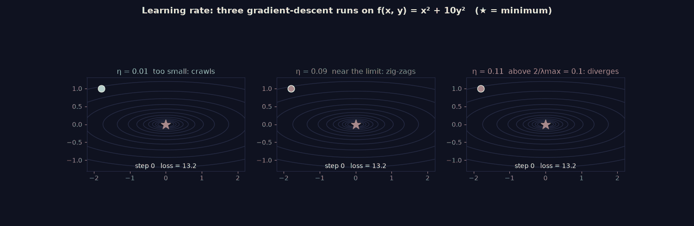

> Tier 2 · Machine Learning Fundamentals · **Level: beginner** · Reading time: about 10 minutes

# 2.25 Learning rate

**Metadata** — Tier: 2 · Phase: 1 · Priority: P0 · Difficulty: 2/5 · Interview: Very high · Hands-on: Very high
Prerequisites: 2.19, 1.23, 1.18 · Leads to: Tier 4 LR scheduling (4.10), warm-up (4.11), cosine decay (4.12), 2.35 Hyper-parameters

> **In plain words**
> The **learning rate** `η` is **the size of each step** when the model walks downhill on the loss. Too small: you crawl and waste time. Too large: you **overshoot** the valley, bounce around, and the loss can explode.
> It is usually the single most important training setting. For a simple bowl-shaped loss there is even a precise limit: steps larger than `2/λ_max` (twice over the steepest curvature) diverge.

**You need first:** 2.19 Gradient descent.

> **Figure 2.25-1 — three learning rates on a narrow valley (animated)**
>
> 
>
> *How to read it:* the loss is `f(x, y) = x² + 10y²`, whose curvature gives a stability limit `η < 2/λ_max = 0.1`. `η = 0.01` is stable but slow (loss 0.64 after 40 steps); `η = 0.09` zig-zags across the valley but converges (loss 6×10⁻⁷); `η = 0.11` is just above the limit and diverges (loss 2×10⁷).
>
> *Generated by* `tier-02-ml-fundamentals/figures/src/t2_training.py`.

**Words you'll meet on this page**

| Word | What it means here |
|---|---|
| learning rate `η` | the scalar multiplying each gradient step |
| `λ_max` | the largest curvature (Hessian eigenvalue) of the loss |
| stability limit | `η < 2/λ_max` for a quadratic loss |
| diverge | the loss grows instead of shrinking |
| warm-up | small `η` at the start, then increased |
| decay / schedule | lowering `η` over time (cosine, step, 1/t) |
| LR range test | a quick sweep to find a good `η` |

### 1. What is it?
The scalar `η` that scales each gradient step: `θ ← θ − η∇J`. It sets how far the parameters move per update.

### 2. Why does it exist?
Too small wastes compute; too large overshoots and diverges. It is usually the most important hyper-parameter.

### 3. Detailed explanation
- **Stability limit for a quadratic loss:** gradient descent converges if and only if `η < 2/λ_max`, where `λ_max` is the largest eigenvalue of the Hessian (1.18, 1.45, 1.23). Below the limit it converges (even if it zig-zags); above it the loss explodes.
- **Too small is slow, not wrong:** the loss still falls, just slowly.
- **Feature scale controls the usable rate.** Multiplying one feature by 30 multiplies its curvature by 900, so the stability limit shrinks by about that factor. Standardise inputs (2.47).
- **Finding `η`:** a *range test*: increase `η` exponentially over a short run and pick a value somewhat below where the loss starts to blow up.
- **Schedules** (Tier 4): warm-up (small `η` first), then decay (cosine, step, `1/t`) to reduce noise near the end (2.20). Adaptive optimisers (Adam) rescale the step per parameter but still need a global `η`.
- **Batch size interaction:** larger batches tolerate (and often need) a larger `η` (2.21).
- **Diagnosis:** loss diverges or NaN → too high; loss falls very slowly and smoothly → too low; loss falls, then oscillates or plateaus noisily → reduce or decay.
- **Don't tune it on the test set;** treat `η` as a hyper-parameter chosen on validation data (2.12, 2.35).

### 4. How does it work?
Choose `η` from a range test or sweep → add warm-up and decay → monitor the loss and gradient norm → adjust.

### 5. Simple example
The step length when walking downhill: too short takes forever, too long overshoots the valley floor.

**By hand: `f(x) = x²`**, gradient `2x`, start at `x = 1`. The update is `x ← x − η·2x = x(1 − 2η)`.

| `η` | factor `(1 − 2η)` | what happens |
|---|---|---|
| 0.1 | 0.8 | shrinks: 1, 0.8, 0.64 … converges |
| 0.5 | 0 | lands on 0 in one step |
| 0.9 | −0.8 | overshoots but still shrinks: 1, −0.8, 0.64 … |
| 1.0 | −1 | bounces forever between 1 and −1 |
| 1.1 | −1.2 | grows: 1, −1.2, 1.44 … diverges |

Here `λ_max = 2` (the second derivative of `x²`) so the limit is `2/λ_max = 1`: exactly where the behaviour flips.

### 6. Technical example
AdamW with peak `η = 3e-4`, 500 warm-up steps and cosine decay; fine-tuning a pretrained model with an `η` 10–100× smaller than in pretraining.

### 7. Code
**① By hand (plain Python).** The stability limit on `f = x² + 10y²`.

```python
for lr in (0.01, 0.09, 0.11):
    x, y = 1.0, 1.0
    for _ in range(40):
        x, y = x - lr * 2 * x, y - lr * 20 * y                  # gradient of x² + 10y² is (2x, 20y)
    print(f"lr = {lr:<4} loss after 40 steps = {x ** 2 + 10 * y ** 2:.3g}")
print("limit 2 / lambda_max = 2 / 20 =", 2 / 20)
```

```text
lr = 0.01 loss after 40 steps = 0.199
lr = 0.09 loss after 40 steps = 3.04e-07
lr = 0.11 loss after 40 steps = 2.16e+07
limit 2 / lambda_max = 2 / 20 = 0.1
```

**② With NumPy.** The limit for a regression problem, and what feature scaling does to it.

```python
import numpy as np

rng = np.random.default_rng(0)
X = rng.normal(0, 1, (200, 2))
A = np.column_stack([X, np.ones(200)])
lam = np.linalg.eigvalsh(2 * A.T @ A / 200).max()
print("stability limit with sensible features:", round(2 / lam, 3))

X2 = X.copy(); X2[:, 0] *= 30                                   # one feature in much bigger units
A2 = np.column_stack([X2, np.ones(200)])
lam2 = np.linalg.eigvalsh(2 * A2.T @ A2 / 200).max()
print("stability limit after scaling one feature by 30:", round(2 / lam2, 5), f"(about {lam2 / lam:.0f}x smaller)")
```

```text
stability limit with sensible features: 0.92
stability limit after scaling one feature by 30: 0.00115 (about 802x smaller)
```

**③ With PyTorch.** A warm-up plus cosine-decay schedule, and a learning-rate range test.

```python
import math
import torch

model = torch.nn.Linear(2, 1)
opt = torch.optim.SGD(model.parameters(), lr=0.1)
total, warmup = 100, 10
sched = torch.optim.lr_scheduler.LambdaLR(opt, lambda s: (s + 1) / warmup if s < warmup else 0.5 * (1 + math.cos(math.pi * (s - warmup) / (total - warmup))))
lrs = []
for step in range(total):
    lrs.append(opt.param_groups[0]["lr"])
    opt.step()
    sched.step()
print("learning rate at steps 0, 5, 10, 50, 99:", [round(lrs[i], 4) for i in (0, 5, 10, 50, 99)])

# range test: grow the learning rate exponentially and watch where the loss blows up
torch.manual_seed(0)
X = torch.randn(200, 2); y = X @ torch.tensor([2.0, -1.0])
w = torch.zeros(2, requires_grad=True)
for lr in (1e-4, 1e-3, 1e-2, 1e-1, 0.5, 1.5):
    w.data.zero_()
    for _ in range(50):
        w.grad = None
        ((X @ w - y) ** 2).mean().backward()
        w.data -= lr * w.grad
    print(f"lr {lr:<6}: loss after 50 steps {((X @ w - y) ** 2).mean().item():.3g}")
```

```text
learning rate at steps 0, 5, 10, 50, 99: [0.01, 0.06, 0.1, 0.0587, 0.0]
lr 0.0001: loss after 50 steps 3.83
lr 0.001 : loss after 50 steps 3.33
lr 0.01  : loss after 50 steps 0.81
lr 0.1   : loss after 50 steps 2.16e-07
lr 0.5   : loss after 50 steps 0
lr 1.5   : loss after 50 steps inf
```

### 8. Input → Process → Output
`gradient × η → parameter change`

<details>
<summary><b>Beyond the basics (sections 9–16)</b> — real-world use, limits, mistakes. Skip on a first read.</summary>

### 9. Enterprise use case
The learning-rate choice dominates training cost and failure rate; runs are launched with sweeps and automatic divergence alerts.

### 10. AI engineering connection
Fine-tuning rates, LoRA rates, and warm-up and decay schedules (Tier 4, Tier 10) are among the first things engineers tune.

### 11. Advantages
One knob with a large effect; simple to reason about for convex problems.

### 12. Limitations
The best value depends on the model, data scale, batch size and optimiser; there is no universal default.

### 13. Trade-offs
Speed of progress versus stability and final accuracy.

### 14. Common mistakes
Using the same rate after changing batch size or optimiser; unscaled features; skipping warm-up for large models; tuning on test data; changing several hyper-parameters at once.

### 15. Performance / cost
A good learning rate can cut training time several-fold; a bad one wastes the entire run.

### 16. Security
Divergent or tampered training runs can silently produce bad models; keep run-level monitoring and checkpoints.

</details>

### 17. Interview explanation
"The learning rate scales the gradient step. For a quadratic objective gradient descent is stable only below 2 over the largest Hessian eigenvalue, which is why unscaled features force tiny rates. I find a range with a log-scale sweep, use warm-up and decay, and retune it when I change batch size or optimiser."

### 18. Rapid-fire answer
`η` scales each step; stable iff `η < 2/λ_max` (quadratic); sweep on a log scale; retune with batch size.

### 19. Interview questions
- **Basic:** What happens if `η` is too large? Too small?
- **Intermediate:** How do feature scales affect the maximum stable learning rate?
- **Advanced:** Derive the condition `η < 2/λ_max` for a quadratic.
- **Scenario:** The loss falls fast and then spikes to NaN at step 3,000. What are your first three checks?

### 20. Hands-on exercise
**Goal:** see how standardisation widens the usable learning-rate range.

1. Fit `y = 3·x₁ + 2·x₂` with `x₁` in 0–1 and `x₂` in 0–100.
2. For learning rates 1e-6, 1e-5, 1e-4, 1e-3, 1e-2, run 200 full-batch steps and print the final loss.
3. Repeat with standardised features and compare which rates work.

<details>
<summary>Show a solution</summary>

```python
import numpy as np

rng = np.random.default_rng(0)
X = np.column_stack([rng.uniform(0, 1, 300), rng.uniform(0, 100, 300)])
y = X @ np.array([3.0, 2.0])

def final_loss(X, y, lr, steps=200):
    w = np.zeros(X.shape[1])
    with np.errstate(all="ignore"):
        for _ in range(steps):
            w -= lr * (2 / len(X)) * X.T @ (X @ w - y)
        return float(np.mean((X @ w - y) ** 2))

Z, yc = (X - X.mean(axis=0)) / X.std(axis=0), y - y.mean()
print(f"{'lr':>8} {'raw features':>14} {'standardised':>14}")
for lr in (1e-6, 1e-5, 1e-4, 1e-3, 1e-2, 1e-1):
    print(f"{lr:>8} {final_loss(X, y, lr):>14.3g} {final_loss(Z, yc, lr):>14.3g}")
```

```text
      lr   raw features   standardised
   1e-06            932          3e+03
   1e-05           1.34       2.98e+03
  0.0001           1.32       2.77e+03
   0.001            inf       1.35e+03
    0.01            nan          0.939
     0.1            nan       1.18e-26
```

With raw features only tiny rates (about 1e-5 to 1e-4) work and anything from 1e-3 up explodes (`inf` or `nan`). After standardising, rates 100–1,000 times larger (0.01 and 0.1) are stable, and they finish the job far faster (loss around 1e-26 versus about 1). Small rates on standardised data are stable but slow.
</details>

### 21. Revision questions
1. What is the stability bound?
2. Why scale the features?
3. What are the symptoms of too-high and too-low `η`?

### 22. Related concepts
2.19 Gradient descent · 2.20 SGD · 2.35 Hyper-parameters · 1.46 Landscapes · Tier 4 LR scheduling and warm-up

### 23. One-line memory hook
**Learning rate: big enough to move, small enough not to explode, and under `2/λ_max`.**

<details>
<summary><b>For reviewers</b> (not part of the lesson)</summary>

- Status: DRAFT, learner-first layout (Author: Claude). Code is executed by `tests/test_md_snippets.py`.
- TESTED earlier: `ex_2_25`, `test_learning_rate_too_large_diverges_and_too_small_is_slow` (regression with `λ_max = 2.174`, limit 0.920: 0.9× the limit converged to the noise floor 0.0098, 1.1× exploded to 3×10³¹; scaling one feature by 30 shrank the limit from 0.92 to 0.0011). The page's snippets use different data, so numbers differ. Figure values (0.64, 6×10⁻⁷, 2×10⁷) are from the figure script.
- "Scaling a feature by 30 multiplies its curvature by about 900" is arithmetic (30²).
</details>
