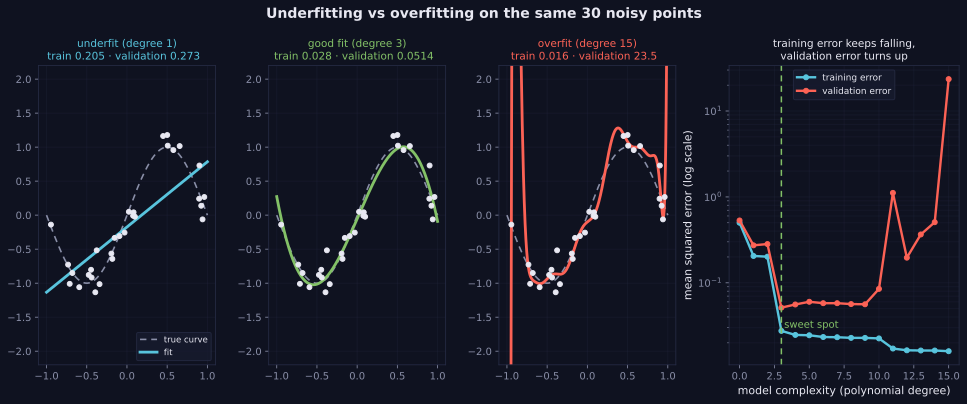

> Tier 2 · Machine Learning Fundamentals · **Level: beginner** · Reading time: about 10 minutes

# 2.27 Overfitting

**Metadata** — Tier: 2 · Phase: 1 · Priority: P0 · Difficulty: 2/5 · Interview: Very high · Hands-on: Very high
Prerequisites: 2.26, 2.12 · Leads to: 2.30 Bias–variance, 2.31 Generalisation, 2.32 Regularisation, 2.44 Cross-validation

> **In plain words**
> A model **overfits** when it **memorises the training data, including its random noise**, instead of learning the underlying pattern. It looks brilliant on the data it studied and does worse on new data.
> Like a student who memorised last year's exam answers without understanding the subject. The telltale sign: **training error keeps falling while validation error stops improving and then rises.**

**You need first:** 2.26 Underfitting and 2.12 Validation set.

> **Figure 2.27-1 — the same 30 points fitted three ways**
>
> 
>
> *How to read it:* left to right: degree 1 **underfits** (both errors high); degree 3 matches the true sine (train 0.028, validation 0.051); degree 15 passes through the points but **oscillates wildly** (train 0.016, validation 23.5). The right-hand plot shows the signature: training error keeps falling while validation error turns up.
>
> *Generated by* `tier-02-ml-fundamentals/figures/src/t2_generalization.py`.

**Words you'll meet on this page**

| Word | What it means here |
|---|---|
| overfitting | fitting noise: low train error, high validation error |
| generalisation gap | validation error minus training error |
| capacity | how flexible the model is |
| early stopping | stop training when validation error starts to rise |
| regularisation | a penalty that keeps the model simple (2.32) |
| memorisation | storing training examples instead of learning a rule |
| double descent | very large models can generalise again past the memorising point |

### 1. What is it?
A model that **fits the training data (including its noise) too closely** and therefore performs worse on new data.

### 2. Why does it matter?
Training error alone rewards memorisation. Knowing overfitting's signature and its cures is central to every ML project.

### 3. Detailed explanation
- **Signature:** training error keeps falling while validation error stops improving and then rises. A large gap between the two.
- **Polynomial demonstration** (the same data as 2.26): a degree-15 polynomial gets the *lowest* training error of all (0.016) but a validation error of **23.5**, about 460× worse than degree 3 (0.051). In-between degrees are mildly worse than degree 3, showing the gradual transition.
- **Early-stopping demonstration:** with 30 examples and 60 features, gradient descent from zero makes the validation loss fall, reach a minimum early, and then rise as the model interpolates the training set (see 2.12 and 2.22 for runnable versions).
- **Causes:** capacity high relative to the data (many parameters, few examples), noisy labels, too many features, training too long, repeated tuning on the same validation set (2.12), leakage that looks like skill (2.33).
- **Remedies:** more or better data (and augmentation); a simpler model; regularisation (2.32); early stopping; dropout and weight decay (Tier 3); cross-validation to choose complexity (2.44); ensembling.
- **Modern nuance:** very large networks can fit the training data perfectly and still generalise ("benign overfitting", double descent). The classical U-shaped curve is a useful guide for small models and small data, not a universal law (REVIEW_REQUIRED: cite the double-descent literature).
- **Memorisation in LLMs** is a form of overfitting with privacy implications (see 2.31, Tier 9).

### 4. How does it work?
Track the training and validation metrics together at every epoch or complexity setting; the point where they diverge marks the onset.

### 5. Simple example
Memorising the answers to last year's exam without understanding the subject.

**The extreme case: a lookup table.** A "model" that memorises every training example scores 100% on the training data, but on a new example it has nothing to say except a guess. Perfect training score, chance-level validation score.

### 6. Technical example
A decision threshold tuned on the same 200 validation items 500 times will look great there and worse in production.

### 7. Code
**① By hand (plain Python).** The memoriser.

```python
import random

random.seed(0)
train = [(random.random(), random.randint(0, 1)) for _ in range(100)]        # features are random, labels are random
valid = [(random.random(), random.randint(0, 1)) for _ in range(100)]
memory = dict(train)                                                          # memorise every training example
train_acc = sum(memory[x] == y for x, y in train) / len(train)
valid_acc = sum(memory.get(x, 0) == y for x, y in valid) / len(valid)         # unseen inputs: guess 0
print("memoriser: training accuracy", train_acc, "  validation accuracy", valid_acc, "(chance)")
```

```text
memoriser: training accuracy 1.0   validation accuracy 0.52 (chance)
```

**② With NumPy.** Higher degree, lower training error, but not lower validation error.

```python
import numpy as np
import warnings

warnings.simplefilter("ignore")
rng = np.random.default_rng(1)
f = lambda x: np.sin(np.pi * x)
x, xv = rng.uniform(-1, 1, 30), rng.uniform(-1, 1, 500)
y, yv = f(x) + rng.normal(0, 0.2, 30), f(xv) + rng.normal(0, 0.2, 500)

for degree in (1, 3, 5, 9, 15):
    c = np.polyfit(x, y, degree)
    print(f"degree {degree:>2}: train MSE {np.mean((np.polyval(c, x) - y) ** 2):.3f}   validation MSE {np.mean((np.polyval(c, xv) - yv) ** 2):.3f}")
```

```text
degree  1: train MSE 0.242   validation MSE 0.257
degree  3: train MSE 0.053   validation MSE 0.054
degree  5: train MSE 0.044   validation MSE 0.051
degree  9: train MSE 0.042   validation MSE 0.065
degree 15: train MSE 0.019   validation MSE 1431.492
```

**③ With scikit-learn.** A touch of regularisation tames the wild curve.

```python
import numpy as np
from sklearn.linear_model import Ridge
from sklearn.pipeline import make_pipeline
from sklearn.preprocessing import PolynomialFeatures, StandardScaler

rng = np.random.default_rng(1)
f = lambda x: np.sin(np.pi * x)
x, xv = rng.uniform(-1, 1, (30, 1)), rng.uniform(-1, 1, (500, 1))
y, yv = f(x[:, 0]) + rng.normal(0, 0.2, 30), f(xv[:, 0]) + rng.normal(0, 0.2, 500)
for alpha in (1e-8, 1e-4, 1e-2, 1):
    model = make_pipeline(PolynomialFeatures(15), StandardScaler(), Ridge(alpha=alpha)).fit(x, y)
    print(f"degree 15, ridge alpha = {alpha:<6}: validation MSE {np.mean((model.predict(xv) - yv) ** 2):.3f}")
```

```text
degree 15, ridge alpha = 1e-08 : validation MSE 48.544
degree 15, ridge alpha = 0.0001: validation MSE 0.342
degree 15, ridge alpha = 0.01  : validation MSE 0.056
degree 15, ridge alpha = 1     : validation MSE 0.078
```

### 8. Input → Process → Output
`high capacity + limited or noisy data → memorise the noise → low train error, high validation error`

<details>
<summary><b>Beyond the basics (sections 9–16)</b> — real-world use, limits, mistakes. Skip on a first read.</summary>

### 9. Enterprise use case
Release gates compare train, validation and test metrics and stop launches when the gap exceeds a threshold.

### 10. AI engineering connection
Fine-tuning LLMs on small datasets for too many epochs, prompt engineering tuned on a few examples, and RAG parameters tuned on one evaluation set are all overfitting risks.

### 11. Advantages
(Of detecting it) it is cheap and actionable via validation curves.

### 12. Limitations
A single validation set is noisy; heavy tuning overfits the validation set itself.

### 13. Trade-offs
Capacity and training time reduce bias but raise variance (2.30).

### 14. Common mistakes
Judging by training metrics; no held-out set; tuning on the test set; ignoring high variance across folds; equating a small gap with a good model (it may be underfit).

### 15. Performance / cost
Early stopping saves compute; heavy regularisation sweeps cost compute.

### 16. Security
Overfit models memorise training records, which enables membership-inference and extraction attacks.

</details>

### 17. Interview explanation
"Overfitting is when the model learns the noise in the training set, so training error keeps dropping while validation error rises. I monitor both curves, use cross-validation and regularisation, stop early, and prefer more or cleaner data. For very large networks I remember the classical U-shape isn't always the whole story, but I still validate on held-out data."

### 18. Rapid-fire answer
Overfit = train error down, validation error up; fix with data, a simpler model, regularisation and early stopping.

### 19. Interview questions
- **Basic:** How do you detect overfitting?
- **Intermediate:** List five remedies and when each applies.
- **Advanced:** Why can heavy hyper-parameter tuning overfit the validation set?
- **Scenario:** Train accuracy 99%, validation 71%, production 65%. In what order do you investigate?

### 20. Hands-on exercise
**Goal:** see overfitting vanish as data grows.

1. Fit degree-15 polynomials to noisy sine data with 30, 100 and 1,000 training points.
2. Print the validation error each time.
3. At what size does the wild behaviour disappear?

<details>
<summary>Show a solution</summary>

```python
import numpy as np
import warnings

warnings.simplefilter("ignore")
rng = np.random.default_rng(1)
f = lambda x: np.sin(np.pi * x)
xv = rng.uniform(-1, 1, 1000); yv = f(xv) + rng.normal(0, 0.2, 1000)
for n in (30, 100, 1000):
    x = rng.uniform(-1, 1, n); y = f(x) + rng.normal(0, 0.2, n)
    c = np.polyfit(x, y, 15)
    print(f"n = {n:>4}: degree-15 validation MSE {np.mean((np.polyval(c, xv) - yv) ** 2):.3f}")
```

```text
n =   30: degree-15 validation MSE 2.351
n =  100: degree-15 validation MSE 0.454
n = 1000: degree-15 validation MSE 0.043
```

With enough data, even a high-capacity model has too little room to memorise noise.
</details>

### 21. Revision questions
1. What is the signature of overfitting?
2. What is the idea of early stopping?
3. Why can very large networks still generalise?

### 22. Related concepts
2.26 Underfitting · 2.30 Bias–variance · 2.31 Generalisation · 2.32 Regularisation · 2.44 Cross-validation

### 23. One-line memory hook
**Overfit: a perfect memory and a poor understanding.**

<details>
<summary><b>For reviewers</b> (not part of the lesson)</summary>

- Status: DRAFT, learner-first layout (Author: Claude). Code is executed by `tests/test_md_snippets.py`.
- TESTED earlier: `test_underfit_good_fit_overfit_by_degree` and `test_early_stopping_when_params_exceed_samples` (4 seeds); degree 15: train 0.016, validation 23.5 (about 460× worse than degree 3 at 0.051); early-stopping demo: validation MSE minimum at epoch 61 (4.33), rising to 5.06 by epoch 3,000. The page's snippets use different seeds, so numbers differ. Figure numbers are from the figure script.
- Double-descent statement remains REVIEW_REQUIRED.
</details>
