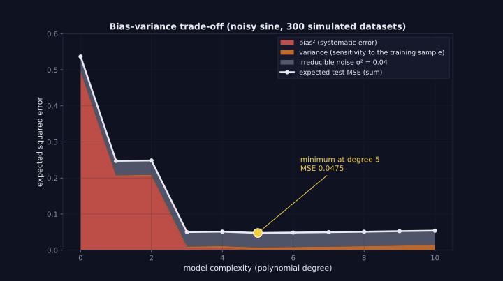
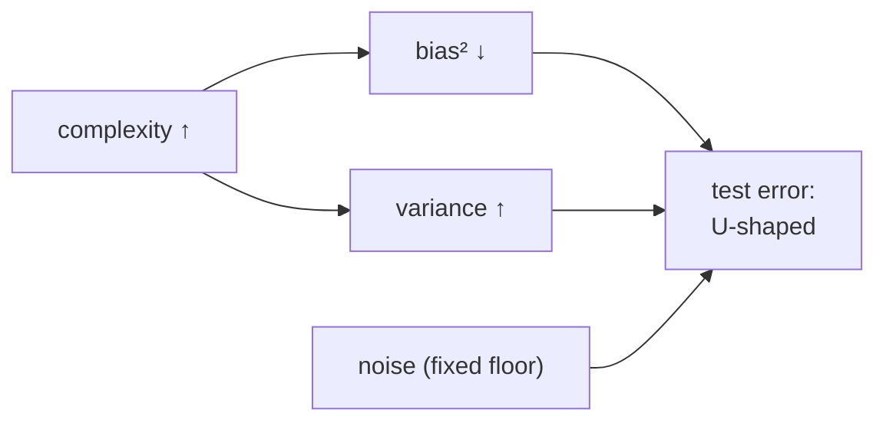

> Tier 2 · Machine Learning Fundamentals · **Level: beginner–intermediate** · Reading time: about 11 minutes

# 2.30 Bias–variance trade-off

**Metadata** — Tier: 2 · Phase: 1 · Priority: P0 · Difficulty: 3/5 · Interview: Very high · Hands-on: Medium
Prerequisites: 2.28, 2.29 · Leads to: 2.31 Generalisation, 2.32 Regularisation, 2.36 Tuning

> **In plain words**
> The expected test error of a model has three parts: **bias²** (systematic miss because the model is too simple) + **variance** (jumpiness because it is too flexible) + **noise** (randomness in the data itself that nobody can remove).
> Making a model more flexible lowers the bias but raises the variance. The best model sits **in between**, where the sum is smallest. Like a suit: too loose hangs badly (bias); too tight rips when you move (variance).

**You need first:** 2.28 Bias and 2.29 Variance.

> **Figure 2.30-1 — bias², variance and noise against complexity**
>
> 
>
> *How to read it:* at low complexity the red **bias²** dominates; as complexity grows, bias falls and the orange **variance** rises slowly. The minimum of the total (white line) is at degree 5 with error 0.0475, just above the irreducible noise 0.04 that no model can remove.
>
> *Generated by* `tier-02-ml-fundamentals/figures/src/t2_generalization.py`.

**Words you'll meet on this page**

| Word | What it means here |
|---|---|
| bias² | squared systematic error of the model class |
| variance | spread of predictions across training sets |
| irreducible noise `σ²` | error from randomness in the data; a floor |
| complexity / capacity | how flexible the model is (degree, depth, size) |
| learning curve | error plotted against training-set size |
| double descent | very large models can improve again past the interpolation point |
| regularisation strength `λ` | knob that trades variance for bias |

### 1. What is it?
For squared-error regression, the expected test error at a point splits as

**`Bias² + Variance + Irreducible noise`**.

Changing the model's complexity trades the first two against each other.

### 2. Why does it matter?
It explains why neither the simplest nor the most flexible model is best, and gives a way to reason about the right complexity.

### 3. Detailed explanation
- **The decomposition:** `E[(y − f̂(x))²] = (E f̂(x) − f(x))² + E[(f̂(x) − E f̂(x))²] + σ²`. In simulation it holds numerically to floating-point accuracy.
- **Typical pattern for a noisy sine with 30 training points** (noise variance 0.04): degree 0 and 1 are dominated by bias; degree 3 balances; degree 5 is the best; beyond that variance grows while bias is already about 0. The floor is the noise, 0.04: no model can do better on this noise.
- **Ridge at fixed high capacity:** a mild `λ` lowers the variance for little bias; an excessive `λ` adds a lot of bias. The sweet spot is found on validation data (2.36).
- **Scope:** the exact decomposition applies to squared error. For other losses analogous but not identical decompositions exist. The classical U-shaped curve describes many small and medium problems; very over-parameterised networks can show **double descent**, where test error falls again past the point where the model fits the training set perfectly (REVIEW_REQUIRED: citation).
- **Practical use: read learning curves.** High train *and* validation error → a bias problem (add capacity or features). Low train error, high validation error → a variance problem (more data, regularise, simplify).
- **Irreducible noise** sets the best achievable score; knowing it (or estimating it from how often humans disagree) tells you when to stop tuning.

### 4. How does it work?
Vary the complexity (degree, depth, `λ`, number of epochs), measure the validation error, choose the minimum, and verify once on the test set.



### 5. Simple example
Fitting a suit: too loose (high bias) hangs badly; too tight (high variance) rips when you move. Tailor it to the person (the data), not to one pose (one sample).

**Reading learning curves:**

| Train error | Validation error | Diagnosis | Try |
|---|---|---|---|
| high | high (close to train) | high bias | richer model, features, less regularisation |
| low | high (big gap) | high variance | more data, regularise, simpler model |
| low | low | good | stop tuning; check the test set once |

### 6. Technical example
Gradient-boosted trees: depth and number of rounds raise capacity; shrinkage (learning rate) and subsampling lower the variance.

### 7. Code
**① By hand (plain Python).** The decomposition on a tiny example: an estimator of a number.

```python
import random, statistics

random.seed(0)
truth = 5.0
def estimator(shrink, n=5):
    sample = [truth + random.gauss(0, 2) for _ in range(n)]
    return shrink * sum(sample) / n                       # shrink < 1 adds bias but lowers variance

for shrink in (1.0, 0.8, 0.6):
    est = [estimator(shrink) for _ in range(20000)]
    bias2 = (statistics.mean(est) - truth) ** 2
    var = statistics.pvariance(est)
    mse = statistics.mean((e - truth) ** 2 for e in est)
    print(f"shrink {shrink}: bias² {bias2:.3f} + variance {var:.3f} = {bias2 + var:.3f}   (measured MSE {mse:.3f})")
```

```text
shrink 1.0: bias² 0.000 + variance 0.804 = 0.804   (measured MSE 0.804)
shrink 0.8: bias² 0.996 + variance 0.515 = 1.511   (measured MSE 1.511)
shrink 0.6: bias² 3.968 + variance 0.286 = 4.255   (measured MSE 4.255)
```

**② With NumPy.** The full decomposition for polynomial fits.

```python
import numpy as np
import warnings

warnings.simplefilter("ignore")
f = lambda x: np.sin(np.pi * x)
xs = np.linspace(-1, 1, 30)
grid = np.linspace(-1, 1, 200)
noise = 0.2
rng = np.random.default_rng(0)

print("degree   bias²   variance   bias²+var+noise")
for degree in (0, 1, 3, 5, 10):
    preds = np.array([np.polyval(np.polyfit(xs, f(xs) + rng.normal(0, noise, 30), degree), grid) for _ in range(300)])
    bias2 = np.mean((preds.mean(axis=0) - f(grid)) ** 2)
    var = preds.var(axis=0).mean()
    print(f"{degree:>5}   {bias2:6.4f}   {var:7.4f}   {bias2 + var + noise ** 2:8.4f}")
```

```text
degree   bias²   variance   bias²+var+noise
    0   0.4975    0.0016     0.5391
    1   0.2018    0.0023     0.2441
    3   0.0049    0.0046     0.0495
    5   0.0000    0.0072     0.0472
   10   0.0000    0.0136     0.0537
```

**③ With scikit-learn.** Ridge at fixed high capacity: a sweet spot for `λ`.

```python
import numpy as np
from sklearn.linear_model import Ridge
from sklearn.pipeline import make_pipeline
from sklearn.preprocessing import PolynomialFeatures, StandardScaler

f = lambda x: np.sin(np.pi * x)
rng = np.random.default_rng(0)
X = np.linspace(-1, 1, 30).reshape(-1, 1)
Xt = rng.uniform(-1, 1, (2000, 1))
errors = {alpha: [] for alpha in (1e-6, 1e-3, 1e-2, 1e-1, 1, 10)}
for _ in range(100):
    y = f(X[:, 0]) + rng.normal(0, 0.2, 30)
    for alpha in errors:
        model = make_pipeline(PolynomialFeatures(10), StandardScaler(), Ridge(alpha=alpha)).fit(X, y)
        errors[alpha].append(np.mean((model.predict(Xt) - f(Xt[:, 0])) ** 2))
for alpha, e in errors.items():
    print(f"degree 10, ridge alpha = {alpha:<6}: average test error vs the truth {np.mean(e):.4f}")
```

```text
degree 10, ridge alpha = 1e-06 : average test error vs the truth 0.0133
degree 10, ridge alpha = 0.001 : average test error vs the truth 0.0104
degree 10, ridge alpha = 0.01  : average test error vs the truth 0.0092
degree 10, ridge alpha = 0.1   : average test error vs the truth 0.0107
degree 10, ridge alpha = 1     : average test error vs the truth 0.0380
degree 10, ridge alpha = 10    : average test error vs the truth 0.1543
```

### 8. Input → Process → Output
`complexity ↑ → bias² ↓, variance ↑ → test error U-shaped (classical regime)`

<details>
<summary><b>Beyond the basics (sections 9–16)</b> — real-world use, limits, mistakes. Skip on a first read.</summary>

### 9. Enterprise use case
Model-selection standards specify validation protocols and report the learning curves used to justify a complexity choice.

### 10. AI engineering connection
Choosing LoRA rank, number of epochs, model size and the number of prompt examples follows the same logic; report variance across seeds.

### 11. Advantages
A principled mental model for complexity control.

### 12. Limitations
Exact only for squared loss and a fixed true function; on real data, bias and variance are hard to separate.

### 13. Trade-offs
This concept *is* the trade-off.

### 14. Common mistakes
Treating it as a law for all models; trying to reduce both with the same lever; ignoring the noise floor; choosing complexity on the test set.

### 15. Performance / cost
Higher complexity costs more compute and data.

### 16. Security
Complex models memorise more (privacy); simple models are easier to audit.

</details>

### 17. Interview explanation
"Expected squared error equals bias squared plus variance plus irreducible noise. Simple models have high bias and low variance; flexible models the reverse. I read learning curves to see which side I'm on, then adjust capacity or regularisation. For very large networks the picture can be more subtle, with double descent, but validation still decides."

### 18. Rapid-fire answer
Error = bias² + variance + noise; complexity trades bias for variance; validate to find the sweet spot.

### 19. Interview questions
- **Basic:** Write the decomposition.
- **Intermediate:** How do the learning curves of high-bias and high-variance models differ?
- **Advanced:** Why can ridge reduce test error even though it adds bias?
- **Scenario:** Training error 0.02, validation 0.30. Which side are you on, and what do you do?

### 20. Hands-on exercise
**Goal:** read a learning curve.

1. Fit polynomials of degree 1, 5 and 12 to noisy sine data with training-set sizes 20, 50, 200 and 1,000.
2. Print the training and validation error for each combination.
3. Which degree is limited by bias, and which by variance?

<details>
<summary>Show a solution</summary>

```python
import numpy as np
import warnings

warnings.simplefilter("ignore")
rng = np.random.default_rng(0)
f = lambda x: np.sin(np.pi * x)
xv = rng.uniform(-1, 1, 2000); yv = f(xv) + rng.normal(0, 0.2, 2000)
print("degree   n      train    validation")
for degree in (1, 5, 12):
    for n in (20, 50, 200, 1000):
        x = rng.uniform(-1, 1, n); y = f(x) + rng.normal(0, 0.2, n)
        c = np.polyfit(x, y, degree)
        print(f"{degree:>5} {n:>5}   {np.mean((np.polyval(c, x) - y) ** 2):7.3f}   {np.mean((np.polyval(c, xv) - yv) ** 2):9.3f}")
```

```text
degree   n      train    validation
    1    20     0.127       0.267
    1    50     0.122       0.244
    1   200     0.238       0.234
    1  1000     0.232       0.234
    5    20     0.029       0.045
    5    50     0.043       0.043
    5   200     0.044       0.041
    5  1000     0.038       0.040
   12    20     0.021     352.250
   12    50     0.041       0.055
   12   200     0.038       0.044
   12  1000     0.038       0.040
```

The line (degree 1) stays high on both errors however large `n` is (bias). Degree 12 has a large gap at small `n` that closes as `n` grows (variance).
</details>

### 21. Revision questions
1. What are the three terms?
2. What does a mild `λ` do?
3. What limits the best achievable error?

### 22. Related concepts
2.28 Bias · 2.29 Variance · 2.31 Generalisation · 2.32 Regularisation

### 23. One-line memory hook
**Pick the complexity where bias and variance cross, and respect the noise floor.**

<details>
<summary><b>For reviewers</b> (not part of the lesson)</summary>

- Status: DRAFT, learner-first layout (Author: Claude). Code is executed by `tests/test_md_snippets.py`.
- TESTED earlier: `ex_2_30` (decomposition error < 1e-12; optimum at degree 5; degree 0: bias² 0.495, var 0.0016, test 0.537; degree 1: 0.205, 0.0028, 0.247; degree 3: 0.005, 0.0050, 0.050; degree 5: ≈ 0, 0.0074, 0.0475; degree 10: ≈ 0, 0.0139, 0.0539; ridge at degree 10: 0.0539 (λ = 0) → 0.0490 (λ = 0.01) → 0.1196 (λ = 1)); `test_bias_variance_tradeoff_with_degree_and_ridge`. The page's simulations use a different generator, so numbers differ slightly. Figure values are from the figure script.
- Double-descent statement remains REVIEW_REQUIRED.
</details>
