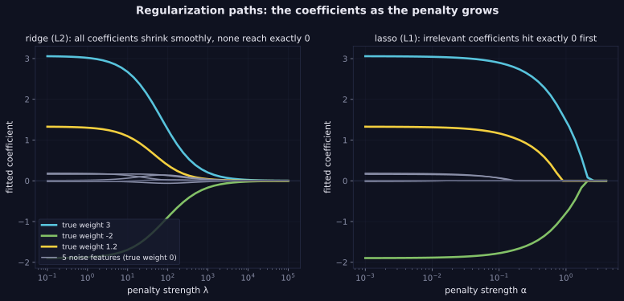

> Tier 2 — Machine Learning Fundamentals · Status: DRAFT (Author: Claude) · Code: `code/mlkit.py`, `lab/lab_03_generalization.py` — TESTED

# 2.32 Regularization

**Metadata** — Tier: 2 · Phase: 1 · Priority: P0 · Difficulty: 2/5 · Interview: Very high · Hands-on: Very high
Prerequisites: 2.18, 2.27, 1.15 · Leads to: Tier 3 Dropout (3.28) & Weight decay (3.29), Tier 10 Fine-tuning

### 1. What is it?
Any technique that **reduces overfitting by constraining the model's effective complexity**: penalty terms, early stopping, dropout, data augmentation, ensembling, parameter sharing.

### 2. Why does it exist?
Flexible models fit noise. Regularization trades a little bias for a large reduction in variance (2.30).

### 3. Detailed explanation
- **L2 / ridge / weight decay:** objective `J = loss + λ‖w‖₂²` (2.18). Shrinks all weights smoothly. `mlkit.LinearRegression(ridge=λ)` matches scikit-learn's `Ridge`. Equivalent to a Gaussian prior on weights (1.34).
- **L1 / lasso:** `J = loss + α‖w‖₁`. Produces **exactly zero** weights (feature selection) because of the sharp corner at zero (1.15). Our proximal-gradient (ISTA) lasso matches scikit-learn's `Lasso` to 1e-4.
- **Demonstration, ridge on a degree-15 polynomial (same data as 2.27):**
  | λ | validation MSE |
  |---|---|
  | 0 | 23.52 |
  | 1e-6 | 0.305 |
  | **1e-4** | **0.060** |
  | 1e-2 | 0.063 |
  | 1e-1 | 0.081 |
  | 1 | 0.130 |
  | 10 | 0.321 |
  A U-shape: too little λ overfits, too much underfits. Choose λ on validation data (2.36).
- **Sparsity demonstration (10 features, only 2 informative):** lasso keeps exactly features {0, 1}; ridge keeps all 10 nonzero (largest "noise" coefficient 0.17).
- **Scale features first.** Penalties act on coefficient size, which depends on feature scale (2.47); never penalize the intercept (as in our implementation).
- **Early stopping** (2.27) is implicit regularization; **dropout** randomly removes units; **data augmentation** adds label-preserving variants; **ensembling/bagging** averages variance away; **label smoothing** softens targets.
- **Hyperparameter λ** belongs to the objective (2.18) and is tuned like any hyperparameter (2.35).
- **Weight decay vs L2 in adaptive optimizers (Adam):** not identical; AdamW decouples them (Tier 4, 4.9). REVIEW_REQUIRED against current documentation.

### 4. How does it work?
Add the penalty to the objective (or modify training), tune strength on validation data, retrain on train+validation, evaluate once on the test set.

> **Figure 2.32-1 — ridge and lasso coefficient paths**



*How to read it:* Three true weights (3, −2, 1.2) and five pure-noise features. Ridge (left) shrinks every coefficient smoothly toward 0 but none reach it exactly. Lasso (right) sets the noise coefficients to exactly 0 first and the true ones last, which is why it performs feature selection.

*Generated by* `tier-02-ml-fundamentals/figures/src/t2_generalization.py` *from this chapter's code, so the numbers are computed, not typed in.*

### 5. Simple example
Telling a student to answer briefly: less room to ramble into noise.

### 6. Technical example
LLM fine-tuning with weight decay 0.01, dropout in adapters, and early stopping on validation loss.

### 7. Code
```python
import mlkit as M
from lab_03_generalization import lasso_ista
x, y = M.make_sine(30, 0.2, seed=1); xv, yv = M.make_sine(500, 0.2, seed=101)
print({lam: round(M.fit_poly_train_val(15, x, y, xv, yv, ridge=lam).val_mse, 3) for lam in (0, 1e-6, 1e-4, 1e-2, 1, 10)})
X, yy = M.make_linear(100, w=(3, -2) + (0,) * 8, noise=1.0, seed=1); w, b = lasso_ista(X, yy, 0.3)   # nonzero only at [0, 1]
```
TESTED (`test_regularization_ridge_lasso`, `test_lasso_matches_sklearn`, ridge vs scikit-learn in `test_linear_regression_matches_sklearn_and_ridge`).

### 8. Input → Process → Output
`complex model + constraint/penalty → smaller effective capacity → lower variance`

### 9. Enterprise use case
Regularized baselines are standard in regulated settings because they are stable and auditable.

### 10. AI engineering connection
Weight decay, dropout, LoRA rank limits, early stopping, label smoothing, data augmentation and KL penalties to a reference model (1.38) all regularize.

### 11. Advantages
Cheap, general, often the highest-return fix for overfitting.

### 12. Limitations
Introduces bias and a new hyperparameter; effect depends on scaling and optimizer.

### 13. Trade-offs
Strength λ: more shrinkage = more bias, less variance.

### 14. Common mistakes
Not standardizing features; tuning λ on the test set; penalizing the bias term; using L1 expecting stability under correlated features; assuming weight decay = L2 for every optimizer.

### 15. Performance / cost
Penalties are almost free; searching λ costs training runs.

### 16. Security
Regularization reduces memorization, which helps privacy, but does not provide formal guarantees (use differential privacy for that).

### 17. Interview explanation
"Regularization limits model complexity to reduce variance: L2 shrinks weights, L1 drives some exactly to zero, and early stopping, dropout and augmentation do the same job in other ways. I scale features first, pick the strength on a validation set, and expect a U-shaped curve in validation error."

### 18. Rapid-fire
Constrain complexity: L2 shrinks, L1 sparsifies; tune λ on validation; scale features first.

### 19. Interview questions
- Basic: L1 vs L2 effect on coefficients?
- Intermediate: Why does L1 give exact zeros?
- Advanced: Relate L2 to a Gaussian prior; weight decay vs L2 in Adam.
- Scenario: Your model has 1,000 features and 500 rows. Plan?

### 20. Hands-on exercise
Compute the ridge regularization path (coefficients vs λ) and the lasso path on the same data and plot both.

### 21. Revision questions
1) Objective with L2? 2) Which regularizer selects features? 3) Name three non-penalty regularizers.

### 22. Related concepts
2.18 Objective functions · 2.27 Overfitting · 2.30 Bias–variance · Tier 3 Dropout & Weight decay · 1.15 Norms

### 23. Memory hook
**Regularize: pay a little bias to buy a lot of stability.**
