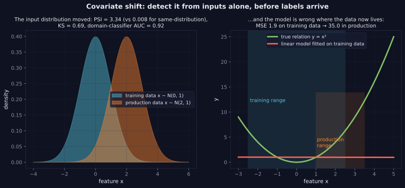

> Tier 2 · Machine Learning Fundamentals · **Level: beginner–intermediate** · Reading time: about 11 minutes

# 2.34 Distribution shift

**Metadata** — Tier: 2 · Phase: 1 · Priority: P0 · Difficulty: 3/5 · Interview: High · Hands-on: High
Prerequisites: 2.31, 1.28, 1.38 · Leads to: Tier 31 Observability and drift monitoring, retraining policies

> **In plain words**
> **Distribution shift** means **the data the model meets in the real world is different from the data it was trained on**, so it performs worse. The world moves; the model doesn't.
> Like a driver trained only on city streets who takes the highway. Shift is the *normal* condition of deployed models, not an exception, so you must **monitor** for it.

**You need first:** 2.31 Generalisation, 1.28 Distributions, 1.38 KL divergence (helpful).

> **Figure 2.34-1 — covariate shift and its detectors**
>
> 
>
> *How to read it:* **left** — production inputs moved from N(0,1) to N(2,1); this is detected without labels by PSI (3.3 versus 0.008 for unshifted data), the KS statistic (0.69) and a classifier that separates the two samples (AUC 0.92). **Right** — a linear model fitted on the training range is acceptable there (MSE 1.9) but wrong where the data now lives (MSE 35.0).
>
> *Generated by* `tier-02-ml-fundamentals/figures/src/t2_generalization.py`.

**Words you'll meet on this page**

| Word | What it means here |
|---|---|
| covariate shift | `P(x)` changes, `P(y|x)` stays |
| label (prior) shift | `P(y)` changes, `P(x|y)` stays |
| concept drift | `P(y|x)` changes |
| PSI | Population Stability Index: how much a feature's distribution moved |
| KS statistic | largest gap between two cumulative distributions |
| domain classifier | a model trained to tell training data from production data |
| importance weighting | reweighting training examples to look like production |

### 1. What is it?
When the **data distribution at deployment differs from the training distribution**, so performance degrades. Also called dataset shift or drift.

### 2. Why does it matter?
Models are fitted to the past; production is the future. Shift is the normal condition, not an exception.

### 3. Detailed explanation
**Types** (with `x` = features, `y` = label)
- **Covariate shift:** `P(x)` changes, `P(y|x)` is stable. Example: customers get younger. It harms models that are wrong in the newly populated region of feature space. A *linear* model fitted to `y = x²` on `x ~ N(0,1)` has a small error there but a huge one when `x ~ N(2,1)`.
- **Label (prior) shift:** `P(y)` changes, `P(x|y)` is stable. Example: the fraud rate drops from 50% to 5%. With a fixed classifier, recall stays about the same but **precision collapses**: base rates matter (1.34).
- **Concept drift:** `P(y|x)` changes. Example: user preferences or fraud tactics evolve. You need fresh labels.
- **Upstream or pipeline changes:** new units, schema changes, missing features, a new tokeniser or embedding model.

**Detection without labels:** compare each feature's distribution between a reference window and now with **PSI** or the **KS statistic**, or train a **domain classifier** to tell the two samples apart (AUC about 0.5 means no detectable covariate shift; near 1 means strong shift). **With labels:** monitor accuracy, precision, recall and calibration over time slices.

**Mitigation:** monitor and alert; retrain on recent data (windows, weights); importance weighting for covariate shift; recalibrate thresholds or priors; robust or domain-adaptive training; fall back to rules or human review when inputs are out-of-distribution.

**PSI rule of thumb** (< 0.1 stable, 0.1–0.25 moderate, > 0.25 large) is a convention, not a theorem.

**LLM systems:** shifts in the prompt distribution, new documents in the corpus, model-provider updates, seasonal query patterns (Tier 31).

### 4. How does it work?
Log inputs and predictions, compute drift statistics against a reference window per feature and for model outputs, alert on thresholds, and evaluate with fresh labels when they arrive.

### 5. Simple example
A driver trained only on city streets takes the highway.

**Precision after prevalence shifts, by hand.** A fraud classifier with recall 97% and false-alarm rate 5%.
- At 50% fraud (1,000 cases: 500 fraud): 485 caught, 25 false alarms → precision `485/510 = 95%`.
- At 5% fraud (1,000 cases: 50 fraud): 48.5 caught, 47.5 false alarms → precision `48.5/96 = 50%`.

Same classifier, same recall and false-alarm rate; half its alerts are now false, just because fraud became rarer.

### 6. Technical example
A recommender trained before a product redesign sees different click patterns after launch; an embedding-model upgrade makes old vectors incomparable.

### 7. Code
**① By hand (plain Python).** PSI from two binned distributions.

```python
import math

def psi(expected, actual):
    return sum((a - e) * math.log(a / e) for e, a in zip(expected, actual))

reference = [0.25, 0.25, 0.25, 0.25]            # share of customers per age band at training time
today_ok = [0.26, 0.24, 0.25, 0.25]
today_shifted = [0.60, 0.20, 0.15, 0.05]
print("PSI, no real change:", round(psi(reference, today_ok), 4), " (below 0.1: stable)")
print("PSI, big shift     :", round(psi(reference, today_shifted), 3), " (above 0.25: large)")
```

```text
PSI, no real change: 0.0008  (below 0.1: stable)
PSI, big shift     : 0.691  (above 0.25: large)
```

**② With NumPy.** Covariate shift hurts a linear model, and label shift hurts precision.

```python
import numpy as np

rng = np.random.default_rng(0)
x = rng.normal(0, 1, 2000); y = x ** 2 + rng.normal(0, 0.3, 2000)             # the truth is curved
w = np.polyfit(x, y, 1)                                                          # but we fit a straight line
for mean in (0, 2):
    xn = rng.normal(mean, 1, 2000)
    print(f"inputs ~ N({mean}, 1): MSE of the line {np.mean((np.polyval(w, xn) - xn ** 2) ** 2):.1f}")

def precision(prevalence, recall=0.97, fpr=0.05, n=100000):
    pos = n * prevalence
    return recall * pos / (recall * pos + fpr * (n - pos))
print("precision at 50% fraud:", round(precision(0.5), 2), "  at 5% fraud:", round(precision(0.05), 2))
```

```text
inputs ~ N(0, 1): MSE of the line 1.9
inputs ~ N(2, 1): MSE of the line 38.0
precision at 50% fraud: 0.95   at 5% fraud: 0.51
```

**③ With scikit-learn and SciPy.** Detect covariate shift without labels.

```python
import numpy as np
from scipy.stats import ks_2samp
from sklearn.ensemble import RandomForestClassifier
from sklearn.metrics import roc_auc_score
from sklearn.model_selection import cross_val_predict

rng = np.random.default_rng(0)
train = rng.normal(0, 1, (1000, 1))
same = rng.normal(0, 1, (1000, 1))
shifted = rng.normal(2, 1, (1000, 1))

for name, prod in (("unshifted", same), ("shifted", shifted)):
    X = np.vstack([train, prod]); domain = np.r_[np.zeros(1000), np.ones(1000)]          # 0 = training data, 1 = production
    p = cross_val_predict(RandomForestClassifier(100, random_state=0), X, domain, cv=5, method="predict_proba")[:, 1]
    print(f"{name:>9}: KS statistic {ks_2samp(train[:, 0], prod[:, 0]).statistic:.2f}   domain-classifier AUC {roc_auc_score(domain, p):.2f}")
```

```text
unshifted: KS statistic 0.05   domain-classifier AUC 0.50
  shifted: KS statistic 0.70   domain-classifier AUC 0.88
```

### 8. Input → Process → Output
`P_train ≠ P_prod → degraded accuracy and calibration → detect → retrain or adapt`

<details>
<summary><b>Beyond the basics (sections 9–16)</b> — real-world use, limits, mistakes. Skip on a first read.</summary>

### 9. Enterprise use case
Drift dashboards, scheduled retraining, canary releases and rollback plans are standard MLOps practice (Tier 31).

### 10. AI engineering connection
Corpus drift for RAG, query-topic drift, tool or API changes for agents, provider model updates, and embedding-version mismatches.

### 11. Advantages
(Of monitoring) catches silent failures early.

### 12. Limitations
Unlabelled drift detection says "different", not "worse"; labels arrive late.

### 13. Trade-offs
Frequent retraining reduces staleness but adds cost and risk; thresholds trade false alarms against missed drift.

### 14. Common mistakes
No monitoring; alerting on every statistically significant tiny drift; assuming drift always hurts; retraining on contaminated recent data; ignoring label delay.

### 15. Performance / cost
Drift computations are cheap; labelling for ground truth is the costly part.

### 16. Security
Attackers can induce drift (poisoning, adversarial traffic) or hide inside it; monitor segments and inputs, not only aggregate metrics.

</details>

### 17. Interview explanation
"Distribution shift means production data differs from training data. I separate covariate shift, label shift and concept drift because the remedies differ: monitor features with PSI or KS and a domain classifier, track prediction and base-rate changes, and retrain or recalibrate when metrics on fresh labels degrade."

### 18. Rapid-fire answer
Train ≠ production distribution: covariate, label and concept shift; detect with PSI, KS and a domain classifier; retrain or recalibrate.

### 19. Interview questions
- **Basic:** Covariate versus label versus concept shift?
- **Intermediate:** Why does precision drop when prevalence drops, with the same classifier?
- **Advanced:** How does importance weighting correct covariate shift?
- **Scenario:** Accuracy is stable but revenue per user fell after a UI change. What shifted?

### 20. Hands-on exercise
**Goal:** correct covariate shift with importance weights.

1. Fit a line to `y = x²` data from `N(0, 1)` but weight each training point by how likely it is under the production distribution `N(2, 1)` relative to training: `w = pdf₂(x)/pdf₀(x) = exp(2x − 2)`.
2. Compare the production MSE of the weighted and the unweighted line.

<details>
<summary>Show a solution</summary>

```python
import numpy as np

rng = np.random.default_rng(0)
x = rng.normal(0, 1, 5000); y = x ** 2 + rng.normal(0, 0.3, 5000)
x_prod = rng.normal(2, 1, 5000)

plain = np.polyfit(x, y, 1)
weights = np.exp(2 * x - 2)                                      # density ratio N(2,1) / N(0,1)
weighted = np.polyfit(x, y, 1, w=np.sqrt(weights))               # polyfit squares the weights it is given
for name, c in (("unweighted line", plain), ("importance-weighted line", weighted)):
    print(f"{name:<26} production MSE {np.mean((np.polyval(c, x_prod) - x_prod ** 2) ** 2):.2f}")
```

```text
unweighted line            production MSE 34.12
importance-weighted line   production MSE 3.03
```

The weighted fit puts its effort where production data lives, so it is much better there (at some cost where training data used to be). A straight line still cannot match a parabola everywhere: weighting helps, it does not replace a better model.
</details>

### 21. Revision questions
1. Name three shift types.
2. Which detectors need no labels?
3. List some mitigations.

### 22. Related concepts
2.31 Generalisation · 2.43 Calibration · 2.51 Metric selection · 1.38 KL divergence · Tier 31 Observability

### 23. One-line memory hook
**The world moves; the model doesn't, so measure the gap.**

<details>
<summary><b>For reviewers</b> (not part of the lesson)</summary>

- Status: DRAFT, learner-first layout (Author: Claude). Code is executed by `tests/test_md_snippets.py`.
- TESTED earlier: `test_distribution_shift_detection_and_effects`, `test_psi_and_ks_detect_shift` (linear fit to `y = x²`: MSE 2.0 in-distribution vs 36.2 under `N(2,1)`; label shift: precision 0.956 → 0.543 at the same recall; PSI 0.004 vs 3.37; KS 0.024 vs 0.69; domain-classifier AUC 0.50 vs 0.92). The page's snippets use different data, so numbers differ; figure numbers are from the figure script.
- The importance-weight formula `exp(2x − 2)` is the density ratio of N(2,1) to N(0,1).
</details>
