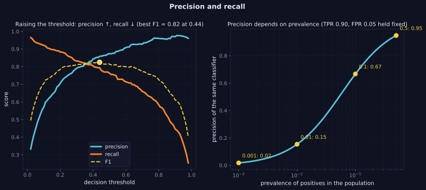

> Tier 2 · Machine Learning Fundamentals · **Level: beginner** · Reading time: about 10 minutes

# 2.38 Precision

**Metadata** — Tier: 2 · Phase: 1 · Priority: P0 · Difficulty: 1/5 · Interview: Very high · Hands-on: High
Prerequisites: 2.42, 1.33 · Leads to: 2.39 Recall, 2.40 F1, 2.41 PR curve, 2.51 Metric selection

> **In plain words**
> **Precision** answers: "**when the model says YES, how often is it right?**" Of the 20 emails the filter put in spam, 18 really were spam: precision 90%.
> It measures the cost of **false alarms**. A big trap: precision depends on **how common the positives are**. The *same* classifier can have 95% precision when half the cases are positive and only 15% when 1% are.

**You need first:** 2.37 Accuracy, the confusion matrix (2.42) and conditional probability (1.33).

> **Figure 2.38-1 — precision, recall and the effect of prevalence**
>
> 
>
> *How to read it:* **left** — raising the threshold makes the model pickier, so precision rises and recall falls; F1 peaks (0.82) near threshold 0.44. **Right** — the same classifier (TPR 0.90, FPR 0.05) has precision 0.95 when half the population is positive, but only 0.15 at 1% and 0.02 at 0.1%.
>
> *Generated by* `tier-02-ml-fundamentals/figures/src/t2_metrics.py`.

**Words you'll meet on this page**

| Word | What it means here |
|---|---|
| precision (PPV) | `TP / (TP + FP)` |
| false alarm (FP) | predicted yes, truly no |
| prevalence `π` | share of positives in the population |
| TPR / FPR | true positive rate (recall) / false positive rate |
| threshold | score above which we predict yes |
| precision@k | share of the top-k results that are relevant |
| zero division | 0/0 when nothing is predicted positive |

### 1. What is it?
Of the items the model **flagged as positive, the fraction that truly are positive**: `precision = TP / (TP + FP)` (also called positive predictive value).

### 2. Why does it exist?
It answers "when the model raises its hand, how often is it right?", which governs the cost of false alarms.

### 3. Detailed explanation
- **Conditional probability view:** `precision = P(actually positive | predicted positive)` (1.33).
- **It depends on prevalence.** For a fixed classifier with true-positive rate `TPR` and false-positive rate `FPR`: `precision = TPR·π / (TPR·π + FPR·(1 − π))`. With TPR 0.90 and FPR 0.05 that is 0.947 at `π = 0.5`, 0.667 at 10%, **0.154 at 1%**, and 0.018 at 0.1%. (This is Bayes' theorem, 1.34.)
- **Threshold trade-off:** raising the threshold raises precision and lowers recall (2.39).
- **Undefined when nothing is predicted positive** (0/0). Libraries return 0 by default and expose a `zero_division` option; always state the convention.
- **Where precision matters most:** when false positives are expensive: spam filters blocking real mail, manual review queues, automatic account suspension.
- **Precision@k** (the fraction of the top-k results that are relevant) is the retrieval and RAG version (Tiers 20, 21).
- **Micro and macro averaging** for multiclass problems (2.40).

### 4. How does it work?
Count the predicted positives, count how many of those were truly positive, divide.

### 5. Simple example
Of the 20 emails the filter put in spam, 18 really were spam: precision 90%.

**Prevalence effect, by hand.** A classifier with TPR 0.90 and FPR 0.05, on 10,000 cases:

| Prevalence | actual positives | caught (TP) | false alarms (FP) | precision |
|---|---|---|---|---|
| 50% | 5,000 | 4,500 | 250 | 0.947 |
| 1% | 100 | 90 | 495 | **0.154** |

Same model. At 1% prevalence, five out of six alerts are false.

### 6. Technical example
A fraud model flags 100 transactions and 30 are fraud: precision 30%. The review capacity (100 cases per day) decides whether that is acceptable.

### 7. Code
**① By hand (plain Python).**

```python
def precision(tp, fp, zero_division=0.0):
    return tp / (tp + fp) if tp + fp else zero_division

print("tp=30, fp=70:", precision(30, 70))
print("nothing flagged (0/0):", precision(0, 0), "<- convention!   with zero_division=1:", precision(0, 0, zero_division=1.0))
for pi in (0.5, 0.1, 0.01, 0.001):
    tpr, fpr, n = 0.9, 0.05, 100_000
    tp, fp = tpr * pi * n, fpr * (1 - pi) * n
    print(f"prevalence {pi:>6.1%}: precision {precision(tp, fp):.3f}")
```

```text
tp=30, fp=70: 0.3
nothing flagged (0/0): 0.0 <- convention!   with zero_division=1: 1.0
prevalence  50.0%: precision 0.947
prevalence  10.0%: precision 0.667
prevalence   1.0%: precision 0.154
prevalence   0.1%: precision 0.018
```

**② With NumPy.** The threshold trade-off on simulated scores.

```python
import numpy as np

rng = np.random.default_rng(0)
y = (rng.random(20000) < 0.10).astype(int)                         # 10% positives
score = np.clip(0.55 * y + rng.normal(0.25, 0.18, 20000), 0, 1)
print("threshold  precision  recall")
for t in (0.1, 0.3, 0.5, 0.7, 0.9):
    pred = score > t
    tp = (pred & (y == 1)).sum()
    print(f"{t:>9}  {tp / max(pred.sum(), 1):9.3f}  {tp / y.sum():6.3f}")
```

```text
threshold  precision  recall
      0.1      0.125   1.000
      0.3      0.224   0.997
      0.5      0.562   0.950
      0.7      0.908   0.702
      0.9      0.988   0.286
```

**③ With scikit-learn.**

```python
import numpy as np
from sklearn.metrics import precision_recall_curve, precision_score

y = np.array([1, 0, 1, 1, 0, 0, 0, 0, 1, 0])
pred = np.array([1, 1, 1, 0, 0, 0, 0, 0, 1, 0])
print("precision:", precision_score(y, pred))
print("nothing predicted positive:", precision_score(y, np.zeros(10, dtype=int), zero_division=0))
prec, rec, thr = precision_recall_curve(y, [0.9, 0.8, 0.7, 0.4, 0.3, 0.2, 0.2, 0.1, 0.6, 0.1])
print("precision at each threshold:", prec.round(2).tolist())
```

```text
precision: 0.75
nothing predicted positive: 0.0
precision at each threshold: [0.4, 0.5, 0.67, 0.8, 0.75, 0.67, 0.5, 1.0, 1.0]
```

### 8. Input → Process → Output
`predicted positives → fraction truly positive`

<details>
<summary><b>Beyond the basics (sections 9–16)</b> — real-world use, limits, mistakes. Skip on a first read.</summary>

### 9. Enterprise use case
Precision links directly to reviewer workload and customer friction; teams set a minimum precision (say ≥ 90%) and maximise recall subject to it.

### 10. AI engineering connection
Precision of retrieved chunks (precision@k), of tool calls that were necessary, of guard-rail blocks that were justified, of claims in an answer that are supported (faithfulness).

### 11. Advantages
Intuitive, and tied to the cost of false alarms.

### 12. Limitations
Ignores missed positives; shifts with prevalence; unstable when few predictions are positive.

### 13. Trade-offs
Raising the threshold increases precision and decreases recall.

### 14. Common mistakes
Comparing precision across datasets with different prevalence; reporting precision without recall; hiding undefined values as 0; evaluating on a rebalanced set and quoting the number as production precision.

### 15. Performance / cost
`O(n)`.

### 16. Security
Low-precision security alerts cause alert fatigue, and real incidents get ignored.

</details>

### 17. Interview explanation
"Precision is the fraction of flagged items that are truly positive: TP over TP plus FP. It's a conditional probability, so it depends on prevalence: the same classifier can have 95% precision at a 50% base rate and 15% at 1%. I choose a threshold to meet a precision floor set by review capacity."

### 18. Rapid-fire answer
Precision = TP/(TP + FP) = P(positive | flagged); falls with lower prevalence and lower thresholds.

### 19. Interview questions
- **Basic:** Compute precision for TP = 30, FP = 70.
- **Intermediate:** Why does precision fall when prevalence falls?
- **Advanced:** Derive precision from TPR, FPR and prevalence.
- **Scenario:** Your detector has 90% precision in testing and 20% in production. Explain.

### 20. Hands-on exercise
**Goal:** compare how three classifiers' precision falls with prevalence.

1. Classifiers: (TPR, FPR) = (0.95, 0.10), (0.80, 0.02), (0.60, 0.001).
2. Compute precision at prevalences 50%, 10%, 1%, 0.1%.
3. Which classifier holds up best when positives are rare?

<details>
<summary>Show a solution</summary>

```python
classifiers = {"A (0.95, 0.10)": (0.95, 0.10), "B (0.80, 0.02)": (0.80, 0.02), "C (0.60, 0.001)": (0.60, 0.001)}
print(f"{'':<17}" + "".join(f"{p:>9.1%}" for p in (0.5, 0.1, 0.01, 0.001)))
for name, (tpr, fpr) in classifiers.items():
    row = [tpr * p / (tpr * p + fpr * (1 - p)) for p in (0.5, 0.1, 0.01, 0.001)]
    print(f"{name:<17}" + "".join(f"{v:>9.3f}" for v in row))
```

```text
                     50.0%    10.0%     1.0%     0.1%
A (0.95, 0.10)       0.905    0.514    0.088    0.009
B (0.80, 0.02)       0.976    0.816    0.288    0.038
C (0.60, 0.001)      0.998    0.985    0.858    0.375
```

The classifier with the tiniest false-positive rate keeps its precision when positives are rare, even though its recall is lowest.
</details>

### 21. Revision questions
1. What is the formula?
2. What is the conditional-probability form?
3. What drives precision in production?

### 22. Related concepts
2.39 Recall · 2.40 F1 · 1.34 Bayes' theorem · 2.45 Class imbalance

### 23. One-line memory hook
**Precision: when it shouts "positive", how often is it right?**

<details>
<summary><b>For reviewers</b> (not part of the lesson)</summary>

- Status: DRAFT, learner-first layout (Author: Claude). Code is executed by `tests/test_md_snippets.py`.
- TESTED earlier: `test_precision_recall_tradeoff_and_prevalence_dependence` (TPR 0.90, FPR 0.05: 0.947 at 50%, 0.667 at 10%, 0.154 at 1%, 0.018 at 0.1%; thresholds 0.1/0.3/0.5/0.7/0.9 at 10% positives: precision 0.571, 0.791, 0.874, 0.928, 0.970 while recall fell 0.921 → 0.447), `test_metrics_edge_cases`, vs scikit-learn. The page's threshold snippet uses a different generator, so numbers differ. Figure numbers (F1 0.82 near threshold 0.44) are from the figure script.
</details>
