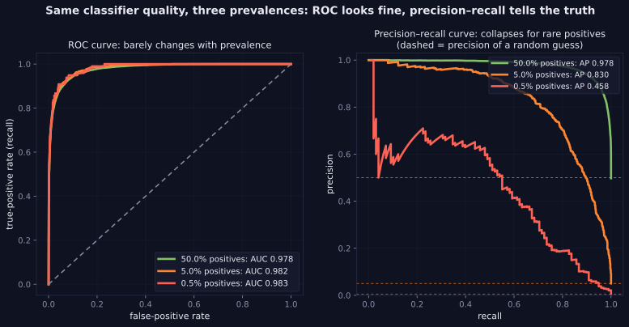
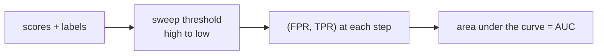

> Tier 2 · Machine Learning Fundamentals · **Level: beginner–intermediate** · Reading time: about 11 minutes

# 2.41 ROC and AUC

**Metadata** — Tier: 2 · Phase: 1 · Priority: P0 · Difficulty: 3/5 · Interview: Very high · Hands-on: High
Prerequisites: 2.38, 2.39, 1.29 · Leads to: 2.43 Calibration, 2.51 Metric selection, Tier 30

> **In plain words**
> The **ROC curve** shows, for **every possible threshold**, how many real positives you catch (true-positive rate) against how many negatives you wrongly flag (false-positive rate). **AUC** is the area under it, and it has a lovely meaning: **pick one random positive and one random negative; AUC is the chance the model scores the positive higher.**
> 0.5 means no better than a coin flip; 1.0 means perfect separation. But AUC judges **ranking only**, and with **rare positives** it can look excellent while the alerts are mostly false.

**You need first:** 2.38 Precision, 2.39 Recall.

> **Figure 2.41-1 — ROC versus precision–recall under imbalance**
>
> 
>
> *How to read it:* the same score quality at three prevalences. The ROC curves are nearly identical (AUC 0.978, 0.982, 0.983) because TPR and FPR do not depend on prevalence. The precision–recall curves collapse as positives get rarer (average precision 0.978, 0.830, 0.458), exposing the cost of false positives that ROC hides.
>
> *Generated by* `tier-02-ml-fundamentals/figures/src/t2_metrics.py`.

**Words you'll meet on this page**

| Word | What it means here |
|---|---|
| ROC curve | TPR plotted against FPR over all thresholds |
| AUC | area under the ROC curve; `P(score_pos > score_neg)` |
| rank-based | depends only on the order of the scores |
| average precision (AP) | area under the precision–recall curve |
| partial AUC | area over only the useful FPR range |
| Mann–Whitney | the statistical test that gives the same number as AUC |
| ties | positives and negatives with identical scores (count half) |

### 1. What is it?
The **ROC curve** plots the true-positive rate (recall) against the false-positive rate as the decision threshold sweeps from high to low. **AUC** is the area under it: the probability that a random positive receives a higher score than a random negative (ties count half).

### 2. Why does it exist?
It measures how well a score *ranks* positives above negatives, independent of any single threshold or of calibration.

### 3. Detailed explanation
- **Interpretation:** 0.5 = no ranking ability (a constant or random score), 1.0 = perfect separation, below 0.5 = worse than random (flip the sign of the score: `AUC(−s) = 1 − AUC(s)`).
- **Rank-based:** any strictly increasing transform of the scores leaves AUC unchanged (for instance `exp(5s)` gives the same AUC). So AUC says nothing about calibration (2.43).
- **Prevalence-insensitive but also precision-blind.** The same model quality at 50%, 5% and 0.5% positives gives an almost constant ROC-AUC, but the **average precision** (area under the precision–recall curve) collapses. For rare positives use precision–recall curves, because FPR is dominated by the huge number of negatives.
- **AUC summarises all thresholds, including irrelevant ones** (an FPR above 20% may be unacceptable). Partial AUC, or recall at a fixed FPR, matches operations better.
- **Choosing a threshold** requires costs (2.51): pick a *point* on the curve, not the area.
- **Multiclass:** one-vs-rest AUC per class, averaged.
- **Confidence intervals:** AUC has sampling variance; bootstrap it.
- **Degenerate cases:** both classes must be present, otherwise AUC is undefined.

### 4. How does it work?
Sort by score, sweep the threshold, record `(FPR, TPR)` at each distinct score, and integrate with the trapezoid rule.



### 5. Simple example
If you pick one sick and one healthy patient at random, how often does the test give the sick one the higher risk score? That frequency is the AUC.

**By hand.** Positive scores `[0.9, 0.7, 0.4]`, negative scores `[0.8, 0.3, 0.2]`. The 9 positive–negative pairs:

| positive | beats 0.8? | beats 0.3? | beats 0.2? |
|---|---|---|---|
| 0.9 | yes | yes | yes |
| 0.7 | no | yes | yes |
| 0.4 | no | yes | yes |

7 of 9 pairs are ranked correctly: **AUC = 7/9 ≈ 0.778**.

### 6. Technical example
Evaluating a re-ranker or a risk score, where ranking quality is the goal; comparing candidate models before choosing an operating point.

### 7. Code
**① By hand (plain Python).** AUC as a pairwise probability.

```python
pos = [0.9, 0.7, 0.4]
neg = [0.8, 0.3, 0.2]
wins = sum(1.0 if p > n else 0.5 if p == n else 0.0 for p in pos for n in neg)
print("AUC =", wins, "/", len(pos) * len(neg), "=", round(wins / (len(pos) * len(neg)), 3))
print("flipping the scores gives 1 - AUC:", round(1 - wins / 9, 3))
```

```text
AUC = 7.0 / 9 = 0.778
flipping the scores gives 1 - AUC: 0.222
```

**② With NumPy.** The ROC points, the trapezoid area, and rank invariance.

```python
import numpy as np

rng = np.random.default_rng(0)
y = (rng.random(2000) < 0.3).astype(int)
s = rng.normal(0, 1, 2000) + 1.5 * y

def roc_auc(y, s):
    order = np.argsort(-s)
    y = y[order]
    tpr = np.r_[0, np.cumsum(y) / y.sum()]
    fpr = np.r_[0, np.cumsum(1 - y) / (1 - y).sum()]
    return float(np.sum(np.diff(fpr) * (tpr[1:] + tpr[:-1]) / 2))

print("AUC:", round(roc_auc(y, s), 4))
print("AUC after exp(2*s) (monotone transform):", round(roc_auc(y, np.exp(2 * s)), 4), "(unchanged)")
print("AUC with the sign flipped:", round(roc_auc(y, -s), 4), "(= 1 - AUC)")
```

```text
AUC: 0.8542
AUC after exp(2*s) (monotone transform): 0.8542 (unchanged)
AUC with the sign flipped: 0.1458 (= 1 - AUC)
```

**③ With scikit-learn.** ROC-AUC barely moves with prevalence; average precision collapses.

```python
import numpy as np
from sklearn.metrics import average_precision_score, roc_auc_score

rng = np.random.default_rng(0)
for prevalence in (0.5, 0.05, 0.005):
    n = 200000
    y = (rng.random(n) < prevalence).astype(int)
    s = rng.normal(0, 1, n) + 3.0 * y                                  # the same score quality every time
    print(f"prevalence {prevalence:>6.1%}: ROC-AUC {roc_auc_score(y, s):.3f}   average precision {average_precision_score(y, s):.3f}")
```

```text
prevalence  50.0%: ROC-AUC 0.983   average precision 0.983
prevalence   5.0%: ROC-AUC 0.983   average precision 0.852
prevalence   0.5%: ROC-AUC 0.984   average precision 0.595
```

### 8. Input → Process → Output
`scores → threshold sweep → (FPR, TPR) curve → area`

<details>
<summary><b>Beyond the basics (sections 9–16)</b> — real-world use, limits, mistakes. Skip on a first read.</summary>

### 9. Enterprise use case
Used to compare risk models across segments and over time; operations then choose a threshold using costs and capacity.

### 10. AI engineering connection
Evaluating re-rankers, safety classifiers, hallucination detectors and LLM-judge scores as rankers of good versus bad outputs.

### 11. Advantages
Threshold-free, rank-based and widely understood.

### 12. Limitations
Misleading for rare positives; blind to calibration; averages over irrelevant operating regions.

### 13. Trade-offs
ROC (insensitive to class balance) versus precision–recall (reflects precision under imbalance).

### 14. Common mistakes
Treating AUC as accuracy; using ROC-AUC alone for rare events; comparing AUCs from different populations; ignoring confidence intervals.

### 15. Performance / cost
`O(n log n)` for sorting.

### 16. Security
AUC does not reveal subgroup disparities; compute it per slice.

</details>

### 17. Interview explanation
"ROC-AUC is the probability a random positive outranks a random negative. It's threshold-free and rank-based, so it ignores calibration, and with rare positives it can look excellent while precision is poor, so I add precision–recall curves and pick the operating point using costs."

### 18. Rapid-fire answer
AUC = P(score_pos > score_neg); 0.5 is chance; rank-only; use PR-AUC for rare positives.

### 19. Interview questions
- **Basic:** What does AUC = 0.5 mean?
- **Intermediate:** Why is AUC unchanged by monotone transforms, and what does it not tell you?
- **Advanced:** Why does ROC-AUC stay high while average precision collapses under extreme imbalance?
- **Scenario:** Two models have AUC 0.91 and 0.90, but the second has better recall at 1% FPR. Which do you choose?

### 20. Hands-on exercise
**Goal:** compare AUC with recall at a fixed false-positive rate.

1. Simulate scores at prevalences 50%, 5% and 0.5% (positives shifted by 3).
2. For each, find the recall at FPR = 1%.
3. Compare with the AUC values.

<details>
<summary>Show a solution</summary>

```python
import numpy as np
from sklearn.metrics import roc_auc_score, roc_curve

rng = np.random.default_rng(0)
for prevalence in (0.5, 0.05, 0.005):
    n = 200000
    y = (rng.random(n) < prevalence).astype(int)
    s = rng.normal(0, 1, n) + 3.0 * y
    fpr, tpr, _ = roc_curve(y, s)
    print(f"prevalence {prevalence:>6.1%}: AUC {roc_auc_score(y, s):.3f}   recall at 1% FPR {np.interp(0.01, fpr, tpr):.3f}")
```

```text
prevalence  50.0%: AUC 0.983   recall at 1% FPR 0.751
prevalence   5.0%: AUC 0.983   recall at 1% FPR 0.746
prevalence   0.5%: AUC 0.984   recall at 1% FPR 0.757
```

Recall at a fixed FPR does not depend on prevalence either: the lesson is that both ignore how many false alarms you will actually see, which precision captures.
</details>

### 21. Revision questions
1. What is the probabilistic meaning of AUC?
2. Why use precision–recall curves for rare events?
3. What is AUC invariant to?

### 22. Related concepts
2.38 Precision · 2.39 Recall · 2.43 Calibration · 2.45 Class imbalance · 2.51 Metric selection

### 23. One-line memory hook
**AUC measures ranking, not trust: it can't tell you the threshold or the probability.**

<details>
<summary><b>For reviewers</b> (not part of the lesson)</summary>

- Status: DRAFT, learner-first layout (Author: Claude). Code is executed by `tests/test_md_snippets.py`.
- TESTED earlier: `test_roc_auc_matches_sklearn_ties_and_rank_form`, `test_auc_is_rank_based_so_invariant_to_monotone_transform`, `test_average_precision_matches_sklearn_and_is_prevalence_sensitive`, `test_roc_auc_hides_what_pr_auc_shows_under_imbalance` (prevalence 50%/5%/0.5%: ROC-AUC 0.978/0.982/0.983, average precision 0.978/0.830/0.458). Figure numbers are from the figure script; the page's snippets use a different score model.
</details>
