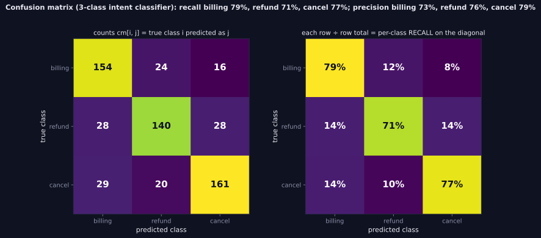

> Tier 2 · Machine Learning Fundamentals · **Level: absolute beginner** · Reading time: about 9 minutes

# 2.42 Confusion matrix

**Metadata** — Tier: 2 · Phase: 1 · Priority: P0 · Difficulty: 1/5 · Interview: Very high · Hands-on: Very high
Prerequisites: 2.14 · Leads to: 2.37–2.41, 2.51, error analysis

> **In plain words**
> A **confusion matrix** is a **scoreboard of right and wrong calls, broken down by kind of mistake**: a table whose rows are the **true** classes and columns the **predicted** classes. The diagonal holds the correct calls; everything off the diagonal is a specific kind of confusion.
> Almost every classification metric (accuracy, precision, recall, F1) is computed from it. And it tells you **which** errors happen, not just how many.

**You need first:** 2.14 Classification.

> **Figure 2.42-1 — a 3-class confusion matrix as counts and as recall**
>
> 
>
> *How to read it:* rows are true classes, columns are predictions. The diagonal holds correct predictions; off-diagonal cells show which classes get confused. Dividing each **row** by its total turns the diagonal into per-class recall (billing 79%, refund 71%, cancel 77%); dividing each **column** instead would give precision.
>
> *Generated by* `tier-02-ml-fundamentals/figures/src/t2_metrics.py`.

**Words you'll meet on this page**

| Word | What it means here |
|---|---|
| confusion matrix | counts of (true class, predicted class) pairs |
| TP / TN / FP / FN | true / false positives / negatives (binary case) |
| diagonal | correct predictions |
| off-diagonal | mistakes, by type |
| normalise by row / column | to read recall / precision |
| cost matrix | how much each kind of mistake costs |
| support | the number of true examples of a class (the row total) |

### 1. What is it?
A table counting predictions against truth. For binary problems: `[[TN, FP], [FN, TP]]`. For `K` classes: a `K × K` matrix where `cm[i, j]` is the number of examples of true class `i` predicted as class `j`.

### 2. Why does it exist?
All threshold-based classification metrics derive from it, and it shows *which* errors occur, not only how many.

### 3. Detailed explanation
- **Derived metrics:** accuracy `(TP + TN)/N`, precision `TP/(TP + FP)`, recall `TP/(TP + FN)`, specificity `TN/(TN + FP)`, FPR `FP/(FP + TN)`, F1 `2TP/(2TP + FP + FN)`.
- **Orientation warning:** libraries differ (rows = true versus rows = predicted). This book and scikit-learn use **rows = true, columns = predicted**. State it on every printed matrix.
- **Normalisation:** by row (true class) to read recall per class; by column to read precision; by the grand total for joint frequencies.
- **Multiclass error analysis:** off-diagonal cells reveal confusable pairs (say "refund" versus "cancellation"), guiding label cleaning, features or data collection.
- **Cost-sensitive evaluation:** multiply by a cost matrix and sum. Example (20% positives, a miss costs 10, a false alarm 1): `cm = [[2359, 56], [95, 490]]` gives an expected cost of `(56 + 10·95)/3000 ≈ 0.335` per example.
- **Threshold-dependent:** a different threshold gives a different matrix; show the matrix at the operating point actually used.
- **Counts versus rates:** report counts too; percentages hide small sample sizes.
- **Beyond classification:** the same idea underlies tool-selection matrices for agents, retrieval hit/miss tables, and moderation outcome tables.

### 4. How does it work?
Loop over the examples and increment `cm[true, predicted]` (vectorised with `np.add.at`).

### 5. Simple example
A scoreboard of right and wrong calls, broken down by kind of mistake.

**By hand, binary.** 100 emails; 20 are really spam. The filter flags 25, of which 18 are really spam.

| | predicted not-spam | predicted spam |
|---|---|---|
| **truly not-spam (80)** | TN = 73 | FP = 7 |
| **truly spam (20)** | FN = 2 | TP = 18 |

Accuracy `(73 + 18)/100 = 91%`; precision `18/25 = 72%`; recall `18/20 = 90%`.

### 6. Technical example
An intent classifier with 12 intents: the matrix shows that "billing" is often predicted as "refund".

### 7. Code
**① By hand (plain Python).**

```python
true = ["spam"] * 20 + ["ok"] * 80
pred = ["spam"] * 18 + ["ok"] * 2 + ["spam"] * 7 + ["ok"] * 73

counts = {}
for t, p in zip(true, pred):
    counts[(t, p)] = counts.get((t, p), 0) + 1
tp, fn, fp, tn = counts[("spam", "spam")], counts[("spam", "ok")], counts[("ok", "spam")], counts[("ok", "ok")]
print("TN", tn, " FP", fp, " FN", fn, " TP", tp)
print("accuracy", (tp + tn) / 100, " precision", round(tp / (tp + fp), 3), " recall", tp / (tp + fn))
```

```text
TN 73  FP 7  FN 2  TP 18
accuracy 0.91  precision 0.72  recall 0.9
```

**② With NumPy.** A multiclass matrix, row and column normalisation, and a cost.

```python
import numpy as np

classes = ["billing", "refund", "cancel"]
rng = np.random.default_rng(0)
y = rng.integers(0, 3, 600)
pred = np.where(rng.random(600) < 0.78, y, rng.integers(0, 3, 600))          # a classifier that is right most of the time
cm = np.zeros((3, 3), dtype=int)
np.add.at(cm, (y, pred), 1)                                                   # rows = true, columns = predicted
print("counts (rows = true):\n", cm)
print("recall per class   (row-normalised):", (np.diag(cm) / cm.sum(axis=1)).round(2))
print("precision per class (column-normalised):", (np.diag(cm) / cm.sum(axis=0)).round(2))

cost = np.array([[0, 1, 1], [5, 0, 2], [5, 2, 0]])                            # missing a refund or cancel costs more
print("expected cost per example:", round(float((cm * cost).sum() / cm.sum()), 3))
```

```text
counts (rows = true):
 [[159  16  13]
 [ 13 160  16]
 [ 17  12 194]]
recall per class   (row-normalised): [0.85 0.85 0.87]
precision per class (column-normalised): [0.84 0.85 0.87]
expected cost per example: 0.392
```

**③ With scikit-learn.**

```python
import numpy as np
from sklearn.metrics import classification_report, confusion_matrix

y_true = np.array([0] * 20 + [1] * 80)
y_pred = np.array([0] * 18 + [1] * 2 + [0] * 7 + [1] * 73)
print(confusion_matrix(y_true, y_pred))                      # rows = true, columns = predicted
print(classification_report(y_true, y_pred, target_names=["spam", "ok"], digits=3))
```

```text
[[18  2]
 [ 7 73]]
              precision    recall  f1-score   support

        spam      0.720     0.900     0.800        20
          ok      0.973     0.912     0.942        80

    accuracy                          0.910       100
   macro avg      0.847     0.906     0.871       100
weighted avg      0.923     0.910     0.914       100
```

### 8. Input → Process → Output
`(y_true, y_pred) → counts per (true, predicted) pair`

<details>
<summary><b>Beyond the basics (sections 9–16)</b> — real-world use, limits, mistakes. Skip on a first read.</summary>

### 9. Enterprise use case
Review boards want the matrix at the production threshold with costs; QA uses it to prioritise labelling fixes.

### 10. AI engineering connection
Intent routing, guard-rail decisions, tool-call correctness, retrieval hit/miss tables, and LLM-judge agreement with humans.

### 11. Advantages
Complete, transparent, and the source of most metrics.

### 12. Limitations
Threshold-dependent; large for many classes; ignores confidence.

### 13. Trade-offs
Detail versus readability for many classes (use the top confusions or normalised heat maps).

### 14. Common mistakes
Mixed row/column orientation; unnormalised matrices on imbalanced data; reading off-diagonals without sample sizes; evaluating on the training set.

### 15. Performance / cost
`O(n)` to build; `O(K²)` memory.

### 16. Security
Reveals where attackers can induce misclassification; monitor the off-diagonals for safety classes.

</details>

### 17. Interview explanation
"The confusion matrix counts predictions against truth, TP, FP, FN, TN for binary, and every threshold-based metric comes from it. I check its orientation, look at row-normalised rates for recall, and use the off-diagonal cells in multiclass problems to find which classes get confused so I can fix labels or features."

### 18. Rapid-fire answer
Counts of (true, predicted) pairs; derives accuracy, precision, recall and F1; rows = true here.

### 19. Interview questions
- **Basic:** Fill in TP, FP, FN and TN for a given example.
- **Intermediate:** Row versus column normalisation: what does each show?
- **Advanced:** How do you turn a confusion matrix and a cost matrix into an expected cost, and choose a threshold?
- **Scenario:** Overall accuracy is 92% but one class has recall 30%. What do you do?

### 20. Hands-on exercise
**Goal:** find the most confused pairs in a 5-class problem.

1. Make a classifier on 5 classes that confuses class 1 with class 2 and class 3 with class 4 more often than anything else.
2. Build the confusion matrix and set the diagonal to zero.
3. List the three largest off-diagonal cells.

<details>
<summary>Show a solution</summary>

```python
import numpy as np

rng = np.random.default_rng(0)
y = rng.integers(0, 5, 2000)
pred = y.copy()
noise = rng.random(2000)
pred[(y == 1) & (noise < 0.3)] = 2                      # 1 -> 2 often
pred[(y == 3) & (noise < 0.2)] = 4                      # 3 -> 4 sometimes
pred[noise > 0.95] = rng.integers(0, 5, (noise > 0.95).sum())   # a little random noise
cm = np.zeros((5, 5), dtype=int)
np.add.at(cm, (y, pred), 1)
off = cm.copy(); np.fill_diagonal(off, 0)
for flat in np.argsort(off, axis=None)[::-1][:3]:
    i, j = np.unravel_index(flat, off.shape)
    print(f"true class {i} predicted as {j}: {off[i, j]} times")
```

```text
true class 1 predicted as 2: 117 times
true class 3 predicted as 4: 99 times
true class 3 predicted as 2: 6 times
```

</details>

### 21. Revision questions
1. What is the orientation convention?
2. Which metrics can be derived from it?
3. Why show counts as well as rates?

### 22. Related concepts
2.37–2.41 Metrics · 2.45 Class imbalance · 2.51 Metric selection

### 23. One-line memory hook
**Don't just count the errors: see which kind they are.**

<details>
<summary><b>For reviewers</b> (not part of the lesson)</summary>

- Status: DRAFT, learner-first layout (Author: Claude). Code is executed by `tests/test_md_snippets.py`.
- TESTED earlier: exact agreement with scikit-learn (`test_confusion_and_scores_match_sklearn`, `test_multiclass_confusion_and_f1_averages_match_sklearn`) and `test_confusion_matrix_and_cost` (cost example `cm = [[2359, 56], [95, 490]]` → 0.335 per sample).
- Figure values (79%, 71%, 77%) are from the figure script.
</details>
