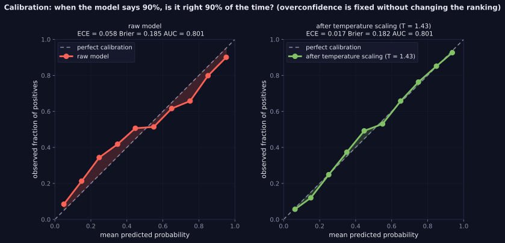
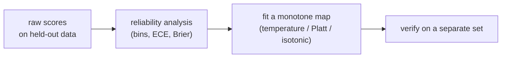

> Tier 2 · Machine Learning Fundamentals · **Level: intermediate** · Reading time: about 11 minutes

# 2.43 Calibration

**Metadata** — Tier: 2 · Phase: 1 · Priority: P0 · Difficulty: 3/5 · Interview: High · Hands-on: High
Prerequisites: 2.14, 2.41, 1.34, 1.37 · Leads to: Tier 15 Evaluation, Tier 30 Evaluation, decision thresholds, abstention

> **In plain words**
> A model is **calibrated** if, among all cases where it says "70% likely", about 70% really happen. A weather forecaster who says "70% rain" should be right on about 70% of those days.
> **A probability is a promise; calibration checks whether the promise is kept.** Many models (especially big neural networks) are **overconfident**: their 90% is really 80%. You can fix this cheaply after training, and the fix changes the numbers **but not the ranking**.

**You need first:** 2.14 Classification, 2.41 ROC/AUC; log-loss (1.37) helps.

> **Figure 2.43-1 — reliability diagrams before and after temperature scaling**
>
> 
>
> *How to read it:* a calibrated model lies on the diagonal. The raw model is **overconfident** (low predictions too low, high predictions too high): ECE 0.058. After dividing the logits by T = 1.43 (fitted on a separate set) the curve follows the diagonal: ECE 0.017, Brier 0.185 → 0.182, and AUC unchanged at 0.801.
>
> *Generated by* `tier-02-ml-fundamentals/figures/src/t2_metrics.py`.

**Words you'll meet on this page**

| Word | What it means here |
|---|---|
| calibrated | predicted probability ≈ observed frequency |
| discrimination | how well scores rank positives above negatives (AUC) |
| reliability diagram | observed rate plotted against predicted probability |
| ECE | expected calibration error: average gap per bin |
| Brier score | mean of `(p − y)²` |
| temperature scaling | divide the logits by `T` |
| Platt scaling | fit a logistic regression on the score |
| isotonic regression | a flexible monotone calibration map |

### 1. What is it?
A probabilistic classifier is **calibrated** if, among predictions with probability `p`, about a fraction `p` are truly positive: `P(y = 1 | p̂ = p) = p`.

### 2. Why does it exist?
Decisions use probabilities directly (expected cost, risk scores, abstention). Uncalibrated scores that look like probabilities mislead.

### 3. Detailed explanation
- **Calibration versus discrimination:** discrimination is ranking (AUC); calibration is the honesty of the numbers. A model can rank perfectly and be badly calibrated, or vice versa. Recalibration changes ECE and Brier but **leaves AUC identical**.
- **Reliability diagram:** bin the predictions, plot the mean predicted probability against the observed positive rate. The diagonal is perfect.
- **Expected calibration error (ECE):** the weighted mean of `|observed rate − predicted probability|` over bins. It depends on the binning; report the bin count.
- **Proper scoring rules** (log-loss, Brier score) reward honest probabilities and combine calibration with sharpness. Brier = mean `(p − y)²`.
- **A common failure: overconfidence** in over-parameterised models, with extremes that are too extreme.
- **Post-hoc fixes** (fit on a *held-out calibration set*, never on training data):
  - **Temperature scaling:** divide the logits by `T` (`T > 1` softens).
  - **Platt scaling:** fit a logistic regression on the logit.
  - **Isotonic regression:** a non-parametric monotone fit (needs more data).
- **Calibration under shift:** calibration drifts with prevalence and covariate changes; correct base rates explicitly (2.50) and monitor calibration in production (2.34).
- **LLMs:** token probabilities from instruction-tuned models are often poorly calibrated; verbalised confidence is unreliable; evaluate before using either as a risk signal (Tiers 15, 30; REVIEW_REQUIRED).
- **Multiclass:** top-label (confidence) calibration or class-wise calibration.

### 4. How does it work?
Collect predictions on held-out data → bin and compare → fit a monotone map from the raw score to a probability → verify on a separate set.



### 5. Simple example
A weather forecaster who says "70% rain" should be right about 70% of those days.

**By hand.** A model made 10 predictions of "0.9": 8 came true. Observed rate 0.8, claimed 0.9: it is overconfident by 0.1 in that bin. If all bins were like this, ECE would be 0.1.

### 6. Technical example
Routing an LLM answer to human review when the predicted error risk exceeds 20% only makes sense if "20%" really means 20%.

### 7. Code
**① By hand (plain Python).** A reliability table.

```python
import random

random.seed(0)
rows = []
for _ in range(20000):
    true_p = random.random()                                 # the real probability of the event
    claimed = min(0.99, max(0.01, 0.5 + 1.6 * (true_p - 0.5)))     # an overconfident model exaggerates
    rows.append((claimed, random.random() < true_p))
print("claimed prob   observed rate   cases")
for lo in (0.0, 0.2, 0.4, 0.6, 0.8):
    sel = [hit for c, hit in rows if lo <= c < lo + 0.2]
    avg = sum(c for c, _ in rows if lo <= c < lo + 0.2) / len(sel)
    print(f"{avg:12.2f}   {sum(sel) / len(sel):13.2f}   {len(sel):5}")
```

```text
claimed prob   observed rate   cases
        0.05            0.15    6267
        0.30            0.37    2502
        0.50            0.52    2503
        0.70            0.61    2496
        0.95            0.84    6232
```

**② With NumPy.** ECE, Brier, and temperature scaling fitted on a held-out set.

```python
import numpy as np

rng = np.random.default_rng(0)
n = 20000
true_logit = rng.normal(0, 2, n)
y = (rng.random(n) < 1 / (1 + np.exp(-true_logit))).astype(int)
raw_logit = 1.8 * true_logit                                  # an overconfident model: logits too large
sigmoid = lambda z: 1 / (1 + np.exp(-z))

def ece(y, p, bins=10):
    idx = np.minimum((p * bins).astype(int), bins - 1)
    return sum(abs(y[idx == b].mean() - p[idx == b].mean()) * (idx == b).mean() for b in range(bins) if (idx == b).any())

fit, test = slice(0, 10000), slice(10000, n)                  # fit T on one half, report on the other
def nll(T): p = sigmoid(raw_logit[fit] / T); return -np.mean(y[fit] * np.log(p) + (1 - y[fit]) * np.log(1 - p))
T = min(np.linspace(0.5, 4, 351), key=nll)
for name, p in (("raw", sigmoid(raw_logit[test])), (f"temperature scaled (T = {T:.2f})", sigmoid(raw_logit[test] / T))):
    print(f"{name:<34} ECE {ece(y[test], p):.4f}   Brier {np.mean((p - y[test]) ** 2):.4f}")
```

```text
raw                                ECE 0.0878   Brier 0.1616
temperature scaled (T = 1.77)      ECE 0.0110   Brier 0.1526
```

**③ With scikit-learn.** A reliability curve, recalibration, and unchanged AUC.

```python
import numpy as np
from sklearn.calibration import calibration_curve
from sklearn.linear_model import LogisticRegression
from sklearn.metrics import roc_auc_score

rng = np.random.default_rng(0)
X = rng.normal(0, 1, (900, 40))
y = (rng.random(900) < 1 / (1 + np.exp(-(1.2 * X[:, 0] + X[:, 1])))).astype(int)
train, calib, test = slice(0, 300), slice(300, 600), slice(600, 900)
model = LogisticRegression(C=1e4, max_iter=5000).fit(X[train], y[train])           # overfits: 40 features, 300 rows
z = model.decision_function(X)
platt = LogisticRegression().fit(z[calib].reshape(-1, 1), y[calib])                # Platt scaling on the calibration set
p_raw = 1 / (1 + np.exp(-z[test]))
p_platt = platt.predict_proba(z[test].reshape(-1, 1))[:, 1]
for name, p in (("raw", p_raw), ("Platt-scaled", p_platt)):
    frac, mean = calibration_curve(y[test], p, n_bins=4, strategy="quantile")
    print(f"{name:<13} predicted {mean.round(2).tolist()} -> observed {frac.round(2).tolist()}   AUC {roc_auc_score(y[test], p):.3f}")
```

```text
raw           predicted [0.09, 0.37, 0.68, 0.92] -> observed [0.15, 0.44, 0.55, 0.79]   AUC 0.772
Platt-scaled  predicted [0.2, 0.42, 0.59, 0.79] -> observed [0.15, 0.44, 0.55, 0.79]   AUC 0.772
```

### 8. Input → Process → Output
`raw scores → reliability analysis → recalibration map → trustworthy probabilities`

<details>
<summary><b>Beyond the basics (sections 9–16)</b> — real-world use, limits, mistakes. Skip on a first read.</summary>

### 9. Enterprise use case
Credit, insurance and medical settings require calibrated risk estimates for pricing and compliance.

### 10. AI engineering connection
Confidence thresholds for answer abstention, retrieval-score thresholds in RAG, guard-rail classifiers, and LLM-judge probabilities.

### 11. Advantages
Makes probabilities usable for cost-based decisions; the post-hoc fixes are cheap.

### 12. Limitations
Needs held-out data; breaks under shift; binning-dependent metrics; class-specific miscalibration may be hidden.

### 13. Trade-offs
Recalibration is cheap but cannot fix poor ranking.

### 14. Common mistakes
Calibrating on training data; treating AUC as if it implied calibration; trusting softmax outputs; using too few bins or examples; never re-checking in production.

### 15. Performance / cost
Fitting a temperature or Platt map is negligible compared with training.

### 16. Security
Overconfident wrong predictions are exploitable; adversarial inputs often yield high confidence.

</details>

### 17. Interview explanation
"Calibration means predicted probabilities match observed frequencies. Discrimination, like AUC, is about ranking and is unaffected by recalibration. Large networks tend to be overconfident, so I fit temperature or Platt scaling on a held-out set, check a reliability diagram plus ECE and Brier, and monitor it because shift breaks it."

### 18. Rapid-fire answer
Calibrated: predicted `p` ≈ observed frequency; check the reliability diagram, ECE and Brier; fix with temperature or Platt scaling on held-out data.

### 19. Interview questions
- **Basic:** What does a reliability diagram show?
- **Intermediate:** Why doesn't recalibration change AUC?
- **Advanced:** Why are deep networks overconfident, and how does temperature scaling work?
- **Scenario:** Your risk model's top decile predicts 0.9 but only 70% are positive. What are the consequences, and what is the fix?

### 20. Hands-on exercise
**Goal:** see how sensitive ECE is to the number of bins.

1. Use the overconfident model from the NumPy example (logits scaled by 1.8).
2. Compute the ECE with 5, 10, 20 and 50 bins.
3. Why does it change?

<details>
<summary>Show a solution</summary>

```python
import numpy as np

rng = np.random.default_rng(0)
n = 20000
true_logit = rng.normal(0, 2, n)
y = (rng.random(n) < 1 / (1 + np.exp(-true_logit))).astype(int)
p = 1 / (1 + np.exp(-1.8 * true_logit))                          # overconfident predictions

def ece(y, p, bins):
    idx = np.minimum((p * bins).astype(int), bins - 1)
    return sum(abs(y[idx == b].mean() - p[idx == b].mean()) * (idx == b).mean() for b in range(bins) if (idx == b).any())

for n_used in (20000, 300):                                       # a big and a small evaluation set
    print(f"{n_used} examples:", "   ".join(f"{b} bins: {ece(y[:n_used], p[:n_used], b):.3f}" for b in (5, 10, 20, 50)))
```

```text
20000 examples: 5 bins: 0.082   10 bins: 0.082   20 bins: 0.083   50 bins: 0.084
300 examples: 5 bins: 0.060   10 bins: 0.076   20 bins: 0.087   50 bins: 0.130
```

With 20,000 examples the ECE is stable across bin counts. With only 300 examples, more bins mean fewer examples per bin, so noise inflates the measured gap; too few bins average real miscalibration away. Always report the bin count (and the sample size).
</details>

### 21. Revision questions
1. What is the difference between calibration and discrimination?
2. How is ECE defined?
3. Name two post-hoc calibration methods.

### 22. Related concepts
2.41 ROC/AUC · 1.37 Cross-entropy · 2.34 Distribution shift · 2.50 Dataset imbalance · Tiers 15 and 30

### 23. One-line memory hook
**A probability is a promise; calibration checks whether it's kept.**

<details>
<summary><b>For reviewers</b> (not part of the lesson)</summary>

- Status: DRAFT, learner-first layout (Author: Claude). Code is executed by `tests/test_md_snippets.py`.
- TESTED earlier: `test_calibration_metrics_and_overconfidence`, `test_calibration_fix_changes_probabilities_not_ranking` (40 features, 300 training samples: raw ECE 0.0576, Brier 0.1851; temperature scaling (T = 1.43) → ECE 0.0170, Brier 0.1819; Platt → ECE 0.0167; AUC unchanged at 0.801); Brier vs scikit-learn. Figure numbers are from the figure script; the page's snippets use different data.
- LLM-calibration remarks remain REVIEW_REQUIRED.
</details>
