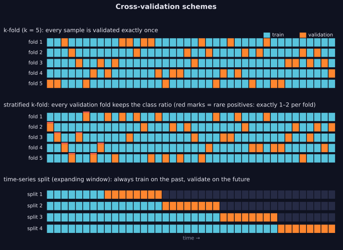
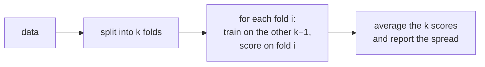

> Tier 2 · Machine Learning Fundamentals · **Level: beginner** · Reading time: about 10 minutes

# 2.44 Cross-validation

**Metadata** — Tier: 2 · Phase: 1 · Priority: P0 · Difficulty: 2/5 · Interview: Very high · Hands-on: Very high
Prerequisites: 2.12, 2.13, 2.33 · Leads to: 2.36 Tuning, 2.31 Generalisation, Tier 30 Evaluation

> **In plain words**
> **Cross-validation (CV)** gets a **steadier performance estimate from limited data**. Cut the data into `k` equal parts (**folds**). Train on `k − 1` of them, test on the one left out; rotate until every part has been the test part once; average the scores.
> Five study groups take turns being the quiz audience while the other four study. Every row gets to be the exam once, but never while it is also in the textbook.

**You need first:** 2.12 Validation set, 2.13 Test set, 2.33 Data leakage.

> **Figure 2.44-1 — k-fold, stratified and time-series splits**
>
> 
>
> *How to read it:* each strip is the dataset; orange cells are validation and blue cells training. In **k-fold** every example is validated once. **Stratified** folds spread the rare positives (red) evenly. In the **time-series** split the training window always ends before the validation window starts.
>
> *Generated by* `tier-02-ml-fundamentals/figures/src/t2_metrics.py`. The index sets are drawn from `mlkit.kfold_indices` and `mlkit.time_series_splits`.

**Words you'll meet on this page**

| Word | What it means here |
|---|---|
| fold | one of the `k` parts of the data |
| k-fold CV | rotate which fold is held out |
| leave-one-out | `k = n` |
| stratified | keeps class proportions in every fold |
| group k-fold | keeps all rows of a user/patient in one fold |
| time-series split | train on the past, validate on the next block |
| nested CV | an inner loop tunes, an outer loop evaluates |

### 1. What is it?
Estimating generalisation by **splitting the data into `k` folds**, training on `k − 1` folds and validating on the held-out fold, rotating until every fold has served as validation; the scores are averaged.

### 2. Why does it exist?
With limited data a single validation split is noisy and wastes data. Cross-validation uses every example for both training and validation (never at the same time).

### 3. Detailed explanation
- **k-fold:** each example is validated exactly once. Typical `k` is 5 or 10. A larger `k` means less pessimistic bias but more compute; `k = n` is leave-one-out.
- **Variance reduction:** with 100 examples, a single 70/30 hold-out gives an estimate that varies a lot from split to split; 5-fold CV varies far less (see the experiment below).
- **Stratified k-fold** keeps the class proportions in each fold. Essential for imbalance (2.45).
- **Group k-fold** keeps all rows of a group (user, patient, document) in one fold (2.10).
- **Time-series CV (expanding window)** trains on the past and validates on the next block. For time-ordered data, random k-fold is optimistic.
- **All preprocessing inside the fold:** scalers, imputers, feature selection, target encoding and resampling are fitted on the training part only (2.33).
- **CV for model selection versus error estimation:** choosing hyper-parameters by CV makes the best CV score optimistic; use **nested CV** or a final test set for an honest estimate (2.36).
- **Report the mean and the spread** (standard deviation across folds, or repeated CV). Folds are not independent, so the naive standard error understates uncertainty.
- **Not suitable when** training is very expensive (LLM fine-tuning); use a single large validation set instead.

### 4. How does it work?
Create folds (stratified, grouped or time-aware as needed) → for each fold: fit the preprocessing and the model on the training folds, score on the validation fold → aggregate.



### 5. Simple example
Five study groups take turns being the quiz audience while the other four study.

**By hand: 10 examples, 5 folds.** Fold 1 validates examples {0, 1}, fold 2 validates {2, 3}, and so on. Every example appears in exactly one validation fold, and each fold trains on the other 8.

### 6. Technical example
5×2 repeated stratified CV to compare two models on a 3,000-row dataset; time-series CV for demand forecasting.

### 7. Code
**① By hand (plain Python).** Build the folds and check the "every row validated once" property.

```python
import random

def kfold(n, k, seed=0):
    idx = list(range(n))
    random.Random(seed).shuffle(idx)
    folds = [idx[i::k] for i in range(k)]                     # k roughly equal parts
    for i in range(k):
        train = [j for f in range(k) if f != i for j in folds[f]]
        yield train, folds[i]

splits = list(kfold(10, 5))
for i, (train, val) in enumerate(splits, 1):
    print(f"fold {i}: validate on {sorted(val)}, train on {len(train)} examples")
validated = sorted(j for _, val in splits for j in val)
print("every example validated exactly once:", validated == list(range(10)))
```

```text
fold 1: validate on [4, 7], train on 8 examples
fold 2: validate on [2, 8], train on 8 examples
fold 3: validate on [0, 1], train on 8 examples
fold 4: validate on [5, 9], train on 8 examples
fold 5: validate on [3, 6], train on 8 examples
every example validated exactly once: True
```

**② With NumPy and scikit-learn.** A single hold-out versus 5-fold: how steady are they?

```python
import numpy as np
from sklearn.linear_model import LogisticRegression
from sklearn.model_selection import KFold, cross_val_score, train_test_split

holdout, cv5 = [], []
for seed in range(30):
    rng = np.random.default_rng(seed)
    y = np.arange(100) % 2
    X = rng.normal(0, 1, (100, 5)) + 0.6 * y[:, None]
    Xa, Xb, ya, yb = train_test_split(X, y, test_size=0.3, random_state=seed)
    holdout.append(LogisticRegression().fit(Xa, ya).score(Xb, yb))
    cv5.append(cross_val_score(LogisticRegression(), X, y, cv=KFold(5, shuffle=True, random_state=seed)).mean())
print(f"single 70/30 hold-out: mean {np.mean(holdout):.3f}  std over 30 repeats {np.std(holdout):.3f}")
print(f"5-fold cross-validation: mean {np.mean(cv5):.3f}  std over 30 repeats {np.std(cv5):.3f}")
```

```text
single 70/30 hold-out: mean 0.697  std over 30 repeats 0.095
5-fold cross-validation: mean 0.722  std over 30 repeats 0.044
```

**③ With scikit-learn.** Stratified folds, and time-aware folds for ordered data.

```python
import numpy as np
from sklearn.model_selection import StratifiedKFold, TimeSeriesSplit
from sklearn.neighbors import KNeighborsRegressor

y = np.array([0] * 90 + [1] * 10)
for i, (tr, va) in enumerate(StratifiedKFold(5, shuffle=True, random_state=0).split(np.zeros(100), y), 1):
    print(f"stratified fold {i}: {int(y[va].sum())} rare positives in {len(va)} validation rows")

rng = np.random.default_rng(0)
t = np.arange(400).reshape(-1, 1)
series = np.cumsum(rng.normal(0, 1, 400))                              # a random walk
model = KNeighborsRegressor(1)
random_mse, forward_mse = [], []
from sklearn.model_selection import KFold
for tr, va in KFold(4, shuffle=True, random_state=0).split(t):
    random_mse.append(np.mean((model.fit(t[tr], series[tr]).predict(t[va]) - series[va]) ** 2))
for tr, va in TimeSeriesSplit(4).split(t):
    forward_mse.append(np.mean((model.fit(t[tr], series[tr]).predict(t[va]) - series[va]) ** 2))
print("random folds MSE:", round(float(np.mean(random_mse)), 2), "  forward-in-time folds MSE:", round(float(np.mean(forward_mse)), 2))
```

```text
stratified fold 1: 2 rare positives in 20 validation rows
stratified fold 2: 2 rare positives in 20 validation rows
stratified fold 3: 2 rare positives in 20 validation rows
stratified fold 4: 2 rare positives in 20 validation rows
stratified fold 5: 2 rare positives in 20 validation rows
random folds MSE: 1.11   forward-in-time folds MSE: 9.55
```

### 8. Input → Process → Output
`data → folds → (train on k−1, validate on 1) × k → mean ± spread`

<details>
<summary><b>Beyond the basics (sections 9–16)</b> — real-world use, limits, mistakes. Skip on a first read.</summary>

### 9. Enterprise use case
CV scores with their spread are required in model cards for tabular models; platforms provide group- and time-aware splitters.

### 10. AI engineering connection
Used for classifiers and re-rankers on small labelled sets; for LLM evaluation use fixed, versioned dev and test sets with bootstrap intervals instead.

### 11. Advantages
Efficient use of data; steadier estimates; the basis for model selection.

### 12. Limitations
`k` times the training cost; invalid if examples are dependent and folds ignore groups or time; folds are correlated.

### 13. Trade-offs
Larger `k`: less bias, more variance in fold scores, more compute.

### 14. Common mistakes
Preprocessing before splitting; random folds for time-ordered or grouped data; selecting a model by CV and then quoting its CV score as the final performance; ignoring fold-to-fold spread.

### 15. Performance / cost
Cost is proportional to `k`; run folds in parallel.

### 16. Security
CV does not protect against leakage through duplicates or test contamination; de-duplicate first.

</details>

### 17. Interview explanation
"Cross-validation rotates validation across k folds to get a steadier estimate from limited data. I stratify for imbalance, group by entity, use forward-in-time folds for temporal data, and fit all preprocessing inside each fold. Because choosing by CV is optimistic, I confirm on an untouched test set or use nested CV."

### 18. Rapid-fire answer
k-fold: train on `k − 1`, validate on 1, rotate; stratify, group and time-aware variants; preprocess inside folds; nested CV for honest tuning.

### 19. Interview questions
- **Basic:** Describe 5-fold CV.
- **Intermediate:** Why is stratification needed for imbalanced data?
- **Advanced:** Why are CV folds' scores not independent, and what does that mean for confidence intervals?
- **Scenario:** CV AUC is 0.95 but production is 0.70, and the data is customer transactions over three years. What went wrong?

### 20. Hands-on exercise
**Goal:** do nested cross-validation to choose ridge `α` and see the optimism.

1. Make 80 examples with 30 features of which 3 matter.
2. The *inner* loop picks the best ridge `α` by 5-fold CV (`RidgeCV` can do that).
3. The *outer* loop scores the whole procedure with 5-fold CV. Compare the inner best score with the outer estimate.

<details>
<summary>Show a solution</summary>

```python
import numpy as np
from sklearn.linear_model import Ridge, RidgeCV
from sklearn.model_selection import GridSearchCV, KFold, cross_val_score

rng = np.random.default_rng(0)
X = rng.normal(0, 1, (80, 30))
y = 2 * X[:, 0] - 1.5 * X[:, 1] + X[:, 2] + rng.normal(0, 2, 80)
alphas = [0.01, 0.1, 1, 10, 100, 1000]

inner = GridSearchCV(Ridge(), {"alpha": alphas}, cv=KFold(5, shuffle=True, random_state=0), scoring="neg_mean_squared_error").fit(X, y)
print("best inner CV error (optimistic):", round(-inner.best_score_, 3), " alpha:", inner.best_params_["alpha"])

outer = cross_val_score(GridSearchCV(Ridge(), {"alpha": alphas}, cv=5, scoring="neg_mean_squared_error"), X, y,
                        cv=KFold(5, shuffle=True, random_state=1), scoring="neg_mean_squared_error")
print("nested CV error (honest)         :", round(-outer.mean(), 3))
```

```text
best inner CV error (optimistic): 5.27  alpha: 10
nested CV error (honest)         : 4.178
```

</details>

### 21. Revision questions
1. Why is CV steadier than a hold-out?
2. What is the time-series variant?
3. What goes inside the fold?

### 22. Related concepts
2.12 Validation · 2.33 Data leakage · 2.36 Hyper-parameter tuning · 2.45 Class imbalance

### 23. One-line memory hook
**Every row gets to be the exam once, but never while it is also in the textbook.**

<details>
<summary><b>For reviewers</b> (not part of the lesson)</summary>

- Status: DRAFT, learner-first layout (Author: Claude). Code is executed by `tests/test_md_snippets.py`.
- TESTED earlier: `test_kfold_partitions_and_stratification`, `test_time_series_splits_never_train_on_the_future`, `test_cross_validation_reduces_estimate_variance_and_respects_time` (n = 100, 30 repeats: hold-out std 0.083 vs 5-fold 0.0066, over 12× steadier; MSE 0.189 random folds vs 0.405 forward folds; selecting features on all data then CV gives 90% on pure noise). The page's snippets use different generators, so numbers differ.
</details>
