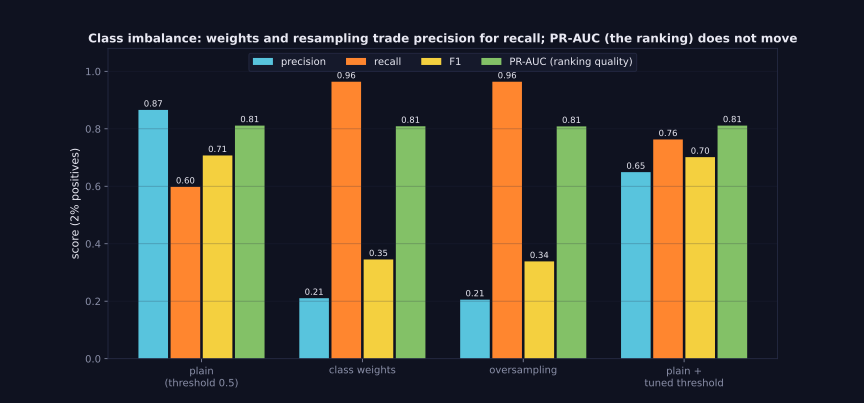

> Tier 2 — Machine Learning Fundamentals · Status: DRAFT (Author: Claude) · Code: `code/mlkit.py`, `lab/lab_04_metrics_and_data.py` — TESTED

# 2.45 Class imbalance

**Metadata** — Tier: 2 · Phase: 1 · Priority: P0 · Difficulty: 2/5 · Interview: Very high · Hands-on: Very high
Prerequisites: 2.14, 2.37–2.41 · Leads to: 2.50 Dataset imbalance, 2.51 Metric selection, fraud/safety systems

### 1. What is it?
A classification problem where **one class is much rarer than the others**, such as 2% fraud or 0.1% defects. This concept covers the *modelling and metric consequences*; 2.50 covers the *dataset-level* aspects (sampling, prevalence, calibration).

### 2. Why does it exist?
Standard training and accuracy favour the majority class; rare classes are often the ones that matter.

### 3. Detailed explanation
- **Symptoms:** high accuracy but near-zero recall on the rare class (2.37); predicted probabilities that rarely exceed 0.5 for positives.
- **Metrics:** prefer precision, recall, F1, PR-AUC/average precision, balanced accuracy, and cost-based measures; report per-class results (2.38–2.42).
- **Levers** (2% positives, 10,000 train / 10,000 test, same model family):
  | method | precision | recall | F1 | PR-AUC | accuracy |
  |---|---|---|---|---|---|
  | plain logistic regression | 0.866 | 0.598 | **0.707** | 0.811 | 0.990 |
  | class weights (balanced) | 0.210 | 0.964 | 0.345 | 0.809 | 0.929 |
  | random oversampling | 0.205 | 0.964 | 0.338 | 0.809 | 0.927 |
  | plain + tuned threshold | 0.649 | 0.763 | 0.701 | 0.811 | 0.987 |
- **Key lesson:** weights and resampling **move the operating point, they do not improve the ranking** (PR-AUC unchanged at ≈ 0.81). Here they trade precision for recall; F1 actually *falls* because the default threshold is no longer appropriate. Tuning the threshold on the plain model achieves a similar trade-off more cheaply. Choose the operating point from costs (2.51).
- **Techniques:** class weights / cost-sensitive losses; oversampling (random, SMOTE-style interpolation); undersampling the majority; threshold moving; focal loss; ensembling with balanced bootstrap; anomaly-detection framing when positives are extremely rare; collecting more positives / active learning.
- **Resample only the training fold,** after splitting (otherwise duplicates leak into evaluation, 2.33). Never resample validation/test data if you want production-representative metrics.
- **Probabilities become miscalibrated** after resampling or weighting; correct the prior or recalibrate (2.43, 2.50).
- **Multiclass imbalance:** use macro-F1/per-class recall; stratified splits (2.10).
- **Definitions of 'rare':** think in absolute numbers of positives, not just the ratio: 100 positives out of 10,000 is a very different learning problem from 100,000 out of 10,000,000.

### 4. How does it work?
Quantify prevalence → pick suitable metrics → baseline (majority) → try threshold tuning, weights, resampling → compare at the cost-based operating point on an untouched, representative validation set.

> **Figure 2.45-1 — imbalance methods move the operating point**



*How to read it:* With 2% positives: class weights and oversampling raise recall (0.60 → 0.96) at the expense of precision (0.87 → 0.21) and F1 (0.71 → 0.35), while PR-AUC, the quality of the ranking, stays at 0.81 for every method. Tuning the threshold on the plain model reaches a good trade-off (F1 0.70) without changing the model.

*Generated by* `tier-02-ml-fundamentals/figures/src/t2_metrics.py` *from this chapter's code, so the numbers are computed, not typed in.*

### 5. Simple example
Finding a few needles in a haystack: counting 'hay correctly identified' doesn't help.

### 6. Technical example
Credit-card fraud with 0.2% positives; rare-defect detection in manufacturing; harmful-content classification.

### 7. Code
```python
import mlkit as M
w = M.balanced_class_weights(y_train)                      # {0: 0.51, 1: 25.7} for 2% positives
m = M.LogisticRegression(class_weight=w).fit(Xs, y_train)   # shifts the operating point
Xo, yo = M.random_oversample(Xs, y_train)                  # only after the split, only on training data
t, f1 = M.best_f1_threshold(y_val, p_val)                   # often the cheapest fix
```
TESTED (`ex_2_45` via `test_class_imbalance_methods_move_operating_point_not_ranking`; `test_accuracy_paradox_and_class_weights`, `test_oversample_balances_and_threshold_tuning_improves_f1`).

### 8. Input → Process → Output
`rare positives → biased training signal → adjust loss/data/threshold → evaluate with PR-oriented metrics`

### 9. Enterprise use case
Fraud, safety, security and quality teams work with prevalence-aware metrics, review capacities and threshold policies, not accuracy.

### 10. AI engineering connection
Guardrail classifiers, rare-intent routers, hallucination detectors, jailbreak detection: all severely imbalanced; evaluation sets are often built by oversampling positives (then prevalence-corrected).

### 11. Advantages
Relatively cheap fixes exist; the main gain is choosing the right metrics and threshold.

### 12. Limitations
Weights/resampling don't create information; very few positives limit any method.

### 13. Trade-offs
Recall vs precision (review load); over/undersampling vs information loss/overfitting.

### 14. Common mistakes
Reporting accuracy; oversampling before the split; evaluating on a rebalanced set and quoting production precision; ignoring calibration shift; believing weights improve ranking.

### 15. Performance / cost
Oversampling inflates training time; undersampling saves it.

### 16. Security
Adversaries target the rare class (new fraud patterns); monitor and refresh positives continuously.

### 17. Interview explanation
"With a rare class, accuracy is useless, so I use PR-AUC, recall and precision at a chosen operating point, and cost-based thresholds. Class weights and resampling shift the operating point rather than improving ranking; often a tuned threshold on a well-calibrated model does just as well. I resample only inside the training split and correct probabilities afterwards."

### 18. Rapid-fire
Rare class: use PR-AUC/recall/precision; weights & resampling move the threshold, not the ranking; resample after splitting.

### 19. Interview questions
- Basic: Why is accuracy misleading with 1% positives?
- Intermediate: Compare class weights, oversampling and threshold tuning.
- Advanced: Why do weights leave PR-AUC unchanged yet change F1 at 0.5?
- Scenario: 40 positives total. What can and can't you do?

### 20. Hands-on exercise
Implement SMOTE-like interpolation between positive neighbours and compare with random oversampling on the lab data.

### 21. Revision questions
1) Best metrics? 2) Effect of weights on ranking? 3) When to resample?

### 22. Related concepts
2.37 Accuracy · 2.41 ROC/AUC · 2.43 Calibration · 2.50 Dataset imbalance · 2.51 Metric selection

### 23. Memory hook
**Imbalance changes the metric and the threshold, not the model's intelligence.**
