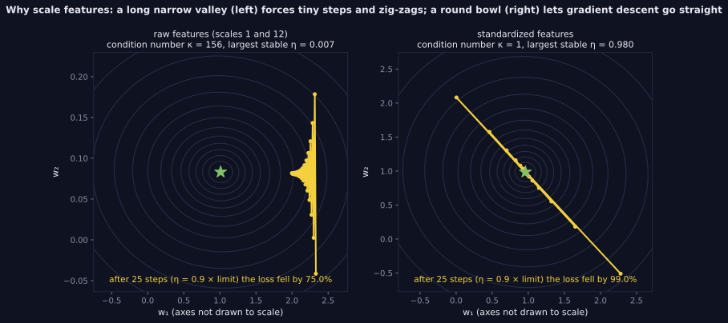

> Tier 2 — Machine Learning Fundamentals · Status: DRAFT (Author: Claude) · Code: `code/mlkit.py`, `lab/lab_04_metrics_and_data.py` — TESTED

# 2.47 Feature scaling and normalization

**Metadata** — Tier: 2 · Phase: 1 · Priority: P0 · Difficulty: 1/5 · Interview: High · Hands-on: Very high
Prerequisites: 2.7, 1.30, 1.31 · Leads to: 2.25 Learning rate, 2.16 Clustering, 2.32 Regularization, Tier 3 Normalization layers

### 1. What is it?
Rescaling numeric features to comparable ranges: **standardization** `(x−μ)/σ`, **min–max** `(x−min)/(max−min)`, **robust scaling** `(x−median)/IQR`, plus transformations such as `log` for skew.

### 2. Why does it exist?
Features on very different scales distort distances, gradient-descent conditioning and penalties.

### 3. Detailed explanation
- **When it matters:** gradient-based training (conditioning, learning-rate limit), distance-based methods (k-means, k-NN), regularized models (penalties depend on coefficient size), PCA. **When it doesn't:** ordinary least squares predictions (coefficients rescale; predictions are identical, tested), tree-based models (splits are order-based).
- **Effect on optimization:** two features with scales 1 and 100: the largest stable learning rate drops ~840× (2.25) and gradient descent at that rate has not reached loss 0.02 in 400 epochs; after standardization it takes **14 epochs**.
- **Outlier behaviour:** with one extreme value (10,000 vs data around 50±10), the spread of the *ordinary points* after scaling is 0.031 (standard), **0.001 (min–max)** and 0.745 (robust). Min–max squashes everything; robust scaling keeps the bulk usable. Robust scaler matches scikit-learn.
- **Skew:** log-normal data has skewness 5.17; after `log` it is 0.04. Use `log1p` when zeros are possible.
- **Fit on training data only** (2.33) and apply the same parameters to validation, test and production; do not re-fit at inference. Persist the fitted scaler with the model.
- **Constant features** have zero variance: guard the division (our scalers leave them unscaled).
- **Min–max with unseen extremes** produces values outside [0,1] in production; decide on clipping.
- **Normalization has other meanings:** L2-normalizing each *sample* (unit vectors for cosine similarity, 1.17), batch/layer normalization of *activations* inside networks (Tier 3: 3.30–3.32), and database normalization. This concept covers feature scaling.
- **Categorical features** are encoded, not scaled (2.48, 2.49).

### 4. How does it work?
Compute statistics on the training set → transform every split with those statistics → store parameters with the model.

> **Figure 2.47-1 — scaling reshapes the loss surface**



*How to read it:* Same regression, features on scales 1 and 12 (left) versus standardized (right). The raw problem has condition number 156 and largest stable learning rate 0.007; the standardized one has condition number 1 and limit 0.98. With the learning rate set to 0.9× each problem's own limit, 25 steps reduce the loss by 75% (raw) versus 99% (standardized). The axes on the left are not drawn to scale.

*Generated by* `tier-02-ml-fundamentals/figures/src/t2_training.py` *from this chapter's code, so the numbers are computed, not typed in.*

### 5. Simple example
Converting inches, kilometres and dollars into comparable units before measuring distances.

### 6. Technical example
Standardize numeric inputs before logistic regression with L2 penalty; log-transform price; use robust scaling for sensor data with spikes.

### 7. Code
```python
import mlkit as M
from lab_04_metrics_and_data import RobustScaler, ex_2_47
sc = M.StandardScaler().fit(X_train); Xtr, Xte = sc.transform(X_train), sc.transform(X_test)
print(ex_2_47()['epochs_to_loss_below_0.02'])      # {'raw_scales_1_and_100': None, 'standardized': 14}
```
TESTED (`test_scaling_effects`, `test_robust_scaler_matches_sklearn`, `test_scalers_fit_on_train_only_and_constant_column`).

### 8. Input → Process → Output
`raw features → (x − center)/scale with training statistics → comparable features`

### 9. Enterprise use case
Feature-store transformations are versioned; training and serving share the same scaler artifact.

### 10. AI engineering connection
Embedding normalization for cosine search; input standardization for small models; understanding why LayerNorm exists in Transformers (Tier 3).

### 11. Advantages
Faster, more stable training; fair distance and penalty behaviour.

### 12. Limitations
Sensitive to outliers (standard, min–max); changes interpretability of coefficients; must be applied consistently.

### 13. Trade-offs
Standardization (assumes outliers are rare) vs robust (resists outliers, ignores tail scale) vs min–max (bounded but fragile).

### 14. Common mistakes
Fitting on all data; re-fitting at inference; scaling categorical codes; forgetting to scale the new feature after adding it; min–max with outliers.

### 15. Performance / cost
`O(nd)` to fit; negligible.

### 16. Security
Scaler statistics are derived from data; they can leak aggregate information if shared.

### 17. Interview explanation
"I scale features when the algorithm depends on distances, gradient conditioning or penalty size. Standardization is the default, robust scaling when outliers exist, log transforms for heavy skew; I fit the scaler on the training set only and ship it with the model. Trees and plain least squares don't need it."

### 18. Rapid-fire
Standardize/min-max/robust (+log for skew); fit on train only; matters for GD, distances, penalties; not for trees/OLS predictions.

### 19. Interview questions
- Basic: Standardization vs min–max?
- Intermediate: Why does scaling speed up gradient descent?
- Advanced: Why is OLS prediction invariant to scaling while ridge isn't?
- Scenario: Production data contains values 10× larger than training max. What happens with min–max scaling and how do you guard it?

### 20. Hands-on exercise
Compare k-means cluster agreement and ridge test error with no scaling, standard, robust scaling on data with outliers.

### 21. Revision questions
1) Three scalers? 2) When unnecessary? 3) Why train-only fit?

### 22. Related concepts
2.25 Learning rate · 2.32 Regularization · 2.16 Clustering · 2.33 Data leakage · Tier 3 Normalization

### 23. Memory hook
**Put every feature on a comparable ruler — measured with the training set's ruler only.**
