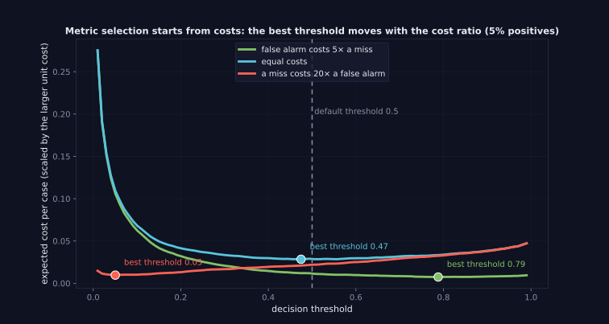
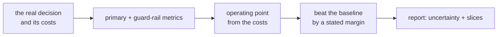

> Tier 2 · Machine Learning Fundamentals · **Level: intermediate** · Reading time: about 11 minutes

# 2.51 Metric selection

**Metadata** — Tier: 2 · Phase: 1 · Priority: P0 · Difficulty: 2/5 · Interview: Very high · Hands-on: High
Prerequisites: 2.37–2.50 · Leads to: Tier 15 and 30 Evaluation, Tier 36 Cost engineering

> **In plain words**
> **Metric selection** means choosing **what to measure from the real decision, its costs and its constraints**, not from what is easiest to compute. You optimise what you measure, so a mismatched metric gives you a model that wins the benchmark and loses the business.
> The punchline: **two models can rank cases identically and still "win" or "lose" depending on the threshold and on how much each kind of error costs.** So decide the metric, the threshold and the uncertainty reporting *before* you run experiments.

**You need first:** the metric pages 2.37–2.43 and baselines (2.46).

> **Figure 2.51-1 — the best threshold moves with the costs**
>
> 
>
> *How to read it:* for the same model on data with 5% positives, the cost-minimising threshold depends on what errors cost: **0.79** when a false alarm costs five times a miss, **0.47** when costs are equal, and **0.05** when a miss costs twenty times a false alarm. The default 0.5 is right only for one of these cases.
>
> *Generated by* `tier-02-ml-fundamentals/figures/src/t2_metrics.py`.

**Words you'll meet on this page**

| Word | What it means here |
|---|---|
| primary metric | the one decision-linked number you optimise |
| guard-rail metric | a limit you must not break (latency, cost, fairness) |
| operating point | the chosen threshold |
| slice | a subgroup (segment, language, region) reported separately |
| Goodhart's law | a measure that becomes a target stops being a good measure |
| NDCG / precision@k | ranking metrics for retrieval |
| MASE | forecast error relative to a naive forecast |

### 1. What is it?
Choosing the **evaluation metric(s) that reflect the real decision, costs and constraints**, plus the threshold or operating point and the uncertainty reporting.

### 2. Why does it matter?
You optimise what you measure. A mismatched metric yields a model that wins the benchmark and loses the business.

### 3. Detailed explanation
**A decision guide**

| Situation | Metric(s) |
|---|---|
| Balanced classes, equal costs | accuracy, macro-F1 |
| Rare positives, misses costly | recall at a precision floor, PR-AUC (average precision) |
| False alarms costly (review queue, blocking users) | precision at a recall floor |
| Ranking quality (re-rankers, risk scores) | ROC-AUC, precision@k, recall@k, NDCG |
| Probabilities used in decisions | log-loss, Brier score, ECE (calibration) |
| Regression, outliers matter | RMSE; robust: MAE, Huber loss; relative: MAPE (careful near 0) |
| Forecasting | compare with a naive baseline (MASE-style), prediction intervals |
| Multiclass with a long tail | macro-F1, per-class recall |

- **Ranking versus operating point:** a plain and a class-weighted logistic regression have the **same ROC-AUC and PR-AUC** (they rank identically), yet at a fixed threshold 0.5 they differ a lot in F1 and log-loss. The metric you choose decides which model "wins".
- **Costs flip the winner.** If a miss is much costlier than a false alarm, the class-weighted model's operating point is cheaper; if false alarms are costlier, the plain model is. The answer comes from the cost ratio, not from a leaderboard.
- **The cost-optimal threshold** for a calibrated model with costs `c_FN` (miss) and `c_FP` (false alarm) is `t* = c_FP/(c_FP + c_FN)`: flag a case when its probability is above `t*`.
- **Use a small set of metrics:** one primary (decision-linked), a few guard-rails (latency, cost, fairness slices, calibration), and report uncertainty (bootstrap intervals).
- **Report on slices** (segments, languages, user groups), because averages hide failures.
- **Goodhart's law and metric hacking:** once a metric becomes a target it stops being a good measure; use held-out evaluation sets and refresh them periodically.
- **LLM applications:** task success rate, groundedness or faithfulness, retrieval recall@k, latency and cost per task, human preference win rate, calibrated judge agreement (Tier 30); choose them before building.
- **Decide the metric before running experiments,** to avoid picking the metric that flatters the result.

### 4. How does it work?
Define the decision and its costs → choose primary and guard-rail metrics → choose the operating point from costs → set success thresholds against the baseline (2.46) → report with uncertainty and slices.



### 5. Simple example
You judge a delivery service by "delivered on time", not by how fast the van's engine is.

**The cost-optimal threshold, by hand.** A fraud model whose scores are calibrated probabilities.

| A miss costs | A false alarm costs | `t* = c_FP/(c_FP + c_FN)` | what you do |
|---|---|---|---|
| 1 | 5 | 5/6 ≈ 0.83 | flag only the near-certain cases |
| 1 | 1 | 0.50 | the default |
| 20 | 1 | 1/21 ≈ 0.05 | flag almost anything suspicious |

### 6. Technical example
Fraud: maximise recall subject to the review capacity (a precision floor) using a calibrated score. RAG: retrieval recall@5, answer faithfulness, p95 latency and cost per answer.

### 7. Code
**① By hand (plain Python).** The best threshold from the costs, checked by brute force.

```python
import random

random.seed(0)
cases = [(p, random.random() < p) for p in (random.random() ** 3 for _ in range(20000))]      # calibrated scores, rare positives

def total_cost(t, c_miss, c_false_alarm):
    cost = 0
    for p, y in cases:
        flagged = p > t
        cost += c_miss * (y and not flagged) + c_false_alarm * ((not y) and flagged)
    return cost

for c_miss, c_fa in ((1, 5), (1, 1), (20, 1)):
    best = min((t / 100 for t in range(1, 100)), key=lambda t: total_cost(t, c_miss, c_fa))
    print(f"miss costs {c_miss:>2}, false alarm costs {c_fa}: best threshold {best:.2f}   formula {c_fa / (c_fa + c_miss):.2f}")
```

```text
miss costs  1, false alarm costs 5: best threshold 0.84   formula 0.83
miss costs  1, false alarm costs 1: best threshold 0.48   formula 0.50
miss costs 20, false alarm costs 1: best threshold 0.05   formula 0.05
```

**② With NumPy and scikit-learn.** Same ranking, different winners.

```python
import numpy as np
from sklearn.linear_model import LogisticRegression
from sklearn.metrics import average_precision_score, f1_score, log_loss, roc_auc_score

rng = np.random.default_rng(0)
def data(n):
    y = (rng.random(n) < 0.05).astype(int)
    return rng.normal(0, 1, (n, 4)) + 1.3 * y[:, None], y
Xtr, ytr = data(20000)
Xte, yte = data(20000)
plain = LogisticRegression().fit(Xtr, ytr)
weighted = LogisticRegression(class_weight="balanced").fit(Xtr, ytr)

def cost(p, c_miss, c_fa, t=0.5):
    pred = p > t
    return (c_miss * ((yte == 1) & ~pred).sum() + c_fa * ((yte == 0) & pred).sum()) / len(yte)

print(f"{'':<10}{'ROC-AUC':>9}{'PR-AUC':>9}{'F1@0.5':>8}{'log-loss':>10}{'cost 20:1':>11}{'cost 1:5':>10}")
for name, m in (("plain", plain), ("weighted", weighted)):
    p = m.predict_proba(Xte)[:, 1]
    print(f"{name:<10}{roc_auc_score(yte, p):9.3f}{average_precision_score(yte, p):9.3f}{f1_score(yte, p > 0.5):8.3f}{log_loss(yte, p):10.3f}{cost(p, 20, 1):11.3f}{cost(p, 1, 5):10.3f}")
```

```text
            ROC-AUC   PR-AUC  F1@0.5  log-loss  cost 20:1  cost 1:5
plain         0.970    0.776   0.680     0.078      0.428     0.056
weighted      0.971    0.777   0.491     0.233      0.168     0.474
```

**③ With NumPy.** Report uncertainty: a bootstrap interval and a per-slice view.

```python
import numpy as np
from sklearn.metrics import recall_score

rng = np.random.default_rng(0)
n = 3000
segment = rng.integers(0, 3, n)                                  # three customer segments
y = (rng.random(n) < 0.1).astype(int)
catch = np.where(segment == 2, 0.45, 0.85)                       # the model misses most positives in segment 2
pred = ((rng.random(n) < catch) & (y == 1)).astype(int)

boot = [recall_score(y[i], pred[i]) for i in (rng.integers(0, n, n) for _ in range(500))]
print(f"overall recall {recall_score(y, pred):.3f}   95% bootstrap interval ({np.percentile(boot, 2.5):.3f}, {np.percentile(boot, 97.5):.3f})")
for s in range(3):
    m = segment == s
    print(f"  segment {s}: recall {recall_score(y[m], pred[m]):.3f}  ({int(y[m].sum())} positives)")
```

```text
overall recall 0.717   95% bootstrap interval (0.673, 0.767)
  segment 0: recall 0.807  (109 positives)
  segment 1: recall 0.846  (104 positives)
  segment 2: recall 0.495  (105 positives)
```

### 8. Input → Process → Output
`business decision + costs → metric(s) + operating point → model comparison → monitoring`

<details>
<summary><b>Beyond the basics (sections 9–16)</b> — real-world use, limits, mistakes. Skip on a first read.</summary>

### 9. Enterprise use case
Model cards document the primary metric, its business link, thresholds, slices and monitoring plan; release gates are metric-based.

### 10. AI engineering connection
Eval-first design for LLM apps: define the golden dataset and the metrics before the prompts; track quality, cost and latency together (Tiers 30, 36).

### 11. Advantages
Keeps work aligned with value; prevents benchmark chasing.

### 12. Limitations
Real costs are often uncertain; offline metrics only approximate online impact.

### 13. Trade-offs
One metric (clarity) versus several (coverage); precision versus recall; accuracy versus fairness and robustness slices.

### 14. Common mistakes
Using accuracy by default; choosing the metric after seeing the results; ignoring costs and thresholds; reporting one aggregate number without slices or uncertainty; a mismatch with online metrics.

### 15. Performance / cost
Some metrics (bootstrap intervals, human evaluation) are expensive; plan the evaluation budget.

### 16. Security
Safety and abuse metrics (attack success rate, refusal rate on harmful prompts) belong in the metric suite (Tier 32).

</details>

### 17. Interview explanation
"I pick metrics from the decision and its costs: recall at a precision floor for rare, costly events; PR-AUC for ranking under imbalance; log-loss or Brier when probabilities drive decisions. Two models can rank identically yet win or lose depending on the threshold and the cost ratio, so I set the operating point from costs, report slices and uncertainty, and confirm with an online test."

### 18. Rapid-fire answer
Metric = decision + costs + operating point; ranking, threshold and probability metrics are different families; costs flip the winner; report slices and uncertainty.

### 19. Interview questions
- **Basic:** Which metric for a rare-event detector, and why?
- **Intermediate:** Two models have equal AUC but different F1 at 0.5. What does that tell you?
- **Advanced:** Derive the cost-optimal threshold for a calibrated model with costs `c_FN` and `c_FP`.
- **Scenario:** Offline F1 improved by 3 points but the A/B test shows no revenue change. Why?

### 20. Hands-on exercise
**Goal:** write an evaluation plan for a RAG support bot.

1. Name the primary metric, three guard-rails, two slices and a success threshold against a baseline.
2. State how you will report uncertainty and what sample size you need to detect a 5-point change in a metric near 80% (use `n = 1.96²·p(1 − p)/h²` with half-width `h = 0.05`).

<details>
<summary>Show a solution</summary>

```python
import math

p, h = 0.8, 0.05
n = math.ceil(1.96 ** 2 * p * (1 - p) / h ** 2)
plan = {
    "primary metric": "answer faithfulness (share of answers fully supported by retrieved passages)",
    "guard-rails": ["retrieval recall@5 >= 0.90", "p95 latency <= 4 s", "cost per answer <= $0.02"],
    "slices": ["language", "question category (billing / technical)"],
    "baseline": "keyword search + template answers; must beat it by >= 5 points",
    "uncertainty": "95% bootstrap interval",
}
for k, v in plan.items():
    print(f"{k:>15}: {v}")
print(f"questions needed per slice to see a ±5-point interval at 80%: about {n}")
```

```text
 primary metric: answer faithfulness (share of answers fully supported by retrieved passages)
    guard-rails: ['retrieval recall@5 >= 0.90', 'p95 latency <= 4 s', 'cost per answer <= $0.02']
         slices: ['language', 'question category (billing / technical)']
       baseline: keyword search + template answers; must beat it by >= 5 points
    uncertainty: 95% bootstrap interval
questions needed per slice to see a ±5-point interval at 80%: about 246
```

</details>

### 21. Revision questions
1. What are the three families of metrics?
2. How do costs set the threshold?
3. Why decide the metrics up front?

### 22. Related concepts
2.37–2.43 Metrics · 2.45 Class imbalance · 2.46 Baselines · 2.50 Dataset imbalance · Tier 30 Evaluation

### 23. One-line memory hook
**Measure what the decision costs, not what is easiest to compute.**

<details>
<summary><b>For reviewers</b> (not part of the lesson)</summary>

- Status: DRAFT, learner-first layout (Author: Claude). Code is executed by `tests/test_md_snippets.py`.
- TESTED earlier: `test_metric_choice_depends_on_decision_context` (plain and class-weighted logistic regression: identical ROC-AUC 0.966 / PR-AUC 0.746; F1 at 0.5 0.66 vs 0.46; log-loss 0.082 vs 0.247; the winner flips with the cost ratio). Figure thresholds (0.79, 0.47, 0.05) come from the figure script. The page's snippets use a different generator, so numbers differ.
- The decision-guide table and the sample-size formula are standard; the cost-optimal threshold formula assumes calibrated probabilities.
</details>
