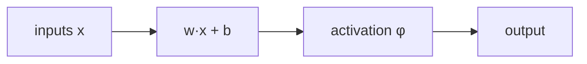

> Tier 3 · Neural Networks · **Level: absolute beginner** · Reading time: about 8 minutes

# 3.1 Biological inspiration versus the artificial neuron

**Metadata** — Tier: 3 · Phase: 1 · Priority: P1 · Difficulty: 1/5 · Interview: Medium · Hands-on: Medium
Prerequisites: 1.2, 1.10, 2.2 · Leads to: 3.2 Perceptron, 3.8 Weighted sum, 3.9 Activation functions

> **In plain words**
> An **artificial neuron** is a tiny function: it takes some numbers, **multiplies each by a weight, adds them up, adds a bias**, and passes the result through a simple rule (the **activation**) to give one output number.
> It was *inspired* by brain cells (inputs, connection strengths, a firing threshold) but it is only a **loose mathematical sketch**, not a copy of the brain. Think of it as a **voter** who weighs advice from several friends (some trusted more), adds a personal leaning, and decides.

**You need first:** 1.2 Vectors, 1.10 Dot product, 2.2 Supervised learning.

> **Figure 3.1-1 — a biological neuron and its artificial sketch**
>
> ```mermaid
> flowchart LR
>     subgraph Biology
>         D["dendrites receive<br/>signals through synapses"] --> S["cell body integrates"]
>         S --> T{"above the<br/>firing threshold?"}
>         T --> A["axon sends a spike"]
>     end
>     subgraph Artificial neuron
>         X["inputs x₁…xₙ"] --> W["× weights w₁…wₙ"]
>         W --> Z["sum + bias b<br/>z = w·x + b"]
>         Z --> P["activation φ(z)"]
>         P --> Y["output y"]
>     end
> ```
>
> *How to read it:* each part of the biological story has a counterpart: incoming signals ↔ inputs, synapse strength ↔ weights, firing threshold ↔ bias, integration ↔ the weighted sum, spiking ↔ the activation. Learning means adjusting the weights and bias.

**Words you'll meet on this page**

| Word | What it means here |
|---|---|
| neuron (unit) | `y = φ(w·x + b)` |
| weight `w` | how much one input matters |
| bias `b` | a built-in push, like a threshold |
| activation `φ` | the rule that turns `z` into the output |
| threshold unit | outputs 1 if `z > 0`, else 0 |
| logic gate | a unit computing AND, OR, NAND … |
| plasticity | learning: connection strengths changing with experience |

### 1. What is it?
An **artificial neuron** is a small function: it takes a vector of inputs, forms a weighted sum plus a bias, and applies a non-linearity: `y = φ(w·x + b)`. It was *inspired by* biological neurons but is only a loose abstraction of them.

### 2. Why does it exist?
Understanding what the analogy keeps and what it throws away prevents both mystification ("it works like the brain") and underestimation ("it's just a dot product").

### 3. Detailed explanation
**The biological neuron, simplified.** Dendrites receive signals from other cells through synapses of varying strength; the cell body integrates them; if the integrated signal exceeds a threshold, the neuron emits an all-or-none electrical pulse (a spike) along its axon. Synaptic strengths change with experience (plasticity).

**The mapping**

| Biology | Artificial neuron |
|---|---|
| incoming signals | inputs `x₁…xₙ` |
| synaptic strength | weights `w₁…wₙ` (3.6) |
| firing threshold | bias `b` (3.7) |
| integration | weighted sum `z = w·x + b` (3.8) |
| spiking decision / firing rate | activation `φ(z)` (3.9) |
| plasticity | learning: updating `w` and `b` (3.20) |

- **History:** McCulloch and Pitts (1943) modelled a neuron as a threshold logic unit; Rosenblatt's perceptron (1958) added a learning rule (3.2). Modern networks descend from these ideas but are engineered, not copied from biology.
- **What the abstraction drops:** spike timing and dynamics, continuous chemistry, structured dendritic computation, glial cells, energy constraints, and the enormous, recurrent wiring of real brains.
- **Learning differs:** backpropagation (3.20) needs precise error signals sent backwards through the same weights, which is not known to be how the brain learns. Take "inspired by" literally.
- **A single neuron as a logic gate:** weights `[1, 1]` with bias −1.5 computes AND; bias −0.5 computes OR; weights `[−1, −1]` with bias 1.5 computes NAND. **A single neuron cannot compute XOR; two layers can** (3.17).
- Be careful with quantitative brain-versus-model comparisons (neuron counts, "synapses ≈ parameters"): they are rough and contested (REVIEW_REQUIRED before quoting numbers).

### 4. How does it work?
Weighted sum of the inputs plus a bias → non-linearity → the output is passed to the next neurons.

### 5. Simple example
A voter weighs advice from three friends (Ann is trusted a lot, Bo a little), adds a personal leaning, and decides yes or no.

**By hand.** Advice scores `x = [1, 0, 1]` (yes, no, yes), trust `w = [0.8, 0.3, 0.5]`, leaning `b = −1`.
`z = 0.8·1 + 0.3·0 + 0.5·1 − 1 = 0.3 > 0` → the voter says **yes**. If Ann had said no (`x = [0, 0, 1]`), `z = 0.5 − 1 = −0.5` → **no**.

### 6. Technical example
Every hidden unit in a Transformer's feed-forward block is such a neuron: a learned linear combination followed by GELU or SiLU.

### 7. Code
**① By hand (plain Python).** Logic gates from one threshold neuron.

```python
def neuron(inputs, weights, bias):
    z = sum(w * x for w, x in zip(weights, inputs)) + bias
    return 1 if z > 0 else 0

cases = [(0, 0), (0, 1), (1, 0), (1, 1)]
print("AND :", [neuron(c, [1, 1], -1.5) for c in cases])
print("OR  :", [neuron(c, [1, 1], -0.5) for c in cases])
print("NAND:", [neuron(c, [-1, -1], 1.5) for c in cases])
print("the voter, advice [1, 0, 1] ->", neuron([1, 0, 1], [0.8, 0.3, 0.5], -1))
```

```text
AND : [0, 0, 0, 1]
OR  : [0, 1, 1, 1]
NAND: [1, 1, 1, 0]
the voter, advice [1, 0, 1] -> 1
```

**② With NumPy.** XOR needs two layers: three neurons combined.

```python
import numpy as np

X = np.array([[0, 0], [0, 1], [1, 0], [1, 1]], float)
step = lambda z: (z > 0).astype(int)

hidden = step(X @ np.array([[1, -1], [1, -1]]) + np.array([-0.5, 1.5]))        # column 0: OR, column 1: NAND
output = step(hidden @ np.array([1, 1]) - 1.5)                                  # AND of (OR, NAND) = XOR
print("hidden layer (OR, NAND):\n", hidden)
print("XOR from two layers   :", output.tolist(), "  (a single neuron cannot do this)")
```

```text
hidden layer (OR, NAND):
 [[0 1]
 [1 1]
 [1 1]
 [1 0]]
XOR from two layers   : [0, 1, 1, 0]   (a single neuron cannot do this)
```

**③ With PyTorch.** A neuron is a `Linear(n, 1)` plus an activation.

```python
import torch

neuron = torch.nn.Sequential(torch.nn.Linear(3, 1), torch.nn.Sigmoid())
with torch.no_grad():
    neuron[0].weight.copy_(torch.tensor([[0.8, 0.3, 0.5]]))
    neuron[0].bias.copy_(torch.tensor([-1.0]))
x = torch.tensor([[1.0, 0.0, 1.0], [0.0, 0.0, 1.0]])
print("outputs:", [round(v, 3) for v in neuron(x).flatten().tolist()], "(sigmoid turns z = 0.3 and -0.5 into soft yes/no)")
print("learnable numbers in one neuron with 3 inputs:", sum(p.numel() for p in neuron.parameters()), "(3 weights + 1 bias)")
```

```text
outputs: [0.574, 0.378] (sigmoid turns z = 0.3 and -0.5 into soft yes/no)
learnable numbers in one neuron with 3 inputs: 4 (3 weights + 1 bias)
```

### 8. Input → Process → Output



<details>
<summary><b>Beyond the basics (sections 9–16)</b> — real-world use, limits, mistakes. Skip on a first read.</summary>

### 9. Enterprise use case
When explaining models to stakeholders, "a function with learned weights" is more accurate than "a digital brain" and avoids over-claiming.

### 10. AI engineering connection
The unit of every neural layer (3.16) and of attention and feed-forward blocks (Tier 8); the abstraction explains parameter counts and compute.

### 11. Advantages
A simple, composable, differentiable building block.

### 12. Limitations
Not a biological model; single neurons are weak (linear separators).

### 13. Trade-offs
Biological realism (spiking, dynamics) versus trainability and hardware efficiency.

### 14. Common mistakes
Claiming networks "think like humans"; equating parameters with synapses; assuming backpropagation is biologically plausible.

### 15. Performance / cost
Artificial neurons map well to matrix multiplication on GPUs: the reason this abstraction won.

### 16. Security
Anthropomorphic language can mislead risk assessments; describe behaviour and evidence instead.

</details>

### 17. Interview explanation
"An artificial neuron computes an activation of a weighted sum plus a bias. It's inspired by biological neurons (inputs, synaptic strengths, a firing threshold) but it's a mathematical abstraction: no spikes or chemistry, and it's trained by backpropagation, which the brain isn't known to use."

### 18. Rapid-fire answer
Artificial neuron: `y = φ(w·x + b)`; loosely inspired by biology; weights ↔ synapses, bias ↔ threshold.

### 19. Interview questions
- **Basic:** Write the neuron equation and map each part to biology.
- **Intermediate:** Why can one neuron not compute XOR?
- **Advanced:** Why is backpropagation considered biologically implausible?
- **Scenario:** A stakeholder says "neural networks work like our brain". How do you respond?

### 20. Hands-on exercise
**Goal:** find a NOR gate and build XOR from it.

1. NOR is 1 only when both inputs are 0. Find weights and a bias for a threshold neuron.
2. XOR can be built from NOR and AND-style units; here, check your NOR gate on all four inputs.

<details>
<summary>Show a solution</summary>

```python
def neuron(inputs, weights, bias):
    return 1 if sum(w * x for w, x in zip(weights, inputs)) + bias > 0 else 0

cases = [(0, 0), (0, 1), (1, 0), (1, 1)]
nor = lambda a, b: neuron((a, b), [-1, -1], 0.5)
print("NOR:", [nor(a, b) for a, b in cases])
# XOR = NOR( AND(a, b), NOR(a, b) )
and_ = lambda a, b: neuron((a, b), [1, 1], -1.5)
print("XOR:", [nor(and_(a, b), nor(a, b)) for a, b in cases])
```

```text
NOR: [1, 0, 0, 0]
XOR: [0, 1, 1, 0]
```

NOR uses weights `[−1, −1]` and bias `0.5`; XOR then needs two layers of such neurons.
</details>

### 21. Revision questions
1. What are the parts of an artificial neuron?
2. Name two things the abstraction drops.
3. What did McCulloch and Pitts add?

### 22. Related concepts
3.2 Perceptron · 3.6 Weights · 3.7 Bias · 3.9 Activation functions · 1.10 Dot product

### 23. One-line memory hook
**An artificial neuron is a weighted vote with a threshold: inspired by biology, not a copy.**

<details>
<summary><b>For reviewers</b> (not part of the lesson)</summary>

- Status: DRAFT, learner-first layout (Author: Claude). Code is executed by `tests/test_md_snippets.py`.
- TESTED earlier: `lab_01_neurons_and_mlp.ex_3_1` (AND, OR, NAND from one threshold neuron).
- Brain-versus-model numeric comparisons remain REVIEW_REQUIRED.
</details>
