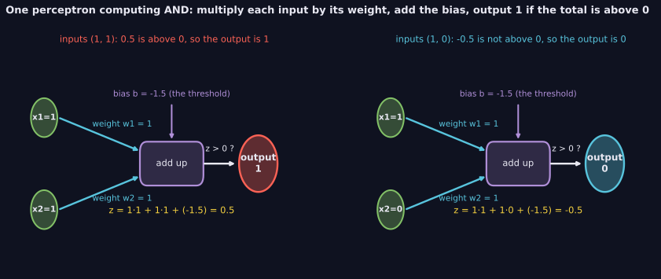
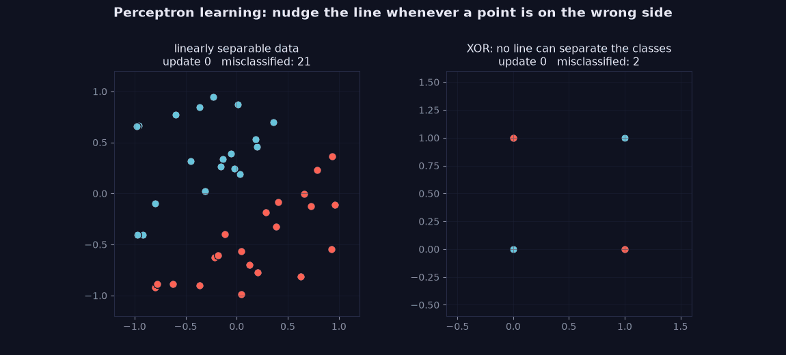
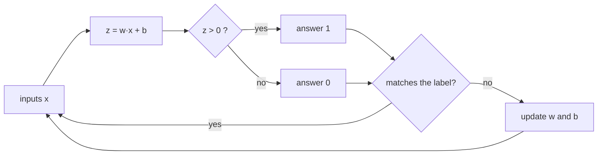

> Tier 3 · Neural Networks · **Level: beginner** · Reading time: about 10 minutes

# 3.2 Perceptron

**Metadata** — Tier: 3 · Phase: 1 · Priority: P1 · Difficulty: 2/5 · Interview: Medium-High · Hands-on: High
Prerequisites: 3.1 Artificial neuron, 2.14 Classification · Leads to: 3.17 MLP, 3.20 Backpropagation

> **In plain words**
> A **perceptron** is the smallest "learning machine". It looks at some numbers, adds them up with a weight for each, and says **yes (1) or no (0)**.
> When it says the wrong thing, it **nudges its weights** a little toward the right answer. Repeat until it stops making mistakes.
> It works only when one straight line can separate the "yes" cases from the "no" cases.

**You need first:** what an input and a label are (2.2), and multiplying then adding numbers (the *dot product*, 1.10). No calculus needed.

> **Figure 3.2-1 — one perceptron, drawn as a picture**
>
> 
>
> *How to read it:* numbers enter on the left (inputs). Each is multiplied by its own **weight** (how much it matters). The results are added together with a **bias** (a built-in push up or down) to give one number `z`. The **step** at the end turns `z` into 1 if it is above zero and 0 otherwise. The two worked examples (left and right panels) use the AND gate: with inputs (1,1) we get z = 0.5, so the output is 1; with (1,0) we get z = −0.5, so the output is 0.
>
> *Generated by* `tier-03-neural-networks/figures/src/fig_3_02_perceptron_diagram.py`.

> **Figure 3.2-2 — perceptron learning, step by step (animated)**
>
> 
>
> *How to read it:* each update nudges the line after a mistake. Left: the data can be split by a line, and after 10 updates the line has 0 misclassified points and stops. Right: for XOR no line can split the classes, so after 40 updates the perceptron is still wrong on 2 of 4 points. This is the limit that hidden layers remove.
>
> *Generated by* `tier-03-neural-networks/figures/src/t3_concepts.py`.

**Words you'll meet on this page**

| Word | What it means here |
|---|---|
| weight (`w`) | a number saying how much one input matters |
| bias (`b`) | a number added at the end, shifting the decision |
| step function | outputs 1 if its input is above 0, else 0 |
| label | the correct answer for an example (0 or 1) |
| epoch | one full pass over all training examples |
| linearly separable | the two groups can be split by one straight line |
| learning rate (`η`) | how big each nudge is (here 1, to keep the arithmetic easy) |

### 1. What is it?
A perceptron takes inputs `x₁, x₂, …`, computes

`z = w₁·x₁ + w₂·x₂ + … + b`

and answers **1 if z > 0, otherwise 0**. Training means finding good weights `w` and bias `b`.

The **learning rule** is only two lines. For each example, compare the answer with the label:

- if the answer is right: change nothing;
- if it is wrong: `w ← w + (label − answer) · x` and `b ← b + (label − answer)`.

If the label is 1 and the answer was 0, `(label − answer)` is +1, so we **add** the input to the weights. If the label is 0 and the answer was 1, it is −1, so we **subtract** it.

### 2. Why does it exist?
It was the first machine that could **learn from examples** instead of being programmed with rules (Rosenblatt, 1958). It is still the cleanest way to see what a "line that separates two groups" is, and why more than one layer is later needed.

### 3. Detailed explanation
1. **It only learns from mistakes.** A correct answer leaves the weights alone.
2. **Why the update helps.** Adding the input to the weights makes `z` larger for that same input next time, so a missed "yes" moves toward "yes". Subtracting does the opposite.
3. **When it stops.** If a straight line can separate the groups, the perceptron reaches an epoch with zero mistakes and stops, always (the *convergence theorem*).
4. **When it can't.** XOR ("one or the other, but not both") cannot be split by any line, so the perceptron never settles. Single perceptrons cannot learn it. This limit was pointed out in 1969 and motivated networks with hidden layers (3.17).
5. **Compared with logistic regression (2.14).** The perceptron uses a hard yes/no step and updates only on mistakes; logistic regression uses a smooth curve, outputs a probability and learns from every example by gradient descent.

### 4. How does it work?
1. Start with all weights and the bias at 0.
2. Take one example. Compute `z`, then the answer (1 if `z > 0`).
3. Compare with the label. If wrong, apply the update.
4. Move to the next example. After the last one, start a new epoch.
5. Stop when a whole epoch has no mistakes.

### 5. Simple example — learning the AND gate by hand
AND answers 1 only when **both** inputs are 1. Four examples, labels in the last column:

| x₁ | x₂ | label |
|---|---|---|
| 0 | 0 | 0 |
| 0 | 1 | 0 |
| 1 | 0 | 0 |
| 1 | 1 | 1 |

Start: `w = (0, 0)`, `b = 0`.

**Epoch 1.**
- (0,0): `z = 0` → answer 0, label 0. Right. No change.
- (0,1): `z = 0` → answer 0, label 0. Right.
- (1,0): `z = 0` → answer 0, label 0. Right.
- (1,1): `z = 0` → answer 0, label **1**. Wrong, so `(label − answer) = +1`. Add the input: `w = (0+1, 0+1) = (1, 1)`, `b = 0+1 = 1`.

**Epoch 2.** Now `w = (1,1)`, `b = 1`.
- (0,0): `z = 1` → answer 1, label 0. Wrong (−1): `w` stays `(1,1)` because the input is 0, `b = 0`.
- (0,1): `z = 1` → answer 1, label 0. Wrong: `w = (1, 0)`, `b = −1`.
- (1,0): `z = 0` → answer 0. Right.
- (1,1): `z = 0` → answer 0, label 1. Wrong (+1): `w = (2, 1)`, `b = 0`.

Epochs 3–5 make 3, 2 and 1 more mistakes. **Epoch 6 makes none**, so training stops with **`w = (2, 1)` and `b = −2`**. Check it: `(1,1)` gives `2+1−2 = 1 > 0`, answer 1 ✓. `(1,0)` gives `0`, answer 0 ✓. `(0,1)` gives `−1`, answer 0 ✓. `(0,0)` gives `−2`, answer 0 ✓.

In total there were 10 mistakes. The weights in Figure 3.2-1 (`w = (1,1)`, `b = −1.5`) are another valid answer that we chose by hand; many solutions exist and the learning rule simply finds one of them.

### 6. Technical example
Early spam filters represented each email by which words it contained (1 if present, 0 if not) and trained a perceptron on emails marked spam or not. A new email was scored with `z`, and the sign decided.

### 7. Code
The same learner three ways.

**① By hand (plain Python, no libraries).** This follows the table above.

```python
examples = [((0, 0), 0), ((0, 1), 0), ((1, 0), 0), ((1, 1), 1)]   # AND gate
w1, w2, b = 0, 0, 0

for epoch in range(1, 20):
    mistakes = 0
    for (x1, x2), label in examples:
        z = w1 * x1 + w2 * x2 + b
        answer = 1 if z > 0 else 0
        error = label - answer            # +1, 0 or -1
        if error != 0:
            w1, w2, b = w1 + error * x1, w2 + error * x2, b + error
            mistakes += 1
    print("epoch", epoch, "mistakes", mistakes)
    if mistakes == 0:
        break

print("weights", (w1, w2), "bias", b)
```

```text
epoch 1 mistakes 1
epoch 2 mistakes 3
epoch 3 mistakes 3
epoch 4 mistakes 2
epoch 5 mistakes 1
epoch 6 mistakes 0
weights (2, 1) bias -2
```

**② With NumPy.** The same rule with vectors, so it works for any number of inputs.

```python
import numpy as np

X = np.array([[0, 0], [0, 1], [1, 0], [1, 1]])
y = np.array([0, 0, 0, 1])
w, b = np.zeros(2), 0.0

for epoch in range(20):
    mistakes = 0
    for x_i, label in zip(X, y):
        answer = 1 if x_i @ w + b > 0 else 0
        error = label - answer
        if error != 0:
            w = w + error * x_i
            b = b + error
            mistakes += 1
    if mistakes == 0:
        break

print("weights", w, "bias", b, "epochs", epoch + 1)
print("predictions", (X @ w + b > 0).astype(int))
```

```text
weights [2. 1.] bias -2.0 epochs 6
predictions [0 0 0 1]
```

**③ With PyTorch.** Same update, with tensors (which can later run on a GPU). Note that we still write the update ourselves: a step function has no useful gradient, so PyTorch's automatic learning does not apply here. That is exactly why 3.20 (backpropagation) needs smooth functions.

```python
import torch

X = torch.tensor([[0., 0.], [0., 1.], [1., 0.], [1., 1.]])
y = torch.tensor([0., 0., 0., 1.])
w, b = torch.zeros(2), torch.tensor(0.0)

for epoch in range(20):
    mistakes = 0
    for x_i, label in zip(X, y):
        answer = (x_i @ w + b > 0).float()
        error = label - answer
        if error != 0:
            w = w + error * x_i
            b = b + error
            mistakes += 1
    if mistakes == 0:
        break

print("weights", w.tolist(), "bias", b.item(), "epochs", epoch + 1)
```

```text
weights [2.0, 1.0] bias -2.0 epochs 6
```

### 8. Input → Process → Output



<details>
<summary><b>Beyond the basics (sections 9–16)</b> — real-world use, limits, mistakes. Skip on a first read.</summary>

### 9. Enterprise use case
Rarely deployed on its own now. The same "update only when wrong" idea lives on in online learning and some large-scale linear classifiers.

### 10. AI engineering connection
It is the conceptual root of neural networks: a neuron is a perceptron with a smooth output (3.4–3.8), and networks stack many of them (3.17).

### 11. Advantages
Tiny, fast, easy to understand, and guaranteed to finish when the groups are separable by a line.

### 12. Limitations
Only straight-line boundaries; no probabilities (just yes/no); never settles on data that cannot be separated.

### 13. Trade-offs
Hard step: simple, but no gradients. Smooth output: needs more machinery, but trains with gradient descent.

### 14. Common mistakes
Expecting it to converge on data that no line can separate; forgetting the bias; mixing inputs of very different sizes (scale them first); confusing this rule with gradient descent on a smooth loss.

### 15. Performance / cost
One update costs about as much as one dot product, `O(d)` for `d` inputs.

### 16. Security
If it keeps learning from a live stream of untrusted examples, an attacker can feed it wrong labels to push the line.

</details>

### 17. Interview explanation
"A perceptron is a single threshold neuron. When it misclassifies an example it adds or subtracts that input from its weights. If the classes can be separated by a line, it is guaranteed to converge; it can't learn XOR, which is why we need hidden layers and a differentiable training setup."

### 18. Rapid-fire answer
Update `w += (y − ŷ)·x` on mistakes; converges only on linearly separable data; fails on XOR.

### 19. Interview questions
- **Basic:** State the perceptron update rule.
- **Intermediate:** Why does it fail on XOR?
- **Advanced:** What does the mistake bound `(R/γ)²` say, and what is the margin `γ`?
- **Scenario:** The perceptron never stops on your data. What are your options?

### 20. Hands-on exercise
**Goal:** teach the perceptron the OR gate and see that XOR can't be learned.

1. Reuse the NumPy code from section 7, but change the labels to OR: `y = [0, 1, 1, 1]`.
2. Count the epochs it needs.
3. Now try XOR: `y = [0, 1, 1, 0]`. Cap the loop at 100 epochs and print whether it ever finished with zero mistakes.

<details>
<summary>Show a solution</summary>

```python
import numpy as np

X = np.array([[0, 0], [0, 1], [1, 0], [1, 1]])

def train(y, max_epochs=100):
    w, b = np.zeros(2), 0.0
    for epoch in range(1, max_epochs + 1):
        mistakes = 0
        for x_i, label in zip(X, y):
            error = label - (1 if x_i @ w + b > 0 else 0)
            if error != 0:
                w, b, mistakes = w + error * x_i, b + error, mistakes + 1
        if mistakes == 0:
            return epoch, True
    return max_epochs, False

print("OR :", train(np.array([0, 1, 1, 1])))
print("XOR:", train(np.array([0, 1, 1, 0])))
```

```text
OR : (4, True)
XOR: (100, False)
```

OR finishes (a line can split it). XOR runs out of epochs, because no line can.
</details>

### 21. Revision questions
1. What does the perceptron do when its answer is right?
2. When is it guaranteed to stop?
3. Why can't it learn XOR?

### 22. Related concepts
3.1 Artificial neuron · 3.17 MLP · 2.14 Classification · 1.10 Dot product

### 23. One-line memory hook
**Perceptron: nudge the line whenever you're wrong; it works only if a line can work.**

<details>
<summary><b>For reviewers</b> (not part of the lesson)</summary>

- Status: DRAFT, learner-first pilot layout (Author: Claude).
- TESTED earlier: `nn.Perceptron` (`test_perceptron_learns_and_or_not_xor`, `test_perceptron_mistake_bound`, `lab_01_neurons_and_mlp.ex_3_2`). AND needed 6 epochs and 10 mistakes; the page's by-hand trace matches that run.
- Mistake bound (Novikoff) with measured values (margins 0.5 / 0.2 / 0.05: mistakes 6 / 22 / 8 vs bounds 37 / 219 / 2,865) and the XOR run (397 mistakes in 100 epochs) are kept here from the first draft; they are not shown in the lesson body.
- History statement ("1969 … motivated hidden layers") is simplified (REVIEW_REQUIRED).
- Code blocks are executed by `tests/test_md_snippets.py`.
</details>
