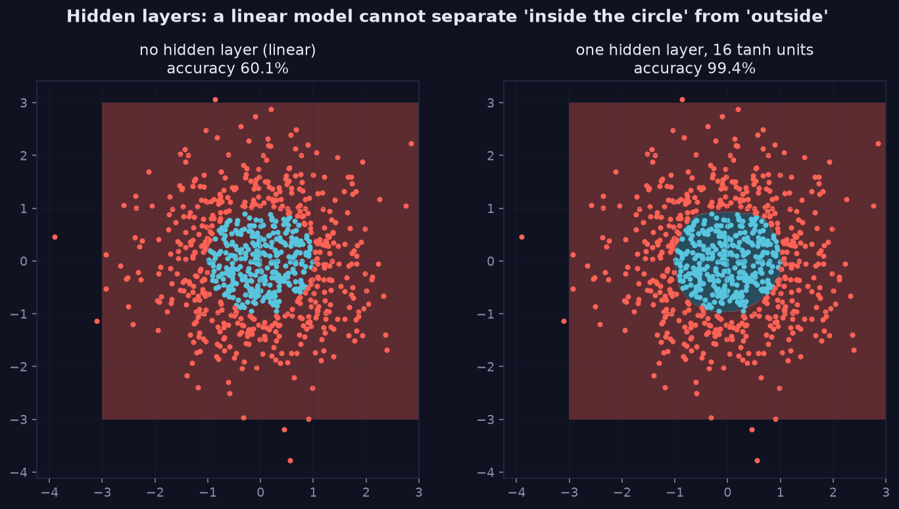
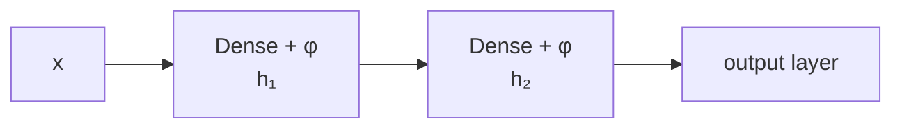

> Tier 3 · Neural Networks · **Level: beginner** · Reading time: about 10 minutes

# 3.4 Hidden layers

**Metadata** — Tier: 3 · Phase: 1 · Priority: P0 · Difficulty: 2/5 · Interview: High · Hands-on: High
Prerequisites: 3.3, 3.9 · Leads to: 3.17 MLP, 3.25 Vanishing gradients, 3.27 Residual connections

> **In plain words**
> **Hidden layers** are the layers **between input and output**, where the network **invents its own features**: each one re-describes the previous layer's output in a more useful way. Their number is the **depth**, their size the **width**.
> Without a hidden layer a network can only draw straight lines. With one, it can bend its decision boundary around almost any shape. Like successive translators, each rephrasing the message into a form the next can use.

**You need first:** 3.3 Input layer, and a first idea of an activation function (3.9).

> **Figure 3.4-1 — why a hidden layer helps: the circle problem**
>
> 
>
> *How to read it:* **left** — with no hidden layer the model is linear, so it cannot draw a circle; it ends up predicting the majority class (red) everywhere and scores 60.1%. **Right** — a hidden layer of 16 tanh units bends the decision region into a closed curve around the blue points and reaches 99.4%.
>
> *Generated by* `tier-03-neural-networks/figures/src/t3_concepts.py`.

**Words you'll meet on this page**

| Word | What it means here |
|---|---|
| hidden layer | a layer between input and output |
| depth / width | number of layers / units per layer |
| representation | the internal description a layer produces |
| parameter count | `n_in·n_h + n_h` for one dense layer |
| bottleneck | a layer narrower than its neighbours |
| activation | the non-linearity after each layer (3.9) |
| capacity | how complicated a function the network can fit |

### 1. What is it?
The layers **between input and output** that transform features into progressively more useful internal representations. Each is typically a Dense layer followed by an activation. Their count is the **depth**, their size the **width**.

### 2. Why does it exist?
Without a hidden layer the model is linear; hidden layers let it learn non-linear functions and its own features.

### 3. Detailed explanation
- **No hidden layer = a linear model.** On a circle-shaped class boundary a linear classifier is stuck near the share of the majority class, while a one-hidden-layer network with 16 tanh units fits it almost perfectly (3.17).
- **Representation learning:** early layers capture simple patterns and later layers combine them (edges → shapes → objects in vision; this hierarchy is an observed tendency, not a guarantee).
- **Depth versus width:** width raises the capacity of one layer; depth composes features and can represent some functions with exponentially fewer units, but it makes optimisation harder (vanishing and exploding gradients, 3.25–3.26) and calls for tools such as residual connections (3.27) and normalisation (3.30–3.32).
- **Parameter count:** a hidden layer with `n_in` inputs and `n_h` units has `n_in·n_h + n_h` parameters. For 784 → 128 → 64 → 10: `100,480 + 8,256 + 650 = 109,386`.
- **Compute and memory:** forward FLOPs per example ≈ 2 × the parameters; activations must be stored for backpropagation (3.20), so memory grows with width × depth × batch.
- **Choosing the size:** start small and increase until validation stops improving (2.30); regularise (3.28, 3.29); widths are often powers of two for hardware efficiency.
- **Bottlenecks:** layers narrower than their neighbours force compression (autoencoders).
- **Hidden units are not individually interpretable by default;** interpretability work (probing, mechanistic analysis) is a separate field (REVIEW_REQUIRED before claiming specific roles).

### 4. How does it work?
`h₁ = φ(W₁x + b₁)`, `h₂ = φ(W₂h₁ + b₂)`, …: each layer re-represents the previous one.



### 5. Simple example
Successive translators, each rephrasing the message into a form the next can use.

**Counting parameters by hand.** A `20 → 50 → 10` network:
- layer 1: `20 × 50 + 50 = 1,050`;
- layer 2: `50 × 10 + 10 = 510`;
- total **1,560** learnable numbers.

### 6. Technical example
The Transformer's feed-forward sub-layer is a two-layer MLP whose hidden width is typically about 4× the model dimension (Tier 8).

### 7. Code
**① By hand (plain Python).** The parameter count of any stack of dense layers.

```python
def n_params(sizes):
    return sum(a * b + b for a, b in zip(sizes, sizes[1:]))            # weights + biases for each layer

print("20 -> 50 -> 10      :", n_params([20, 50, 10]))
print("784 -> 128 -> 64 -> 10:", n_params([784, 128, 64, 10]))
```

```text
20 -> 50 -> 10      : 1560
784 -> 128 -> 64 -> 10: 109386
```

**② With NumPy and scikit-learn.** A linear model versus one hidden layer on the circle problem.

```python
import numpy as np
from sklearn.linear_model import LogisticRegression
from sklearn.neural_network import MLPClassifier

rng = np.random.default_rng(0)
X = rng.uniform(-1.5, 1.5, (1500, 2))
y = (X[:, 0] ** 2 + X[:, 1] ** 2 < 1).astype(int)                         # inside the unit circle = class 1
Xtr, ytr, Xte, yte = X[:1000], y[:1000], X[1000:], y[1000:]

linear = LogisticRegression().fit(Xtr, ytr)
mlp = MLPClassifier(hidden_layer_sizes=(16,), activation="tanh", max_iter=3000, random_state=0).fit(Xtr, ytr)
print("share of class 1 (majority-class baseline is the larger share):", round(float(yte.mean()), 3))
print("no hidden layer (linear):", round(linear.score(Xte, yte), 3))
print("16 tanh hidden units    :", round(mlp.score(Xte, yte), 3))
```

```text
share of class 1 (majority-class baseline is the larger share): 0.344
no hidden layer (linear): 0.656
16 tanh hidden units    : 0.988
```

**③ With PyTorch.** Count parameters, then train.

```python
import torch

model = torch.nn.Sequential(torch.nn.Linear(784, 128), torch.nn.ReLU(), torch.nn.Linear(128, 64), torch.nn.ReLU(), torch.nn.Linear(64, 10))
print("parameters:", sum(p.numel() for p in model.parameters()), "(matches the hand count)")

torch.manual_seed(0)
X = torch.rand(1500, 2) * 3 - 1.5
y = ((X ** 2).sum(dim=1) < 1).float()
net = torch.nn.Sequential(torch.nn.Linear(2, 16), torch.nn.Tanh(), torch.nn.Linear(16, 1))
opt = torch.optim.Adam(net.parameters(), lr=0.05)
for _ in range(400):
    opt.zero_grad()
    torch.nn.functional.binary_cross_entropy_with_logits(net(X[:1000]).squeeze(1), y[:1000]).backward()
    opt.step()
print("test accuracy:", round(((net(X[1000:]).squeeze(1) > 0).float() == y[1000:]).float().mean().item(), 3))
```

```text
parameters: 109386 (matches the hand count)
test accuracy: 0.99
```

### 8. Input → Process → Output
`x → [Dense → φ] × L → representation → output layer`

<details>
<summary><b>Beyond the basics (sections 9–16)</b> — real-world use, limits, mistakes. Skip on a first read.</summary>

### 9. Enterprise use case
Architecture size is a cost lever: parameters drive memory, latency and training cost.

### 10. AI engineering connection
The depth and width of Transformers (Tiers 8, 12); the hidden size `d_model` is the width carried through the residual stream.

### 11. Advantages
Learns features automatically; expressive.

### 12. Limitations
More parameters mean more overfitting risk and cost; optimisation gets harder with depth.

### 13. Trade-offs
Wider or deeper means more capacity but also more compute, more data needed, and more instability.

### 14. Common mistakes
Adding layers without activations (they collapse into one); a network too large for the data; ignoring initialisation when going deeper; assuming deeper is always better.

### 15. Performance / cost
Parameter count × batch determines GPU memory and time.

### 16. Security
Large capacity increases memorisation and extractable training data.

</details>

### 17. Interview explanation
"Hidden layers are where the network builds its own features: each Dense layer plus an activation re-represents the input. With none the model is linear; more width or depth increases capacity at the cost of compute, overfitting risk and harder optimisation, so I size by validation performance."

### 18. Rapid-fire answer
Hidden layers = Dense + activation stacks between input and output; none means linear; depth and width trade capacity against cost.

### 19. Interview questions
- **Basic:** What is the parameter count of a `20 → 50 → 10` network with biases?
- **Intermediate:** Why does a network without hidden layers fail on a circle?
- **Advanced:** What are the optimisation challenges of depth, and the fixes?
- **Scenario:** Validation loss stops improving after widening the layers 4×. What now?

### 20. Hands-on exercise
**Goal:** see why layers without activations add nothing.

1. Build a PyTorch network `Linear(2,16) → Linear(16,1)` **without** an activation and train it on the circle problem.
2. Compare its test accuracy with the version with `Tanh` in between.
3. Why can't the activation-free network do better than a straight line?

<details>
<summary>Show a solution</summary>

```python
import torch

torch.manual_seed(0)
X = torch.rand(1500, 2) * 3 - 1.5
y = ((X ** 2).sum(dim=1) < 1).float()

def accuracy(with_activation):
    layers = [torch.nn.Linear(2, 16)] + ([torch.nn.Tanh()] if with_activation else []) + [torch.nn.Linear(16, 1)]
    net = torch.nn.Sequential(*layers)
    opt = torch.optim.Adam(net.parameters(), lr=0.05)
    for _ in range(400):
        opt.zero_grad()
        torch.nn.functional.binary_cross_entropy_with_logits(net(X[:1000]).squeeze(1), y[:1000]).backward()
        opt.step()
    return ((net(X[1000:]).squeeze(1) > 0).float() == y[1000:]).float().mean().item()

print("two Linear layers, no activation:", round(accuracy(False), 3))
print("with Tanh in between            :", round(accuracy(True), 3))
```

```text
two Linear layers, no activation: 0.604
with Tanh in between            : 0.988
```

Two linear maps in a row are one linear map (`W₂(W₁x) = (W₂W₁)x`), so the extra layer adds no power without an activation.
</details>

### 21. Revision questions
1. What are depth and width?
2. What is the parameter formula for one dense layer?
3. Why do we need activations between layers?

### 22. Related concepts
3.3 Input layer · 3.5 Output layer · 3.16 Dense layer · 3.25 Vanishing gradients · 2.30 Bias–variance

### 23. One-line memory hook
**Hidden layers: where the network invents its own features.**

<details>
<summary><b>For reviewers</b> (not part of the lesson)</summary>

- Status: DRAFT, learner-first layout (Author: Claude). Code is executed by `tests/test_md_snippets.py`.
- TESTED earlier: `test_parameter_counts_match_torch` (109,386 parameters), `lab_01_neurons_and_mlp.ex_3_17` (circle dataset: linear 60.1% vs 16 tanh units 99.4%). The page's snippets use a different circle dataset and seeds, so numbers differ; figure values (60.1%, 99.4%) are from the figure script.
</details>
