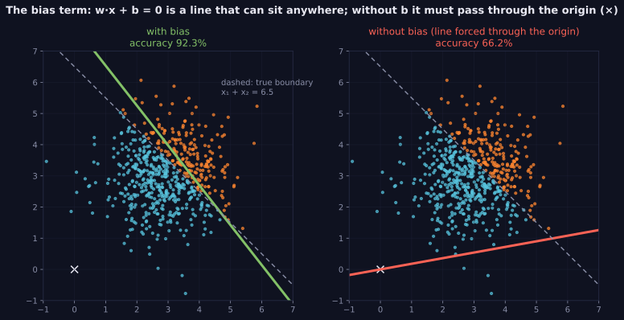

> Tier 3 · Neural Networks · **Level: absolute beginner** · Reading time: about 7 minutes

# 3.7 Bias

**Metadata** — Tier: 3 · Phase: 1 · Priority: P0 · Difficulty: 1/5 · Interview: Medium-High · Hands-on: High
Prerequisites: 3.6 · Leads to: 3.8 Weighted sum, 3.30 Batch normalisation

> **In plain words**
> The **bias** is a **learned offset added to the weighted sum**: `z = w·x + b`. It slides the neuron's decision line **away from the origin**. Without it, a neuron whose input is all zeros must output `φ(0)`, and its boundary is forced through the point (0, 0).
> Like the **base price** before per-item charges are added. *(Naming warning: this "bias" is just an offset; it has nothing to do with statistical bias (2.28), dataset bias or fairness bias.)*

**You need first:** 3.6 Weights.

> **Figure 3.7-1 — what the bias does to the decision boundary**
>
> 
>
> *How to read it:* the true class boundary is `x₁ + x₂ = 6.5` (dashed), far from the origin (×). With a bias term the fitted line (green) follows it and accuracy is 92.3%. Without a bias, `w·x = 0` must pass through the origin, so the best line (red) is badly placed and accuracy drops to 66.2%.
>
> *Generated by* `tier-03-neural-networks/figures/src/t3_concepts.py`.

**Words you'll meet on this page**

| Word | What it means here |
|---|---|
| bias `b` | the learned offset in `z = w·x + b` |
| hyperplane | the set `w·x + b = 0`: the unit's decision boundary |
| intercept | the same thing in regression |
| weight decay | a penalty on weights (biases are usually excluded) |
| prior | the class balance an output bias can encode |
| bias-free layer | `Linear(bias=False)` |

### 1. What is it?
The **learnable offset** `b` added to the weighted sum: `z = w·x + b`. It shifts the activation threshold independently of the inputs.

### 2. Why does it exist?
Without it, a neuron's decision boundary must pass through the origin, and a unit with zero input must output `φ(0)`.

### 3. Detailed explanation
- **Geometry:** `w·x + b = 0` is a hyperplane (a line in 2-D). `w` sets its **orientation**, `b` its **offset** from the origin.
- **Demonstration:** data whose class boundary is `x₁ + x₂ = 6.5` (not through the origin). A logistic unit **with** a bias separates the classes well; **without** one it is stuck with a badly placed line (see the figure).
- **Parameters:** one per unit: `n_out` per Dense layer.
- **Initialisation:** biases usually start at zero (the weights already break the symmetry).
- **Regularisation:** biases are usually excluded from weight decay (3.29), like the intercept in ridge regression (2.32).
- **Redundancy with normalisation:** layers followed by BatchNorm or LayerNorm often drop the bias, because the normalisation's own shift parameter plays that role (3.30–3.31). Many modern LLMs also remove bias terms in linear layers to save parameters and simplify training (a design choice; REVIEW_REQUIRED per model).
- **Output bias can encode class priors** (for example initialise it to `log(p/(1 − p))` for an imbalanced binary target, so early training is stable).

### 4. How does it work?
Add `b` to each unit's weighted sum before the activation; learn it like the weights.

### 5. Simple example
The base price before adding per-item charges.

**By hand.** One unit with `w = [1, 1]`. Boundary `x₁ + x₂ + b = 0`:

| `b` | boundary | a point (3, 3) is… |
|---|---|---|
| 0 | `x₁ + x₂ = 0` | positive (6 > 0) |
| −6.5 | `x₁ + x₂ = 6.5` | negative (6 − 6.5 < 0) |

The bias moves the line from the origin out to 6.5.

### 6. Technical example
`torch.nn.Linear(in, out, bias=False)` omits it; the first layer of a CNN usually has a bias unless it is followed by BatchNorm.

### 7. Code
**① By hand (plain Python).**

```python
def predict(x1, x2, b):
    return 1 if x1 + x2 + b > 0 else 0

print("with b = 0   :", [predict(a, a, 0) for a in (1, 3, 3.5, 5)], "(everything positive here)")
print("with b = -6.5:", [predict(a, a, -6.5) for a in (1, 3, 3.5, 5)], "(the line moved)")
```

```text
with b = 0   : [1, 1, 1, 1] (everything positive here)
with b = -6.5: [0, 0, 1, 1] (the line moved)
```

**② With NumPy and scikit-learn.** With and without an intercept.

```python
import numpy as np
from sklearn.linear_model import LogisticRegression

rng = np.random.default_rng(0)
X = rng.uniform(0, 6.5, (1000, 2))
y = (X.sum(axis=1) + rng.normal(0, 0.8, 1000) > 6.5).astype(int)           # boundary x1 + x2 = 6.5
Xtr, ytr, Xte, yte = X[:700], y[:700], X[700:], y[700:]
print("with a bias   :", round(LogisticRegression(fit_intercept=True).fit(Xtr, ytr).score(Xte, yte), 3))
print("without a bias:", round(LogisticRegression(fit_intercept=False).fit(Xtr, ytr).score(Xte, yte), 3), "(the line is forced through the origin)")
```

```text
with a bias   : 0.877
without a bias: 0.457 (the line is forced through the origin)
```

**③ With PyTorch.** A bias-free layer cannot output a constant; an output bias can encode priors.

```python
import math
import torch

layer = torch.nn.Linear(3, 1, bias=False)
print("bias-free layer, input all zeros -> output:", layer(torch.zeros(1, 3)).item(), "(always 0, whatever the weights)")

p = 0.02                                                     # 2% positives
head = torch.nn.Linear(8, 1)
torch.nn.init.constant_(head.bias, math.log(p / (1 - p)))   # start with the right base rate
x = torch.zeros(1, 8)
print("initial predicted probability with the prior bias:", round(torch.sigmoid(head(x)).item(), 3), "(about the 2% base rate)")
```

```text
bias-free layer, input all zeros -> output: 0.0 (always 0, whatever the weights)
initial predicted probability with the prior bias: 0.02 (about the 2% base rate)
```

### 8. Input → Process → Output
`z = w·x + b`

<details>
<summary><b>Beyond the basics (sections 9–16)</b> — real-world use, limits, mistakes. Skip on a first read.</summary>

### 9. Enterprise use case
Nothing special, but exported models must include biases consistently across frameworks.

### 10. AI engineering connection
Bias handling differs across architectures (bias-free Transformer variants); an LM-head bias can shift token priors.

### 11. Advantages
Adds flexibility cheaply.

### 12. Limitations
Redundant after normalisation; a negligible share of parameters in large layers.

### 13. Trade-offs
Removing biases simplifies and saves parameters but reduces flexibility slightly.

### 14. Common mistakes
Penalising biases with weight decay; omitting the bias where it is needed; confusing it with statistical bias; wrong broadcasting (the bias must broadcast over the batch axis).

### 15. Performance / cost
Negligible compute; the bias add is often fused into the matrix multiplication.

### 16. Security
Nothing specific.

</details>

### 17. Interview explanation
"The bias is a learned offset added to the weighted sum, shifting the decision threshold so the boundary doesn't have to pass through the origin. It's initialised to zero, usually not weight-decayed, and often dropped when normalisation follows."

### 18. Rapid-fire answer
`b` shifts the hyperplane off the origin; initialise to 0; not weight-decayed; unrelated to statistical bias.

### 19. Interview questions
- **Basic:** What does the bias do geometrically?
- **Intermediate:** Why omit the bias before BatchNorm?
- **Advanced:** How can output-bias initialisation help with imbalanced data?
- **Scenario:** Your model can't learn a constant offset. What did you forget?

### 20. Hands-on exercise
**Goal:** prove a network without bias cannot output a non-zero constant for a zero input.

1. Build `Linear(2, 4, bias=False) → Tanh → Linear(4, 1, bias=False)`.
2. Feed it zeros. What does it output, whatever the weights?
3. Add biases and train it to output 5 for a zero input.

<details>
<summary>Show a solution</summary>

```python
import torch

torch.manual_seed(0)
no_bias = torch.nn.Sequential(torch.nn.Linear(2, 4, bias=False), torch.nn.Tanh(), torch.nn.Linear(4, 1, bias=False))
print("no biases, zero input -> output:", abs(no_bias(torch.zeros(1, 2)).item()))

with_bias = torch.nn.Sequential(torch.nn.Linear(2, 4), torch.nn.Tanh(), torch.nn.Linear(4, 1))
opt = torch.optim.Adam(with_bias.parameters(), lr=0.1)
for _ in range(300):
    opt.zero_grad()
    ((with_bias(torch.zeros(1, 2)) - 5.0) ** 2).mean().backward()
    opt.step()
print("with biases, trained to output 5 for zero input:", round(with_bias(torch.zeros(1, 2)).item(), 3))
```

```text
no biases, zero input -> output: 0.0
with biases, trained to output 5 for zero input: 5.0
```

</details>

### 21. Revision questions
1. What is the effect on the boundary?
2. How many parameters per Dense layer?
3. What is the naming confusion?

### 22. Related concepts
3.6 Weights · 3.8 Weighted sum · 3.29 Weight decay · 3.30 Batch normalisation · 2.28 Bias (statistical)

### 23. One-line memory hook
**Bias: slide the line off the origin.**

<details>
<summary><b>For reviewers</b> (not part of the lesson)</summary>

- Status: DRAFT, learner-first layout (Author: Claude). Code is executed by `tests/test_md_snippets.py`.
- TESTED earlier: `lab_01_neurons_and_mlp.ex_3_6_3_7`, `test_bias_shifts_the_boundary_and_weights_reflect_relevance` (boundary `x₁ + x₂ = 6.5`: 92.3% with bias, 66.2% without; figure values are from the figure script). The page's snippet uses a different data generator.
</details>
