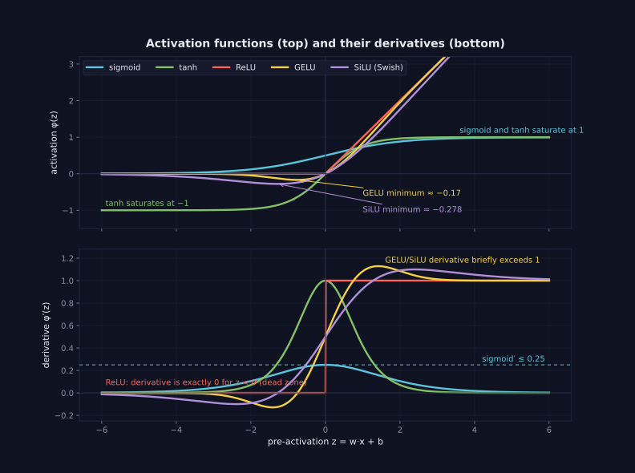

> Tier 3 · Neural Networks · **Level: beginner** · Reading time: about 10 minutes

# 3.9 Activation functions

**Metadata** — Tier: 3 · Phase: 1 · Priority: P0 · Difficulty: 2/5 · Interview: Very high · Hands-on: Very high
Prerequisites: 3.8, 1.20, 1.21, 1.42 · Leads to: 3.10–3.15, 3.25 Vanishing gradients, 3.22–3.24 Initialisation

> **In plain words**
> An **activation function** is a **bend** applied to each neuron's weighted sum: `a = φ(z)`. Without bends, any number of layers collapses into **one straight-line (linear) map**. With a bend between layers, many straight pieces can draw curves.
> Different bends behave differently: some **flatten out at the ends** (sigmoid, tanh: gradients vanish), some **switch off for negatives** (ReLU), some are **smooth versions of that** (GELU, SiLU). The choice affects how well the network trains.

**You need first:** 3.8 Weighted sum, 1.21 Derivatives.

> **Figure 3.9-1 — activation functions and their derivatives**
>
> 
>
> *How to read it:* **top** — what each function outputs for a given pre-activation `z`. **Bottom** — how much each lets the gradient through in backpropagation (3.20). Sigmoid's derivative never exceeds 0.25, and tanh's is near 1 only around `z = 0`; both fall to about 0 in the tails (*saturation*). ReLU's derivative is exactly 0 for `z < 0` (the dead zone) and 1 for `z > 0`. GELU and SiLU are smooth ReLU-like curves that dip slightly below zero, and their derivatives briefly exceed 1.
>
> *Generated by* `tier-03-neural-networks/figures/src/fig_3_09_activations.py`.

**Words you'll meet on this page**

| Word | What it means here |
|---|---|
| activation `φ` | the non-linear function applied to `z` |
| saturation | the flat part of a curve, where the gradient ≈ 0 |
| dead unit | a ReLU whose input is always negative |
| zero-centred | outputs balanced around 0 |
| collapse | stacked linear layers equal one linear layer |
| range | the values the function can output |
| monotonic | never decreases as `z` increases |

### 1. What is it?
Non-linear functions `φ` applied element-wise to the weighted sum: `a = φ(z)`. They give networks the ability to represent non-linear relationships.

### 2. Why does it exist?
Stacking linear layers gives only a linear map: two Dense layers collapse into one. The activation breaks that collapse and sets how gradients flow.

### 3. Detailed explanation
- **The collapse:** `W₂(W₁x) = (W₂W₁)x`. An 8 → 6 → 3 network of two linear layers has `54 + 21 = 75` parameters but computes exactly what a single 27-parameter linear map does. With a ReLU in between, the equality fails.
- **Properties to compare:** non-linearity, differentiability (almost everywhere is enough), output range, monotonicity, zero-centring, **saturation** (flat regions where the gradient ≈ 0), cost, and behaviour on negative inputs.
- **Where each is used:** hidden layers → the ReLU family, GELU or SiLU; recurrent gates → sigmoid and tanh; outputs → identity (regression), sigmoid (binary), softmax (multiclass) (3.5).
- **Gradient flow:** backpropagation multiplies by `φ′(z)` at every layer (1.25). If `φ′ ≤ 0.25` (sigmoid), ten layers give at most `0.25¹⁰ ≈ 9.5 × 10⁻⁷` (3.25).
- **Interaction with initialisation:** He initialisation is derived for ReLU, Xavier for tanh-like (3.23–3.24).
- **Choosing:** default to GELU or SiLU in Transformers and ReLU in CNNs and MLPs; test alternatives; the differences are usually modest compared with data, architecture and optimisation.
- **Implementation:** vectorised and numerically stable, with derivatives checked against autograd.

| activation | range | max derivative | where its slope is almost 0 |
|---|---|---|---|
| sigmoid | (0, 1) | 0.25 | both tails |
| tanh | (−1, 1) | 1.0 | both tails |
| ReLU | [0, ∞) | 1 | all negative inputs |
| Leaky ReLU | (−∞, ∞) | 1 | nowhere |
| GELU | ≈ [−0.17, ∞) | ≈ 1.13 | far negative |
| SiLU | ≈ [−0.28, ∞) | ≈ 1.10 | far negative |

### 4. How does it work?
Apply `φ` element-wise to `Z`; in backpropagation multiply the upstream gradient by `φ′(Z)`.

### 5. Simple example
A bend that lets many straight lines draw a curve.

**By hand.** Two inputs `x = 1`, `x = −1` through `W₁ = 1`, then ReLU, then `W₂ = 1`: outputs `1` and `0`. Without ReLU the outputs would be `1` and `−1`, always a straight line through the origin. The bend makes the response depend on the sign.

### 6. Technical example
A Transformer's feed-forward block: `FFN(x) = W₂ φ(W₁x + b₁) + b₂` with `φ` = GELU or SiLU.

### 7. Code
**① By hand (plain Python).** The functions and their ranges.

```python
import math

sigmoid = lambda z: 1 / (1 + math.exp(-z))
relu = lambda z: max(0.0, z)
for z in (-5, -1, 0, 1, 5):
    print(f"z = {z:>2}:  sigmoid {sigmoid(z):.3f}   tanh {math.tanh(z):+.3f}   relu {relu(z):.1f}")
```

```text
z = -5:  sigmoid 0.007   tanh -1.000   relu 0.0
z = -1:  sigmoid 0.269   tanh -0.762   relu 0.0
z =  0:  sigmoid 0.500   tanh +0.000   relu 0.0
z =  1:  sigmoid 0.731   tanh +0.762   relu 1.0
z =  5:  sigmoid 0.993   tanh +1.000   relu 5.0
```

**② With NumPy.** The collapse of linear layers, and the slope table.

```python
import numpy as np

rng = np.random.default_rng(7)
x, W1, W2 = rng.standard_normal(5), rng.standard_normal((4, 5)), rng.standard_normal((3, 4))
relu = lambda v: np.maximum(v, 0)
print("two linear layers equal one:", np.allclose(W2 @ (W1 @ x), (W2 @ W1) @ x))
print("with ReLU between they differ :", not np.allclose(W2 @ relu(W1 @ x), (W2 @ W1) @ x))

z = np.linspace(-6, 6, 1201)
sig = 1 / (1 + np.exp(-z))
slopes = {"sigmoid": sig * (1 - sig), "tanh": 1 - np.tanh(z) ** 2, "relu": (z > 0).astype(float)}
for name, d in slopes.items():
    print(f"{name:<8} max slope {d.max():.2f}   share of inputs with slope < 0.01: {np.mean(d < 0.01):.1%}")
```

```text
two linear layers equal one: True
with ReLU between they differ : True
sigmoid  max slope 0.25   share of inputs with slope < 0.01: 23.6%
tanh     max slope 1.00   share of inputs with slope < 0.01: 50.1%
relu     max slope 1.00   share of inputs with slope < 0.01: 50.0%
```

**③ With PyTorch.** All the standard activations.

```python
import torch

z = torch.tensor([-3.0, -1.0, 0.0, 1.0, 3.0])
for name, f in (("sigmoid", torch.sigmoid), ("tanh", torch.tanh), ("relu", torch.relu), ("leaky_relu", torch.nn.functional.leaky_relu),
                ("gelu", torch.nn.functional.gelu), ("silu", torch.nn.functional.silu)):
    print(f"{name:<11}", [round(v, 3) for v in f(z).tolist()])
```

```text
sigmoid     [0.047, 0.269, 0.5, 0.731, 0.953]
tanh        [-0.995, -0.762, 0.0, 0.762, 0.995]
relu        [0.0, 0.0, 0.0, 1.0, 3.0]
leaky_relu  [-0.03, -0.01, 0.0, 1.0, 3.0]
gelu        [-0.004, -0.159, 0.0, 0.841, 2.996]
silu        [-0.142, -0.269, 0.0, 0.731, 2.858]
```

### 8. Input → Process → Output
`z → φ(z) → a;   backward: dz = da · φ′(z)`

<details>
<summary><b>Beyond the basics (sections 9–16)</b> — real-world use, limits, mistakes. Skip on a first read.</summary>

### 9. Enterprise use case
Export and compilation tools must support the chosen activation; approximations (for example tanh-GELU) can change numerics slightly.

### 10. AI engineering connection
The activation choice affects trainability, quantisation sensitivity and kernel fusion in LLMs (Tier 11).

### 11. Advantages
Provide expressiveness; cheap.

### 12. Limitations
Saturating ones cause vanishing gradients; ReLUs can die; non-monotone ones are slightly pricier.

### 13. Trade-offs
Smoothness (GELU, SiLU) versus simplicity and sparsity (ReLU).

### 14. Common mistakes
Omitting activations between layers; sigmoid hidden units in deep networks; mismatched initialisation; using softmax as a hidden activation; forgetting that the output activation belongs in the loss.

### 15. Performance / cost
Element-wise operations are memory-bound; fuse them with the preceding matmul (kernel fusion).

### 16. Security
Nothing specific.

</details>

### 17. Interview explanation
"Without a non-linearity a stack of linear layers is just one linear map. I choose activations by gradient behaviour: ReLU, GELU or SiLU for hidden layers, sigmoid or softmax at outputs, and I pair the choice with the right initialisation. Saturating activations multiply gradients by small numbers, which is why they vanish in deep networks."

### 18. Rapid-fire answer
An element-wise non-linearity that prevents layer collapse; compare range, saturation and derivative; ReLU, GELU or SiLU in hidden layers, sigmoid or softmax at outputs.

### 19. Interview questions
- **Basic:** Why can't we skip activation functions?
- **Intermediate:** What is saturation, and which activations suffer from it?
- **Advanced:** Show how activation derivatives bound the gradient through depth.
- **Scenario:** A deep sigmoid network doesn't train. What do you change first?

### 20. Hands-on exercise
**Goal:** compare activations on one task.

1. Train a small PyTorch MLP (`2 → 16 → 1`) on the circle problem (points inside the unit circle are class 1) with `Sigmoid`, `Tanh`, `ReLU` and `GELU` as the hidden activation.
2. Print the test accuracy for each after 300 steps.

<details>
<summary>Show a solution</summary>

```python
import torch

torch.manual_seed(0)
X = torch.rand(1500, 2) * 3 - 1.5
y = ((X ** 2).sum(dim=1) < 1).float()

def accuracy(act):
    torch.manual_seed(1)
    net = torch.nn.Sequential(torch.nn.Linear(2, 16), act, torch.nn.Linear(16, 1))
    opt = torch.optim.Adam(net.parameters(), lr=0.05)
    for _ in range(300):
        opt.zero_grad()
        torch.nn.functional.binary_cross_entropy_with_logits(net(X[:1000]).squeeze(1), y[:1000]).backward()
        opt.step()
    return ((net(X[1000:]).squeeze(1) > 0).float() == y[1000:]).float().mean().item()

for name, act in (("sigmoid", torch.nn.Sigmoid()), ("tanh", torch.nn.Tanh()), ("relu", torch.nn.ReLU()), ("gelu", torch.nn.GELU())):
    print(f"{name:<8} test accuracy {accuracy(act):.3f}")
```

```text
sigmoid  test accuracy 0.986
tanh     test accuracy 0.990
relu     test accuracy 0.986
gelu     test accuracy 0.992
```

On a small, shallow problem all of them work; the differences show up with depth and in training speed.
</details>

### 21. Revision questions
1. Prove the collapse of linear layers.
2. What is saturation?
3. What are the defaults for hidden and output layers?

### 22. Related concepts
3.10 Sigmoid · 3.11 Tanh · 3.12 ReLU · 3.13 GELU · 3.14 SiLU · 3.15 Softmax · 3.25 Vanishing gradients

### 23. One-line memory hook
**Activation: the bend that lets many straight lines draw a curve.**

<details>
<summary><b>For reviewers</b> (not part of the lesson)</summary>

- Status: DRAFT, learner-first layout (Author: Claude). Code is executed by `tests/test_md_snippets.py`.
- TESTED earlier: `test_activation_values_and_derivatives_match_torch`, `test_activation_properties`, `lab_01_neurons_and_mlp.ex_3_9_to_3_14` (on x ∈ [−6, 6]: sigmoid max slope 0.25, 23.6% of inputs with slope < 0.01; tanh 1.0 / 50.1%; ReLU 1 / 50.0%; Leaky ReLU 0%; GELU max ≈ 1.129, 24.9%; SiLU ≈ 1.10, 0.7%). The page's table gives approximate max slopes; the snippet prints fresh fractions for sigmoid, tanh and ReLU.
- Figure values are from the figure script.
</details>
