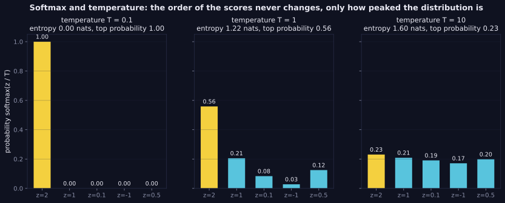

> Tier 3 · Neural Networks · **Level: beginner** · Reading time: about 9 minutes

# 3.15 Softmax

**Metadata** — Tier: 3 · Phase: 1 · Priority: P0 · Difficulty: 2/5 · Interview: Very high · Hands-on: Very high
Prerequisites: 1.42, 1.43, 1.28 · Leads to: 2.14 Classification, 1.37 Cross-entropy, Tier 7 Attention, Tier 16 sampling

> **In plain words**
> **Softmax** turns a list of raw scores (**logits**) into a list of **probabilities that are positive and add up to 1**: "scores in, vote shares out". The biggest score gets the biggest share, but every class keeps a little.
> A **temperature** knob controls sharpness: low temperature → nearly all the probability on the top score; high temperature → nearly equal shares. That is exactly what the "temperature" setting of a chatbot does.

**You need first:** 1.42 Exponentials, 1.43 Log-sum-exp.

> **Figure 3.15-1 — softmax and temperature**
>
> 
>
> *How to read it:* the scores `z = [2, 1, 0.1, −1, 0.5]` never change order. At `T = 0.1` softmax is almost one-hot (top probability 1.00, entropy 0); at `T = 1` the top probability is 0.56 (entropy 1.22 nats); at `T = 10` it is nearly uniform (top 0.23, entropy 1.60). Temperature controls how sharp the distribution is, which is what sampling settings exploit.
>
> *Generated by* `tier-03-neural-networks/figures/src/t3_concepts.py`.

**Words you'll meet on this page**

| Word | What it means here |
|---|---|
| softmax | `exp(zᵢ)/Σ exp(zⱼ)` |
| logits | the raw scores |
| temperature `T` | divides the logits first: `softmax(z/T)` |
| entropy | how spread out the probabilities are (1.36) |
| shift invariance | adding the same number to all logits changes nothing |
| log-softmax | `z − logsumexp(z)`: the stable log of softmax |
| closed set | softmax always assumes the answer is one of the known classes |

### 1. What is it?
`softmax(z)ᵢ = exp(zᵢ) / Σⱼ exp(zⱼ)`: turns a vector of scores (logits) into a probability distribution over `K` classes: positive, summing to 1.

### 2. Why does it exist?
Classification and next-token prediction need a categorical distribution; softmax provides one with a clean gradient when paired with cross-entropy.

### 3. Detailed explanation
- **Properties:** each row sums to 1; **shift-invariant** (`softmax(z + c) = softmax(z)`); preserves the order of the logits (the argmax is unchanged).
- **Stable form:** subtract the maximum before exponentiating (1.43); `log_softmax` is `z − logsumexp(z)`. A naive softmax of `[1000, 0]` overflows to NaN; the stable one is finite.
- **Temperature `T`:** `softmax(z/T)`. `T → 0` approaches argmax; `T → ∞` approaches uniform; the argmax never changes. Used in sampling (Tier 16) and distillation.
- **Sigmoid as a special case:** for two classes `softmax([a, b])₁ = σ(a − b)`.
- **Gradient with cross-entropy:** `∂L/∂z = softmax(z) − onehot(y)` (1.37). The Jacobian of softmax itself is `diag(p) − ppᵀ` (1.24), singular because the outputs sum to 1.
- **Attention:** attention weights are a softmax over the scores `QKᵀ/√d` (Tier 7): a different use of the same function.
- **Calibration:** softmax scores are *not* guaranteed to be probabilities of being correct (2.43); modern networks tend to be overconfident.
- **Closed-set assumption:** softmax forces the probabilities to sum to 1 over the known classes, so an out-of-distribution input still gets a confident class; add an "unknown" class, thresholds, or open-set methods.
- **Cost:** `O(K)` per example; with a 50k-token vocabulary the logits tensor `(B·T, V)` is a major memory consumer.

### 4. How does it work?
Shift by the maximum, exponentiate, normalise.


### 5. Simple example
Turning raw scores into vote shares that add up to 100%.

**By hand.** Logits `[2.0, 1.0, 0.1]`:

| class | `exp(z)` | share |
|---|---|---|
| A | 7.39 | 0.659 |
| B | 2.72 | 0.242 |
| C | 1.11 | 0.099 |

Dividing the logits by `T = 0.1` first gives `[20, 10, 1]` → shares `[1.000, 0.000, 0.000]` (almost one-hot); dividing by `T = 10` gives `[0.2, 0.1, 0.01]` → shares `[0.37, 0.33, 0.30]` (almost uniform).

### 6. Technical example
The final layer of an image classifier: 1,000 logits → softmax → class probabilities.

### 7. Code
**① By hand (plain Python).** A stable softmax with temperature.

```python
import math

def softmax(z, T=1.0):
    scaled = [v / T for v in z]
    m = max(scaled)                                           # subtract the max: no overflow
    e = [math.exp(v - m) for v in scaled]
    return [v / sum(e) for v in e]

z = [2.0, 1.0, 0.1]
for T in (0.1, 1.0, 10.0):
    print(f"T = {T:>4}: {[round(p, 3) for p in softmax(z, T)]}")
print("shift invariance:", [round(p, 3) for p in softmax([v + 100 for v in z])])
print("[1000, 0] is finite:", softmax([1000.0, 0.0]))
```

```text
T =  0.1: [1.0, 0.0, 0.0]
T =  1.0: [0.659, 0.242, 0.099]
T = 10.0: [0.366, 0.331, 0.303]
shift invariance: [0.659, 0.242, 0.099]
[1000, 0] is finite: [1.0, 0.0]
```

**② With NumPy.** Entropy against temperature.

```python
import numpy as np

def softmax(z, T=1.0):
    s = z / T
    e = np.exp(s - s.max())
    return e / e.sum()

z = np.array([2.0, 1.0, 0.1, -1.0, 0.5])
for T in (0.1, 1, 10):
    p = softmax(z, T)
    print(f"T = {T:>4}: top probability {p.max():.2f}   entropy {-(p[p > 0] * np.log(p[p > 0])).sum():.2f} nats   argmax {int(p.argmax())}")
```

```text
T =  0.1: top probability 1.00   entropy 0.00 nats   argmax 0
T =    1: top probability 0.56   entropy 1.22 nats   argmax 0
T =   10: top probability 0.23   entropy 1.60 nats   argmax 0
```

**③ With PyTorch.** The right axis, `log_softmax`, and the gradient.

```python
import torch

z = torch.tensor([[2.0, 1.0, 0.1], [0.0, 0.0, 0.0]], requires_grad=True)
p = torch.softmax(z, dim=1)                                       # dim=1: across the classes of each row
print("rows sum to 1:", [round(v, 6) for v in p.sum(dim=1).tolist()])
print("softmax of [0, 0, 0]:", [round(v, 3) for v in p[1].tolist()], "(uniform)")

loss = torch.nn.functional.cross_entropy(z, torch.tensor([0, 2]))
loss.backward()
onehot = torch.nn.functional.one_hot(torch.tensor([0, 2]), 3).float()
print("gradient equals (softmax - onehot) / batch:", torch.allclose(z.grad, (p.detach() - onehot) / 2))
```

```text
rows sum to 1: [1.0, 1.0]
softmax of [0, 0, 0]: [0.333, 0.333, 0.333] (uniform)
gradient equals (softmax - onehot) / batch: True
```

### 8. Input → Process → Output
`logits → exp(z − max) → normalise → probabilities`

<details>
<summary><b>Beyond the basics (sections 9–16)</b> — real-world use, limits, mistakes. Skip on a first read.</summary>

### 9. Enterprise use case
Probabilities from softmax feed thresholds and abstention rules; those require calibration checks.

### 10. AI engineering connection
Next-token distributions, attention weights, routing in mixture-of-experts gates, and classification heads.

### 11. Advantages
Differentiable, interpretable as a distribution, and pairs with cross-entropy.

### 12. Limitations
Overconfident; closed-world; costly with huge vocabularies.

### 13. Trade-offs
Temperature trades determinism against diversity.

### 14. Common mistakes
Softmax over the wrong axis (1.6); applying softmax before a loss that applies it; a naive unstable implementation; reading the scores as calibrated probabilities.

### 15. Performance / cost
Fused or online softmax kernels reduce memory traffic (the flash-attention idea).

### 16. Security
Confidence from softmax is exploitable by adversarial inputs; do not use it alone for safety gating.

</details>

### 17. Interview explanation
"Softmax exponentiates the logits and normalises them into a distribution. I compute it stably by subtracting the max, pair it with cross-entropy for the clean softmax-minus-label gradient, use temperature to control sharpness, and remember it's overconfident and closed-set, so I check calibration."

### 18. Rapid-fire answer
`exp(zᵢ)/Σ exp(zⱼ)`; sums to 1; shift-invariant; stable via the max-shift; temperature controls entropy; gradient softmax − one-hot.

### 19. Interview questions
- **Basic:** What is the softmax of `[0, 0, 0]`?
- **Intermediate:** Why is subtracting the max valid?
- **Advanced:** Show the softmax–cross-entropy gradient and the softmax Jacobian.
- **Scenario:** Your classifier gives 99% confidence to inputs from an unseen domain. Why, and what do you do?

### 20. Hands-on exercise
**Goal:** relate temperature to the number of "plausible" choices.

1. For logits `[3, 2, 1, 0, −1]`, compute the softmax at `T` = 0.2, 0.5, 1, 2, 5.
2. For each, count how many classes have probability above 5%.

<details>
<summary>Show a solution</summary>

```python
import numpy as np

z = np.array([3.0, 2.0, 1.0, 0.0, -1.0])
for T in (0.2, 0.5, 1, 2, 5):
    e = np.exp(z / T - (z / T).max())
    p = e / e.sum()
    print(f"T = {T:>3}: probabilities {p.round(3).tolist()}   classes above 5%: {int((p > 0.05).sum())}")
```

```text
T = 0.2: probabilities [0.993, 0.007, 0.0, 0.0, 0.0]   classes above 5%: 1
T = 0.5: probabilities [0.865, 0.117, 0.016, 0.002, 0.0]   classes above 5%: 2
T =   1: probabilities [0.636, 0.234, 0.086, 0.032, 0.012]   classes above 5%: 3
T =   2: probabilities [0.429, 0.26, 0.158, 0.096, 0.058]   classes above 5%: 5
T =   5: probabilities [0.287, 0.235, 0.192, 0.157, 0.129]   classes above 5%: 5
```

Low temperature narrows the plausible set to one choice; high temperature widens it. Sampling settings such as top-p act on exactly this distribution.
</details>

### 21. Revision questions
1. What are the properties of softmax?
2. What is the role of temperature?
3. How is it related to the sigmoid?

### 22. Related concepts
3.5 Output layer · 1.37 Cross-entropy · 1.43 Log-sum-exp · 2.43 Calibration · Tier 7 Attention

### 23. One-line memory hook
**Softmax: scores in, vote shares out.**

<details>
<summary><b>For reviewers</b> (not part of the lesson)</summary>

- Status: DRAFT, learner-first layout (Author: Claude). Code is executed by `tests/test_md_snippets.py`.
- TESTED earlier: `test_softmax_properties_and_torch`, `lab_01_neurons_and_mlp.ex_3_15` (mean entropy on random logits 0.051 / 1.06 / 1.77 nats at T = 0.1 / 1 / 10). Figure numbers (top probability 1.00 / 0.56 / 0.23, entropy 0 / 1.22 / 1.60) are from the figure script.
</details>
