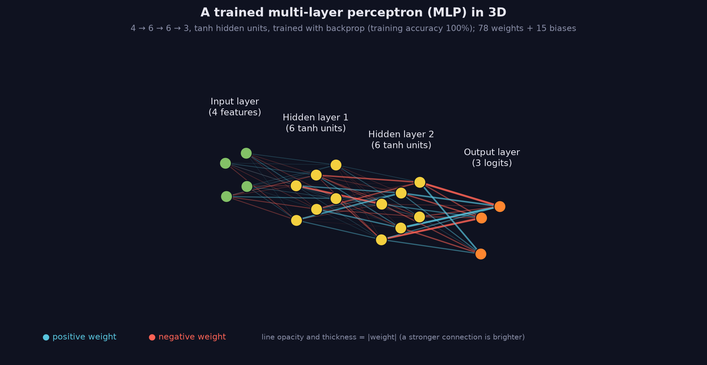

> Tier 3 · Neural Networks · **Level: beginner** · Reading time: about 11 minutes

# 3.17 Multi-layer perceptron (MLP)

**Metadata** — Tier: 3 · Phase: 1 · Priority: P0 · Difficulty: 2/5 · Interview: Very high · Hands-on: Very high
Prerequisites: 3.4, 3.9, 3.16 · Leads to: 3.18 Forward propagation, 3.20 Backpropagation, Tier 8 FFN

> **In plain words**
> An **MLP** is **dense layers stacked with bends (activations) in between**. Information flows one way, from input to output. It is the simplest network that can learn **curved** relationships, and the template for the feed-forward blocks inside every bigger architecture, including Transformers.
> A single neuron cannot solve XOR ("one or the other, but not both"). Add one hidden layer and it can. In theory one hidden layer with enough units can approximate any reasonable function; in practice size and trainability are what matter.

**You need first:** 3.4 Hidden layers, 3.9 Activation functions, 3.16 Dense layer.

> **Figure 3.17-1 — a trained MLP drawn in 3D**
>
> 
>
> *How to read it:* information flows left to right: 4 input features → two hidden layers of 6 tanh units → 3 output logits. Every unit connects to every unit of the next layer (*fully connected*), which is why this network has `4·6 + 6·6 + 6·3 = 78` weights plus 15 biases. **Blue** lines are positive weights, **red** negative; brighter and thicker means a larger `|weight|`. The few thick lines are the connections the network relies on most; the faint ones contribute little.
>
> *Generated by* `tier-03-neural-networks/figures/src/fig_3_17_mlp_3d.py`. The network was trained on a 3-class toy problem (100% training accuracy).

**Words you'll meet on this page**

| Word | What it means here |
|---|---|
| MLP | stacked dense layers with activations in between |
| feed-forward | information flows in one direction only |
| universal approximation | enough hidden units can approximate any continuous function |
| XOR | true when exactly one input is true |
| depth / width | number of layers / units per layer |
| decision boundary | where the predicted class changes |
| FFN | the MLP sub-layer inside a Transformer block |

### 1. What is it?
A **feed-forward network of Dense layers with non-linear activations between them**: `f(x) = W_L φ(… φ(W₁x + b₁) …) + b_L`. Information flows one way, from input to output.

### 2. Why does it exist?
It is the simplest neural network able to represent non-linear functions, and the template for the feed-forward parts of every larger architecture.

### 3. Detailed explanation
- **XOR solved by hand:** hidden units `h₁ = ReLU(x₁ + x₂)` and `h₂ = ReLU(x₁ + x₂ − 1)`, output `h₁ − 2h₂`, give `[0, 1, 1, 0]` exactly for the inputs `(0,0), (0,1), (1,0), (1,1)`. A single neuron cannot (3.2).
- **Training it:** a small tanh MLP reaches 100% on XOR with backpropagation; with no hidden layer the accuracy cannot reach 100%.
- **Curved boundaries:** for points labelled "outside the unit circle", a linear classifier is stuck near the majority share while a 16-unit tanh MLP is nearly perfect (3.4).
- **Universal approximation theorem:** a feed-forward network with one hidden layer and a suitable non-linear activation can approximate any continuous function on a compact set arbitrarily well *given enough hidden units*. It is an existence result: it says nothing about how many units are needed, whether gradient descent finds the weights, or whether the result generalises.
- **Width in practice:** when fitting `sin(x)` (code ③), the error falls as the hidden layer widens. Capacity is not the only limit, though: a wide network with a small training budget can still fit poorly.
- **Counting parameters:** 784 → 128 → 64 → 10 has 109,386.
- **Where MLPs appear:** tabular models, classification heads, embedding projections, and the **feed-forward sub-layer of every Transformer block** (typically hidden width ≈ 4 × `d_model`, Tier 8).
- **Limits:** no built-in structure (translation invariance, sequence order), so images and sequences usually need convolutions or attention for efficiency; MLPs on raw pixels are parameter-heavy.

### 4. How does it work?
`h₀ = x`, `hₗ = φ(Wₗhₗ₋₁ + bₗ)`; the final layer gives logits or values; a loss and backpropagation train all the weights (3.18, 3.20).


### 5. Simple example
A relay of simple deciders, each passing a re-described version of the problem to the next.

**XOR by hand.** Inputs `(x₁, x₂)`:

| `(x₁, x₂)` | `h₁ = ReLU(x₁ + x₂)` | `h₂ = ReLU(x₁ + x₂ − 1)` | `y = h₁ − 2h₂` |
|---|---|---|---|
| (0, 0) | 0 | 0 | **0** |
| (0, 1) | 1 | 0 | **1** |
| (1, 0) | 1 | 0 | **1** |
| (1, 1) | 2 | 1 | **0** |

### 6. Technical example
A credit-scoring model: 40 standardised features → 64 → 32 → 1 logit with dropout, trained with BCE.

### 7. Code
**① By hand (plain Python).** XOR with two hidden ReLU units.

```python
relu = lambda v: max(0.0, v)

def xor_net(x1, x2):
    h1, h2 = relu(x1 + x2), relu(x1 + x2 - 1)
    return h1 - 2 * h2

for x1, x2 in [(0, 0), (0, 1), (1, 0), (1, 1)]:
    print(f"XOR({x1}, {x2}) = {xor_net(x1, x2):.0f}")
```

```text
XOR(0, 0) = 0
XOR(0, 1) = 1
XOR(1, 0) = 1
XOR(1, 1) = 0
```

**② With NumPy.** Parameter counts and a forward pass through an MLP, layer by layer.

```python
import numpy as np

sizes = [784, 128, 64, 10]
rng = np.random.default_rng(0)
Ws = [rng.normal(0, np.sqrt(2 / a), (b, a)) for a, b in zip(sizes, sizes[1:])]       # He-scaled weights
bs = [np.zeros(b) for b in sizes[1:]]
print("parameters:", sum(W.size + b.size for W, b in zip(Ws, bs)))

h = rng.normal(0, 1, (32, 784))
for i, (W, b) in enumerate(zip(Ws, bs)):
    h = h @ W.T + b
    if i < len(Ws) - 1:
        h = np.maximum(h, 0)                                    # ReLU between layers, none at the end (logits)
print("output (logits) shape for a batch of 32:", h.shape)
```

```text
parameters: 109386
output (logits) shape for a batch of 32: (32, 10)
```

**③ With PyTorch.** Train an MLP to fit `sin(x)` with different widths.

```python
import torch

x = torch.linspace(-3, 3, 200).unsqueeze(1)
y = torch.sin(x)
for width in (1, 2, 4, 16):
    torch.manual_seed(0)
    net = torch.nn.Sequential(torch.nn.Linear(1, width), torch.nn.Tanh(), torch.nn.Linear(width, 1))
    opt = torch.optim.Adam(net.parameters(), lr=0.03)
    for _ in range(1500):
        opt.zero_grad()
        loss = ((net(x) - y) ** 2).mean()
        loss.backward()
        opt.step()
    print(f"hidden width {width:>2}: final mean squared error {loss.item():.4f}")
```

```text
hidden width  1: final mean squared error 0.0464
hidden width  2: final mean squared error 0.0037
hidden width  4: final mean squared error 0.0009
hidden width 16: final mean squared error 0.0001
```

### 8. Input → Process → Output
`x → Dense → φ → … → Dense → logits → loss`

<details>
<summary><b>Beyond the basics (sections 9–16)</b> — real-world use, limits, mistakes. Skip on a first read.</summary>

### 9. Enterprise use case
Strong tabular baselines after gradient-boosted trees; easy to serve (small matrix multiplications).

### 10. AI engineering connection
Transformer feed-forward blocks, adapters, projection heads, router networks, reward-model heads.

### 11. Advantages
Simple, general, trainable end to end.

### 12. Limitations
Many parameters for structured data; needs scaling and tuning; can overfit small data.

### 13. Trade-offs
Depth and width versus data and compute (2.30).

### 14. Common mistakes
No activations between layers; unscaled inputs; too large for the dataset; ignoring initialisation; using MLPs on raw images or sequences without considering better inductive biases.

### 15. Performance / cost
Compute ≈ 2 × parameters per example; batch for efficiency.

### 16. Security
As for other models: memorisation and adversarial vulnerability.

</details>

### 17. Interview explanation
"An MLP is stacked dense layers with non-linearities. One hidden layer is enough in theory to approximate any continuous function, but the theorem gives no size or trainability guarantee. I can show XOR needs a hidden layer, count parameters layer by layer, and point out that the Transformer's feed-forward sub-layer is just an MLP."

### 18. Rapid-fire answer
Stacked Dense + activation layers; a universal approximator in theory; XOR needs a hidden layer; the basis of the Transformer FFN.

### 19. Interview questions
- **Basic:** How many parameters does a 10 → 20 → 5 MLP have?
- **Intermediate:** Build XOR with ReLU units by hand.
- **Advanced:** State the universal approximation theorem and its practical limits.
- **Scenario:** Your MLP underfits a simple tabular task. Order your checks (scaling, learning rate, width, activation, bugs).

### 20. Hands-on exercise
**Goal:** train a tiny MLP on XOR and read its weights.

1. Train a PyTorch `2 → 8 → 1` tanh network on the four XOR points for 1,000 steps.
2. Print its predictions.
3. Verify it fails without the hidden layer (a single `Linear(2, 1)`).

<details>
<summary>Show a solution</summary>

```python
import torch

X = torch.tensor([[0., 0.], [0., 1.], [1., 0.], [1., 1.]])
y = torch.tensor([0., 1., 1., 0.])

def train(net):
    opt = torch.optim.Adam(net.parameters(), lr=0.05)
    for _ in range(1000):
        opt.zero_grad()
        torch.nn.functional.binary_cross_entropy_with_logits(net(X).squeeze(1), y).backward()
        opt.step()
    return (net(X).squeeze(1) > 0).int().tolist()

torch.manual_seed(0)
print("with a hidden layer   :", train(torch.nn.Sequential(torch.nn.Linear(2, 8), torch.nn.Tanh(), torch.nn.Linear(8, 1))), "(target [0, 1, 1, 0])")
print("without a hidden layer:", train(torch.nn.Linear(2, 1)), "(cannot get all four right)")
```

```text
with a hidden layer   : [0, 1, 1, 0] (target [0, 1, 1, 0])
without a hidden layer: [1, 0, 1, 0] (cannot get all four right)
```

</details>

### 21. Revision questions
1. How does the XOR network work?
2. What does the universal approximation theorem say, and not say?
3. Where does the MLP appear in Transformers?

### 22. Related concepts
3.4 Hidden layers · 3.9 Activation functions · 3.16 Dense layer · 3.18 Forward propagation · 3.20 Backpropagation · Tier 8

### 23. One-line memory hook
**An MLP is dense layers with bends in between: enough bends, any curve.**

<details>
<summary><b>For reviewers</b> (not part of the lesson)</summary>

- Status: DRAFT, learner-first layout (Author: Claude). Code is executed by `tests/test_md_snippets.py`.
- TESTED earlier: `test_mlp_solves_xor_and_regression_improves`, `test_mlp_backprop_matches_numerical_and_torch`, `lab_01_neurons_and_mlp.ex_3_17` (circle: linear 60.1% vs 16-unit tanh MLP 99.4%; `sin(x)` fit width 1/2/4/16/64: MSE 0.046/0.0154/0.0094/0.0028/0.0096, the 64-unit net being under-trained in the lab's fixed budget).
- The universal approximation statement is the standard theorem, kept deliberately informal.
</details>
