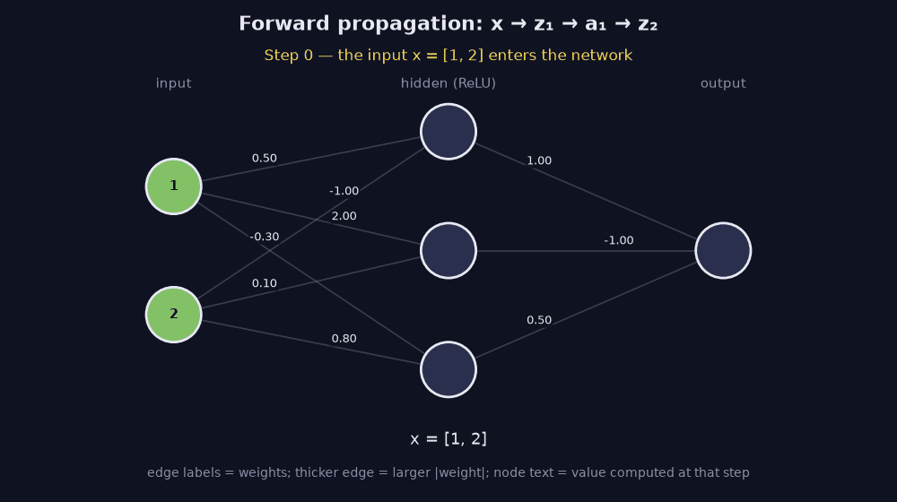
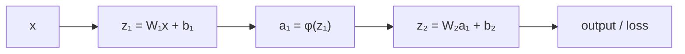

> Tier 3 · Neural Networks · **Level: absolute beginner** · Reading time: about 8 minutes

# 3.18 Forward propagation

**Metadata** — Tier: 3 · Phase: 1 · Priority: P0 · Difficulty: 1/5 · Interview: High · Hands-on: Very high
Prerequisites: 3.8, 3.9, 3.16, 3.17 · Leads to: 3.19 Computational graph, 3.20 Backpropagation, Tier 4 Training loop

> **In plain words**
> **Forward propagation** is **feeding the input through the network, layer by layer, to get the output**: weighted sum, bias, activation; repeat. It is what happens every time you *use* a model, and it is the first half of every training step.
> Like an assembly line: each station transforms what it receives and passes it on. While **training**, the network must also **keep the receipts** (the intermediate values), because the backward pass needs them.

**You need first:** 3.8 Weighted sum, 3.9 Activation functions, 3.16 Dense layer, 3.17 MLP.

> **Figure 3.18-1 — the forward pass, step by step (animated)**
>
> 
>
> *How to read it:* watch the yellow dots travel along the edges. **Step 1** computes the weighted sums `z₁ = W₁x + b₁ = [−1.5, 3.2, 1.1]`. **Step 2** applies ReLU: the first unit is negative so it is switched off (red, value 0) while 3.2 and 1.1 pass unchanged. **Step 3** combines them with the output weights: `1·0 + (−1)·3.2 + 0.5·1.1 + 0.1 = −2.55`. Edge labels are the weights; thicker edges mean larger `|weight|`.
>
> *Generated by* `tier-03-neural-networks/figures/src/fig_3_18_forward_pass.py`. The final output is asserted equal to `nn.MLP.forward` before the animation is drawn.

**Words you'll meet on this page**

| Word | What it means here |
|---|---|
| forward pass | computing the output from the input |
| pre-activation `z` | the weighted sum before the activation |
| activation `a` | the value after the activation |
| cache | intermediate values kept for backpropagation |
| train / eval mode | dropout and BatchNorm behave differently |
| activation checkpointing | recompute activations instead of storing them |
| prefill / decode | processing a prompt / generating one token at a time |

### 1. What is it?
Computing the network's output from its input by applying each layer in order: `a₀ = x`, `zₗ = Wₗaₗ₋₁ + bₗ`, `aₗ = φ(zₗ)`, … until the final output (logits or values), and then the loss.

### 2. Why does it exist?
It is the prediction step at inference time and the first half of every training step. The values it computes are cached for the backward pass.

### 3. Detailed explanation
- **Deterministic:** with fixed weights and no dropout (3.28), the same input always gives the same output. Batch-dependent layers (BatchNorm, 3.30) are the exception in training mode.
- **Cost:** about `2 × (number of weights)` FLOPs per example: 218,368 for 784 → 128 → 64 → 10 (weights only). The cost for a batch scales linearly.
- **Memory:** inference can discard each activation after use. **Training must keep them** for the backward pass: for batch 32 on 784 → 128 → 64 → 10 that is `32 × (784 + 128 + 64 + 10) = 31,552` numbers just for the layer outputs. For large models, activation memory often exceeds parameter memory, hence *activation checkpointing* (Tier 4).
- **Train versus eval mode:** dropout and batch normalisation behave differently (3.28, 3.30); forgetting `model.eval()` is a classic bug.
- **Numerical issues:** overflow in activations or logits (1.44); use stable softmax and loss (1.43).
- **Batching:** one matmul per layer for the whole batch (3.8); sequences add a time axis (Tiers 7–8).
- **Autoregressive generation** repeats a forward pass per generated token (with a KV cache to avoid recomputation, Tier 11).

### 4. How does it work?
Loop over the layers: `x = layer.forward(x)`; keep each layer's inputs for the backward pass when training.



### 5. Simple example
An assembly line: each station transforms what it receives and passes it on.

**A full worked trace.** Input `x = [1, 2]`; a 2 → 3 → 1 network with ReLU.
- `W₁ = [[0.5, −1], [2, 0.1], [−0.3, 0.8]]`, `b₁ = [0, 1, −0.2]`.
- `z₁ = [0.5·1 − 1·2 + 0, 2·1 + 0.1·2 + 1, −0.3·1 + 0.8·2 − 0.2] = [−1.5, 3.2, 1.1]`.
- `a₁ = ReLU(z₁) = [0, 3.2, 1.1]` (the first unit is switched off).
- `W₂ = [1, −1, 0.5]`, `b₂ = 0.1`: `z₂ = 0·1 − 3.2 + 0.55 + 0.1 = −2.55`.

### 6. Technical example
A Transformer forward pass: embedding → N blocks of (attention, MLP) with residuals and norms → output projection.

### 7. Code
**① By hand (plain Python).** The worked trace.

```python
x = [1.0, 2.0]
W1 = [[0.5, -1.0], [2.0, 0.1], [-0.3, 0.8]]
b1 = [0.0, 1.0, -0.2]
W2, b2 = [1.0, -1.0, 0.5], 0.1

z1 = [sum(w * v for w, v in zip(row, x)) + b for row, b in zip(W1, b1)]
a1 = [max(0.0, z) for z in z1]
z2 = sum(w * a for w, a in zip(W2, a1)) + b2
print("z1 =", [round(v, 2) for v in z1])
print("a1 =", [round(v, 2) for v in a1])
print("output =", round(z2, 2))
```

```text
z1 = [-1.5, 3.2, 1.1]
a1 = [0.0, 3.2, 1.1]
output = -2.55
```

**② With NumPy.** The same trace as matrices, and how much memory training must cache.

```python
import numpy as np

x = np.array([[1.0, 2.0]])
W1 = np.array([[0.5, -1], [2, 0.1], [-0.3, 0.8]]); b1 = np.array([0, 1, -0.2])
W2 = np.array([[1, -1, 0.5]]);                        b2 = np.array([0.1])
z1 = x @ W1.T + b1; a1 = np.maximum(0, z1); z2 = a1 @ W2.T + b2
print(z1, a1, z2)

sizes = [784, 128, 64, 10]
print("weights-only FLOPs per example:", sum(2 * a * b for a, b in zip(sizes, sizes[1:])))
print("numbers cached for a batch of 32 (layer outputs):", 32 * sum(sizes))
```

```text
[[-1.5  3.2  1.1]] [[0.  3.2 1.1]] [[-2.55]]
weights-only FLOPs per example: 218368
numbers cached for a batch of 32 (layer outputs): 31552
```

**③ With PyTorch.** The same network; train versus eval mode matters.

```python
import torch

net = torch.nn.Sequential(torch.nn.Linear(2, 3), torch.nn.ReLU(), torch.nn.Linear(3, 1))
with torch.no_grad():
    net[0].weight.copy_(torch.tensor([[0.5, -1.0], [2.0, 0.1], [-0.3, 0.8]])); net[0].bias.copy_(torch.tensor([0.0, 1.0, -0.2]))
    net[2].weight.copy_(torch.tensor([[1.0, -1.0, 0.5]]));                      net[2].bias.copy_(torch.tensor([0.1]))
print("output:", round(net(torch.tensor([[1.0, 2.0]])).item(), 2))

torch.manual_seed(0)
drop = torch.nn.Sequential(torch.nn.Linear(2, 8), torch.nn.Dropout(0.5))
x = torch.ones(1, 2)
drop.train(); a, b = drop(x), drop(x)
drop.eval();  c, d = drop(x), drop(x)
print("train mode: same input, two different outputs:", not torch.equal(a, b))
print("eval  mode: same input, same output          :", torch.equal(c, d))
```

```text
output: -2.55
train mode: same input, two different outputs: True
eval  mode: same input, same output          : True
```

### 8. Input → Process → Output
`x → z₁ → a₁ → … → logits → loss (cache the activations if training)`

<details>
<summary><b>Beyond the basics (sections 9–16)</b> — real-world use, limits, mistakes. Skip on a first read.</summary>

### 9. Enterprise use case
Inference services are forward-only; their latency and cost are governed by forward FLOPs and memory bandwidth.

### 10. AI engineering connection
LLM inference is repeated forward propagation; *prefill* processes the prompt in parallel, *decode* is one token per pass (Tier 11).

### 11. Advantages
Simple, parallel across the batch, no parameter updates.

### 12. Limitations
Sequential over layers; cached activations dominate training memory.

### 13. Trade-offs
Activation checkpointing trades extra forward recomputation for memory.

### 14. Common mistakes
Forgetting eval mode; mixing up pre- and post-activation values; computing in float16 without care; storing activations at inference.

### 15. Performance / cost
Fuse the bias and activation; use batched matrix multiplications; reduce precision (Tier 11).

### 16. Security
Inputs flow through the whole model: validate shapes and ranges at the entry (3.3).

</details>

### 17. Interview explanation
"Forward propagation applies each layer in order (weighted sum, bias, activation) to produce the output and then the loss. At inference I can throw activations away; in training I keep them because backprop needs them, which is why training memory is dominated by activations rather than weights."

### 18. Rapid-fire answer
`z = Wa + b`, `a = φ(z)` layer by layer; about `2·weights` FLOPs per example; training caches activations; eval versus train mode matters.

### 19. Interview questions
- **Basic:** Compute the forward pass for a given 2 → 2 → 1 network.
- **Intermediate:** Why does training use more memory than inference?
- **Advanced:** What is activation checkpointing and what does it trade?
- **Scenario:** Predictions differ between runs of the same input in production. Possible causes?

### 20. Hands-on exercise
**Goal:** estimate activation memory for a Transformer.

1. A 24-layer Transformer with `d = 1024`, batch 8, sequence 2,048, stored in fp16 (2 bytes).
2. Assume each layer keeps about `20 · B · T · d` numbers of activations (a rough rule of thumb).
3. Estimate the total in GB.

<details>
<summary>Show a solution</summary>

```python
layers, d, B, T, bytes_per = 24, 1024, 8, 2048, 2
per_layer = 20 * B * T * d                                  # rough rule of thumb: ~20 tensors of size B*T*d per layer
total_gb = layers * per_layer * bytes_per / 1e9
print(f"per layer: {per_layer * bytes_per / 1e9:.2f} GB   total for {layers} layers: {total_gb:.1f} GB")
print("(this is why activation checkpointing exists)")
```

```text
per layer: 0.67 GB   total for 24 layers: 16.1 GB
(this is why activation checkpointing exists)
```

</details>

### 21. Revision questions
1. What is the layer recursion?
2. What must be cached for training?
3. How do train and eval mode differ?

### 22. Related concepts
3.16 Dense layer · 3.17 MLP · 3.19 Computational graph · 3.20 Backpropagation · Tier 11 Inference

### 23. One-line memory hook
**Forward pass: feed the input through, and keep the receipts for later.**

<details>
<summary><b>For reviewers</b> (not part of the lesson)</summary>

- Status: DRAFT, learner-first layout (Author: Claude). Code is executed by `tests/test_md_snippets.py`.
- TESTED earlier: `test_forward_propagation_hand_trace` (the library's forward equals the hand trace −2.55). Figure values are from the figure script.
- The `20·B·T·d` per-layer activation figure in the exercise is a rough rule of thumb, flagged as such (REVIEW_REQUIRED for exact accounting).
</details>
