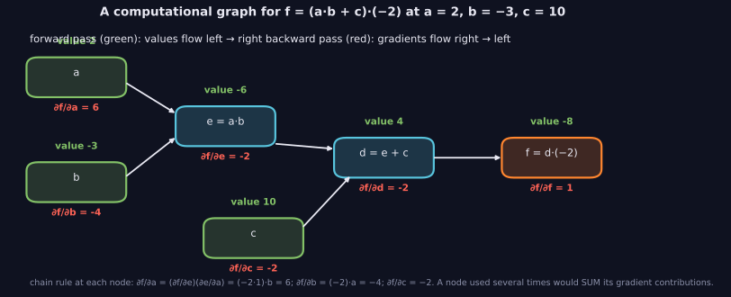
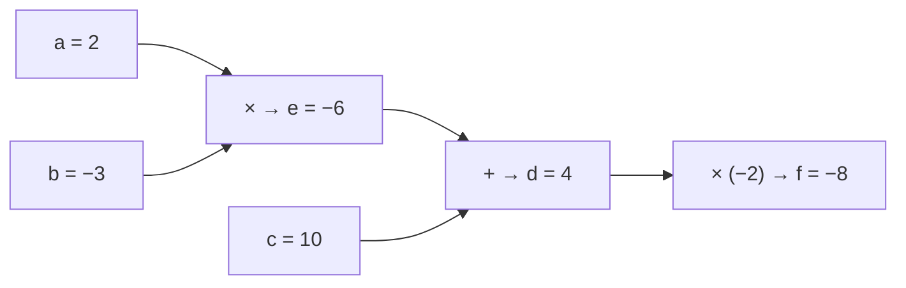

> Tier 3 · Neural Networks · **Level: beginner** · Reading time: about 9 minutes

# 3.19 Computational graph

**Metadata** — Tier: 3 · Phase: 1 · Priority: P0 · Difficulty: 2/5 · Interview: High · Hands-on: High
Prerequisites: 3.18, 1.25 · Leads to: 3.20 Backpropagation, 3.21 Automatic differentiation

> **In plain words**
> A **computational graph** is a **flowchart of a calculation**: boxes are values (inputs, weights, intermediate results) and arrows are the operations connecting them. Computing forward means following the arrows; computing **gradients** means walking them **backwards**.
> The trick that makes learning automatic: **each operation only needs to know its own tiny derivative**. The graph chains them. If a value is used in several places, its gradient is the **sum** of the contributions.

**You need first:** 3.18 Forward propagation, 1.25 Chain rule.

> **Figure 3.19-1 — a computational graph with forward values and gradients**
>
> 
>
> *How to read it:* values flow left to right: `e = a·b = −6`, `d = e + c = 4`, `f = d·(−2) = −8`. Gradients flow right to left by the chain rule: `∂f/∂d = −2`, `∂f/∂e = −2`, `∂f/∂c = −2`, `∂f/∂a = (−2)·b = 6` and `∂f/∂b = (−2)·a = −4`. If a node were used more than once its gradients would be summed.
>
> *Generated by* `tier-03-neural-networks/figures/src/t3_concepts.py`. The numbers come from `autodiff.Value`.

**Words you'll meet on this page**

| Word | What it means here |
|---|---|
| node | a value in the graph |
| edge | an operation connecting values |
| DAG | directed acyclic graph (no loops) |
| leaf | an input or parameter (no operation produces it) |
| local derivative | the derivative of one operation alone |
| `grad_fn` | the record PyTorch keeps of the operation that made a tensor |
| detach | cut a tensor out of the graph |

### 1. What is it?
A **directed acyclic graph** whose nodes are values (inputs, parameters, intermediate results) and whose edges are the operations connecting them. Evaluating the graph forward computes the output; walking it backward applies the chain rule.

### 2. Why does it exist?
Representing a computation as a graph makes gradients mechanical: each operation only needs to know its own local derivative.

### 3. Detailed explanation
- **Example:** `f = (a·b + c)·(−2)` with `a = 2, b = −3, c = 10`: `e = a·b = −6`, `d = e + c = 4`, `f = −8`. Backward gives `∂f/∂a = b·(−2) = 6`, `∂f/∂b = a·(−2) = −4`, `∂f/∂c = −2`.
- **A node used several times receives the sum of its gradient contributions:** for `y = x·x + 2x` at `x = 3`, `x` is used three times and `dy/dx = 2x + 2 = 8`. This is the multivariable chain rule (1.25).
- **Single-neuron graph:** `tanh(w₀x₀ + w₁x₁)` has 8 nodes; a real network has millions, organised in tensor-level operations (matmul, add, activation), not scalars.
- **Static versus dynamic graphs:** *define-by-run* (PyTorch eager) builds the graph as Python runs, so ordinary `if` and loops work; *define-then-run* (older TensorFlow 1.x, `jit` and `torch.compile` tracing) fixes the graph first, enabling optimisations such as operator fusion. Data-dependent control flow needs special handling in traced or compiled modes.
- **The graph as an optimisation target:** compilers fuse operations, remove redundant ones and plan memory.
- **Only differentiable paths carry gradients:** `detach()`, `no_grad`, integer operations, `argmax`, rounding and sampling cut the graph (the gradient through `round` is 0).
- **Leaves versus intermediates:** parameters and inputs are leaves; frameworks store gradients on leaves.
- **Memory:** the graph keeps references to intermediate tensors until `backward()` finishes; holding losses in Python lists keeps the whole graph alive (a common memory leak: store `loss.item()` instead).

### 4. How does it work?
Each operation creates an output node that remembers its inputs and a local backward rule; backward traverses the nodes in reverse topological order.



### 5. Simple example
A recipe flowchart where every step knows how much the final dish changes if its own ingredient changes.

**By hand.** Walk back from `f`:
- `∂f/∂d = −2` (f = d · (−2)).
- `d = e + c`, so `∂d/∂e = 1`, `∂d/∂c = 1` → `∂f/∂e = −2`, `∂f/∂c = −2`.
- `e = a·b`, so `∂e/∂a = b = −3` → `∂f/∂a = −2 · (−3) = 6`; and `∂e/∂b = a = 2` → `∂f/∂b = −2 · 2 = −4`.

### 6. Technical example
`torch.autograd` records `grad_fn` nodes during the forward pass; `loss.backward()` walks them in reverse.

### 7. Code
**① By hand (plain Python).** A tiny scalar graph with backward.

```python
class Value:
    def __init__(self, data, parents=(), backward=lambda: None):
        self.data, self.grad, self._parents, self._backward = data, 0.0, parents, backward

    def __mul__(self, other):
        out = Value(self.data * other.data, (self, other))
        def back():
            self.grad += other.data * out.grad                  # local derivative times upstream gradient
            other.grad += self.data * out.grad
        out._backward = back
        return out

    def __add__(self, other):
        out = Value(self.data + other.data, (self, other))
        def back():
            self.grad += out.grad
            other.grad += out.grad
        out._backward = back
        return out

    def backward(self):
        order, seen = [], set()
        def visit(v):
            if id(v) not in seen:
                seen.add(id(v)); [visit(p) for p in v._parents]; order.append(v)
        visit(self)
        self.grad = 1.0
        for v in reversed(order):                               # reverse topological order
            v._backward()

a, b, c = Value(2.0), Value(-3.0), Value(10.0)
f = (a * b + c) * Value(-2.0)
f.backward()
print("f =", f.data, " df/da =", a.grad, " df/db =", b.grad, " df/dc =", c.grad)

x = Value(3.0)
y = x * x + x * Value(2.0)                                      # x is used 3 times
y.backward()
print("y = x*x + 2x at x = 3: dy/dx =", x.grad, "(contributions are summed: 2x + 2 = 8)")
```

```text
f = -8.0  df/da = 6.0  df/db = -4.0  df/dc = -2.0
y = x*x + 2x at x = 3: dy/dx = 8.0 (contributions are summed: 2x + 2 = 8)
```

**② With NumPy.** A numerical check of the same gradients.

```python
f = lambda a, b, c: (a * b + c) * (-2.0)
h = 1e-6
a, b, c = 2.0, -3.0, 10.0
print("df/da ≈", round((f(a + h, b, c) - f(a - h, b, c)) / (2 * h), 4))
print("df/db ≈", round((f(a, b + h, c) - f(a, b - h, c)) / (2 * h), 4))
print("df/dc ≈", round((f(a, b, c + h) - f(a, b, c - h)) / (2 * h), 4))
```

```text
df/da ≈ 6.0
df/db ≈ -4.0
df/dc ≈ -2.0
```

**③ With PyTorch.** The graph is built as the code runs; some operations cut it.

```python
import torch

a, b, c = (torch.tensor(v, requires_grad=True) for v in (2.0, -3.0, 10.0))
f = (a * b + c) * (-2.0)
print("grad_fn chain starts with:", type(f.grad_fn).__name__)
f.backward()
print("gradients:", a.grad.item(), b.grad.item(), c.grad.item())

x = torch.tensor(1.7, requires_grad=True)
torch.round(x).backward()
print("gradient through round():", x.grad.item(), "(rounding cuts the gradient)")
y = (x * 2).detach()
print("a detached tensor has no graph:", y.requires_grad is False)
```

```text
grad_fn chain starts with: MulBackward0
gradients: 6.0 -4.0 -2.0
gradient through round(): 0.0 (rounding cuts the gradient)
a detached tensor has no graph: True
```

### 8. Input → Process → Output
`inputs → operations (nodes) → loss;  backward: reverse topological order`

<details>
<summary><b>Beyond the basics (sections 9–16)</b> — real-world use, limits, mistakes. Skip on a first read.</summary>

### 9. Enterprise use case
Graph compilers (XLA, TorchInductor, TensorRT) optimise deployed graphs; export formats such as ONNX serialise them.

### 10. AI engineering connection
Understanding the graph explains memory use, fusion, checkpointing, and why dynamic control flow is harder to compile.

### 11. Advantages
Makes differentiation automatic and optimisable.

### 12. Limitations
Memory overhead; graph breaks hurt compilers; dynamic shapes complicate optimisation.

### 13. Trade-offs
Dynamic graphs: flexible and easy to debug. Static or compiled graphs: faster but harder to debug.

### 14. Common mistakes
Keeping graph references alive (memory leaks); detaching by accident; in-place operations that overwrite values needed for backward; assuming Python control flow is captured in traced graphs.

### 15. Performance / cost
Fusion reduces memory traffic; graph capture reduces Python overhead.

### 16. Security
Untrusted serialised graphs or models can execute code or operations; load only trusted artefacts.

</details>

### 17. Interview explanation
"A computational graph records how values are computed from inputs through operations. Backpropagation is a reverse traversal applying each node's local derivative, summing contributions where a value is used more than once. PyTorch builds the graph dynamically during the forward pass and frees it after backward."

### 18. Rapid-fire answer
A DAG of operations; backward = reverse traversal with local derivatives; shared nodes sum their gradients; PyTorch builds it dynamically.

### 19. Interview questions
- **Basic:** Draw the graph for `(a·b + c)·d` and its gradients.
- **Intermediate:** Why do shared nodes get summed gradients?
- **Advanced:** Static versus dynamic graphs: trade-offs and the role of `torch.compile`.
- **Scenario:** GPU memory grows every iteration though the batch size is constant. What do you check?

### 20. Hands-on exercise
**Goal:** extend the tiny `Value` class with `tanh` and differentiate a neuron.

1. Add a `tanh` operation with local derivative `1 − tanh²`.
2. Compute `tanh(w₀·x₀ + w₁·x₁)` for `x = (1, −1)`, `w = (0.5, 0.25)`.
3. Compare the gradients with PyTorch.

<details>
<summary>Show a solution</summary>

```python
import math
import torch

class Value:
    def __init__(self, data, parents=()):
        self.data, self.grad, self._parents, self._backward = data, 0.0, parents, lambda: None
    def __mul__(self, o):
        out = Value(self.data * o.data, (self, o))
        def back(): self.grad += o.data * out.grad; o.grad += self.data * out.grad
        out._backward = back; return out
    def __add__(self, o):
        out = Value(self.data + o.data, (self, o))
        def back(): self.grad += out.grad; o.grad += out.grad
        out._backward = back; return out
    def tanh(self):
        t = math.tanh(self.data); out = Value(t, (self,))
        def back(): self.grad += (1 - t * t) * out.grad
        out._backward = back; return out
    def backward(self):
        order, seen = [], set()
        def visit(v):
            if id(v) not in seen:
                seen.add(id(v)); [visit(p) for p in v._parents]; order.append(v)
        visit(self); self.grad = 1.0
        for v in reversed(order): v._backward()

x0, x1, w0, w1 = Value(1.0), Value(-1.0), Value(0.5), Value(0.25)
y = (w0 * x0 + w1 * x1).tanh(); y.backward()
tw0, tw1 = torch.tensor(0.5, requires_grad=True), torch.tensor(0.25, requires_grad=True)
torch.tanh(tw0 * 1.0 + tw1 * -1.0).backward()
print("mine   :", round(w0.grad, 6), round(w1.grad, 6))
print("PyTorch:", round(tw0.grad.item(), 6), round(tw1.grad.item(), 6))
```

```text
mine   : 0.940015 -0.940015
PyTorch: 0.940015 -0.940015
```

</details>

### 21. Revision questions
1. What are the nodes and edges?
2. Why traverse in reverse topological order?
3. What cuts the graph?

### 22. Related concepts
3.18 Forward propagation · 3.20 Backpropagation · 3.21 Automatic differentiation · 1.25 Chain rule

### 23. One-line memory hook
**The graph is the receipt that lets every step answer "how much did I matter?".**

<details>
<summary><b>For reviewers</b> (not part of the lesson)</summary>

- Status: DRAFT, learner-first layout (Author: Claude). Code is executed by `tests/test_md_snippets.py`.
- TESTED earlier: `test_reverse_mode_matches_torch_and_numerical`, `test_gradient_accumulates_over_multiple_uses`, `lab_02_training_internals.ex_3_19`, `lab_03_pytorch_build.t_3_autograd_graph` (the library's `autodiff.Value`); this page re-implements a minimal `Value` so it is self-contained.
- The printed `grad_fn` name (`MulBackward0`) is PyTorch-version dependent.
</details>
