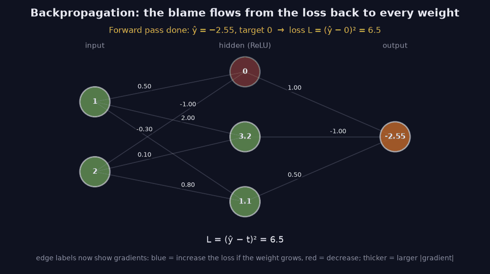
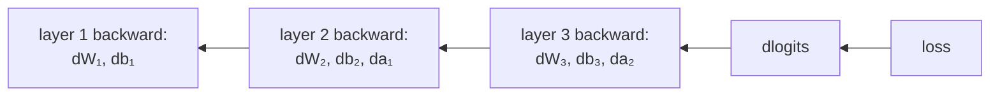

> Tier 3 · Neural Networks · **Level: intermediate** · Reading time: about 12 minutes

# 3.20 Backpropagation

**Metadata** — Tier: 3 · Phase: 1 · Priority: P0 · Difficulty: 3/5 · Interview: Very high · Hands-on: Very high
Prerequisites: 1.24, 1.25, 3.18, 3.19 · Leads to: Tier 4 Training loop, 3.25–3.26 gradient problems

> **In plain words**
> **Backpropagation** works out **how much each weight contributed to the error**, by applying the **chain rule backwards**, from the loss back to the first layer, reusing the numbers saved in the forward pass. One backward sweep gives the gradient for **every** weight at about **twice the cost of a forward pass**.
> Think of tracing blame backwards: "the answer was wrong → which of the last layer's inputs mattered → which earlier units fed them → …". Then an optimiser (gradient descent) uses those blame numbers to nudge the weights.

**You need first:** 1.25 Chain rule, 3.18 Forward propagation, 3.19 Computational graph.

> **Figure 3.20-1 — backpropagation on the same network (animated)**
>
> 
>
> *How to read it:* start from the loss `L = (ŷ − 0)² = 6.5` and move right to left. **Step 1:** `∂L/∂ŷ = −5.1`. **Step 2:** each last-layer weight's gradient is that signal times the activation feeding it: `[0, −16.32, −5.61]`. **Step 3:** the signal is passed down through `W₂` and then through ReLU, which blocks it for the unit that was off (gradient 0). **Step 4:** first-layer weight gradients `[[0, 0], [5.1, 10.2], [−2.55, −5.1]]`. Blue = increasing the weight would increase the loss, red = decreasing it; thicker = larger `|gradient|`.
>
> *Generated by* `tier-03-neural-networks/figures/src/fig_3_20_backprop.py`. All gradients come from `nn.MLP.backward` and are asserted equal to the hand chain-rule values.

**Words you'll meet on this page**

| Word | What it means here |
|---|---|
| backpropagation | computing all gradients by the chain rule, output → input |
| upstream gradient | the gradient arriving from the next layer |
| `δ_z` | gradient with respect to a layer's pre-activation |
| cache | forward values kept for the backward pass |
| gradient check | comparing with finite differences |
| optimiser | turns gradients into updates (SGD, Adam) |
| activation checkpointing | recompute instead of store, saving memory |

### 1. What is it?
The algorithm that computes the **gradient of the loss with respect to every parameter** by applying the chain rule backward through the network, reusing intermediate results from the forward pass.

### 2. Why does it exist?
Training by gradient descent needs `∂L/∂θ` for millions or billions of parameters. Backprop gets all of them for roughly the cost of two forward passes.

### 3. Detailed explanation
For layer `l` with `zₗ = Wₗaₗ₋₁ + bₗ`, `aₗ = φ(zₗ)` and upstream gradient `δ_a = ∂L/∂aₗ`:

1. `δ_z = δ_a ⊙ φ′(zₗ)`
2. `∂L/∂Wₗ = δ_zᵀ aₗ₋₁` and `∂L/∂bₗ = Σ_batch δ_z`
3. `∂L/∂aₗ₋₁ = δ_z Wₗ` (passed to the previous layer)

For softmax + cross-entropy the starting signal at the logits is simply `softmax(z) − onehot(y)`, divided by the batch size (1.37).

- **Verification:** a hand-written backward pass should match central finite differences to high precision and match autograd (do this for every new layer).
- **Cost:** backward ≈ **2×** the forward FLOPs (one matmul for `dW` and one for the input gradient, per layer). Finite differences for a network with `P` parameters would need `2P` forward passes per gradient; backprop needs one forward and one backward.
- **Memory:** forward activations are cached until used; this is the training memory bottleneck (3.18).
- **Reverse mode is the right direction:** one scalar loss, many parameters (3.21).
- **Depth effects:** each layer multiplies the backward signal by `Wᵀφ′`; repeated products shrink (3.25) or blow up (3.26) the gradient.
- **Shared weights** (tied embeddings, recurrence) accumulate gradient contributions from every use (3.19).
- **Non-differentiable pieces:** `argmax`, sampling and rounding block the gradient; use straight-through estimators or reinforcement learning.
- **After backprop:** an optimiser (SGD, Adam; Tier 4) turns gradients into updates; backprop itself only computes gradients.
- **History:** reverse-mode differentiation was known earlier; Rumelhart, Hinton and Williams (1986) popularised backprop for neural networks (REVIEW_REQUIRED: verify the history).

### 4. How does it work?
Forward: compute and cache. Backward: start from `∂L/∂logits`, move layer by layer toward the input, computing the parameter gradients and passing the input gradients on.



### 5. Simple example
Tracing blame backward: how much did each earlier decision contribute to the final error?

**The worked example from the figure.** Network: `x = [1, 2]`, `W₁ = [[0.5, −1], [2, 0.1], [−0.3, 0.8]]`, `b₁ = [0, 1, −0.2]`, ReLU, `W₂ = [1, −1, 0.5]`, `b₂ = 0.1`. We saw the forward result `ŷ = −2.55`. Take the target 0 and `L = (ŷ − 0)² = 6.5025`.
- `∂L/∂ŷ = 2ŷ = −5.1`.
- `∂L/∂W₂ = −5.1 · a₁ = −5.1 · [0, 3.2, 1.1] = [0, −16.32, −5.61]`.
- Pass down: `∂L/∂a₁ = −5.1 · W₂ = [−5.1, 5.1, −2.55]`; through ReLU (unit 0 was off): `δ_z = [0, 5.1, −2.55]`.
- `∂L/∂W₁ = δ_zᵀ x = [[0, 0], [5.1, 10.2], [−2.55, −5.1]]`.

### 6. Technical example
`loss.backward()` in PyTorch does the same computation as the hand-written backward pass.

### 7. Code
**① By hand (plain Python).** The worked example, step by step.

```python
x = [1.0, 2.0]
W1 = [[0.5, -1.0], [2.0, 0.1], [-0.3, 0.8]]; b1 = [0.0, 1.0, -0.2]
W2, b2 = [1.0, -1.0, 0.5], 0.1

z1 = [sum(w * v for w, v in zip(row, x)) + b for row, b in zip(W1, b1)]
a1 = [max(0.0, z) for z in z1]
y_hat = sum(w * a for w, a in zip(W2, a1)) + b2
dL_dy = 2 * y_hat                                                   # loss = y_hat^2 (target 0)
dW2 = [dL_dy * a for a in a1]
da1 = [dL_dy * w for w in W2]
dz1 = [d if z > 0 else 0.0 for d, z in zip(da1, z1)]               # ReLU blocks the gradient where z <= 0
dW1 = [[d * v for v in x] for d in dz1]
print("loss:", round(y_hat ** 2, 4), "  dL/dy:", round(dL_dy, 2))
print("dW2:", [round(v, 2) + 0.0 for v in dW2])
print("dW1:", [[round(v, 2) for v in row] for row in dW1])
```

```text
loss: 6.5025   dL/dy: -5.1
dW2: [0.0, -16.32, -5.61]
dW1: [[0.0, 0.0], [5.1, 10.2], [-2.55, -5.1]]
```

**② With NumPy.** A full backward pass for a small softmax network, verified numerically.

```python
import numpy as np

rng = np.random.default_rng(0)
X, y = rng.normal(0, 1, (6, 4)), rng.integers(0, 3, 6)
W1, b1 = rng.normal(0, 0.5, (5, 4)), np.zeros(5)
W2, b2 = rng.normal(0, 0.5, (3, 5)), np.zeros(3)

def forward(W1, b1, W2, b2):
    z1 = X @ W1.T + b1; a1 = np.tanh(z1); z2 = a1 @ W2.T + b2
    p = np.exp(z2 - z2.max(axis=1, keepdims=True)); p /= p.sum(axis=1, keepdims=True)
    return z1, a1, p, -np.log(p[np.arange(6), y]).mean()

z1, a1, p, loss = forward(W1, b1, W2, b2)
dz2 = p.copy(); dz2[np.arange(6), y] -= 1; dz2 /= 6                      # softmax - onehot, over the batch
dW2, db2 = dz2.T @ a1, dz2.sum(axis=0)
da1 = dz2 @ W2
dz1 = da1 * (1 - a1 ** 2)                                                 # tanh' = 1 - tanh^2
dW1, db1 = dz1.T @ X, dz1.sum(axis=0)

h, num = 1e-6, np.zeros_like(W1)
for i in range(5):
    for j in range(4):
        Wp, Wm = W1.copy(), W1.copy(); Wp[i, j] += h; Wm[i, j] -= h
        num[i, j] = (forward(Wp, b1, W2, b2)[3] - forward(Wm, b1, W2, b2)[3]) / (2 * h)
print("max |backprop - finite difference| for W1:", f"{np.abs(dW1 - num).max():.1e}")
```

```text
max |backprop - finite difference| for W1: 1.9e-10
```

**③ With PyTorch.** Autograd gives the same numbers, and shows the cost ratio.

```python
import torch

x = torch.tensor([[1.0, 2.0]])
W1 = torch.tensor([[0.5, -1.0], [2.0, 0.1], [-0.3, 0.8]], requires_grad=True); b1 = torch.tensor([0.0, 1.0, -0.2], requires_grad=True)
W2 = torch.tensor([[1.0, -1.0, 0.5]], requires_grad=True); b2 = torch.tensor([0.1], requires_grad=True)
y_hat = torch.relu(x @ W1.T + b1) @ W2.T + b2
(y_hat ** 2).sum().backward()
print("dW2:", [round(v, 2) for v in W2.grad.flatten().tolist()])
print("dW1:", [[round(v, 2) for v in row] for row in W1.grad.tolist()])

P = 109_386
print("finite differences need", 2 * P, "forward passes per gradient; backprop needs 1 forward + 1 backward")
```

```text
dW2: [0.0, -16.32, -5.61]
dW1: [[0.0, 0.0], [5.1, 10.2], [-2.55, -5.1]]
finite differences need 218772 forward passes per gradient; backprop needs 1 forward + 1 backward
```

### 8. Input → Process → Output
`dL/dlogits → ×Wᵀ, ×φ′ → … → dL/dW for every layer`

<details>
<summary><b>Beyond the basics (sections 9–16)</b> — real-world use, limits, mistakes. Skip on a first read.</summary>

### 9. Enterprise use case
Training cost estimates multiply the forward cost by about 3 (forward + 2× backward) per token; this feeds GPU budgeting.

### 10. AI engineering connection
Fine-tuning, LoRA and RLHF all rely on backprop; gradient checkpointing, mixed precision and clipping are engineering around it.

### 11. Advantages
Exact gradients at low cost; general for any differentiable graph.

### 12. Limitations
Memory for activations; vanishing and exploding gradients; needs differentiability.

### 13. Trade-offs
Activation checkpointing: less memory, about 33% more compute.

### 14. Common mistakes
Forgetting to zero accumulated gradients; the wrong order of multiplications and transposes; in-place operations breaking caches; using probabilities instead of logits at the start.

### 15. Performance / cost
Backward matmuls dominate; overlapping communication with backward is key in distributed training (Tier 4).

### 16. Security
Gradients can leak training data (federated and distributed settings); clip and add noise for privacy.

</details>

### 17. Interview explanation
"Backprop applies the chain rule from the loss back to each parameter, reusing the forward activations: for each layer, dW is the upstream gradient transposed times the layer input, and the gradient passed down is upstream times W. It costs about twice a forward pass, versus a forward pass per parameter for finite differences."

### 18. Rapid-fire answer
Reverse chain rule: `δ_z = δ_a ⊙ φ′`; `dW = δ_zᵀ a_prev`; `da_prev = δ_z W`; cost ≈ 2× forward; start with softmax − one-hot.

### 19. Interview questions
- **Basic:** Write the gradients of a dense layer.
- **Intermediate:** Why is reverse mode efficient for neural networks?
- **Advanced:** Derive the gradient signal at the logits for softmax cross-entropy.
- **Scenario:** Your gradient check fails by 1e-2 only for ReLU networks. Possible reasons?

### 20. Hands-on exercise
**Goal:** add a skip connection and check the gradient.

1. Extend the NumPy example so the output is `a1 @ W2.T + X @ Ws.T` with a skip matrix `Ws` of shape `(3, 4)`.
2. Derive `dWs` (it is just another dense layer from `X`).
3. Check `dWs` against finite differences.

<details>
<summary>Show a solution</summary>

```python
import numpy as np

rng = np.random.default_rng(0)
X, y = rng.normal(0, 1, (6, 4)), rng.integers(0, 3, 6)
W1, W2, Ws = rng.normal(0, 0.5, (5, 4)), rng.normal(0, 0.5, (3, 5)), rng.normal(0, 0.5, (3, 4))

def forward(Ws):
    a1 = np.tanh(X @ W1.T)
    z2 = a1 @ W2.T + X @ Ws.T                                      # the skip connection adds a second path
    p = np.exp(z2 - z2.max(axis=1, keepdims=True)); p /= p.sum(axis=1, keepdims=True)
    return p, -np.log(p[np.arange(6), y]).mean()

p, _ = forward(Ws)
dz2 = p.copy(); dz2[np.arange(6), y] -= 1; dz2 /= 6
dWs = dz2.T @ X                                                      # the skip path gets its own dense-layer gradient
h, num = 1e-6, np.zeros_like(Ws)
for i in range(3):
    for j in range(4):
        P, M = Ws.copy(), Ws.copy(); P[i, j] += h; M[i, j] -= h
        num[i, j] = (forward(P)[1] - forward(M)[1]) / (2 * h)
print("max |dWs - finite difference|:", f"{np.abs(dWs - num).max():.1e}")
```

```text
max |dWs - finite difference|: 1.7e-10
```

</details>

### 21. Revision questions
1. What are the three backward formulas?
2. What is the cost ratio of backward to forward?
3. What must be cached?

### 22. Related concepts
3.19 Computational graph · 3.21 Automatic differentiation · 3.25 Vanishing gradients · 1.25 Chain rule · Tier 4

### 23. One-line memory hook
**Backprop: send the blame backward, one chain-rule step at a time.**

<details>
<summary><b>For reviewers</b> (not part of the lesson)</summary>

- Status: DRAFT, learner-first layout (Author: Claude). Code is executed by `tests/test_md_snippets.py`.
- TESTED earlier: `test_mlp_backprop_matches_numerical_and_torch[tanh|relu|gelu|sigmoid|silu]` (manual backward vs finite differences to about 2×10⁻¹⁰ and vs PyTorch), `lab_02_training_internals.ex_3_20`. Figure values (L = 6.5, `[0, −16.32, −5.61]`, `[[0,0],[5.1,10.2],[−2.55,−5.1]]`) are from the figure script and re-derived on this page.
- Backprop history remains REVIEW_REQUIRED.
</details>
