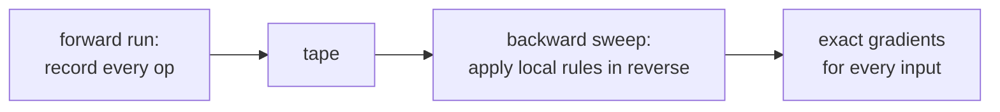

> Tier 3 · Neural Networks · **Level: intermediate** · Reading time: about 10 minutes

# 3.21 Automatic differentiation

**Metadata** — Tier: 3 · Phase: 1 · Priority: P0 · Difficulty: 3/5 · Interview: High · Hands-on: High
Prerequisites: 3.19, 3.20, 1.21 · Leads to: Tier 4 PyTorch autograd, JAX-style transformations

> **In plain words**
> **Automatic differentiation ("autodiff")** is a way for the computer to work out **exact derivatives of any program** by applying the chain rule to each tiny step it actually ran. You write only the forward calculation; the derivative comes for free.
> It beats the other two ways: *by hand* is error-prone, and *nudging the input and watching the output* (finite differences) is slow and slightly wrong. Backpropagation (3.20) is autodiff in its **reverse mode**, applied to a neural network.

**You need first:** 3.19 Computational graph, 3.20 Backpropagation, 1.21 Derivatives.

> **Figure 3.21-1 — three ways to get a derivative**
>
> ```mermaid
> flowchart LR
>     P["a program<br/>f(x)"] --> S["symbolic:<br/>algebra on a formula<br/>(can explode in size)"]
>     P --> N["numerical:<br/>nudge x, re-run<br/>(approximate, 1 run per input)"]
>     P --> A["automatic:<br/>chain rule on each step<br/>(exact, cheap)"]
> ```
>
> *How to read it:* all three start from the same function. Only **automatic** differentiation gives exact answers at a cost close to running the program once or twice, which is why every deep-learning framework uses it.

**Words you'll meet on this page**

| Word | What it means here |
|---|---|
| autodiff | exact derivatives from the operations a program ran |
| finite difference | approximate derivative by nudging an input by a small `h` |
| forward mode | carry a derivative along with each value, one input at a time |
| reverse mode | record first, then sweep backwards for all inputs at once |
| dual number | a pair `(value, derivative)` used by forward mode |
| tape | the record of operations kept for reverse mode |
| round-off error | tiny errors from storing numbers with limited digits |

### 1. What is it?
Systematic computation of exact derivatives of programs by applying the chain rule to each elementary operation. Two modes: **forward mode** (propagate derivatives together with the values) and **reverse mode** (record, then propagate backward). Backpropagation is reverse mode applied to neural networks.

### 2. Why does it exist?
Writing gradients by hand is error-prone; numerical differences are slow and inaccurate. Autodiff gives exact gradients for arbitrary code at a small constant overhead.

### 3. Detailed explanation
- **Three ways to get derivatives:** symbolic (algebra, can explode in size), numerical (finite differences: approximate, one function evaluation per input), automatic (exact up to floating-point).
- **Finite differences have a sweet spot.** A big `h` gives a *truncation* error; a tiny `h` gives *round-off* error. The table in code ② shows the error falling and then rising again (1.21). Autodiff has neither problem.
- **Forward mode (dual numbers):** carry `(value, derivative with respect to one chosen input)`. One pass per input. Cheap when there are few inputs and many outputs.
- **Reverse mode:** one forward pass to record, one backward pass for **all** input gradients of a scalar output. For 1,000 inputs forward mode needs 1,000 passes; reverse mode needs 1 (code ③ checks the equality). This asymmetry is why deep learning uses reverse mode: one scalar loss, billions of parameters.
- **Handles control flow:** the derivative is of the executed path. A Python `if` choosing `x` or `0.1x` gives gradient 1.0 or 0.1.
- **Limits:** derivatives of non-smooth or discrete operations are 0 or undefined (`round` gives gradient 0); iterative numerical routines may need careful treatment; in-place mutation breaks recording.
- **Higher-order derivatives** (Hessian-vector products) come from differentiating the gradient program (1.46).
- **Frameworks:** PyTorch `autograd` (dynamic tape), JAX `grad/jit/vmap` (function transformations), TensorFlow `GradientTape`. The ideas are shared.
- **Deep chains:** a recursive topological sort overflows Python's stack at about 1,000 nested operations, so real engines sort iteratively.

### 4. How does it work?
Overload operations so each records its local derivative rule; reverse mode then runs the recorded rules in reverse order, accumulating gradients.



### 5. Simple example
A calculator that keeps a ledger of each step so it can tell you how the final answer reacts to any input.

**Forward mode by hand.** To differentiate `f(x) = x²` at `x = 0.4`, carry the pair `(value, derivative)`. Start with `x = (0.4, 1)` (its derivative with respect to itself is 1). Multiplying `(a, a′)·(b, b′) = (ab, a′b + ab′)` gives `(0.16, 1·0.4 + 0.4·1) = (0.16, 0.8)`. The derivative `2x = 0.8` appeared with no algebra.

### 6. Technical example
`loss.backward()` in PyTorch; `jax.grad(loss)(params)` in JAX.

### 7. Code
**① By hand (plain Python).** Forward mode with dual numbers.

```python
class Dual:
    def __init__(self, v, d=0.0):
        self.v, self.d = v, d                                   # value and derivative
    def __add__(self, o):
        return Dual(self.v + o.v, self.d + o.d)
    def __mul__(self, o):
        return Dual(self.v * o.v, self.d * o.v + self.v * o.d)  # product rule

x = Dual(0.4, 1.0)                                              # derivative of x with respect to x is 1
y = x * x
print("x*x at 0.4 -> value", round(y.v, 2), " derivative", round(y.d, 2), "(2x = 0.8)")
z = x * x * x + x                                               # x^3 + x
print("x^3 + x at 0.4 -> derivative", round(z.d, 2), "(3x^2 + 1 = 1.48)")
```

```text
x*x at 0.4 -> value 0.16  derivative 0.8 (2x = 0.8)
x^3 + x at 0.4 -> derivative 1.48 (3x^2 + 1 = 1.48)
```

**② With NumPy.** Why finite differences are not enough: the error against the step size.

```python
import numpy as np

f, true_derivative, x = (lambda v: v ** 3), 3 * 0.7 ** 2, 0.7
for h in (1e-1, 1e-3, 1e-5, 1e-8, 1e-12):
    approx = (f(x + h) - f(x - h)) / (2 * h)                    # central difference
    print(f"h = {h:7.0e}   error = {abs(approx - true_derivative):.1e}")
print("autodiff / the exact formula has no step size and no such trade-off")
```

```text
h =   1e-01   error = 1.0e-02
h =   1e-03   error = 1.0e-06
h =   1e-05   error = 9.2e-11
h =   1e-08   error = 7.8e-09
h =   1e-12   error = 3.7e-05
autodiff / the exact formula has no step size and no such trade-off
```

**③ With PyTorch.** Reverse mode: one backward pass gives every gradient; control flow is handled.

```python
import torch

x = torch.randn(1000, dtype=torch.float64, requires_grad=True)
loss = (x ** 2).sum()
loss.backward()                                                 # ONE backward pass, 1000 gradients
print("gradients computed:", x.grad.numel(), "  all equal 2x:", torch.allclose(x.grad, 2 * x.detach()))

for value in (3.0, -3.0):
    v = torch.tensor(value, requires_grad=True)
    out = v if v > 0 else 0.1 * v                                # a Python if: the executed path is differentiated
    out.backward()
    print(f"x = {value:>4}: gradient = {v.grad.item():.1f}")
```

```text
gradients computed: 1000   all equal 2x: True
x =  3.0: gradient = 1.0
x = -3.0: gradient = 0.1
```

### 8. Input → Process → Output
`program → record ops → backward sweep → exact gradients`

<details>
<summary><b>Beyond the basics (sections 9–16)</b> — real-world use, limits, mistakes. Skip on a first read.</summary>

### 9. Enterprise use case
Autodiff frameworks make custom losses and architectures cheap to build and verify.

### 10. AI engineering connection
Custom layers, loss functions, differentiable retrieval or ranking components, meta-learning (differentiating through training).

### 11. Advantages
Exact, general, efficient for scalar objectives.

### 12. Limitations
Memory of the recorded graph; non-differentiable operations; subtle in-place and numerical issues.

### 13. Trade-offs
Reverse mode: memory heavy but efficient for many inputs. Forward mode: low memory but one pass per input.

### 14. Common mistakes
Using numerical gradients in training; detaching accidentally; differentiating through `argmax`; relying on autodiff through unstable numerics (fuse log-softmax).

### 15. Performance / cost
Tape memory ≈ activations; checkpointing and fusion reduce it.

### 16. Security
Gradient access can enable model inversion and adversarial examples; control it in deployed APIs.

</details>

### 17. Interview explanation
"Autodiff applies the chain rule mechanically to the operations a program actually executed. Reverse mode computes the gradient of a scalar with respect to all inputs in about the cost of two evaluations, which is why training uses it; forward mode needs one pass per input. Unlike finite differences it has no step-size error."

### 18. Rapid-fire answer
Exact derivatives by chain rule over executed ops; reverse mode = all grads of a scalar in one backward pass; forward mode = one input per pass.

### 19. Interview questions
- **Basic:** Autodiff versus numerical versus symbolic differentiation?
- **Intermediate:** When is forward mode preferable?
- **Advanced:** Why does reverse mode need to store the forward pass?
- **Scenario:** A custom op trains but gradients are zero. What could be wrong (detach, non-differentiable op, in-place)?

### 20. Hands-on exercise
**Goal:** add the `sin` rule to the dual-number class and check it.

1. Add a function `dual_sin(x)` returning `Dual(sin(v), cos(v)·d)` (the chain rule).
2. Differentiate `x·sin(x)` at `x = 1.2`.
3. Compare with the formula `sin(x) + x·cos(x)`.

<details>
<summary>Show a solution</summary>

```python
import math

class Dual:
    def __init__(self, v, d=0.0):
        self.v, self.d = v, d
    def __mul__(self, o):
        return Dual(self.v * o.v, self.d * o.v + self.v * o.d)

def dual_sin(x):
    return Dual(math.sin(x.v), math.cos(x.v) * x.d)             # chain rule: derivative of sin is cos

x = Dual(1.2, 1.0)
y = x * dual_sin(x)
print("autodiff :", round(y.d, 6))
print("formula  :", round(math.sin(1.2) + 1.2 * math.cos(1.2), 6))
```

```text
autodiff : 1.366868
formula  : 1.366868
```

</details>

### 21. Revision questions
1. What are the two modes?
2. Why reverse mode for training?
3. Name two failure cases.

### 22. Related concepts
3.19 Computational graph · 3.20 Backpropagation · 1.21 Derivatives · 1.24 Jacobians · Tier 4

### 23. One-line memory hook
**Autodiff: exact derivatives, because the computer keeps a ledger of every step.**

<details>
<summary><b>For reviewers</b> (not part of the lesson)</summary>

- Status: DRAFT, learner-first layout (Author: Claude). Code is executed by `tests/test_md_snippets.py`.
- TESTED earlier: `test_reverse_mode_matches_torch_and_numerical`, `test_forward_mode_equals_reverse_mode_for_one_input`, `test_reverse_mode_one_pass_gives_all_gradients_while_forward_needs_one_per_input`, `lab_02_training_internals.ex_3_21` (library `Value` and `Dual`, agree with PyTorch to 1e-12).
</details>
