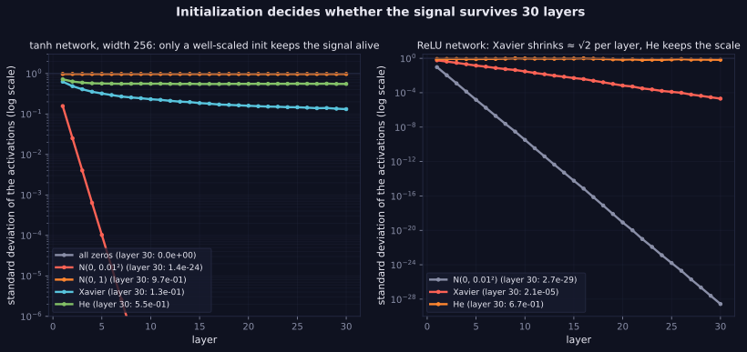

> Tier 3 — Neural Networks · Status: DRAFT (Author: Claude) · Code: `code/nn.py`, `code/autodiff.py`, `lab/lab_02_training_internals.py` — TESTED

# 3.22 Parameter initialization

**Metadata** — Tier: 3 · Phase: 1 · Priority: P0 · Difficulty: 2/5 · Interview: High · Hands-on: Very high
Prerequisites: 3.6, 3.8, 1.30 · Leads to: 3.23 Xavier, 3.24 He, 3.25–3.26 gradient problems

### 1. What is it?
Choosing the **starting values of the weights and biases** before training. The scale and symmetry of the initial values decide whether signals and gradients flow.

### 2. Why does it exist?
Bad initialization can make a network untrainable: activations or gradients vanish, saturate or explode, or all units stay identical.

### 3. Detailed explanation
- **Zeros break symmetry badly.** If all weights in a layer are equal, every hidden unit computes the same function and receives the same gradient, so they stay identical forever: after 50 training epochs from a constant initialization all rows of the first weight matrix were still identical (tested). Random, unequal initial weights break symmetry. Biases may start at 0.
- **Scale matters.** Pass unit-variance inputs through 30 layers of width 256 with tanh and different `W` initializations (std of activations at layers 1 / 10 / 30):
  | init | layer 1 | layer 10 | layer 30 | verdict |
  |---|---|---|---|---|
  | zeros | 0 | 0 | 0 | dead |
  | N(0, 0.01²) | 0.157 | ≈0 | ≈0 | vanishes |
  | N(0, 1) | 0.975 | 0.974 | 0.974 | saturated (outputs ±1, near-zero gradients) |
  | Xavier normal | 0.628 | 0.232 | 0.132 | shrinks slowly, remains usable |
  | He normal | 0.721 | 0.559 | 0.553 | stable |
- **Principle:** keep the variance of activations (forward) and of gradients (backward) roughly constant from layer to layer: `Var(W) ∝ 1/fan_in` (and/or `1/fan_out`). The constant depends on the activation: Xavier (3.23) for symmetric activations, He (3.24) for ReLU.
- **fan_in / fan_out:** the numbers of input and output units of the layer (for convolutions, times the kernel size).
- **Other cases:** output layers sometimes start small (so initial predictions are near uniform or near the prior); residual branches may be scaled down or zero-initialized (3.27); embeddings use small normal values; biases of output layer can encode class priors (3.7); pretrained weights are the best initialization (fine-tuning, Tier 10).
- **Normalization layers reduce sensitivity** to initial scale (3.30–3.32) but do not remove the need for a sensible start.
- **Reproducibility:** fix the random seed and record the initializer (Tier 4, 4.21–4.22).
- Library init helpers (`torch.nn.init`) are verified against the formulas (3.23, 3.24).

### 4. How does it work?
Draw `W` from a zero-mean distribution with variance set by fan_in/fan_out and the activation; set biases to zero.

> **Figure 3.22-1 — activation scale through 30 layers for different initializations**



*How to read it:* Left (tanh, width 256): all-zero weights give 0 immediately; N(0, 0.01²) collapses to 10⁻²⁴ by layer 30; N(0, 1) saturates near 0.97; Xavier declines slowly to 0.13 and stays alive; He stays near 0.55. Right (ReLU): N(0, 0.01²) is 10⁻²⁹ at layer 30, Xavier shrinks by about √2 per layer to 2×10⁻⁵, and He keeps the scale near 0.67.

*Generated by* `tier-03-neural-networks/figures/src/t3_training.py` *from this chapter's code, so the numbers are computed, not typed in.*

### 5. Simple example
Starting a long relay with each runner given just the right amount of energy: too little and nobody moves; too much and the baton flies off.

### 6. Technical example
Default `nn.Linear` init in PyTorch uses a uniform distribution scaled by 1/√fan_in (REVIEW_REQUIRED: check current default); Transformer implementations commonly use N(0, 0.02²) for linear and embedding weights.

### 7. Code
```python
import nn as N, numpy as np
rng = np.random.default_rng(0)
W = N.init_weights(256, 256, 'he_normal', rng)          # std = sqrt(2/fan_in)
from lab_02_training_internals import ex_3_22; print(ex_3_22()['activation_std_layers_1_10_30'])
```
TESTED (`test_init_scheme_scales`, `test_initialization_scale_matters`, `lab_03_pytorch_build.t_3_init_helpers`).

### 8. Input → Process → Output
`random W with controlled variance → stable signal and gradient scale at step 0`

### 9. Enterprise use case
Training recipes fix initialization; changing it silently can break reproduction of published results.

### 10. AI engineering connection
Careful init (and residual scaling) is part of making very deep Transformers train stably (Tier 8, 9).

### 11. Advantages
Cheap; prevents many failures before they start.

### 12. Limitations
Only controls the start; training can still drift into bad regimes.

### 13. Trade-offs
Larger init speeds early learning but risks instability.

### 14. Common mistakes
All-zero or all-equal weights; unscaled N(0,1); Xavier with ReLU; forgetting that framework defaults differ; re-initializing pretrained layers by accident.

### 15. Performance / cost
Negligible cost.

### 16. Security
Seeds and init affect reproducibility; backdoored checkpoints bypass initialization entirely.

### 17. Interview explanation
"Initialization has to break symmetry and keep activations and gradients at a stable scale across depth. I scale the variance by fan-in — Xavier for tanh-like, He for ReLU — start biases at zero, and verify by checking the activation standard deviation layer by layer."

### 18. Rapid-fire
Random (symmetry-breaking) weights with variance ∝ 1/fan_in; Xavier for tanh/sigmoid, He for ReLU; biases 0.

### 19. Interview questions
- Basic: Why not initialize all weights to zero?
- Intermediate: What goes wrong with N(0,1) weights in a deep tanh net?
- Advanced: Derive why `Var(W) = 2/fan_in` keeps ReLU activations' variance constant.
- Scenario: Loss is NaN at step 1. What init-related checks do you do?

### 20. Hands-on exercise
Write a hook that logs per-layer activation std and gradient norm at step 0 and use it to compare three initializations.

### 21. Revision questions
1) Symmetry problem? 2) Principle behind scale choice? 3) fan_in/fan_out?

### 22. Related concepts
3.6 Weights · 3.23 Xavier initialization · 3.24 He initialization · 3.25–3.26 Gradient problems · Tier 4

### 23. Memory hook
**Initialize so the signal neither dies nor screams on its way through.**
