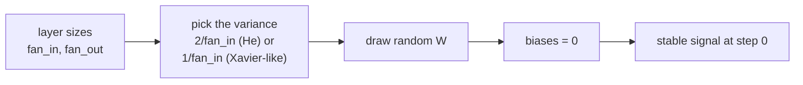

> Tier 3 · Neural Networks · **Level: beginner** · Reading time: about 10 minutes

# 3.22 Parameter initialization

**Metadata** — Tier: 3 · Phase: 1 · Priority: P0 · Difficulty: 2/5 · Interview: High · Hands-on: Very high
Prerequisites: 3.6, 3.8, 1.30 · Leads to: 3.23 Xavier, 3.24 He, 3.25–3.26 gradient problems

> **In plain words**
> **Initialization** is **choosing the starting values of the weights** before any training. It sounds minor, but it decides whether a network can learn at all.
> Two rules: (1) the starting weights must be **different from each other** (random), otherwise all the neurons copy each other forever; (2) they must have the **right size**, so the signal neither fades to nothing nor explodes as it passes through many layers.
> Think of a long relay race: give each runner too little energy and nobody moves; too much and the baton flies off.

**You need first:** 3.6 Weights, 3.8 Weighted sum, 1.30 Variance.

> **Figure 3.22-1 — activation scale through 30 layers for different initializations**
>
> 
>
> *How to read it:* each line shows how "big" the signal is (its standard deviation) after each of 30 layers. **Left (tanh, width 256):** all-zero weights give 0 immediately; tiny weights `N(0, 0.01²)` collapse to 10⁻²⁴ by layer 30; `N(0, 1)` saturates near 0.97 (outputs stuck at ±1 with almost no gradient); Xavier declines slowly to 0.13 and stays alive; He stays near 0.55. **Right (ReLU):** tiny weights reach 10⁻²⁹ at layer 30, Xavier shrinks by about √2 per layer to 2×10⁻⁵, and He keeps the scale near 0.67. A flat line is what you want.
>
> *Generated by* `tier-03-neural-networks/figures/src/t3_training.py` from this chapter's code, so the numbers are computed, not typed in.

**Words you'll meet on this page**

| Word | What it means here |
|---|---|
| initialization | the starting values of the parameters |
| symmetry | when units are identical and learn identical things |
| fan_in / fan_out | number of inputs to / outputs from a layer |
| variance | how spread out the values are |
| saturation | an activation stuck at its flat ends (tanh near ±1) |
| Xavier / He | scaling rules for tanh-like / ReLU layers (3.23, 3.24) |
| seed | a number that makes "random" values repeatable |

### 1. What is it?
Choosing the **starting values of the weights and biases** before training. The scale and symmetry of the initial values decide whether signals and gradients flow.

### 2. Why does it exist?
Bad initialization can make a network untrainable: activations or gradients vanish, saturate or explode, or all units stay identical.

### 3. Detailed explanation
- **Zeros break symmetry badly.** If all weights in a layer are equal, every hidden unit computes the same function and receives the same gradient, so they stay identical forever (code ③ shows it). Random, unequal initial weights break the symmetry. Biases may start at 0.
- **Scale matters.** Pass unit-variance inputs through 30 layers of width 256 with tanh and different `W` choices; code ② prints the spread of the activations at layers 1, 10 and 30.
- **Principle:** keep the variance of activations (forward) and of gradients (backward) roughly constant from layer to layer: `Var(W) ∝ 1/fan_in` (and/or `1/fan_out`). The constant depends on the activation: Xavier (3.23) for symmetric activations, He (3.24) for ReLU.
- **fan_in / fan_out:** the numbers of input and output units of the layer (for convolutions, multiplied by the kernel size).
- **Other cases:** output layers sometimes start small (so initial predictions are near uniform or near the prior); residual branches may be scaled down or zero-initialized (3.27); embeddings use small normal values; biases of the output layer can encode class priors (3.7); pretrained weights are the best initialization (fine-tuning, Tier 10).
- **Normalization layers reduce sensitivity** to the initial scale (3.30–3.32) but do not remove the need for a sensible start.
- **Reproducibility:** fix the random seed and record the initializer (Tier 4).

### 4. How does it work?
Draw `W` from a zero-mean distribution with variance set by fan_in/fan_out and the activation; set biases to zero.



### 5. Simple example
A long relay: runners with too little energy stop; runners with too much throw the baton. Initialization gives each just the right amount.

**By hand.** One layer of 100 inputs, each about size 1. A weight of size `w` makes each output about `w·√100 = 10w`. With `w = 0.01` the signal shrinks to 0.1 per layer; after 10 layers `0.1¹⁰ = 10⁻¹⁰`. With `w = 1` it grows to 10 per layer; after 10 layers `10¹⁰`. The right size is `w ≈ 1/√100 = 0.1`, which keeps the signal near 1.

### 6. Technical example
PyTorch's default `nn.Linear` initialization draws from a uniform distribution scaled by `1/√fan_in` (REVIEW_REQUIRED: check the current default); Transformer implementations commonly use `N(0, 0.02²)` for linear and embedding weights.

### 7. Code
**① By hand (plain Python).** The relay in numbers.

```python
fan_in, layers = 100, 10
for w in (0.01, 0.1, 1.0):
    signal = 1.0
    for _ in range(layers):
        signal *= w * fan_in ** 0.5                              # typical growth of one layer
    print(f"weight size {w:>4}: signal after {layers} layers = {signal:.1e}")
```

```text
weight size 0.01: signal after 10 layers = 1.0e-10
weight size  0.1: signal after 10 layers = 1.0e+00
weight size  1.0: signal after 10 layers = 1.0e+10
```

**② With NumPy.** A real 30-layer tanh network with different initializations.

```python
import numpy as np

rng = np.random.default_rng(0)
width, depth = 256, 30
x0 = rng.normal(0, 1, (512, width))
schemes = {
    "zeros":        lambda: np.zeros((width, width)),
    "N(0, 0.01^2)": lambda: rng.normal(0, 0.01, (width, width)),
    "N(0, 1)":      lambda: rng.normal(0, 1.0, (width, width)),
    "Xavier":       lambda: rng.normal(0, np.sqrt(1 / width), (width, width)),
    "He":           lambda: rng.normal(0, np.sqrt(2 / width), (width, width)),
}
print(f"{'init':<14}{'layer 1':>10}{'layer 10':>10}{'layer 30':>10}")
for name, make in schemes.items():
    h, stds = x0, []
    for _ in range(depth):
        h = np.tanh(h @ make())
        stds.append(h.std())
    print(f"{name:<14}{stds[0]:>10.3f}{stds[9]:>10.1e}{stds[29]:>10.1e}")
```

```text
init             layer 1  layer 10  layer 30
zeros              0.000   0.0e+00   0.0e+00
N(0, 0.01^2)       0.156   1.1e-08   1.3e-24
N(0, 1)            0.975   9.7e-01   9.7e-01
Xavier             0.626   2.3e-01   1.4e-01
He                 0.720   5.5e-01   5.5e-01
```

**③ With PyTorch.** Equal weights stay equal forever (the symmetry problem).

```python
import torch

torch.manual_seed(0)
X = torch.randn(64, 3)
y = (X[:, 0] > 0).float().unsqueeze(1)
net = torch.nn.Sequential(torch.nn.Linear(3, 4), torch.nn.Tanh(), torch.nn.Linear(4, 1))
with torch.no_grad():
    for layer in (net[0], net[2]):
        layer.weight.fill_(0.3); layer.bias.zero_()              # a constant initialization
opt = torch.optim.SGD(net.parameters(), lr=0.5)
for _ in range(200):
    opt.zero_grad()
    torch.nn.functional.binary_cross_entropy_with_logits(net(X), y).backward()
    opt.step()
rows = net[0].weight
print("first-layer weight rows after training:")
print(rows.detach().numpy().round(4))
print("all four hidden units identical:", bool(torch.allclose(rows, rows[0].expand_as(rows))))
```

```text
first-layer weight rows after training:
[[ 1.957e+00 -4.000e-04  2.000e-03]
 [ 1.957e+00 -4.000e-04  2.000e-03]
 [ 1.957e+00 -4.000e-04  2.000e-03]
 [ 1.957e+00 -4.000e-04  2.000e-03]]
all four hidden units identical: True
```

### 8. Input → Process → Output
`random W with controlled variance → stable signal and gradient scale at step 0`

<details>
<summary><b>Beyond the basics (sections 9–16)</b> — real-world use, limits, mistakes. Skip on a first read.</summary>

### 9. Enterprise use case
Training recipes fix initialization; changing it silently can break reproduction of published results.

### 10. AI engineering connection
Careful init (and residual scaling) is part of making very deep Transformers train stably (Tier 8, 9).

### 11. Advantages
Cheap; prevents many failures before they start.

### 12. Limitations
Only controls the start; training can still drift into bad regimes.

### 13. Trade-offs
Larger init speeds early learning but risks instability.

### 14. Common mistakes
All-zero or all-equal weights; unscaled `N(0,1)`; Xavier with ReLU; forgetting that framework defaults differ; re-initializing pretrained layers by accident.

### 15. Performance / cost
Negligible cost.

### 16. Security
Seeds and init affect reproducibility; backdoored checkpoints bypass initialization entirely.

</details>

### 17. Interview explanation
"Initialization has to break symmetry and keep activations and gradients at a stable scale across depth. I scale the variance by fan-in — Xavier for tanh-like, He for ReLU — start biases at zero, and verify by checking the activation standard deviation layer by layer."

### 18. Rapid-fire answer
Random (symmetry-breaking) weights with variance ∝ 1/fan_in; Xavier for tanh/sigmoid, He for ReLU; biases 0.

### 19. Interview questions
- **Basic:** Why not initialize all weights to zero?
- **Intermediate:** What goes wrong with `N(0,1)` weights in a deep tanh net?
- **Advanced:** Derive why `Var(W) = 2/fan_in` keeps ReLU activations' variance constant.
- **Scenario:** Loss is NaN at step 1. What init-related checks do you do?

### 20. Hands-on exercise
**Goal:** log the activation spread of every layer at step 0 and compare three initializations.

1. Build a 10-layer ReLU network of width 128 with random weights.
2. Print the standard deviation of each layer's output for scales 0.02, `√(2/128)` and 0.5.
3. Which scale keeps it closest to constant?

<details>
<summary>Show a solution</summary>

```python
import numpy as np

rng = np.random.default_rng(0)
x = rng.normal(0, 1, (256, 128))
for name, scale in (("0.02", 0.02), ("He sqrt(2/128)", np.sqrt(2 / 128)), ("0.5", 0.5)):
    h, stds = x, []
    for _ in range(10):
        h = np.maximum(0, h @ rng.normal(0, scale, (128, 128)))
        stds.append(h.std())
    print(f"{name:<15} layer 1: {stds[0]:.2e}   layer 5: {stds[4]:.2e}   layer 10: {stds[9]:.2e}")
```

```text
0.02            layer 1: 1.32e-01   layer 5: 9.04e-05   layer 10: 8.71e-09
He sqrt(2/128)  layer 1: 8.25e-01   layer 5: 8.90e-01   layer 10: 7.43e-01
0.5             layer 1: 3.35e+00   layer 5: 8.38e+02   layer 10: 9.81e+05
```

</details>

### 21. Revision questions
1. What is the symmetry problem?
2. What principle sets the scale?
3. What are fan_in and fan_out?

### 22. Related concepts
3.6 Weights · 3.23 Xavier initialization · 3.24 He initialization · 3.25–3.26 Gradient problems · Tier 4

### 23. One-line memory hook
**Initialize so the signal neither dies nor screams on its way through.**

<details>
<summary><b>For reviewers</b> (not part of the lesson)</summary>

- Status: DRAFT, learner-first layout (Author: Claude). Code is executed by `tests/test_md_snippets.py`.
- TESTED earlier: `test_init_scheme_scales`, `test_initialization_scale_matters`, `lab_03_pytorch_build.t_3_init_helpers`, `lab_02_training_internals.ex_3_22` (std at layers 1/10/30: zeros 0/0/0; N(0,0.01²) 0.157/≈0/≈0; N(0,1) 0.975/0.974/0.974; Xavier 0.628/0.232/0.132; He 0.721/0.559/0.553). The page's code ② uses its own random draws, so its values differ slightly from the lab and from the figure.
- PyTorch default init statement is REVIEW_REQUIRED.
</details>
