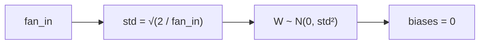

> Tier 3 · Neural Networks · **Level: intermediate** · Reading time: about 8 minutes

# 3.24 He (Kaiming) initialization

**Metadata** — Tier: 3 · Phase: 1 · Priority: P1 · Difficulty: 3/5 · Interview: High · Hands-on: High
Prerequisites: 3.12, 3.22, 3.23 · Leads to: 3.25 Vanishing gradients

> **In plain words**
> **He initialization** is the starting-weight rule for **ReLU** networks. ReLU switches off about **half** of its units (everything negative becomes 0), so half of the signal's energy disappears at every layer. He's fix: make the weights **twice as spread out** as the plain rule, `variance = 2 / fan_in`, so the loss is exactly made up.
> Without it, the signal shrinks by about √2 per layer and, after 30 layers, is almost gone.

**You need first:** 3.12 ReLU, 3.22 Parameter initialization, 3.23 Xavier.

> **Figure 3.24-1 — why the factor 2**
>
> ```mermaid
> flowchart LR
>     Z["pre-activation z<br/>(symmetric around 0)"] --> R["ReLU zeroes the<br/>negative half"]
>     R --> H["second moment<br/>halves: E[a²] = ½·Var(z)"]
>     H --> F["fix: double Var(W)<br/>→ 2 / fan_in"]
> ```
>
> *How to read it:* ReLU keeps only the positive half, so the average squared output is half of what went in. Doubling the weight variance cancels that halving, layer after layer. The numbers over 30 layers are in Figure 3.22-1 (right panel): He stays near 0.67, Xavier decays to about 2×10⁻⁵.

**Words you'll meet on this page**

| Word | What it means here |
|---|---|
| He / Kaiming | the rule `Var(W) = 2/fan_in` (He et al., 2015) |
| second moment | the average of the squares, `E[a²]` |
| fan_in / fan_out mode | keep the forward / the backward signal steady |
| Leaky ReLU | ReLU with a small slope `α` for negatives |
| nonlinearity | the activation you tell the initializer about |

### 1. What is it?
An initialization for ReLU-family activations: `W ~ N(0, 2/fan_in)`. Proposed by He et al. (2015).

### 2. Why does it exist?
ReLU zeroes about half of its inputs, halving the second moment of the output; doubling the weight variance compensates and keeps the activation scale constant across layers.

### 3. Detailed explanation
- **Derivation sketch:** for `a = ReLU(z)` with symmetric `z`, `E[a²] = ½ Var(z)`. With `Var(z) = fan_in · Var(W) · E[a_prev²]`, constant scale requires `Var(W) = 2/fan_in`.
- **Compounding:** one factor √2 per layer compounds exponentially. Over 30 layers Xavier shrinks by about `0.5^(30/2) ≈ 3×10⁻⁵`, He does not shrink (code ② shows it).
- **Fan modes:** `fan_in` preserves forward variance (the default in PyTorch `kaiming_normal_`); `fan_out` preserves backward variance.
- **Leaky ReLU** uses `2/((1 + α²)·fan_in)`; GELU and SiLU are close to ReLU, so He is a standard choice for them too.
- **Normal versus uniform variants** exist; the variance is what matters.
- **Interaction with BatchNorm and residuals:** both reduce dependence on the exact scale, but He remains the default for ReLU nets; residual branches may be scaled down or zero-initialized at the last layer of each block (3.27).
- **Does not guarantee training success:** it only sets the initial scale.

### 4. How does it work?
Set `std = √(2/fan_in)` and sample normally; biases zero.



### 5. Simple example
ReLU throws away half the signal, so start with enough extra gain to make up for it.

**By hand.** Fan-in 512: He std = `√(2/512) = 0.0625`; Xavier (square layer, fan_out 512) std = `√(2/1024) = 0.0442`. The ratio is `√2 ≈ 1.41`.

### 6. Technical example
`torch.nn.init.kaiming_normal_(w, nonlinearity='relu')` is the default recipe for ResNet-style convolutional layers.

### 7. Code
**① By hand (plain Python).** The two stds and how the shrinkage compounds.

```python
import math

fan_in = 512
he, xavier = math.sqrt(2 / fan_in), math.sqrt(2 / (fan_in + fan_in))
print(f"He std: {he:.4f}   Xavier std (square layer): {xavier:.4f}   ratio: {he / xavier:.3f}")
print("signal factor per ReLU layer with Xavier: 1/sqrt(2) =", round(1 / math.sqrt(2), 3))
print("after 30 layers:", f"{(1 / math.sqrt(2)) ** 30:.1e}", "(He: stays near 1)")
```

```text
He std: 0.0625   Xavier std (square layer): 0.0442   ratio: 1.414
signal factor per ReLU layer with Xavier: 1/sqrt(2) = 0.707
after 30 layers: 3.1e-05 (He: stays near 1)
```

**② With NumPy.** 30 real ReLU layers.

```python
import numpy as np

rng = np.random.default_rng(0)
width, depth = 256, 30
x = rng.normal(0, 1, (512, width))
for name, std in (("He", np.sqrt(2 / width)), ("Xavier", np.sqrt(1 / width)), ("N(0, 0.01^2)", 0.01)):
    h = x
    for _ in range(depth):
        h = np.maximum(0, h @ rng.normal(0, std, (width, width)))
    print(f"{name:<13} activation std after {depth} layers: {h.std():.1e}")
```

```text
He            activation std after 30 layers: 1.2e+00
Xavier        activation std after 30 layers: 2.2e-05
N(0, 0.01^2)  activation std after 30 layers: 3.3e-29
```

**③ With PyTorch.** The library helper and its fan mode.

```python
import torch

torch.manual_seed(0)
w = torch.empty(256, 1024)                                       # 256 outputs, 1024 inputs
torch.nn.init.kaiming_normal_(w, nonlinearity="relu")            # default mode = fan_in
print("fan_in mode  std:", round(w.std().item(), 4), " formula sqrt(2/1024):", round((2 / 1024) ** 0.5, 4))
torch.nn.init.kaiming_normal_(w, mode="fan_out", nonlinearity="relu")
print("fan_out mode std:", round(w.std().item(), 4), " formula sqrt(2/256) :", round((2 / 256) ** 0.5, 4))
```

```text
fan_in mode  std: 0.0442  formula sqrt(2/1024): 0.0442
fan_out mode std: 0.0885  formula sqrt(2/256) : 0.0884
```

### 8. Input → Process → Output
`fan_in → std √(2/fan_in) → weights that keep ReLU activations at a constant scale`

<details>
<summary><b>Beyond the basics (sections 9–16)</b> — real-world use, limits, mistakes. Skip on a first read.</summary>

### 9. Enterprise use case
Part of training recipes; mismatched init after porting code from another framework is a frequent reproducibility bug.

### 10. AI engineering connection
Used in vision and MLP components; understanding it guides initialization of new layer types.

### 11. Advantages
Keeps deep ReLU nets trainable without normalization; simple.

### 12. Limitations
Assumes ReLU-like activations and zero-mean symmetric pre-activations; approximate.

### 13. Trade-offs
fan_in versus fan_out mode: forward versus backward preservation.

### 14. Common mistakes
Applying He to tanh/sigmoid (too large, saturation); forgetting biases zero; using the fan_in of the wrong tensor axis.

### 15. Performance / cost
None.

### 16. Security
No direct issue; reproducibility only.

</details>

### 17. Interview explanation
"He initialization uses variance two over fan-in for ReLU networks because ReLU zeroes half of the pre-activations. With Xavier the activation scale shrinks by about √2 per layer — a thirty-layer net ends around 1e-5 — while with He it stays near one."

### 18. Rapid-fire answer
`N(0, 2/fan_in)` for ReLU; compensates for half the units being zero; Xavier would shrink by √2 per layer.

### 19. Interview questions
- **Basic:** He std for a 512 → 256 layer?
- **Intermediate:** Why the factor 2?
- **Advanced:** Derive `E[ReLU(z)²] = ½ Var(z)` for symmetric `z`.
- **Scenario:** Activations double every layer in a net you ported. What init mismatch might be responsible?

### 20. Hands-on exercise
**Goal:** check the factor-½ claim numerically.

1. Draw 1,000,000 numbers from `N(0, 1)`.
2. Compute `E[ReLU(z)²]` and `Var(z)`.
3. Is the first about half of the second?

<details>
<summary>Show a solution</summary>

```python
import numpy as np

z = np.random.default_rng(0).normal(0, 1, 1_000_000)
second_moment = (np.maximum(0, z) ** 2).mean()
print("E[ReLU(z)^2] =", round(second_moment, 3), "  Var(z) =", round(z.var(), 3), "  ratio =", round(second_moment / z.var(), 3))
```

```text
E[ReLU(z)^2] = 0.501   Var(z) = 1.001   ratio = 0.501
```

</details>

### 21. Revision questions
1. What is the formula?
2. Why the 2?
3. Where does Xavier fail?

### 22. Related concepts
3.22 Parameter initialization · 3.23 Xavier initialization · 3.12 ReLU · 3.25 Vanishing gradients

### 23. One-line memory hook
**He: double the variance because ReLU kills half.**

<details>
<summary><b>For reviewers</b> (not part of the lesson)</summary>

- Status: DRAFT, learner-first layout (Author: Claude). Code is executed by `tests/test_md_snippets.py`.
- TESTED earlier: `test_xavier_and_he_variance_preservation`, `lab_03_pytorch_build.t_3_init_helpers`, `lab_02_training_internals.ex_3_22` (30-layer ReLU width 256: He 0.67, Xavier 2.05×10⁻⁵, N(0,0.01²) 2.7×10⁻²⁹).
</details>
