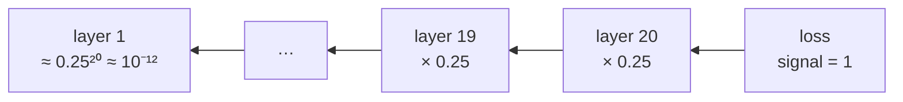

> Tier 3 · Neural Networks · **Level: intermediate** · Reading time: about 10 minutes

# 3.25 Vanishing gradients

**Metadata** — Tier: 3 · Phase: 1 · Priority: P0 · Difficulty: 3/5 · Interview: Very high · Hands-on: High
Prerequisites: 3.10, 3.20, 3.22–3.24 · Leads to: 3.26 Exploding gradients, 3.27 Residual connections, normalization (3.30–3.32)

> **In plain words**
> **Vanishing gradients** means the learning signal **fades to almost nothing** on its way back through a deep network, so the **early layers barely learn**.
> Picture a message whispered down a line of 20 people: by the time it reaches the start, nobody can hear it. Each layer multiplies the signal by a number smaller than 1 (for example the sigmoid's slope is at most 0.25), and many small multiplications shrink it exponentially.

**You need first:** 3.10 Sigmoid, 3.20 Backpropagation, 3.22 Initialization.

> **Figure 3.25-1 — how much learning signal reaches each layer**
>
> 
>
> *How to read it:* the x-axis is the layer index (1 = nearest the input). A **flat** line means every layer learns at a similar rate; a **steep** line means early layers receive almost no signal. Sigmoid (red) loses about 4× per layer (first/last ratio 1.3×10⁻¹³); residual connections (teal) restore a flat profile.
>
> **Figure 3.25-2 — depth and initial scale together**
>
> 
>
> *How to read it:* each point is a freshly initialized ReLU network. Height is log₁₀ of the global gradient norm; the grey plane marks norm 1. Blue = vanishing, red = exploding. The surface bends exponentially with depth when the weight scale is off, which is why initialization matters (3.22–3.26).
>
> *Generated by* `tier-03-neural-networks/figures/src/fig_3_25_gradient_flow.py` from this chapter's code, so the numbers are computed, not typed in.

**Words you'll meet on this page**

| Word | What it means here |
|---|---|
| vanishing gradient | the backward signal shrinks toward 0 with depth |
| saturation | an activation stuck on its flat part, where its slope is ≈ 0 |
| gradient norm | the overall size of a gradient |
| residual connection | a skip path that adds the input to the output (3.27) |
| dead ReLU | a ReLU that always outputs 0, so its gradient is exactly 0 |
| LSTM / GRU | gated recurrent units built to carry signals over time (Tier 5) |

### 1. What is it?
When gradients shrink toward zero as they are propagated backward through many layers (or time steps), early layers receive almost no learning signal.

### 2. Why does it exist?
The backward signal is a product of per-layer factors `Wᵀφ′(z)`. If those factors are typically below 1 in magnitude, the product decays exponentially with depth.

### 3. Detailed explanation
- **Mechanism:** `∂L/∂a₀ = Π_l (φ′(z_l) W_l) ∂L/∂a_L`. For sigmoid, `φ′ ≤ 0.25`, so each layer scales the signal by at most 0.25 before the weights act: ten sigmoid layers bound the factor by `0.25¹⁰ ≈ 9.5×10⁻⁷` (3.10).
- **Measured at initialization** (20 layers, width 64, gradient norm of the first layer ÷ the last layer): sigmoid + Xavier **1.3×10⁻¹³**; sigmoid + LayerNorm 1.5×10⁻⁹; sigmoid + residual connections 4.0×10⁻³; tanh + Xavier 1.33; ReLU + He 0.27. (Code ③ reproduces the idea with its own random draws.)
- **Symptoms:** early layers barely change; training loss plateaus near its initial value; gradient norms per layer decay by orders of magnitude; deep nets underperform shallow ones.
- **Causes:** saturating activations (sigmoid/tanh in their flat regions), weights too small (bad init), very deep or long-sequence recurrent networks.
- **Remedies:** non-saturating activations (ReLU family, GELU/SiLU), proper initialization (3.23–3.24), **normalization** (3.30–3.32), **residual connections** (3.27) which add an identity path, gated recurrent units / LSTM (Tier 5), and layer-wise monitoring.
- **Detection:** log per-layer gradient norms; compare early and late layers; watch for exactly-zero gradients (dead ReLUs, 3.12).
- **Not the same as a poor local minimum:** the loss can be high and still the gradient vanishes.
- **Caveat on the ratio metric:** weight-gradient norms also scale with the activations feeding each layer, so the first/last ratio is only an indicator; compare trends across settings, not absolute values.
- Tier 4 covers gradient monitoring and debugging in practice.

### 4. How does it work?
Multiply the per-layer backward factors; if their typical size is below 1 the product decays geometrically.



### 5. Simple example
A message whispered down a line of 20 people: it fades before it reaches the start.

**By hand.** Suppose each layer keeps only 25% of the signal (the sigmoid's best case): after 1 layer 0.25; 5 layers `0.25⁵ ≈ 0.001`; 10 layers `≈ 0.000001`; 20 layers `≈ 0.0000000000009`. The first layer's weights receive a gradient about a trillion times smaller than the last layer's.

### 6. Technical example
Early RNNs and deep sigmoid MLPs could not learn long-range dependencies; LSTM gates and ResNet skip connections were responses.

### 7. Code
**① By hand (plain Python).** The shrinking signal.

```python
signal = 1.0
for layer in range(1, 21):
    signal *= 0.25                                              # best-case sigmoid slope
    if layer in (1, 5, 10, 20):
        print(f"after {layer:>2} layers the signal is {signal:.1e}")
```

```text
after  1 layers the signal is 2.5e-01
after  5 layers the signal is 9.8e-04
after 10 layers the signal is 9.5e-07
after 20 layers the signal is 9.1e-13
```

**② With NumPy.** Backpropagate through a 20-layer sigmoid net and print the gradient size per layer.

```python
import numpy as np

rng = np.random.default_rng(0)
width, depth = 64, 20
Ws = [rng.normal(0, np.sqrt(1 / width), (width, width)) for _ in range(depth)]   # Xavier-like
a, zs, acts = rng.normal(0, 1, (32, width)), [], []
for W in Ws:
    z = a @ W.T
    a = 1 / (1 + np.exp(-z))
    zs.append(z); acts.append(a)

grad = np.ones_like(a) / a.size                                  # pretend gradient arriving from the loss
norms = []
for W, a_l in zip(reversed(Ws), reversed(acts)):
    grad = (grad * a_l * (1 - a_l)) @ W                           # sigmoid slope, then the weights
    norms.append(np.linalg.norm(grad))
norms = norms[::-1]
for layer in (1, 5, 10, 15, 20):
    print(f"gradient size reaching layer {layer:>2}: {norms[layer - 1]:.1e}")
```

```text
gradient size reaching layer  1: 4.4e-15
gradient size reaching layer  5: 1.3e-12
gradient size reaching layer 10: 2.8e-09
gradient size reaching layer 15: 3.1e-06
gradient size reaching layer 20: 4.1e-03
```

**③ With PyTorch.** Compare sigmoid, ReLU and a residual version.

```python
import torch

def first_over_last(make_activation, he, residual=False, depth=20, width=64):
    torch.manual_seed(0)
    layers = [torch.nn.Linear(width, width) for _ in range(depth)]
    for lin in layers:
        (torch.nn.init.kaiming_normal_ if he else torch.nn.init.xavier_normal_)(lin.weight)
        torch.nn.init.zeros_(lin.bias)
    act = make_activation()
    h = torch.randn(32, width)
    for lin in layers:
        h = h + act(lin(h)) if residual else act(lin(h))
    h.pow(2).mean().backward()
    first, last = layers[0].weight.grad.norm().item(), layers[-1].weight.grad.norm().item()
    return first / last

print(f"sigmoid, Xavier          : first/last gradient = {first_over_last(torch.nn.Sigmoid, he=False):.1e}")
print(f"sigmoid + residual       : first/last gradient = {first_over_last(torch.nn.Sigmoid, he=False, residual=True):.1e}")
print(f"ReLU, He                 : first/last gradient = {first_over_last(torch.nn.ReLU, he=True):.1e}")
```

```text
sigmoid, Xavier          : first/last gradient = 1.4e-13
sigmoid + residual       : first/last gradient = 5.8e-02
ReLU, He                 : first/last gradient = 7.1e-01
```

### 8. Input → Process → Output
`product of (φ′·W) factors < 1 → exponentially small gradient in early layers → little learning`

<details>
<summary><b>Beyond the basics (sections 9–16)</b> — real-world use, limits, mistakes. Skip on a first read.</summary>

### 9. Enterprise use case
Debugging a deep model that "does not learn" starts with per-layer gradient norms; this check is cheap and decisive.

### 10. AI engineering connection
Transformers rely on residual connections, normalization and careful initialization precisely to avoid vanishing signals across dozens of layers (Tier 8).

### 11. Advantages
Understanding it explains the design of ReLU, ResNets, LSTMs and Transformers.

### 12. Limitations
Hard to diagnose from the loss alone; mitigation choices interact.

### 13. Trade-offs
Residual paths and normalization add a little compute and memory but make depth practical.

### 14. Common mistakes
Using sigmoid or tanh in deep stacks; deep networks without normalization or skips; reading a flat loss as "needs more epochs"; not logging gradient norms.

### 15. Performance / cost
Monitoring gradient norms costs little; do it every few hundred steps.

### 16. Security
No direct issue.

</details>

### 17. Interview explanation
"Backprop multiplies one factor per layer; if they are below one, as with saturating sigmoid or tanh or too-small weights, gradients decay exponentially and early layers don't learn. The fixes are ReLU-family activations, He or Xavier initialization, normalization and residual connections, and I'd confirm with per-layer gradient norms."

### 18. Rapid-fire answer
Backward product of factors < 1 → exponential decay; fixes: ReLU/GELU, good init, normalization, residuals, LSTM.

### 19. Interview questions
- **Basic:** What are vanishing gradients and why do they happen?
- **Intermediate:** Why are residual connections helpful?
- **Advanced:** Bound the gradient through ten sigmoid layers.
- **Scenario:** Loss does not move in a 30-layer sigmoid MLP. How do you diagnose and fix it?

### 20. Hands-on exercise
**Goal:** see how the ratio changes with depth.

1. Reuse the sigmoid network of code ③ (without residuals).
2. Measure the first/last gradient ratio for depths 5, 10, 20.
3. Does it fall about exponentially (a straight line on a log scale)?

<details>
<summary>Show a solution</summary>

```python
import torch

def ratio(depth, width=64):
    torch.manual_seed(0)
    layers = [torch.nn.Linear(width, width) for _ in range(depth)]
    for lin in layers:
        torch.nn.init.xavier_normal_(lin.weight); torch.nn.init.zeros_(lin.bias)
    h = torch.randn(32, width)
    for lin in layers:
        h = torch.sigmoid(lin(h))
    h.pow(2).mean().backward()
    return layers[0].weight.grad.norm().item() / layers[-1].weight.grad.norm().item()

for depth in (5, 10, 20):
    print(f"depth {depth:>2}: first/last gradient = {ratio(depth):.1e}")
```

```text
depth  5: first/last gradient = 7.1e-04
depth 10: first/last gradient = 5.0e-07
depth 20: first/last gradient = 1.4e-13
```

</details>

### 21. Revision questions
1. Why does the gradient shrink?
2. Name four remedies.
3. How do you detect it?

### 22. Related concepts
3.10 Sigmoid · 3.12 ReLU · 3.20 Backpropagation · 3.22–3.24 Initialization · 3.26 Exploding gradients · 3.27 Residual connections · 3.30–3.32 Normalization

### 23. One-line memory hook
**Vanishing gradient: the whisper dies before it reaches the first layers.**

<details>
<summary><b>For reviewers</b> (not part of the lesson)</summary>

- Status: DRAFT, learner-first layout (Author: Claude). Code is executed by `tests/test_md_snippets.py`.
- TESTED earlier: `test_vanishing_gradients_and_fixes` and `lab_02_training_internals.grad_norms_by_layer` (20 layers, width 64: sigmoid+Xavier 1.3×10⁻¹³, LayerNorm 1.5×10⁻⁹, residual 4.0×10⁻³, tanh 1.33, ReLU+He 0.27). The page's code uses its own random draws and a different loss, so its numbers differ in size but show the same pattern.
</details>
