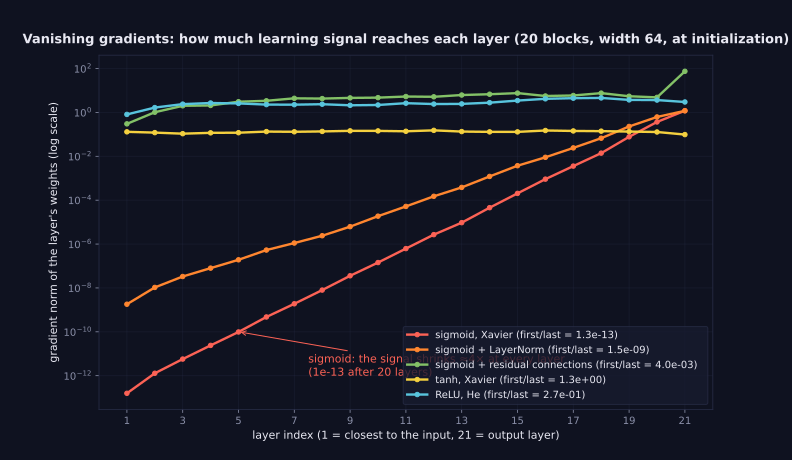
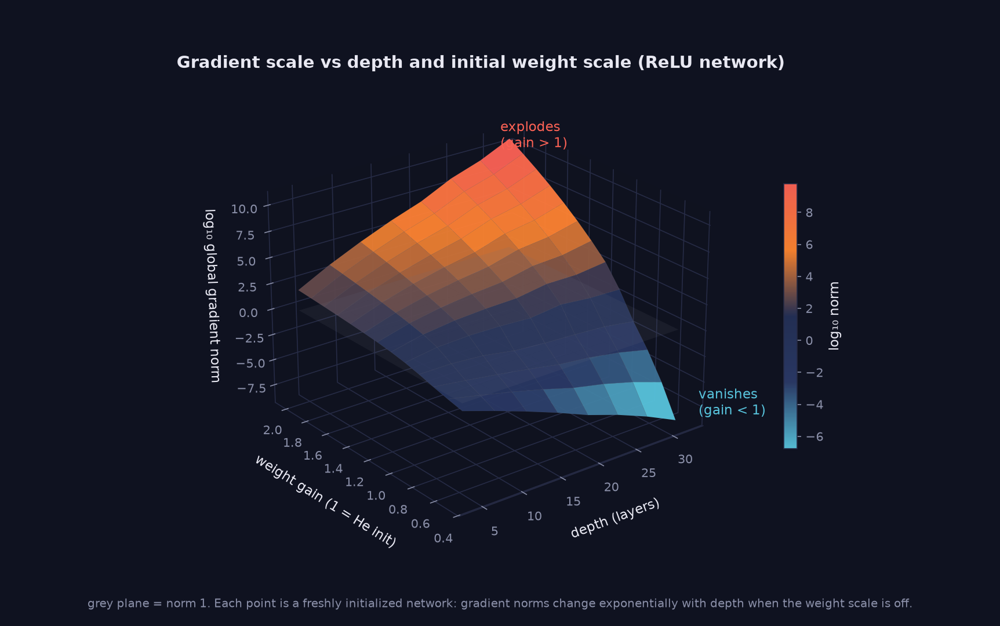

> Tier 3 — Neural Networks · Status: DRAFT (Author: Claude) · Code: `code/nn.py`, `lab/lab_02_training_internals.py` — TESTED

# 3.25 Vanishing gradients

**Metadata** — Tier: 3 · Phase: 1 · Priority: P0 · Difficulty: 3/5 · Interview: Very high · Hands-on: High
Prerequisites: 3.20, 3.10, 3.22 · Leads to: 3.27 Residual connections, 3.30–3.32 Normalization, Tier 5 LSTM

### 1. What is it?
When gradients shrink toward zero as they are propagated backward through many layers (or time steps), so early layers receive almost no learning signal.

### 2. Why does it exist?
The backward signal is a product of per-layer factors `Wᵀφ′(z)`. If those factors are typically below 1 in magnitude, the product decays exponentially with depth.

### 3. Detailed explanation
- **Mechanism:** `∂L/∂a₀ = Π_l (φ′(z_l) W_l) ∂L/∂a_L`. For sigmoid `φ′ ≤ 0.25`, so each layer scales the signal by at most 0.25 before weights act: ten sigmoid layers bound the factor by `0.25¹⁰ ≈ 9.5×10⁻⁷` (3.10).
- **Measured at initialization (20 layers, width 64, gradient norm of the first layer ÷ the last layer):**
  | network | first/last gradient norm |
  |---|---|
  | sigmoid, Xavier | **1.3×10⁻¹³** |
  | sigmoid + LayerNorm | 1.5×10⁻⁹ |
  | sigmoid + residual connections | 4.0×10⁻³ |
  | tanh, Xavier | 1.33 |
  | ReLU, He | 0.27 |
- **Symptoms:** early layers barely change; training loss plateaus near its initial value; gradient norms per layer decay by orders of magnitude; deep nets underperform shallow ones.
- **Causes:** saturating activations (sigmoid/tanh in their flat regions), weights too small (bad init), very deep or long-sequence recurrent networks.
- **Remedies:** non-saturating activations (ReLU family, GELU/SiLU), proper initialization (3.23–3.24), **normalization** (3.30–3.32), **residual connections** (3.27) which add an identity path, gated recurrent units/LSTM (Tier 5), gradient-friendly architectures, and layer-wise monitoring.
- **Detection:** log per-layer gradient norms; compare early vs late layers; watch for exactly-zero gradients (dead ReLUs, 3.12).
- **Not the same as a poor local minimum:** the loss can be high and still the gradient vanishes.
- **Caveat on the ratio metric:** weight-gradient norms also scale with the activations feeding each layer, so the first/last ratio is only an indicator; compare trends across settings, not absolute values.
- Tier 4 covers gradient monitoring and debugging in practice (4.37–4.39).

### 4. How does it work?
Multiply the per-layer backward Jacobian factors; if their typical size is below 1 the product decays geometrically.

> **Figure 3.25-1 and 3.25-2 — how much learning signal reaches each layer, and how it depends on depth and initial scale**




*How to read it:* 3.25-1: the x-axis is the layer index (1 = nearest the input). A flat line means every layer learns at a similar rate; a steep line means early layers receive almost no signal. Sigmoid (red) loses ~4× per layer (first/last ratio 1.3×10⁻¹³); residual connections (teal) restore a flat profile. 3.25-2: each point is a freshly initialized ReLU network. Height is log₁₀ of the global gradient norm; the grey plane marks norm 1. Blue = vanishing, red = exploding; the surface bends exponentially with depth when the weight scale is off, which is why initialization matters (3.22–3.26).

*Generated by* `tier-03-neural-networks/figures/src/fig_3_25_gradient_flow.py` *from this chapter's code, so the numbers are computed, not typed in.*

### 5. Simple example
A message whispered down a line of 20 people: it fades before it reaches the start.

### 6. Technical example
Early RNNs and deep sigmoid MLPs could not learn long-range dependencies; LSTM gates and ResNet skip connections were responses.

### 7. Code
```python
from lab_02_training_internals import grad_norms_by_layer
g = grad_norms_by_layer('sigmoid', 'xavier_normal', depth=20); print(g[0] / g[-1])            # ~1e-13
g = grad_norms_by_layer('sigmoid', 'xavier_normal', depth=20, residual=True); print(g[0] / g[-1])   # ~4e-3
```
TESTED (`test_vanishing_gradients_and_fixes`).

### 8. Input → Process → Output
`backward signal × (φ′ · Wᵀ) at each layer → geometric decay`

### 9. Enterprise use case
Training dashboards track per-layer gradient norms and alert on collapse.

### 10. AI engineering connection
One reason Transformers use residual connections and layer normalization around every sublayer (Tier 8).

### 11. Advantages
(Of understanding it) explains architecture and activation choices.

### 12. Limitations
Diagnosis from norms is indirect.

### 13. Trade-offs
Normalization and residuals add compute/params but stabilize depth.

### 14. Common mistakes
Deep sigmoid/tanh stacks without normalization; blaming the optimizer instead; judging only by loss; ignoring per-layer statistics.

### 15. Performance / cost
N/A.

### 16. Security
N/A.

### 17. Interview explanation
"Vanishing gradients happen when the product of per-layer derivative factors is below one: sigmoid's derivative is at most 0.25, so ten layers shrink the signal by a million. In my experiment a 20-layer sigmoid net had first-to-last gradient ratio around 1e-13, and residual connections lifted it to about 1e-3. I fix it with ReLU-family activations, He initialization, normalization and skip connections."

### 18. Rapid-fire
Backward signal = product of φ′·W factors; <1 ⇒ decays; fix with ReLU/GELU, He init, normalization, residuals, gating.

### 19. Interview questions
- Basic: Why does sigmoid cause vanishing gradients?
- Intermediate: How do residual connections help?
- Advanced: Why do LSTMs mitigate vanishing gradients in time?
- Scenario: Layer-wise gradient norms drop 10× per layer. What do you try, in order?

### 20. Hands-on exercise
Plot first/last gradient ratio vs depth (5–40 layers) for sigmoid, tanh, ReLU with and without residuals.

### 21. Revision questions
1) Mechanism? 2) Bound for sigmoid chains? 3) Four fixes?

### 22. Related concepts
3.10 Sigmoid · 3.20 Backpropagation · 3.26 Exploding gradients · 3.27 Residual connections · 3.30–3.32 Normalization

### 23. Memory hook
**Vanishing: multiply many numbers below one and the early layers hear nothing.**
