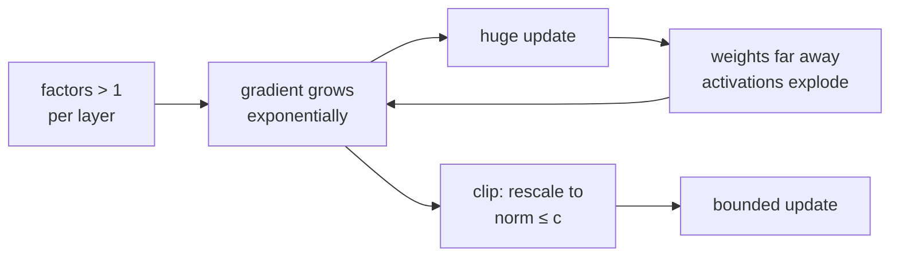

> Tier 3 · Neural Networks · **Level: intermediate** · Reading time: about 10 minutes

# 3.26 Exploding gradients

**Metadata** — Tier: 3 · Phase: 1 · Priority: P0 · Difficulty: 3/5 · Interview: High · Hands-on: High
Prerequisites: 3.20, 3.25, 1.15 · Leads to: Tier 4 gradient clipping, learning-rate schedules

> **In plain words**
> **Exploding gradients** are the mirror image of vanishing ones: the learning signal **grows** at every layer until it is enormous. Then a single update throws the weights far away, the loss spikes, and you see `inf` or `NaN`.
> Like a microphone too close to the speaker: each pass through the loop amplifies the squeal.
> The usual emergency brake is **gradient clipping**: if the gradient is too large, shrink it to a fixed maximum size, keeping its direction.

**You need first:** 3.20 Backpropagation, 3.25 Vanishing gradients, 1.15 Norms.

> **Figure 3.26-1 — exploding gradients and global-norm clipping**
>
> 
>
> *How to read it:* a 12-layer ReLU network with weights 1.3× too large. Without clipping (red) the gradient norm explodes within 5 steps and the loss becomes infinite, so the red loss line stops. With the global norm clipped to 1 (orange) the pre-clip norm still reaches about 125, but every update is bounded and the loss keeps falling; the correctly scaled network (green) is stable and lower. Clipping treats the symptom; the weight scale is the cause.
>
> *Generated by* `tier-03-neural-networks/figures/src/t3_training.py` from this chapter's code, so the numbers are computed, not typed in.

**Words you'll meet on this page**

| Word | What it means here |
|---|---|
| exploding gradient | the backward signal grows exponentially with depth |
| gradient norm | the overall size of all gradients together |
| clipping | rescale the gradient if its norm exceeds a limit `c` |
| gain | a multiplier on the initial weights (1.0 = correct scale) |
| `NaN` / `inf` | "not a number" / infinity: a numeric overflow |
| loss spike | a sudden jump in the loss during training |
| warm-up | start with a small learning rate and raise it gradually |

### 1. What is it?
Gradients that grow exponentially as they are propagated backward, producing huge parameter updates, loss spikes, `inf`/`NaN`, or divergence.

### 2. Why does it exist?
It is the mirror image of vanishing gradients: if the per-layer factors exceed 1 in magnitude, their product explodes with depth or sequence length.

### 3. Detailed explanation
- **Mechanism:** weight matrices with large singular values (1.19) and non-saturating activations (ReLU) amplify the signal at each layer. Recurrent networks reuse the same matrix at every step, so the effect compounds with sequence length (Tier 5).
- **Sensitivity to scale:** with 20 ReLU layers, a modest 25% error in the weight scale multiplies the gradient by about 100, and doubling the scale makes it millions of times larger (code ② shows the pattern; the earlier lab measured 13.5 / 1.6×10³ / 5.3×10⁴ / 1.3×10⁷ for gains 1.0 / 1.25 / 1.5 / 2.0).
- **Training behaviour (12-layer ReLU net, learning rate 0.1, gain 1.3):** without clipping the loss becomes infinite after 5 steps; with **global-norm clipping at 1.0** (max pre-clip norm 125) training stays finite and reaches loss 0.79. The well-initialized net (gain 1.0) reaches 0.52.
- **Gradient clipping:** if `‖g‖₂ > c`, replace `g ← g·c/‖g‖₂` (1.15). It limits the step size without changing the gradient direction. Clipping treats the symptom; fix the scale (init, normalization) too.
- **Other remedies:** proper initialization (3.22–3.24), normalization (3.30–3.32), lower learning rate or warm-up (Tier 4), weight decay, residual scaling, gated recurrent units, mixed-precision safeguards (loss scaling, 1.44).
- **Detection:** monitor the global gradient norm; spikes preceding NaNs; sudden loss jumps; log the fraction of steps where clipping triggers. A clip rate near 100% means the threshold or the scale is wrong.
- **Interaction with fp16:** overflow to `inf` is more likely in low precision; bf16's range helps (1.40).
- **Not always bad:** occasional large-gradient steps on rare batches are normal; persistent explosion is the issue.

### 4. How does it work?
A product of backward factors larger than 1 → exponential growth → huge update → even larger activations and gradients.



### 5. Simple example
A microphone too close to the speaker: every pass amplifies the squeal.

**By hand.** If each layer multiplies the signal by 1.5, then after 12 layers the factor is `1.5¹² ≈ 130`; after 40 layers `1.5⁴⁰ ≈ 1.1×10⁷`. **Clipping by hand:** a gradient `[30, 40]` has norm 50. With limit `c = 1` we multiply by `1/50` and get `[0.6, 0.8]`: same direction, norm 1.

### 6. Technical example
LLM pretraining runs monitor the gradient norm and clip at 1.0; loss spikes are investigated and often traced to data or learning-rate issues.

### 7. Code
**① By hand (plain Python).** Clipping a gradient, and growth per layer.

```python
import math

g = [30.0, 40.0]
norm = math.sqrt(sum(v * v for v in g))
c = 1.0
clipped = [v * min(1.0, c / norm) for v in g]
print("norm before:", norm, " clipped gradient:", [round(v, 2) for v in clipped],
      " norm after:", round(math.sqrt(sum(v * v for v in clipped)), 2))
for layers in (12, 40):
    print(f"factor 1.5 per layer over {layers} layers: {1.5 ** layers:.1e}")
```

```text
norm before: 50.0  clipped gradient: [0.6, 0.8]  norm after: 1.0
factor 1.5 per layer over 12 layers: 1.3e+02
factor 1.5 per layer over 40 layers: 1.1e+07
```

**② With NumPy.** The gradient norm at initialization for different weight gains.

```python
import numpy as np

rng = np.random.default_rng(0)
width, depth = 64, 20
x = rng.normal(0, 1, (32, width))
for gain in (1.0, 1.25, 1.5, 2.0):
    Ws = [rng.normal(0, gain * np.sqrt(2 / width), (width, width)) for _ in range(depth)]
    a, masks = x, []
    for W in Ws:
        z = a @ W.T
        masks.append(z > 0)
        a = np.maximum(0, z)
    grad = np.ones_like(a) / a.size
    for W, m in zip(reversed(Ws), reversed(masks)):
        grad = (grad * m) @ W                                    # ReLU mask, then the weights
    print(f"gain {gain:>4}: gradient size at the input = {np.linalg.norm(grad):.1e}")
```

```text
gain  1.0: gradient size at the input = 5.0e-02
gain 1.25: gradient size at the input = 5.7e+00
gain  1.5: gradient size at the input = 1.9e+02
gain  2.0: gradient size at the input = 9.8e+04
```

**③ With PyTorch.** Train a 12-layer ReLU net whose weights are 1.3× too large, with and without clipping.

```python
import torch

def run(gain, clip, steps=40):
    torch.manual_seed(0)
    net = torch.nn.Sequential(*[m for _ in range(12) for m in (torch.nn.Linear(32, 32), torch.nn.ReLU())], torch.nn.Linear(32, 1))
    for p in net.parameters():
        if p.dim() == 2:
            torch.nn.init.kaiming_normal_(p); p.data *= gain
        else:
            torch.nn.init.zeros_(p)
    X = torch.randn(256, 32); y = X[:, :1]
    opt = torch.optim.SGD(net.parameters(), lr=0.01)
    peak, loss = 0.0, None
    with torch.no_grad():
        start = ((net(X) - y) ** 2).mean().item()
    for _ in range(steps):
        opt.zero_grad()
        loss = ((net(X) - y) ** 2).mean()
        loss.backward()
        norm = torch.nn.utils.clip_grad_norm_(net.parameters(), clip if clip else 1e12).item()
        peak = max(peak, norm)
        opt.step()
    return peak, start, loss.item()

for name, gain, clip in (("gain 1.0, no clipping", 1.0, None), ("gain 1.3, no clipping", 1.3, None), ("gain 1.3, clip at 1.0", 1.3, 1.0)):
    peak, start, loss = run(gain, clip)
    print(f"{name:<24} peak gradient norm {peak:9.1f}   loss {start:.3g} -> {loss:.3g}")
```

```text
gain 1.0, no clipping    peak gradient norm      12.5   loss 1.53 -> 0.785
gain 1.3, no clipping    peak gradient norm       inf   loss 378 -> 4.71e+20
gain 1.3, clip at 1.0    peak gradient norm    8397.0   loss 378 -> 10.8
```

### 8. Input → Process → Output
`factors > 1 → exponential growth → (clip) → bounded update`

<details>
<summary><b>Beyond the basics (sections 9–16)</b> — real-world use, limits, mistakes. Skip on a first read.</summary>

### 9. Enterprise use case
Large training runs log the gradient norm and clip rate; a rising clip rate is an early warning of instability.

### 10. AI engineering connection
LLM training uses clipping at 1.0, warm-up, bf16 and careful initialization; loss spikes are investigated as data or learning-rate issues.

### 11. Advantages
Clipping is cheap and robust; it preserves the gradient direction.

### 12. Limitations
It does not cure the root cause (scale); a bad threshold hides problems or slows learning.

### 13. Trade-offs
A lower clip threshold gives more stability but slows learning.

### 14. Common mistakes
Clipping each tensor separately instead of globally; clipping before unscaling fp16 gradients; very high learning rate hidden by clipping; ignoring the clip rate.

### 15. Performance / cost
Computing the global norm needs one pass over the gradients; in distributed training it needs a reduction.

### 16. Security
Poisoned or adversarial batches can cause large gradients; clipping bounds their effect (and is part of differential-privacy training).

</details>

### 17. Interview explanation
"Exploding gradients are the multiplicative mirror of vanishing: factors above one compound across depth or time, giving huge steps and NaNs. I monitor the global gradient norm, fix the init and normalization, and use global-norm clipping, usually at one, as the safety net."

### 18. Rapid-fire answer
Backward factors > 1 compound; symptoms: loss spikes, NaN; remedies: init, normalization, lower learning rate/warm-up, global-norm clipping.

### 19. Interview questions
- **Basic:** What causes exploding gradients?
- **Intermediate:** Write the clipping rule. Does it change the direction?
- **Advanced:** Why is global-norm clipping preferred to per-tensor clipping?
- **Scenario:** Loss spikes every few thousand steps. What do you check?

### 20. Hands-on exercise
**Goal:** find the weight gain at which the gradient at the input exceeds 100 for several depths.

1. For depths 20, 40 and 80 (width 64, ReLU), scan gains from 1.0 to 2.0 in steps of 0.1.
2. Report the smallest gain whose input gradient exceeds 10².
3. Relate it to `gain^depth`.

<details>
<summary>Show a solution</summary>

```python
import numpy as np

def input_grad(gain, depth, width=64):
    rng = np.random.default_rng(0)
    Ws = [rng.normal(0, gain * np.sqrt(2 / width), (width, width)) for _ in range(depth)]
    a, masks = rng.normal(0, 1, (32, width)), []
    for W in Ws:
        z = a @ W.T; masks.append(z > 0); a = np.maximum(0, z)
    grad = np.ones_like(a) / a.size
    for W, m in zip(reversed(Ws), reversed(masks)):
        grad = (grad * m) @ W
    return np.linalg.norm(grad)

for depth in (20, 40, 80):
    first = next((round(g, 1) for g in np.arange(1.0, 2.01, 0.1) if input_grad(g, depth) > 1e2), None)
    print(f"depth {depth:>2}: smallest gain with input gradient > 1e2 = {first}")
```

```text
depth 20: smallest gain with input gradient > 1e2 = 1.5
depth 40: smallest gain with input gradient > 1e2 = 1.2
depth 80: smallest gain with input gradient > 1e2 = 1.1
```

</details>

### 21. Revision questions
1. What is the mechanism?
2. What is the clipping formula?
3. Why fix the scale as well as clip?

### 22. Related concepts
3.22–3.24 Initialization · 3.25 Vanishing gradients · 1.15 Norms · 1.44 Numerical stability · Tier 4

### 23. One-line memory hook
**Exploding gradients: the squeal grows each pass; clip it, then fix the gain.**

<details>
<summary><b>For reviewers</b> (not part of the lesson)</summary>

- Status: DRAFT, learner-first layout (Author: Claude). Code is executed by `tests/test_md_snippets.py`.
- TESTED earlier: `test_exploding_gradients_and_clipping`, `test_clip_grad_norm`, `lab_03_pytorch_build.t_3_clip_grad_matches` (our `clip_grad_norm` agrees with PyTorch within 1e-6). The lab numbers quoted in section 3 come from the library (learning rate 0.1, fixed seeds); the page's code uses a gentler learning rate, so its numbers are different.
</details>
