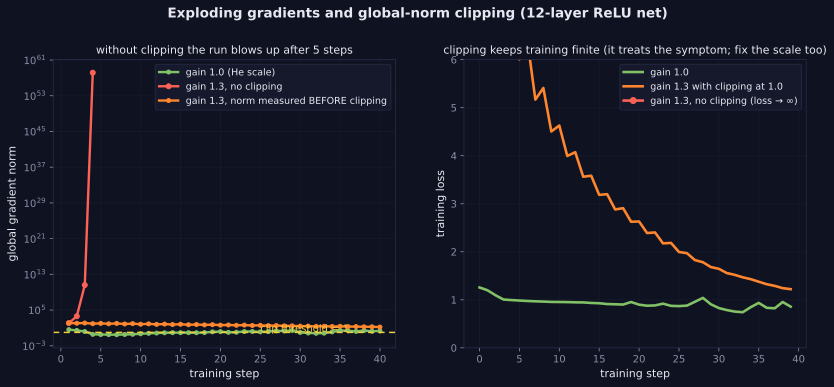

> Tier 3 — Neural Networks · Status: DRAFT (Author: Claude) · Code: `code/nn.py`, `lab/lab_02_training_internals.py` — TESTED

# 3.26 Exploding gradients

**Metadata** — Tier: 3 · Phase: 1 · Priority: P0 · Difficulty: 3/5 · Interview: High · Hands-on: High
Prerequisites: 3.25, 1.15 · Leads to: Tier 4 Gradient clipping (4.15), Tier 5 RNN training

### 1. What is it?
When gradients grow exponentially as they are propagated backward, producing huge parameter updates, loss spikes, `inf`/`NaN`, or divergence.

### 2. Why does it exist?
The mirror image of vanishing gradients: if the per-layer factors exceed 1 in magnitude, their product explodes with depth or sequence length.

### 3. Detailed explanation
- **Mechanism:** weight matrices with large singular values (1.19) and non-saturating activations (ReLU) amplify the signal at each layer. Recurrent networks reuse the same matrix at every step, so the effect compounds with sequence length (Tier 5).
- **Measured (20 ReLU layers, He init scaled by a gain; global gradient norm at initialization):** 13.5 (gain 1.0), 1.6×10³ (1.25), 5.3×10⁴ (1.5), **1.3×10⁷** (2.0). A modest 25% error in weight scale multiplies the gradient by ~100.
- **Training behaviour (12-layer ReLU net, lr 0.1, gain 1.3):** without clipping the loss becomes infinite after 5 steps; with **global-norm clipping at 1.0** (max pre-clip norm 125) training stays finite and reaches loss 0.79. The well-initialized net (gain 1.0) reaches 0.52.
- **Gradient clipping:** if `‖g‖₂ > c`, replace `g ← g·c/‖g‖₂` (1.15). It limits step size without changing the gradient direction. Our `clip_grad_norm` matches `torch.nn.utils.clip_grad_norm_` (agreement within 1e-6; PyTorch adds a small epsilon). Clipping treats the symptom; fix scale (init, normalization) too.
- **Other remedies:** proper initialization (3.22–3.24), normalization (3.30–3.32), lower learning rate or warm-up (Tier 4, 4.11), weight decay, residual scaling, using gated recurrent units, mixed-precision safeguards (loss scaling, 1.44).
- **Detection:** monitor global gradient norm; spikes preceding NaNs; sudden loss jumps; log the fraction of steps where clipping triggers. A clip rate near 100% means the threshold or the scale is wrong.
- **Interaction with fp16:** overflow to `inf` is more likely in low precision; bf16's range helps (1.40).
- **Not always bad:** occasional large-gradient steps on rare batches are normal; persistent explosion is the issue.

### 4. How does it work?
Product of backward factors larger than 1 → exponential growth → huge update → even larger activations/gradients.

> **Figure 3.26-1 — exploding gradients and global-norm clipping**



*How to read it:* A 12-layer ReLU network with weights 1.3× too large. Without clipping (red) the gradient norm explodes within 5 steps and the loss becomes infinite, so the red loss line stops. With the global norm clipped to 1 (orange) the pre-clip norm still reaches about 125, but every update is bounded and the loss keeps falling; the correctly scaled network (green) is stable and lower. Clipping treats the symptom; the scale is the cause.

*Generated by* `tier-03-neural-networks/figures/src/t3_training.py` *from this chapter's code, so the numbers are computed, not typed in.*

### 5. Simple example
A microphone too close to the speaker: every pass amplifies the squeal.

### 6. Technical example
LLM pretraining runs monitor gradient norm and clip at 1.0; loss spikes are investigated and often traced to data or learning-rate issues.

### 7. Code
```python
import nn as N
net = N.build_deep_net(32, 12, 'relu', 'he_normal', n_out=3)
norm_before = N.clip_grad_norm(net, 1.0)           # returns the pre-clip global norm; scales gradients so that it is ≤ 1
```
TESTED (`test_exploding_gradients_and_clipping`, `test_clip_grad_norm`, `lab_03_pytorch_build.t_3_clip_grad_matches`).

### 8. Input → Process → Output
`factors > 1 → gradient ↑ geometrically → NaN/inf or divergence; clip + fix scale`

### 9. Enterprise use case
Runbooks specify clipping thresholds, spike detection, auto-rollback to a checkpoint, and data forensics.

### 10. AI engineering connection
Standard in Transformer training (clip norm 1.0 is a common default) and essential for RNNs.

### 11. Advantages
(Of clipping) cheap and effective stopgap.

### 12. Limitations
Clipping hides root causes; too-low thresholds slow learning.

### 13. Trade-offs
Aggressive clipping = stable but slower; none = risk of divergence.

### 14. Common mistakes
Using clipping instead of fixing init/learning rate; clipping per-parameter instead of global norm; not logging clip frequency; fp16 overflow mistaken for explosion (or vice versa).

### 15. Performance / cost
Global norm needs an all-reduce in distributed training.

### 16. Security
Gradient spikes can result from poisoned or malformed batches; log the offending batch.

### 17. Interview explanation
"Exploding gradients are the reverse of vanishing: factors above one compound. A 25% too-large weight scale in a 20-layer ReLU net multiplied my gradient norm by about a hundred. I clip by global norm — it keeps direction and bounds the step — but I also fix initialization, normalization and learning rate, and I log the clip rate."

### 18. Rapid-fire
Backward factors >1 compound; clip global norm (g·c/‖g‖) plus fix init/normalization/LR; monitor the norm.

### 19. Interview questions
- Basic: What does gradient clipping do?
- Intermediate: Global-norm vs per-element clipping?
- Advanced: Why are RNNs especially prone to exploding gradients?
- Scenario: Loss spikes to NaN every ~2,000 steps. How do you investigate?

### 20. Hands-on exercise
Find the weight gain at which gradient norm at initialization exceeds 1e6 for depths 10, 20, 40 and relate to `gain^depth`.

### 21. Revision questions
1) Mechanism? 2) Clipping formula? 3) Root-cause fixes?

### 22. Related concepts
3.25 Vanishing gradients · 3.22 Parameter initialization · 1.15 Norms · 1.44 Overflow/underflow · Tier 4 Gradient clipping

### 23. Memory hook
**Exploding: the squeal grows each pass — clip it, then fix the gain.**
