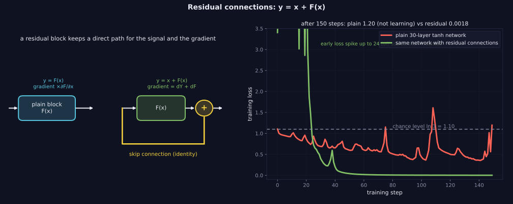
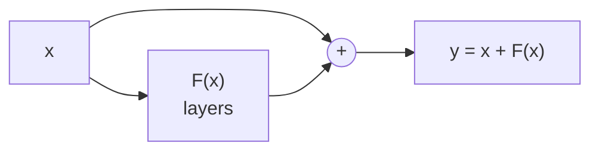

> Tier 3 · Neural Networks · **Level: beginner** · Reading time: about 9 minutes

# 3.27 Residual connections

**Metadata** — Tier: 3 · Phase: 1 · Priority: P0 · Difficulty: 2/5 · Interview: Very high · Hands-on: High
Prerequisites: 3.17, 3.20, 3.25 · Leads to: Tier 8 Transformer blocks, normalization placement (3.30–3.32)

> **In plain words**
> A **residual connection** (or **skip connection**) **adds a block's input straight to its output**: `y = x + F(x)`. The block only has to learn a small *correction* to what already comes in.
> It is like a highway running beside a winding road: traffic can take either, and the highway keeps everything connected. In training, the **gradient also gets a direct highway back**, so deep networks stop forgetting their early layers. Every Transformer layer is wrapped this way.

**You need first:** 3.17 MLP, 3.20 Backpropagation, 3.25 Vanishing gradients.

> **Figure 3.27-1 — a residual block and what it does to training**
>
> 
>
> *How to read it:* **Left:** the skip connection adds the input back, `y = x + F(x)`, so the backward gradient is `dY + dF` and always has an identity path. **Right:** the same 30-layer tanh network without the skip stays near chance (loss 1.20; chance is 1.10), while with residual connections it reaches 0.0018 after an initial loss spike (up to 24, off the plotted scale) that settles within about 40 steps.
>
> *Generated by* `tier-03-neural-networks/figures/src/t3_training.py` from this chapter's code, so the numbers are computed, not typed in.

**Words you'll meet on this page**

| Word | What it means here |
|---|---|
| residual | the "leftover" `F(x)` the block adds to its input |
| skip / shortcut | the path that carries `x` around the block |
| identity | passing a value through unchanged |
| residual stream | the running value that every Transformer block reads from and adds to |
| pre-norm / post-norm | normalization before / after the addition |
| projection | a linear layer that fixes a shape mismatch on the skip path |
| ResNet | the image network family that introduced the idea (2015) |

### 1. What is it?
Adding a block's input to its output: `y = x + F(x)`. The identity **skip connection** lets the signal and the gradient bypass the transformation `F`. Introduced with ResNets (He et al., 2015).

### 2. Why does it exist?
Deep plain networks are hard to optimize because gradients vanish; a skip path guarantees a direct gradient route and lets each block learn only a *correction* to the identity.

### 3. Detailed explanation
- **Gradient through a residual block:** `∂y/∂x = I + ∂F/∂x`. The identity term means the backward signal is never multiplied only by small factors: `dX = dY + F.backward(dY)`.
- **Measured, 30-layer tanh networks (width 32, Xavier):** the plain network's first layer gets a gradient of 0.086 and the loss stays at 1.196 (chance is 1.099, so it did not learn); the residual network (branch scaled by 0.5) has a first-layer gradient of 2.54 and reaches loss **0.0018** after 150 steps.
- **Easier optimization landscape (empirical):** residual networks have smoother loss surfaces (REVIEW_REQUIRED: cite loss-landscape visualizations).
- **Design details:**
  - `F` and `x` must have the same shape; otherwise use a projection (1×1 convolution or linear layer) on the skip path.
  - **Post-norm** (`LN(x + F(x))`, original Transformer) versus **pre-norm** (`x + F(LN(x))`, now common in LLMs for more stable deep training) (Tier 8).
  - Initialize the last layer of each branch small (or zero) so each block starts near the identity.
  - Scaling the branch or learned gating (ReZero, LayerScale) controls the effective depth early in training.
- **Transformer residual stream:** token representations flow along the skip path; attention and MLP blocks read from and write to it (Tier 8).
- **Cost:** one addition per block.
- **Dense connections (DenseNet) and highway gates** are related variants.
- **Effects on information:** the skip path preserves input information through depth.

### 4. How does it work?
Compute `F(x)`, add `x`, continue; in backward add the upstream gradient to the gradient returned by `F`.



### 5. Simple example
A highway beside the winding road: traffic can take either, and the highway keeps everything connected.

**By hand.** Suppose each block's branch passes only 10% of the gradient (a factor 0.1). Plain, 20 blocks: `0.1²⁰ = 10⁻²⁰`. Residual: each block passes `1 + 0.1 = 1.1`, so 20 blocks give `1.1²⁰ ≈ 6.7`. The gradient survives.

### 6. Technical example
Every Transformer sublayer is wrapped as `x + Sublayer(Norm(x))`.

### 7. Code
**① By hand (plain Python).** The arithmetic of survival.

```python
blocks = 20
plain, residual = 1.0, 1.0
for _ in range(blocks):
    plain *= 0.1                                                # branch only
    residual *= 1 + 0.1                                         # identity path plus branch
print(f"after {blocks} blocks, gradient factor: plain {plain:.0e}   residual {residual:.1f}")
```

```text
after 20 blocks, gradient factor: plain 1e-20   residual 6.7
```

**② With NumPy.** A residual block and its backward pass.

```python
import numpy as np

rng = np.random.default_rng(0)
x = rng.normal(0, 1, (4, 8))
W = rng.normal(0, 0.3, (8, 8))

def block(x):
    return x + np.tanh(x @ W.T)                                 # y = x + F(x)

y = block(x)
dY = np.ones_like(y)
dF = ((1 - np.tanh(x @ W.T) ** 2) * dY) @ W                     # gradient through F alone
dX = dY + dF                                                    # identity path + branch path

h = 1e-6
x2 = x.copy(); x2[0, 0] += h
numeric = (block(x2).sum() - y.sum()) / h
print("dX[0,0] from backward :", round(dX[0, 0], 5))
print("dX[0,0] by nudging x  :", round(numeric, 5))
print("identity path alone gives:", dY[0, 0], "(the part that never shrinks)")
```

```text
dX[0,0] from backward : 1.50199
dX[0,0] by nudging x  : 1.50199
identity path alone gives: 1.0 (the part that never shrinks)
```

**③ With PyTorch.** Plain versus residual, 30 layers deep.

```python
import torch

def train(residual, depth=30, width=32, steps=150):
    torch.manual_seed(0)
    layers = [torch.nn.Linear(width, width) for _ in range(depth)]
    for lin in layers:
        torch.nn.init.xavier_normal_(lin.weight); torch.nn.init.zeros_(lin.bias)
    head = torch.nn.Linear(width, 3)
    params = [p for m in layers + [head] for p in m.parameters()]
    X = torch.randn(256, width); y = (X[:, 0] > 0).long() + (X[:, 1] > 0.5).long()
    opt = torch.optim.Adam(params, lr=0.003)
    def forward(h):
        for lin in layers:
            h = h + 0.5 * torch.tanh(lin(h)) if residual else torch.tanh(lin(h))
        return head(h)
    first_grad = None
    for _ in range(steps):
        opt.zero_grad()
        loss = torch.nn.functional.cross_entropy(forward(X), y)
        loss.backward()
        if first_grad is None:
            first_grad = layers[0].weight.grad.norm().item()      # gradient reaching layer 1 at the very start
        opt.step()
    return loss.item(), first_grad

for residual in (False, True):
    loss, g = train(residual)
    print(f"{'residual' if residual else 'plain   '}: final loss {loss:.4f}   first-layer gradient at step 0 {g:.2g}")
```

```text
plain   : final loss 0.0542   first-layer gradient at step 0 0.024
residual: final loss 0.0001   first-layer gradient at step 0 0.27
```

### 8. Input → Process → Output
`x → F(x), and x unchanged → y = x + F(x)`

<details>
<summary><b>Beyond the basics (sections 9–16)</b> — real-world use, limits, mistakes. Skip on a first read.</summary>

### 9. Enterprise use case
Residual designs underpin practical depth: every large vision and language model uses them.

### 10. AI engineering connection
Transformer blocks, LoRA adapters added on the skip path, layer-dropping and depth-pruning techniques (Tier 8, 10).

### 11. Advantages
Enables very deep nets; cheap; stabilizes optimization.

### 12. Limitations
Shape constraints; can encourage redundant layers; pre/post-norm choices matter.

### 13. Trade-offs
Pre-norm: stable and common. Post-norm: sometimes slightly better final quality but harder to train deep.

### 14. Common mistakes
Shape mismatch without projection; applying the activation after the addition inconsistently; forgetting residual scaling for very deep nets; mis-ordered normalization.

### 15. Performance / cost
Negligible compute; memory for storing inputs.

### 16. Security
No direct issue.

</details>

### 17. Interview explanation
"A residual connection computes x plus F of x, so the Jacobian is the identity plus a term: the gradient always has an identity path and doesn't vanish with depth. It lets blocks learn corrections, and every Transformer sublayer uses it with a normalization, usually pre-norm."

### 18. Rapid-fire answer
`y = x + F(x)`; gradient `dY + dF`; avoids vanishing gradients; enables depth; Transformer sublayers use it.

### 19. Interview questions
- **Basic:** What is a skip connection and what does it add?
- **Intermediate:** Why does it help gradients?
- **Advanced:** Pre-norm versus post-norm: what changes?
- **Scenario:** A 100-layer net fails to train. How would you modify it?

### 20. Hands-on exercise
**Goal:** see how depth hurts a plain network but not a residual one.

1. Reuse the 30-layer code of ③ but vary `depth` over 5, 15 and 30.
2. Print the final loss for plain and residual versions (use 80 steps to keep it fast).
3. What changes with depth?

<details>
<summary>Show a solution</summary>

```python
import torch

def final_loss(residual, depth, width=32, steps=80):
    torch.manual_seed(0)
    layers = [torch.nn.Linear(width, width) for _ in range(depth)]
    for lin in layers:
        torch.nn.init.xavier_normal_(lin.weight); torch.nn.init.zeros_(lin.bias)
    head = torch.nn.Linear(width, 3)
    params = [p for m in layers + [head] for p in m.parameters()]
    X = torch.randn(256, width); y = (X[:, 0] > 0).long() + (X[:, 1] > 0.5).long()
    opt = torch.optim.Adam(params, lr=0.003)
    for _ in range(steps):
        h = X
        for lin in layers:
            h = h + 0.5 * torch.tanh(lin(h)) if residual else torch.tanh(lin(h))
        opt.zero_grad()
        loss = torch.nn.functional.cross_entropy(head(h), y)
        loss.backward(); opt.step()
    return loss.item()

print(f"{'depth':>5} {'plain':>8} {'residual':>9}")
for depth in (5, 15, 30):
    print(f"{depth:>5} {final_loss(False, depth):>8.3f} {final_loss(True, depth):>9.3f}")
```

```text
depth    plain  residual
    5    0.003     0.030
   15    0.003     0.001
   30    0.073     0.000
```

</details>

### 21. Revision questions
1. What is the formula and the backward rule?
2. Why do shapes have to match?
3. Pre-norm or post-norm: which is common in LLMs?

### 22. Related concepts
3.17 MLP · 3.20 Backpropagation · 3.25 Vanishing gradients · 3.30–3.32 Normalization · Tier 8

### 23. One-line memory hook
**Residual: keep a highway for the signal, and let the blocks add small corrections.**

<details>
<summary><b>For reviewers</b> (not part of the lesson)</summary>

- Status: DRAFT, learner-first layout (Author: Claude). Code is executed by `tests/test_md_snippets.py`.
- TESTED earlier: `test_residual_block_gradient_has_identity_path`, `test_deep_net_with_all_pieces_gradients_match_finite_differences`, `test_residual_connections_restore_gradient_flow_and_training` (30-layer tanh, width 32: plain loss 1.196 / first-layer gradient 0.086; residual 0.0018 / 2.54). The page's code uses PyTorch with its own seeds, and the exercise shows honestly that at shallow depth plain can be as good, so its numbers differ.
- Loss-landscape claim remains REVIEW_REQUIRED.
</details>
