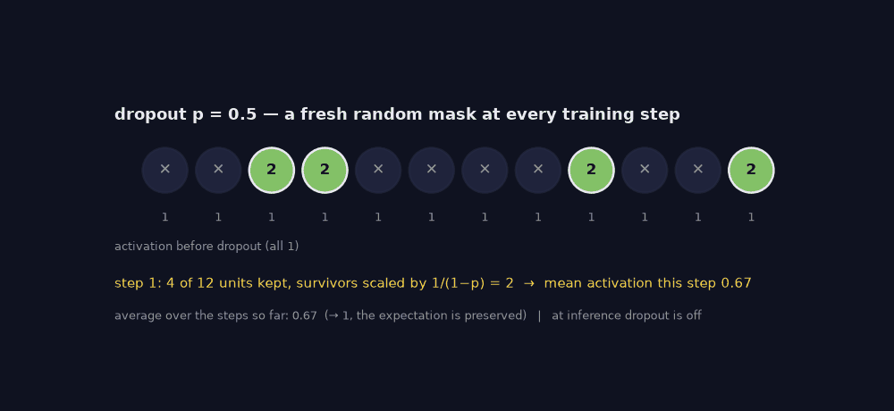
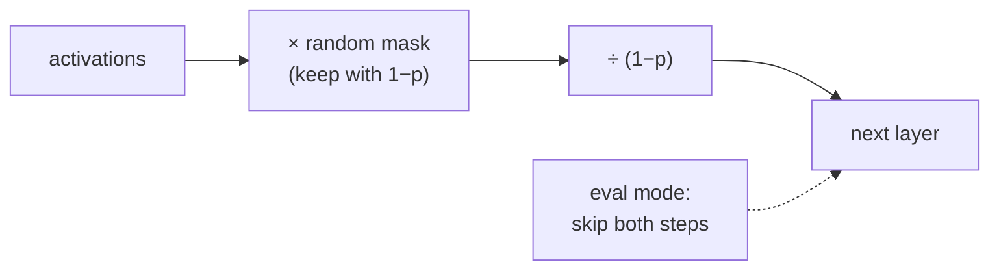

> Tier 3 · Neural Networks · **Level: beginner** · Reading time: about 9 minutes

# 3.28 Dropout

**Metadata** — Tier: 3 · Phase: 1 · Priority: P1 · Difficulty: 2/5 · Interview: High · Hands-on: High
Prerequisites: 2.27, 2.32, 3.17 · Leads to: Tier 8 attention dropout, Monte-Carlo dropout

> **In plain words**
> **Dropout** randomly **switches off** a share of the neurons at every training step (say half of them). The network cannot lean on any single neuron, so it has to spread what it knows around. That makes it less likely to **memorize** the training data (overfitting).
> Like benching random players in practice so the team doesn't depend on one star. At test time **nobody is benched**: dropout is turned off.

**You need first:** 2.27 Overfitting, 2.32 Regularization, 3.17 MLP.

> **Figure 3.28-1 — dropout masks over training steps (animated)**
>
> 
>
> *How to read it:* at every training step a new random mask removes about half of the units (✕); the survivors are multiplied by `1/(1−p) = 2`. One step may keep 6 or 8 of the 12 units, but the average over many steps (shown below the circles) approaches 1, so the expected activation is unchanged. At inference dropout is switched off and every unit passes through unchanged.
>
> *Generated by* `tier-03-neural-networks/figures/src/t3_norm.py` from this chapter's code, so the numbers are computed, not typed in. Masks come from `nn.Dropout`.

**Words you'll meet on this page**

| Word | What it means here |
|---|---|
| dropout rate `p` | the chance that a unit is switched off |
| mask | the random list of 0s and 1s that says who stays |
| inverted dropout | scale survivors by `1/(1−p)` during training so nothing changes at test time |
| overfitting | memorizing the training data instead of the pattern |
| train / eval mode | dropout on / off |
| Monte-Carlo dropout | keep dropout on at test time and average to estimate uncertainty |
| co-adaptation | units that only work in combination |

### 1. What is it?
A regularization technique that randomly sets each activation to zero with probability `p` during training, and scales the survivors by `1/(1−p)` (**inverted dropout**) so the expected activation is unchanged. At evaluation time dropout is turned off. Introduced by Srivastava et al. (2014).

### 2. Why does it exist?
It prevents units from co-adapting, acting like training an ensemble of thinned networks, and reduces overfitting (2.27, 2.32).

### 3. Detailed explanation
- **Inverted dropout:** mask `m ~ Bernoulli(1−p)`, output `x·m/(1−p)`. With `p = 0.3` the keep fraction is about 0.70 and the mean activation about 1.00; only the values 0 and `1/0.7` occur (code ②).
- **Train versus eval:** in eval mode dropout is the identity. Forgetting `model.eval()` makes predictions random and degrades quality; in training mode the same input gives different outputs (code ③).
- **Backward:** the gradient passes through the same mask.
- **Where to apply:** between dense layers, on attention weights or FFN outputs in Transformers (small `p`, like 0.1), on embeddings; rarely after normalization in the last layer. Typical `p`: 0.1–0.5.
- **Measured effect (60 training samples, 40 features with 3 informative, noisy labels; 128 hidden ReLU units; mean of 6 seeds):** test accuracy 64.5% without dropout versus 65.8% with `p = 0.5`. The gain is small here: dropout is one regularizer among several; the effect size depends strongly on data and architecture (2.32).
- **Monte-Carlo dropout:** keeping dropout on at inference and averaging several stochastic passes gives a crude uncertainty estimate (the variance across passes). It is not a calibrated Bayesian posterior (REVIEW_REQUIRED).
- **Interaction with normalization:** dropout before BatchNorm can shift statistics between train and eval (the "variance shift" problem), so ordering matters.
- **LLM practice:** many large-scale pretraining runs use little or no dropout because data is large and single-epoch; fine-tuning on small data may use it (REVIEW_REQUIRED per model).
- **Related:** DropConnect (drops weights), DropPath/stochastic depth (drops whole residual blocks), SpatialDropout (drops feature maps), attention dropout.

### 4. How does it work?
Sample a binary mask per element each forward pass, multiply, rescale; reuse the mask in backward.



### 5. Simple example
Randomly benching players in practice so the team doesn't depend on any single star.

**By hand.** Activations `[1, 1, 1, 1]`, `p = 0.5`, mask `[1, 0, 1, 0]`: the output is `[2, 0, 2, 0]` (survivors doubled). The sum is 4, the same as the original on average.

### 6. Technical example
`nn.Dropout(0.1)` after attention and MLP outputs in BERT-style models.

### 7. Code
**① By hand (plain Python).** One dropout step with a chosen mask.

```python
p = 0.5
activations = [1.0, 1.0, 1.0, 1.0]
mask = [1, 0, 1, 0]                                             # 1 = keep, 0 = switched off
out = [a * m / (1 - p) for a, m in zip(activations, mask)]
print("output:", out, " sum before:", sum(activations), " sum after:", sum(out))
```

```text
output: [2.0, 0.0, 2.0, 0.0]  sum before: 4.0  sum after: 4.0
```

**② With NumPy.** Many random masks keep the average the same.

```python
import numpy as np

rng = np.random.default_rng(1)
p = 0.3
x = np.ones((20000, 10))
mask = rng.random(x.shape) >= p
y = x * mask / (1 - p)
print("fraction switched off :", round((y == 0).mean(), 2), " (expected", p, ")")
print("mean activation       :", round(y.mean(), 2), " (expected 1.0)")
print("distinct values       :", [float(v) for v in np.unique(y.round(4))])
```

```text
fraction switched off : 0.3  (expected 0.3 )
mean activation       : 1.0  (expected 1.0)
distinct values       : [0.0, 1.4286]
```

**③ With PyTorch.** Train mode is random, eval mode is the identity; MC-dropout spread.

```python
import torch

torch.manual_seed(0)
drop = torch.nn.Dropout(0.5)
x = torch.ones(1, 8)
drop.train()
print("train mode, two passes:", drop(x).tolist(), drop(x).tolist())
drop.eval()
print("eval  mode, two passes:", drop(x).tolist(), drop(x).tolist())

net = torch.nn.Sequential(torch.nn.Linear(4, 32), torch.nn.ReLU(), torch.nn.Dropout(0.5), torch.nn.Linear(32, 1))
net.train()                                                     # keep dropout ON at prediction time (MC dropout)
samples = torch.stack([net(torch.ones(1, 4)) for _ in range(200)])
print("MC dropout: mean", round(samples.mean().item(), 3), " spread (std)", round(samples.std().item(), 3))
```

```text
train mode, two passes: [[0.0, 0.0, 2.0, 0.0, 0.0, 0.0, 2.0, 2.0]] [[0.0, 2.0, 2.0, 2.0, 2.0, 0.0, 2.0, 2.0]]
eval  mode, two passes: [[1.0, 1.0, 1.0, 1.0, 1.0, 1.0, 1.0, 1.0]] [[1.0, 1.0, 1.0, 1.0, 1.0, 1.0, 1.0, 1.0]]
MC dropout: mean -0.554  spread (std) 0.328
```

### 8. Input → Process → Output
`activations → random mask → rescale → next layer (training only)`

<details>
<summary><b>Beyond the basics (sections 9–16)</b> — real-world use, limits, mistakes. Skip on a first read.</summary>

### 9. Enterprise use case
Configuration must make the mode explicit at serving time; nondeterminism in training from dropout complicates exact reproducibility.

### 10. AI engineering connection
Regularization in fine-tuning and encoder models; attention dropout; MC-dropout uncertainty heuristics.

### 11. Advantages
Simple, cheap, general regularizer.

### 12. Limitations
Slower convergence; small or no effect in large-data regimes; interacts with BatchNorm.

### 13. Trade-offs
Higher `p` regularizes more but underfits sooner.

### 14. Common mistakes
Leaving dropout on at inference; forgetting the `1/(1−p)` scaling in custom code; applying it to the output logits; using high `p` in small layers.

### 15. Performance / cost
Extra elementwise ops; random-number generation cost.

### 16. Security
No direct issue; nondeterminism can make attacks and audits harder to reproduce.

</details>

### 17. Interview explanation
"Dropout zeroes units at random during training and rescales the survivors by one over one minus p so the expected activation matches inference, where it is off. It prevents co-adaptation and acts like an ensemble of thinned networks; I make sure eval mode is on at serving, and I treat MC-dropout only as a rough uncertainty heuristic."

### 18. Rapid-fire answer
Randomly zero units with prob `p` and scale by `1/(1−p)` in training; identity at eval; regularizer against co-adaptation.

### 19. Interview questions
- **Basic:** What does dropout do, and what is its inference behaviour?
- **Intermediate:** Why scale by `1/(1−p)`?
- **Advanced:** Why can dropout before BatchNorm cause train/test mismatch?
- **Scenario:** Predictions vary between identical requests in production. Check what?

### 20. Hands-on exercise
**Goal:** see how the dropout rate affects held-out accuracy on a small noisy dataset.

1. Make 60 training samples with 40 features, only the first 3 informative, noisy labels (the starter code below).
2. Train a 128-unit ReLU network for 300 steps with `p` in 0, 0.3, 0.5.
3. Average the test accuracy over 5 seeds. Does dropout help here?

<details>
<summary>Show a solution</summary>

```python
import torch

def test_accuracy(p, seed):
    g = torch.Generator().manual_seed(seed)
    def make(n):
        X = torch.randn(n, 40, generator=g)
        y = ((X[:, :3].sum(dim=1) + 1.5 * torch.randn(n, generator=g)) > 0).float().unsqueeze(1)
        return X, y
    Xtr, ytr = make(60); Xte, yte = make(2000)
    torch.manual_seed(seed)
    net = torch.nn.Sequential(torch.nn.Linear(40, 128), torch.nn.ReLU(), torch.nn.Dropout(p), torch.nn.Linear(128, 1))
    opt = torch.optim.Adam(net.parameters(), lr=0.01)
    for _ in range(300):
        opt.zero_grad()
        torch.nn.functional.binary_cross_entropy_with_logits(net(Xtr), ytr).backward()
        opt.step()
    net.eval()
    return ((net(Xte) > 0).float() == yte).float().mean().item()

for p in (0.0, 0.3, 0.5):
    accs = [test_accuracy(p, s) for s in range(5)]
    print(f"p = {p}: mean test accuracy {sum(accs) / len(accs):.3f}")
```

```text
p = 0.0: mean test accuracy 0.608
p = 0.3: mean test accuracy 0.612
p = 0.5: mean test accuracy 0.616
```

The effect is small and noisy with only five seeds — which is the honest lesson: dropout is one regularizer among several.

</details>

### 21. Revision questions
1. Why scale the survivors?
2. What happens at eval time?
3. Why can it be harmful or useless?

### 22. Related concepts
2.27 Overfitting · 2.32 Regularization · 3.29 Weight decay · 3.30 BatchNorm · Tier 8

### 23. One-line memory hook
**Dropout: bench random players in practice, field the whole team on match day.**

<details>
<summary><b>For reviewers</b> (not part of the lesson)</summary>

- Status: DRAFT, learner-first layout (Author: Claude). Code is executed by `tests/test_md_snippets.py`.
- TESTED earlier: `test_dropout_inverted_scaling_eval_identity_and_backward`, `lab_02_training_internals.ex_3_28` (60 samples: 64.5% without dropout versus 65.8% with p = 0.5, mean of 6 seeds), `lab_03_pytorch_build.t_3_layers_vs_torch`. The page's exercise uses its own data and may show a different (even negative) effect.
- MC-dropout and LLM-practice statements remain REVIEW_REQUIRED.
</details>
