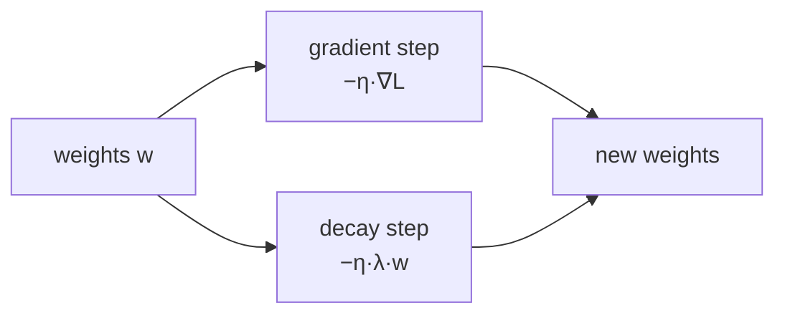

> Tier 3 · Neural Networks · **Level: intermediate** · Reading time: about 9 minutes

# 3.29 Weight decay

**Metadata** — Tier: 3 · Phase: 1 · Priority: P1 · Difficulty: 2/5 · Interview: High · Hands-on: High
Prerequisites: 2.32, 3.6, 3.20 · Leads to: Tier 4 AdamW, learning-rate schedules

> **In plain words**
> **Weight decay** gently **shrinks every weight a little at each update**, like a small tax on large weights. Only weights that keep earning their keep through the gradient stay large. Small weights give smoother, simpler models, which tend to **generalize better** on small data.
> For plain SGD it is exactly the same as L2 regularization (2.32). For Adam-style optimizers it is *not* the same, and the decoupled version is called **AdamW**.

**You need first:** 2.32 Regularization, 3.6 Weights, 3.20 Backpropagation.

> **Figure 3.29-1 — weight decay shrinks weights and can help on small data**
>
> 
>
> *How to read it:* **Left:** with no gradient, the weights shrink by `(1 − ηλ)` every step, faster for larger λ. **Middle:** trained weight norms fall from 16.3 (λ = 0) to 3.0 (λ = 0.1). **Right:** on this 60-sample task test accuracy rises from 64.5% to 66.8% at λ = 0.1 (mean of 6 seeds); the improvement is modest and depends on the data.
>
> *Generated by* `tier-03-neural-networks/figures/src/t3_training.py` from this chapter's code, so the numbers are computed, not typed in.

**Words you'll meet on this page**

| Word | What it means here |
|---|---|
| weight decay `λ` | how strongly weights are shrunk |
| learning rate `η` | how big each update step is |
| L2 penalty | adding `(λ/2)‖w‖²` to the loss |
| weight norm | the overall size of the weights |
| AdamW | Adam with decoupled weight decay |
| decoupled | applied to the weights directly, not through the gradient |
| parameter group | a set of parameters with their own settings (decay or not) |

### 1. What is it?
Shrinking the weights a little at each update: `w ← w − η(∇L + λw)` (equivalently `w ← (1 − ηλ)w − η∇L`). For plain SGD this is exactly L2 regularization with penalty `(λ/2)‖w‖²` (2.32).

### 2. Why does it exist?
It keeps weights small, favoring simpler functions, reducing overfitting and often improving optimization stability.

### 3. Detailed explanation
- **Equivalence with L2 for SGD:** the update using the gradient of `L + (λ/2)‖w‖²` equals the decayed update (code ③ checks it).
- **Pure decay:** with zero gradient and `ηλ = 0.001`, after 100 steps weights shrink by `0.999¹⁰⁰ ≈ 0.905`.
- **Measured (60 samples, 40 features, 128 hidden units, 400 steps; mean over 6 seeds):**
  | weight decay λ | test accuracy | weight norm |
  |---|---|---|
  | 0 | 64.5% | 16.3 |
  | 0.001 | 64.5% | 16.0 |
  | 0.01 | 64.8% | 13.4 |
  | 0.1 | **66.8%** | **3.0** |

  Stronger decay shrinks the weights dramatically and improves held-out accuracy here, as expected in an overparameterized small-data regime.
- **Apply to weights, not biases or normalization parameters.** PyTorch's `weight_decay` argument decays every parameter in a group unless you build separate groups.
- **Adaptive optimizers:** with Adam, adding `λw` to the gradient (L2) is *not* the same as decaying the weights directly, because Adam rescales gradients per parameter. **AdamW** decouples the decay from the gradient scaling and is the standard for Transformers (Loshchilov & Hutter, 2017; Tier 4) (REVIEW_REQUIRED: verify).
- **Typical values:** 1e-4 to 1e-1 depending on model and optimizer; LLM pretraining commonly uses 0.1 with AdamW.
- **Interaction with normalization:** with BatchNorm/LayerNorm the scale of preceding weights is irrelevant to the function, so decay mainly changes the *effective learning rate* rather than capacity (observed, REVIEW_REQUIRED).
- **Schedule:** the decay is multiplied by the learning rate, so schedules scale it too.

### 4. How does it work?
At each step subtract `η·λ·w` in addition to the gradient step; exclude biases and norm parameters.



### 5. Simple example
A small tax on large weights every step: only weights that earn their keep stay large.

**By hand.** One weight `w = 2.0`, `η = 0.1`, `λ = 0.5`, gradient from the data = 0. Each step multiplies by `1 − ηλ = 0.95`: 2.0 → 1.9 → 1.805 → … After 20 steps `2.0·0.95²⁰ ≈ 0.72`. With a real data gradient pulling the other way, the weight settles where the pull and the tax balance.

### 6. Technical example
`torch.optim.AdamW(params, lr=3e-4, weight_decay=0.1)` with no decay on LayerNorm and bias parameters.

### 7. Code
**① By hand (plain Python).** The tax on a single weight.

```python
w, lr, wd = 2.0, 0.1, 0.5
for step in range(1, 21):
    w = w - lr * (0.0 + wd * w)                                  # data gradient 0, only the decay term
    if step in (1, 2, 20):
        print(f"after {step:>2} steps: w = {w:.3f}")
print("closed form 2.0 * 0.95**20 =", round(2.0 * 0.95 ** 20, 3))
```

```text
after  1 steps: w = 1.900
after  2 steps: w = 1.805
after 20 steps: w = 0.717
closed form 2.0 * 0.95**20 = 0.717
```

**② With NumPy.** Weight decay on a noisy small regression: the weights get smaller.

```python
import numpy as np

rng = np.random.default_rng(0)
X = rng.normal(0, 1, (30, 20))
y = X[:, 0] + 0.5 * rng.normal(0, 1, 30)                          # only the first feature matters
for wd in (0.0, 0.1, 1.0):
    w = np.zeros(20)
    for _ in range(2000):
        grad = X.T @ (X @ w - y) / len(y) + wd * w                # data gradient + decay term
        w -= 0.05 * grad
    print(f"weight decay {wd:>3}: weight norm {np.linalg.norm(w):.3f}   weight on the useful feature {w[0]:.3f}")
```

```text
weight decay 0.0: weight norm 1.123   weight on the useful feature 0.838
weight decay 0.1: weight norm 0.829   weight on the useful feature 0.640
weight decay 1.0: weight norm 0.390   weight on the useful feature 0.285
```

**③ With PyTorch.** SGD's `weight_decay` equals L2 in the loss; Adam's does not equal AdamW.

```python
import torch

def one_step(optimizer_factory, l2_in_loss=0.0):
    torch.manual_seed(0)
    w = torch.nn.Parameter(torch.tensor([1.0, -2.0, 3.0]))
    opt = optimizer_factory([w])
    loss = (w ** 2).sum() * 0.1 + l2_in_loss * 0.5 * (w ** 2).sum()
    loss.backward(); opt.step()
    return w.detach().numpy().round(5)

print("SGD weight_decay=0.1       :", one_step(lambda p: torch.optim.SGD(p, lr=0.1, weight_decay=0.1)))
print("SGD with L2 added to loss  :", one_step(lambda p: torch.optim.SGD(p, lr=0.1), l2_in_loss=0.1))
print("Adam weight_decay=0.1 (L2) :", one_step(lambda p: torch.optim.Adam(p, lr=0.1, weight_decay=0.1)))
print("AdamW weight_decay=0.1     :", one_step(lambda p: torch.optim.AdamW(p, lr=0.1, weight_decay=0.1)))
```

```text
SGD weight_decay=0.1       : [ 0.97 -1.94  2.91]
SGD with L2 added to loss  : [ 0.97 -1.94  2.91]
Adam weight_decay=0.1 (L2) : [ 0.9 -1.9  2.9]
AdamW weight_decay=0.1     : [ 0.89 -1.88  2.87]
```

### 8. Input → Process → Output
`weights → (1 − ηλ)·w − η·∇L → smaller, simpler weights`

<details>
<summary><b>Beyond the basics (sections 9–16)</b> — real-world use, limits, mistakes. Skip on a first read.</summary>

### 9. Enterprise use case
A tuned hyperparameter in every serious training recipe; part of the logged configuration (2.35).

### 10. AI engineering connection
AdamW decay in pretraining and fine-tuning; LoRA weight decay; regularizing embeddings differently.

### 11. Advantages
Cheap, effective, easy to implement.

### 12. Limitations
Equivalent to L2 only for SGD; interacts with normalization and optimizer choice; needs tuning.

### 13. Trade-offs
Large λ: simpler models, risk of underfitting. Small λ: little effect.

### 14. Common mistakes
Decaying biases and norm gains; using L2-in-loss with Adam and calling it weight decay; not scaling with the learning-rate schedule; reporting results without λ.

### 15. Performance / cost
Negligible.

### 16. Security
No direct issue.

</details>

### 17. Interview explanation
"Weight decay shrinks weights by a factor of one minus learning rate times lambda each step, which for SGD is identical to an L2 penalty. With Adam they differ because of the per-parameter scaling, so we use decoupled AdamW and exclude biases and norm parameters."

### 18. Rapid-fire answer
`w ← (1 − ηλ)w − η∇L`; equals L2 for SGD; AdamW decouples it; exclude biases and norms; typical λ 0.01–0.1.

### 19. Interview questions
- **Basic:** What does weight decay do to the weights?
- **Intermediate:** When is it identical to L2 regularization?
- **Advanced:** Why is AdamW different from Adam with L2?
- **Scenario:** Fine-tuning degrades pretrained behaviour. How might weight decay and learning rate interact?

### 20. Hands-on exercise
**Goal:** see the shrinkage law.

1. Start with `w = 1.0`, `η = 0.01`, `λ = 0.1`, no data gradient.
2. How many steps until `w` falls below 0.5? Predict from `(1 − ηλ)ⁿ`.
3. Confirm by simulation.

<details>
<summary>Show a solution</summary>

```python
import math

lr, wd = 0.01, 0.1
predicted = math.ceil(math.log(0.5) / math.log(1 - lr * wd))
w, steps = 1.0, 0
while w >= 0.5:
    w *= 1 - lr * wd
    steps += 1
print("predicted steps:", predicted, "  simulated steps:", steps)
```

```text
predicted steps: 693   simulated steps: 693
```

</details>

### 21. Revision questions
1. What is the update rule?
2. When is it equal to L2?
3. Which parameters are usually excluded?

### 22. Related concepts
2.32 Regularization · 3.28 Dropout · 3.30–3.32 Normalization · Tier 4 Optimizers

### 23. One-line memory hook
**Weight decay: a small tax every step, so only useful weights stay big.**

<details>
<summary><b>For reviewers</b> (not part of the lesson)</summary>

- Status: DRAFT, learner-first layout (Author: Claude). Code is executed by `tests/test_md_snippets.py`.
- TESTED earlier: `test_weight_decay_equals_l2_gradient_for_sgd_and_shrinks_weights`, `test_weight_decay_shrinks_weights_and_helps_on_small_data`, `lab_03_pytorch_build.t_3_trajectory_match` (versus `torch.optim.SGD(weight_decay=…)`). Measured table: lab fixed seeds.
- AdamW attribution remains REVIEW_REQUIRED.
</details>
