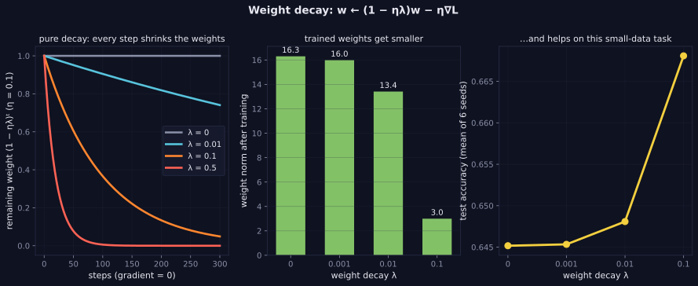

> Tier 3 — Neural Networks · Status: DRAFT (Author: Claude) · Code: `code/nn.py`, `lab/lab_02_training_internals.py` — TESTED

# 3.29 Weight decay

**Metadata** — Tier: 3 · Phase: 1 · Priority: P0 · Difficulty: 2/5 · Interview: High · Hands-on: High
Prerequisites: 2.32, 3.6, 1.15 · Leads to: Tier 4 AdamW (4.9), Tier 10 fine-tuning

### 1. What is it?
Shrinking the weights a little at each update: `w ← w − η(∇L + λw)` (equivalently `w ← (1 − ηλ)w − η∇L`). For plain SGD this is exactly L2 regularization with penalty `(λ/2)‖w‖²` (2.32).

### 2. Why does it exist?
It keeps weights small, favoring simpler functions, reducing overfitting and often improving optimization stability.

### 3. Detailed explanation
- **Equivalence with L2 for SGD:** the update using gradient of `L + (λ/2)‖w‖²` equals the decayed update (tested to machine precision).
- **Pure decay:** with zero gradient and `ηλ = 0.001`, after 100 steps weights shrink by `0.999¹⁰⁰ = 0.905` (tested exactly).
- **Measured (60 samples, 40 features, 128 hidden units, 400 steps; mean over 6 seeds):**
  | weight decay λ | test accuracy | weight norm |
  |---|---|---|
  | 0 | 64.5% | 16.3 |
  | 0.001 | 64.5% | 16.0 |
  | 0.01 | 64.8% | 13.4 |
  | 0.1 | **66.8%** | **3.0** |
  Stronger decay shrinks the weights dramatically and improves held-out accuracy here, as expected in an overparameterized small-data regime.
- **Apply to weights, not biases or normalization parameters** (our `step` decays only `W`; PyTorch's `weight_decay` argument decays every parameter in a group unless you build separate groups, which our trajectory test mirrors).
- **Adaptive optimizers:** with Adam, adding `λw` to the gradient (L2) is *not* the same as decaying the weights directly, because Adam rescales gradients per parameter. **AdamW** decouples the decay from the gradient scaling and is the standard for Transformers (Loshchilov & Hutter, 2017; Tier 4, 4.9) (REVIEW_REQUIRED: verify).
- **Typical values:** 1e-4 to 1e-1 depending on model and optimizer; LLM pretraining commonly uses 0.1 with AdamW.
- **Interaction with normalization:** with BatchNorm/LayerNorm the scale of preceding weights is irrelevant to the function, so decay mainly changes the *effective learning rate* rather than capacity (observed, REVIEW_REQUIRED).
- **Schedule:** decay is multiplied by the learning rate, so schedules scale it too.

### 4. How does it work?
At each step subtract `η·λ·w` in addition to the gradient step; exclude biases/norm parameters.

> **Figure 3.29-1 — weight decay shrinks weights and can help on small data**



*How to read it:* Left: with no gradient, the weights shrink by (1 − ηλ) every step, faster for larger λ. Middle: trained weight norms fall from 16.3 (λ = 0) to 3.0 (λ = 0.1). Right: on this 60-sample task test accuracy rises from 64.5% to 66.8% at λ = 0.1 (mean of 6 seeds); the improvement is modest and depends on the data.

*Generated by* `tier-03-neural-networks/figures/src/t3_training.py` *from this chapter's code, so the numbers are computed, not typed in.*

### 5. Simple example
A small tax on large weights every step: only weights that earn their keep stay large.

### 6. Technical example
`torch.optim.AdamW(params, lr=3e-4, weight_decay=0.1)` with no decay on LayerNorm and bias parameters.

### 7. Code
```python
import nn as N
net.step(lr=0.05, weight_decay=0.1)        # decays W only: W ← W − lr (dW + wd·W)
from lab_02_training_internals import ex_3_29; print(ex_3_29()['by_weight_decay'])
```
TESTED (`test_weight_decay_equals_l2_gradient_for_sgd_and_shrinks_weights`, `test_weight_decay_shrinks_weights_and_helps_on_small_data`, `lab_03_pytorch_build.t_3_trajectory_match` vs `torch.optim.SGD(weight_decay=…)`).

### 8. Input → Process → Output
`gradient step + shrink toward zero`

### 9. Enterprise use case
A tuned hyperparameter in every serious training recipe; part of the logged configuration (2.35).

### 10. AI engineering connection
AdamW decay in pretraining/fine-tuning; LoRA weight decay; regularizing embeddings differently.

### 11. Advantages
Cheap, effective, easy to implement.

### 12. Limitations
Equivalent to L2 only for SGD; interacts with normalization and optimizer choice; needs tuning.

### 13. Trade-offs
Large λ: simpler models, risk of underfitting; small λ: little effect.

### 14. Common mistakes
Decaying biases and norm gains; using L2-in-loss with Adam and calling it weight decay; not scaling with the learning-rate schedule; reporting results without λ.

### 15. Performance / cost
Negligible.

### 16. Security
N/A.

### 17. Interview explanation
"Weight decay shrinks weights each step by a factor of one minus learning rate times lambda. For SGD it's the same as L2 regularization; for Adam they differ, which is why AdamW decouples decay. I exclude biases and normalization parameters and tune lambda on validation data."

### 18. Rapid-fire
w ← (1−ηλ)w − η∇L; = L2 for SGD; AdamW decouples; exclude biases/norm params.

### 19. Interview questions
- Basic: Write the weight-decay update.
- Intermediate: Why isn't L2 in the loss the same as weight decay under Adam?
- Advanced: How does weight decay interact with LayerNorm?
- Scenario: Fine-tuning forgets pretrained knowledge quickly. Would stronger weight decay help or hurt? Alternatives?

### 20. Hands-on exercise
Sweep λ over 6 values with AdamW-style decoupled decay (implement it) and compare with L2-in-gradient Adam.

### 21. Revision questions
1) Update rule? 2) SGD equivalence? 3) Which params to exclude?

### 22. Related concepts
2.32 Regularization · 2.18 Objective functions · 3.28 Dropout · 3.6 Weights · Tier 4 AdamW

### 23. Memory hook
**Weight decay: a small, constant pull of every weight toward zero.**
