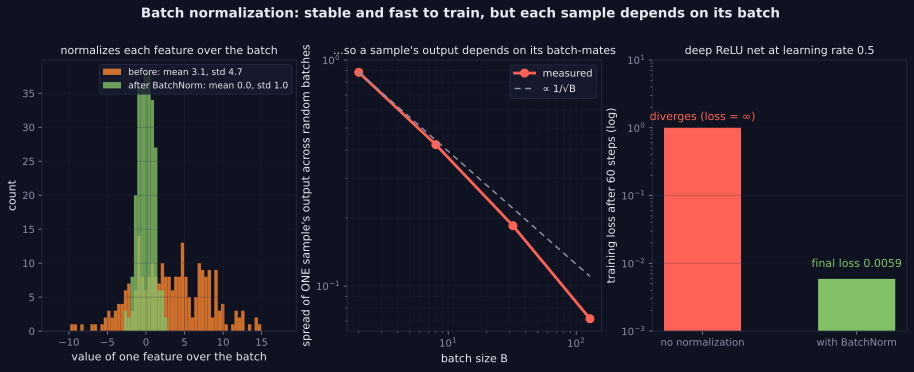
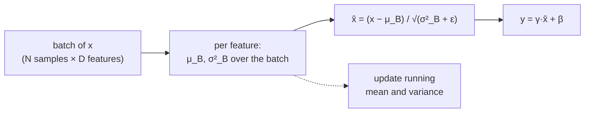

> Tier 3 · Neural Networks · **Level: intermediate** · Reading time: about 11 minutes

# 3.30 Batch normalization

**Metadata** — Tier: 3 · Phase: 1 · Priority: P1 · Difficulty: 3/5 · Interview: High · Hands-on: High
Prerequisites: 1.30, 3.8, 3.22 · Leads to: 3.31 LayerNorm, 3.32 RMSNorm, Tier 13 CNNs

> **In plain words**
> **Batch normalization (BatchNorm)** re-centres and re-scales the numbers flowing through a layer so that, **for each feature, the batch has average 0 and spread 1**. Then it lets the network undo or adjust that with two learned numbers (`γ` scale and `β` shift).
> It is like re-calibrating every instrument against the group average before reading the results. It keeps signals at a steady size, so training can use bigger learning rates and is less touchy about initialization.
> The catch: each sample's result **depends on the other samples in its batch**, and training and testing behave differently.

**You need first:** 1.30 Variance, 3.8 Weighted sum, 3.22 Initialization.

> **Figure 3.30-1 — what batch normalization does and its catch**
>
> 
>
> *How to read it:* **Left:** a feature with mean 3.1 and standard deviation 4.7 becomes mean 0, std 1. **Middle:** the output for one fixed sample varies with the other samples in its batch, with a spread proportional to `1/√B` (0.88 at B = 2, 0.07 at B = 128). **Right:** a deep ReLU net at learning rate 0.5 diverges without normalization and reaches loss 0.0059 with it.
>
> *Generated by* `tier-03-neural-networks/figures/src/t3_norm.py` from this chapter's code, so the numbers are computed, not typed in.

**Words you'll meet on this page**

| Word | What it means here |
|---|---|
| batch | the group of examples processed together |
| `μ_B`, `σ²_B` | the mean and variance of a feature over the batch |
| `γ`, `β` | learned scale and shift after normalizing |
| running statistics | moving averages of `μ` and `σ²` kept for test time |
| train / eval mode | batch statistics / running statistics |
| `ε` (epsilon) | a tiny number that avoids dividing by zero |
| folding | merging BN into the previous layer at inference |

### 1. What is it?
A layer that **normalizes each feature over the batch** to zero mean and unit variance, then applies a learned scale `γ` and shift `β`: `y = γ·(x − μ_B)/√(σ²_B + ε) + β`. Running averages of `μ` and `σ²` are used at inference. Introduced by Ioffe & Szegedy (2015).

### 2. Why does it exist?
It keeps layer inputs at a stable scale, allowing higher learning rates, faster training and less sensitivity to initialization.

### 3. Detailed explanation
- **Training versus eval:** training uses the current batch's statistics (and updates the running averages with momentum); evaluation uses the running statistics. Code ③ shows the two modes giving different outputs for the same input.
- **Backward:** `dx = (1/N)·inv_std·(N·dx̂ − Σdx̂ − x̂·Σ(dx̂·x̂))`, plus `dγ = Σ dy·x̂` and `dβ = Σ dy`. Frameworks do this automatically.
- **Higher learning rates:** an 8-block ReLU net at learning rate 0.5 diverges to infinity without normalization but reaches loss 0.0059 with BatchNorm (lab).
- **Batch dependence is the main drawback.** The output for one fixed sample varies with the other samples in its batch: standard deviation across random batches 0.88 (batch size 2), 0.42 (8), 0.18 (32), 0.07 (128), roughly `1/√B`. With a batch of **one**, the normalized output is exactly zero (variance undefined; code ②).
- **Where it is used:** convolutional networks (normalizing over batch and spatial positions) and MLPs. **Transformers use LayerNorm/RMSNorm instead** because sequence batches are variable, small per device, and train/eval consistency is needed (3.31–3.32).
- **Why it works** is debated: reducing "internal covariate shift" was the original claim; later work points to smoother loss landscapes and better-conditioned gradients (REVIEW_REQUIRED: cite).
- **Position:** commonly Dense/Conv → BN → activation. The preceding bias is redundant because `β` plays that role (3.7).
- **Regularizing side effect:** batch noise acts as mild regularization.
- **Practical issues:** small batches, distributed training (sync BN), frozen BN when fine-tuning with tiny batches, running-stat momentum, and `ε`.
- **Inference folding:** at eval BN is a fixed affine transform and can be folded into the preceding linear or conv layer.

### 4. How does it work?
Compute the batch mean and variance per feature, normalize, scale and shift; keep exponential moving averages for inference.



### 5. Simple example
Re-calibrating every instrument against the group average before reading the results.

**By hand.** One feature over a batch of 4 samples: `[2, 4, 6, 8]`. Mean 5, variance `(9+1+1+9)/4 = 5`, std `√5 ≈ 2.236`. Normalized: `[−1.34, −0.45, 0.45, 1.34]`. With `γ = 1, β = 0` that is the output.

### 6. Technical example
ResNet blocks: Conv → BN → ReLU. Fine-tuning detection models often freezes BN statistics.

### 7. Code
**① By hand (plain Python).** The four-number example.

```python
import math

x = [2.0, 4.0, 6.0, 8.0]
mean = sum(x) / len(x)
var = sum((v - mean) ** 2 for v in x) / len(x)
eps = 1e-5
y = [(v - mean) / math.sqrt(var + eps) for v in x]
print("mean:", mean, " variance:", var)
print("normalized:", [round(v, 2) for v in y])
```

```text
mean: 5.0  variance: 5.0
normalized: [-1.34, -0.45, 0.45, 1.34]
```

**② With NumPy.** Every feature gets mean 0 and spread 1; a batch of one gives all zeros.

```python
import numpy as np

rng = np.random.default_rng(0)
X = rng.normal(3.0, 5.0, (64, 4))                                 # 64 samples, 4 features, mean 3, std 5

def batchnorm(X, eps=1e-5):
    return (X - X.mean(axis=0)) / np.sqrt(X.var(axis=0) + eps)

Y = batchnorm(X)
print("feature means before:", X.mean(axis=0).round(2))
print("feature means after :", Y.mean(axis=0).round(2) + 0.0)
print("feature stds after  :", Y.std(axis=0).round(2))
print("batch of one        :", batchnorm(X[:1]).round(2) + 0.0, "(nothing to compare with)")
```

```text
feature means before: [3.09 3.14 2.   3.8 ]
feature means after : [0. 0. 0. 0.]
feature stds after  : [1. 1. 1. 1.]
batch of one        : [[0. 0. 0. 0.]] (nothing to compare with)
```

**③ With PyTorch.** Train mode uses the batch; eval mode uses running statistics.

```python
import torch

torch.manual_seed(0)
bn = torch.nn.BatchNorm1d(4, momentum=0.1)
data = torch.randn(256, 4) * 5 + 3
bn.train()
for _ in range(40):                                               # 40 passes over the data
    for i in range(0, 256, 32):
        bn(data[i:i + 32])                                        # each call updates the running averages
print("running mean:", bn.running_mean.numpy().round(2), "(the data mean is 3; the estimate is noisy)")
sample = data[:1]
bn.eval()
print("eval output for one sample:", bn(sample).detach().numpy().round(2))
bn.train()
out_train = bn(data[:32])[0]
print("train output for the same sample in a batch:", out_train.detach().numpy().round(2))
```

```text
running mean: [2.55 3.95 3.32 2.67] (the data mean is 3; the estimate is noisy)
eval output for one sample: [[-1.13 -1.25 -0.28 -0.36]]
train output for the same sample in a batch: [-0.98 -0.94 -0.52 -0.62]
```

### 8. Input → Process → Output
`batch → per-feature mean/variance → normalize → scale γ, shift β`

<details>
<summary><b>Beyond the basics (sections 9–16)</b> — real-world use, limits, mistakes. Skip on a first read.</summary>

### 9. Enterprise use case
Serving requires eval mode and correctly restored running statistics; distribution shift can make stale statistics harmful.

### 10. AI engineering connection
Dominant in CNNs (Tier 13); replaced by LayerNorm/RMSNorm in LLMs (3.31–3.32).

### 11. Advantages
Faster, more stable training; allows higher learning rates; mild regularization.

### 12. Limitations
Batch-size dependent; train/eval discrepancy; awkward for sequences, RNNs and tiny batches.

### 13. Trade-offs
Strong optimization benefits versus batch coupling and mode complexity.

### 14. Common mistakes
Forgetting eval mode; batch size 1 or 2 in training; using BN with dropout before it carelessly; not synchronizing across devices; leaving updated running stats while "freezing" a model.

### 15. Performance / cost
Extra memory bandwidth (can be fused or folded at inference).

### 16. Security
Batch statistics let one sample influence another's output; avoid batch-coupled layers in multi-tenant serving.

</details>

### 17. Interview explanation
"BatchNorm normalizes each feature over the batch, then applies a learned scale and shift, and tracks running statistics for inference. It stabilizes and speeds up training, but it couples samples in a batch and behaves differently in train and eval, which is why Transformers use LayerNorm or RMSNorm."

### 18. Rapid-fire answer
Normalize each feature over the batch, then `γ`, `β`; running stats at inference; batch-size dependent; used in CNNs, not Transformers.

### 19. Interview questions
- **Basic:** Write the BatchNorm formula and say what `γ`, `β` do.
- **Intermediate:** What changes between train and eval mode?
- **Advanced:** Why does BatchNorm behave badly with tiny batches?
- **Scenario:** Validation accuracy collapses after deployment although training looked fine. What do you check?

### 20. Hands-on exercise
**Goal:** see the `1/√B` batch dependence.

1. Create one fixed sample and 500 random "other" samples.
2. For batch sizes 2, 8, 32, 128, repeat: pick `B−1` random others, normalize the batch with the fixed sample included, record the fixed sample's output (first feature).
3. Print the standard deviation of those outputs for each `B`.

<details>
<summary>Show a solution</summary>

```python
import numpy as np

rng = np.random.default_rng(0)
others = rng.normal(0, 1, (500, 1))
fixed = np.array([[1.0]])
for B in (2, 8, 32, 128):
    outs = []
    for _ in range(2000):
        batch = np.vstack([fixed, others[rng.choice(500, B - 1, replace=False)]])
        outs.append(((batch - batch.mean(0)) / np.sqrt(batch.var(0) + 1e-5))[0, 0])
    print(f"batch size {B:>3}: output of the fixed sample varies with std {np.std(outs):.2f}")
```

```text
batch size   2: output of the fixed sample varies with std 0.76
batch size   8: output of the fixed sample varies with std 0.41
batch size  32: output of the fixed sample varies with std 0.21
batch size 128: output of the fixed sample varies with std 0.10
```

</details>

### 21. Revision questions
1. What is normalized, and over which axis?
2. Train versus eval: what differs?
3. Why not use it in Transformers?

### 22. Related concepts
3.7 Bias · 3.22 Initialization · 3.31 LayerNorm · 3.32 RMSNorm · Tier 13 CNNs

### 23. One-line memory hook
**BatchNorm: recalibrate each feature against its batch, and remember the averages for test day.**

<details>
<summary><b>For reviewers</b> (not part of the lesson)</summary>

- Status: DRAFT, learner-first layout (Author: Claude). Code is executed by `tests/test_md_snippets.py`.
- TESTED earlier: `test_batchnorm_forward_backward_and_eval_match_torch`, `test_batchnorm_train_output_has_zero_mean_unit_var_and_depends_on_batch`, `test_batchnorm_deep_net_gradient_check_in_train_mode`, `lab_02_training_internals.ex_3_30` (batch spreads 0.88/0.42/0.18/0.07; learning rate 0.5 diverges without BN, loss 0.0059 with it).
- Reason-it-works claims remain REVIEW_REQUIRED.
</details>
