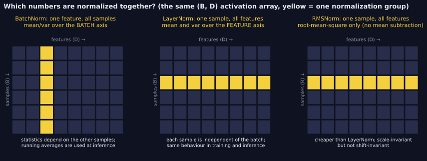
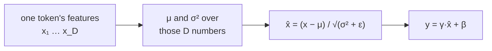

> Tier 3 · Neural Networks · **Level: intermediate** · Reading time: about 9 minutes

# 3.31 Layer normalization

**Metadata** — Tier: 3 · Phase: 1 · Priority: P0 · Difficulty: 2/5 · Interview: Very high · Hands-on: High
Prerequisites: 3.30, 1.30 · Leads to: 3.32 RMSNorm, Tier 8 Transformer blocks

> **In plain words**
> **Layer normalization (LayerNorm)** normalizes **each sample on its own**: it takes all the numbers of one token or one example and re-centres them to average 0 and spread 1, then applies a learned scale and shift.
> Compared with BatchNorm, nothing depends on the other samples in the batch and there is **no difference between training and testing**. That is why it is the standard layer in Transformers.

**You need first:** 3.30 Batch normalization, 1.30 Variance.

> **Figure 3.31-1 — which numbers each normalization layer groups together**
>
> 
>
> *How to read it:* rows are samples in a batch and columns are features. **BatchNorm** normalizes each feature over the batch (a yellow column), so a sample's result depends on the other rows. **LayerNorm** normalizes each sample over its features (a yellow row): no dependence on the batch, no running statistics, the same behaviour in training and inference. **RMSNorm** uses the same row but only the root-mean-square.
>
> *Generated by* `tier-03-neural-networks/figures/src/t3_norm.py` from this chapter's code, so the numbers are computed, not typed in.

**Words you'll meet on this page**

| Word | What it means here |
|---|---|
| feature axis | the last axis: the numbers describing one token or sample |
| `μ`, `σ²` | mean and variance over that sample's features |
| `γ`, `β` | learned per-feature scale and shift |
| pre-norm / post-norm | normalize before / after the sublayer's residual addition |
| `(B, T, D)` | batch, tokens (time), features |
| GroupNorm / InstanceNorm | relatives that group channels differently |
| `ε` | a tiny constant that avoids dividing by zero |

### 1. What is it?
Normalizes **each sample over its features**: `y = γ·(x − μ)/√(σ² + ε) + β` with `μ, σ²` computed across the feature (last) axis of that sample. Introduced by Ba et al. (2016).

### 2. Why does it exist?
It gives the stabilizing effect of normalization without batch dependence: identical behaviour in training and inference, any batch size, and natural handling of sequences.

### 3. Detailed explanation
- **Batch independence:** the normalized output of a sample is identical whether it is processed alone or within a batch; there are no running statistics and no train/eval difference (code ③).
- **Properties:** the per-sample mean is about 0 and the standard deviation 1 before `γ, β`; it works on `(B, T, D)` tensors by normalizing the last axis.
- **Backward:** `dx = (inv_std/D)·(D·dx̂ − Σdx̂ − x̂·Σ(dx̂·x̂))` over the feature axis; `dγ`, `dβ` sum over batch and positions. Frameworks do this automatically.
- **Parameters:** `2D` (γ and β); for `D = 6` that is 12.
- **Invariances:** unchanged under adding a constant to all features of a sample (mean removal) and under positive rescaling of the sample (code ②).
- **Placement in Transformers:** original post-norm `LN(x + Sublayer(x))`; modern pre-norm `x + Sublayer(LN(x))` is more stable for deep models (Tier 8). A final LN is often applied before the output head.
- **Gradient effect:** helps conditioning (in the lab it improved the first/last gradient ratio of a 20-layer sigmoid net from about 10⁻¹³ to about 10⁻⁹; residual connections did more, 3.25).
- **Cost:** two reductions over the feature axis per token (mean and variance); RMSNorm removes one (3.32).
- **Epsilon and precision:** compute statistics in float32 even when activations are bf16/fp16 (1.40).
- **Other variants:** GroupNorm (groups of channels; good for small-batch vision), InstanceNorm.

### 4. How does it work?
For each token/sample compute the mean and variance over features, normalize, scale and shift.



### 5. Simple example
Each reader rescales their own scorecard to their own average and spread, regardless of what other readers did.

**By hand.** One token with features `[1, 2, 3, 6]`: mean 3, variance `(4+1+0+9)/4 = 3.5`, std `1.871`. Normalized: `[−1.07, −0.53, 0, 1.60]`. It does not matter what the other tokens in the batch look like.

### 6. Technical example
BERT/GPT-2 style Transformers: LayerNorm around the attention and MLP sublayers.

### 7. Code
**① By hand (plain Python).** The four-feature token.

```python
import math

x = [1.0, 2.0, 3.0, 6.0]
mean = sum(x) / len(x)
var = sum((v - mean) ** 2 for v in x) / len(x)
y = [(v - mean) / math.sqrt(var + 1e-5) for v in x]
print("mean:", mean, " variance:", var)
print("normalized:", [round(v, 2) for v in y])
```

```text
mean: 3.0  variance: 3.5
normalized: [-1.07, -0.53, 0.0, 1.6]
```

**② With NumPy.** Batch independence and two invariances.

```python
import numpy as np

rng = np.random.default_rng(0)
X = rng.normal(2.0, 3.0, (5, 16))                                 # 5 tokens, 16 features

def layernorm(X, eps=1e-5):
    return (X - X.mean(-1, keepdims=True)) / np.sqrt(X.var(-1, keepdims=True) + eps)

Y = layernorm(X)
print("per-token means :", Y.mean(-1).round(6) + 0.0)
print("per-token stds  :", Y.std(-1).round(3))
print("same result alone or in a batch :", np.allclose(layernorm(X[:1]), Y[:1]))
print("unchanged if we add 100         :", np.allclose(layernorm(X + 100), Y, atol=1e-6))
print("unchanged if we multiply by 10  :", np.allclose(layernorm(X * 10), Y, atol=1e-4))
```

```text
per-token means : [0. 0. 0. 0. 0.]
per-token stds  : [1. 1. 1. 1. 1.]
same result alone or in a batch : True
unchanged if we add 100         : True
unchanged if we multiply by 10  : True
```

**③ With PyTorch.** No difference between train and eval, and the parameter count.

```python
import torch

torch.manual_seed(0)
ln = torch.nn.LayerNorm(16)
x = torch.randn(2, 5, 16) * 3 + 2                                # (batch, tokens, features)
ln.train(); a = ln(x)
ln.eval();  b = ln(x)
print("train output equals eval output:", torch.equal(a, b))
print("output shape:", tuple(a.shape), "  parameters (gamma and beta):", sum(p.numel() for p in ln.parameters()))
print("token mean ≈ 0:", round(a[0, 0].mean().item(), 6) + 0.0, "  token std ≈ 1:", round(a[0, 0].std(unbiased=False).item(), 3))
```

```text
train output equals eval output: True
output shape: (2, 5, 16)   parameters (gamma and beta): 32
token mean ≈ 0: 0.0   token std ≈ 1: 1.0
```

### 8. Input → Process → Output
`each token's features → mean/variance over those features → normalize → γ, β`

<details>
<summary><b>Beyond the basics (sections 9–16)</b> — real-world use, limits, mistakes. Skip on a first read.</summary>

### 9. Enterprise use case
No batch coupling makes serving simple and safe for multi-tenant batching.

### 10. AI engineering connection
Standard in Transformers; its placement (pre/post) strongly affects the trainability of deep models.

### 11. Advantages
Batch-independent, same at train and eval, handles variable batch and sequence shapes.

### 12. Limitations
Slightly less effective than BN in some CNN settings; two reductions per token; mean subtraction is optional (see RMSNorm).

### 13. Trade-offs
Robustness and simplicity versus the extra regularization that BN's batch noise provides.

### 14. Common mistakes
Normalizing over the wrong axis; forgetting `ε`; computing in low precision; mixing pre-/post-norm when porting code; applying LN to features that should keep their scale (for example attention logits).

### 15. Performance / cost
Memory-bound; fuse with residual add and bias.

### 16. Security
No cross-sample leakage through the normalization statistics, unlike BatchNorm.

</details>

### 17. Interview explanation
"LayerNorm normalizes each token across its features with a learned scale and shift. It has no batch dependence and no train/eval difference, so it suits variable-length sequences and is the default in Transformers, usually in pre-norm position."

### 18. Rapid-fire answer
Normalize over the feature axis per token; `γ`, `β`; no running stats; batch-independent; Transformer default.

### 19. Interview questions
- **Basic:** Which axis does LayerNorm normalize over?
- **Intermediate:** Why do Transformers prefer it to BatchNorm?
- **Advanced:** Pre-norm versus post-norm: effect on gradient flow?
- **Scenario:** Porting weights from a framework: LN outputs differ slightly. Check what?

### 20. Hands-on exercise
**Goal:** show that LayerNorm and BatchNorm normalize different axes.

1. Make a 6 × 4 array of random numbers.
2. Normalize over rows (LayerNorm) and over columns (BatchNorm).
3. Print the row means and the column means of each result.

<details>
<summary>Show a solution</summary>

```python
import numpy as np

X = np.random.default_rng(0).normal(5, 2, (6, 4))
ln = (X - X.mean(1, keepdims=True)) / np.sqrt(X.var(1, keepdims=True) + 1e-5)
bn = (X - X.mean(0, keepdims=True)) / np.sqrt(X.var(0, keepdims=True) + 1e-5)
print("LayerNorm row means   :", ln.mean(1).round(3) + 0.0, "(all 0)")
print("LayerNorm column means:", ln.mean(0).round(3) + 0.0, "(not 0)")
print("BatchNorm column means:", bn.mean(0).round(3) + 0.0, "(all 0)")
print("BatchNorm row means   :", bn.mean(1).round(3) + 0.0, "(not 0)")
```

```text
LayerNorm row means   : [0. 0. 0. 0. 0. 0.] (all 0)
LayerNorm column means: [-0.831 -0.127  0.308  0.65 ] (not 0)
BatchNorm column means: [0. 0. 0. 0.] (all 0)
BatchNorm row means   : [ 0.339  0.825 -0.668 -1.354  0.395  0.464] (not 0)
```

</details>

### 21. Revision questions
1. Over which axis are statistics computed?
2. Why is there no train/eval difference?
3. What are pre-norm and post-norm?

### 22. Related concepts
3.27 Residual connections · 3.30 BatchNorm · 3.32 RMSNorm · Tier 8 Transformer

### 23. One-line memory hook
**LayerNorm: each token recalibrates itself, no matter who else is in the batch.**

<details>
<summary><b>For reviewers</b> (not part of the lesson)</summary>

- Status: DRAFT, learner-first layout (Author: Claude). Code is executed by `tests/test_md_snippets.py`.
- TESTED earlier: `test_layernorm_matches_torch_and_is_batch_independent`, `lab_02_training_internals.ex_3_31`, `lab_03_pytorch_build.t_3_layers_vs_torch` (matches `torch.nn.LayerNorm` to 1e-9; shift-invariance error 1.8×10⁻¹⁵).
</details>
