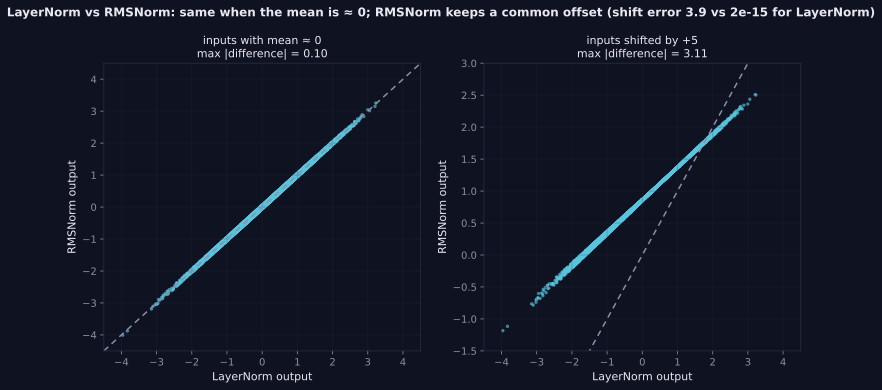
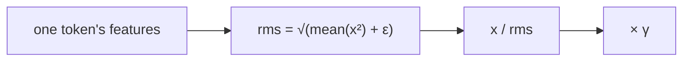

> Tier 3 · Neural Networks · **Level: intermediate** · Reading time: about 8 minutes

# 3.32 RMSNorm

**Metadata** — Tier: 3 · Phase: 1 · Priority: P1 · Difficulty: 2/5 · Interview: High · Hands-on: High
Prerequisites: 3.31, 1.15 · Leads to: Tier 8 and Tier 12 LLM architectures

> **In plain words**
> **RMSNorm** is a **lighter version of LayerNorm**. It only **rescales** each token so its typical size is 1; it does **not** subtract the average, and it has one learned number per feature (a scale) instead of two.
> Think of adjusting the volume so every speaker is equally loud without moving their baseline. Many modern LLMs use it because it is cheaper and works about as well.

**You need first:** 3.31 Layer normalization, 1.15 Norms.

> **Figure 3.32-1 — LayerNorm versus RMSNorm outputs**
>
> 
>
> *How to read it:* each dot is one normalized number. When the inputs have mean ≈ 0 the two layers agree (maximum difference 0.10). When every input is shifted by +5, LayerNorm removes the offset but RMSNorm keeps it, so the points leave the diagonal (maximum difference 3.11). LayerNorm is shift-invariant (error 2×10⁻¹⁵), RMSNorm is not (error 3.9); both are scale-invariant.
>
> *Generated by* `tier-03-neural-networks/figures/src/t3_norm.py` from this chapter's code, so the numbers are computed, not typed in.

**Words you'll meet on this page**

| Word | What it means here |
|---|---|
| RMS | root mean square: `√(average of the squares)` |
| re-centring | subtracting the mean (LayerNorm does, RMSNorm does not) |
| scale invariance | multiplying the input by a constant does not change the output |
| shift invariance | adding a constant to all features does not change the output |
| `γ` | learned per-feature gain |
| fused kernel | one GPU routine that does several steps at once |

### 1. What is it?
Root-mean-square normalization: `y = γ ⊙ x / √(mean(x²) + ε)`. It rescales each sample to unit RMS **without subtracting the mean** and has only a scale parameter `γ` (no shift). Proposed by Zhang & Sennrich (2019).

### 2. Why does it exist?
It keeps LayerNorm's rescaling benefit with fewer operations and parameters, and has worked as well in many Transformers.

### 3. Detailed explanation
- **Comparison with LayerNorm (D = 1024):**

  | property | LayerNorm | RMSNorm |
  |---|---|---|
  | mean subtraction | yes | no |
  | invariant to adding a constant | yes | **no** |
  | invariant to scaling the input | yes | yes |
  | parameters | 2D = 2,048 | D = 1,024 |
  | reductions per token | 2 (mean, variance) | 1 (mean of squares) |

  In the lab, RMSNorm ran about 2.9× faster than LayerNorm in NumPy; in fused GPU kernels the saving is smaller (REVIEW_REQUIRED).
- **When they agree:** for zero-mean inputs they differ only by the small sample-mean term; when the inputs have a large common offset the difference is large because RMSNorm keeps the offset (code ②).
- **Hypothesis behind it:** the *rescaling* invariance matters most; re-centring contributes little in practice (REVIEW_REQUIRED: cite ablations).
- **Backward:** `dx = r·(γ⊙dy) − r³·x·Σ(γ⊙dy⊙x)/D`, `dγ = Σ dy·x̂`, with `r = 1/√(mean(x²)+ε)`. Frameworks do this automatically.
- **Usage:** a number of recent open LLM families use RMSNorm with pre-norm (REVIEW_REQUIRED: cite specific models); some architectures keep LayerNorm.
- **Precision:** accumulate `mean(x²)` in float32; large activations can overflow in fp16 (1.44).
- **Epsilon** goes inside the square root; its value differs between implementations (1e-6 in the lab's tests, with the explicit `eps` set to match PyTorch).

### 4. How does it work?
Compute the RMS over the feature axis, divide, multiply by the learned gain.



### 5. Simple example
Adjusting the volume so every speaker has the same loudness without moving their baseline.

**By hand.** Features `[1, 2, 3, 6]`: squares `[1, 4, 9, 36]`, mean 12.5, RMS `√12.5 = 3.536`. Output: `[0.28, 0.57, 0.85, 1.70]`. Compare LayerNorm of the same numbers, `[−1.07, −0.53, 0, 1.60]` (3.31): RMSNorm kept every number positive because it did not remove the mean.

### 6. Technical example
`y = x * rsqrt(mean(x²) + eps) * weight` in LLaMA-style blocks.

### 7. Code
**① By hand (plain Python).** RMSNorm on one token.

```python
import math

x = [1.0, 2.0, 3.0, 6.0]
rms = math.sqrt(sum(v * v for v in x) / len(x))
y = [v / rms for v in x]
print("rms:", round(rms, 3))
print("output:", [round(v, 2) for v in y])
print("rms of the output:", round(math.sqrt(sum(v * v for v in y) / len(y)), 3))
```

```text
rms: 3.536
output: [0.28, 0.57, 0.85, 1.7]
rms of the output: 1.0
```

**② With NumPy.** RMSNorm versus LayerNorm: agreement, shifts and scaling.

```python
import numpy as np

rng = np.random.default_rng(0)
X = rng.normal(0, 1, (8, 256))

def rmsnorm(X, eps=1e-6):
    return X / np.sqrt((X ** 2).mean(-1, keepdims=True) + eps)

def layernorm(X, eps=1e-6):
    return (X - X.mean(-1, keepdims=True)) / np.sqrt(X.var(-1, keepdims=True) + eps)

print("centred inputs : max |RMSNorm - LayerNorm| =", np.abs(rmsnorm(X) - layernorm(X)).max().round(3))
print("inputs + 5     : max |RMSNorm - LayerNorm| =", np.abs(rmsnorm(X + 5) - layernorm(X + 5)).max().round(3))
print("LayerNorm shift-invariant :", np.allclose(layernorm(X + 7), layernorm(X), atol=1e-4))
print("RMSNorm  shift-invariant  :", np.allclose(rmsnorm(X + 7), rmsnorm(X), atol=1e-4))
print("RMSNorm  scale-invariant  :", np.allclose(rmsnorm(X * 10), rmsnorm(X), atol=1e-4))
```

```text
centred inputs : max |RMSNorm - LayerNorm| = 0.197
inputs + 5     : max |RMSNorm - LayerNorm| = 4.041
LayerNorm shift-invariant : True
RMSNorm  shift-invariant  : False
RMSNorm  scale-invariant  : True
```

**③ With PyTorch.** The library layer and the parameter saving.

```python
import torch

torch.manual_seed(0)
x = torch.randn(4, 1024)
rn = torch.nn.RMSNorm(1024, eps=1e-6)
ln = torch.nn.LayerNorm(1024)
y = rn(x)
manual = x / torch.sqrt((x ** 2).mean(-1, keepdim=True) + 1e-6)
print("matches the formula:", torch.allclose(y, manual, atol=1e-6))
print("rms of each output row:", [round(v, 4) for v in (y ** 2).mean(-1).sqrt()[:3].tolist()])
print("parameters  RMSNorm:", sum(p.numel() for p in rn.parameters()), "  LayerNorm:", sum(p.numel() for p in ln.parameters()))
```

```text
matches the formula: True
rms of each output row: [1.0, 1.0, 1.0]
parameters  RMSNorm: 1024   LayerNorm: 2048
```

### 8. Input → Process → Output
`token features → divide by RMS → multiply by γ`

<details>
<summary><b>Beyond the basics (sections 9–16)</b> — real-world use, limits, mistakes. Skip on a first read.</summary>

### 9. Enterprise use case
Fewer parameters and cheaper kernels reduce serving cost slightly; weights must be ported with the right normalization type.

### 10. AI engineering connection
Pre-norm RMSNorm in several modern decoder-only LLMs (Tier 8, 12).

### 11. Advantages
Cheaper than LayerNorm; scale-invariant; fewer parameters.

### 12. Limitations
No re-centring; not shift-invariant; empirical rather than theoretical justification.

### 13. Trade-offs
Lower cost versus a possible small quality difference in some settings.

### 14. Common mistakes
Assuming RMSNorm equals LayerNorm; porting weights between the two types; wrong epsilon; low-precision accumulation.

### 15. Performance / cost
One reduction per token; fuse with residual add.

### 16. Security
No direct issue.

</details>

### 17. Interview explanation
"RMSNorm divides by the root mean square of the features and multiplies by a learned gain. It drops LayerNorm's mean subtraction and shift, so it is cheaper with half the parameters but not shift-invariant. Many modern LLMs use it with pre-norm."

### 18. Rapid-fire answer
`y = γ·x/√(mean(x²)+ε)`; LayerNorm without re-centring or bias; scale-invariant, not shift-invariant; cheaper.

### 19. Interview questions
- **Basic:** Write the RMSNorm formula.
- **Intermediate:** How does it differ from LayerNorm in parameters and invariances?
- **Advanced:** Why might re-centring matter little?
- **Scenario:** Weights from a LayerNorm model are loaded into an RMSNorm model. What breaks?

### 20. Hands-on exercise
**Goal:** check the parameter savings across a full Transformer-size stack.

1. A model has `d = 4096` and 32 blocks, each with two normalization layers, plus one final layer.
2. Count the normalization parameters with LayerNorm and with RMSNorm.
3. What is the saving?

<details>
<summary>Show a solution</summary>

```python
d, blocks = 4096, 32
layers = 2 * blocks + 1
ln_params = layers * 2 * d                                       # gamma and beta
rms_params = layers * d                                          # gamma only
print("normalization layers:", layers)
print("LayerNorm parameters:", f"{ln_params:,}")
print("RMSNorm parameters  :", f"{rms_params:,}")
print("saving              :", f"{ln_params - rms_params:,}", "parameters")
```

```text
normalization layers: 65
LayerNorm parameters: 532,480
RMSNorm parameters  : 266,240
saving              : 266,240 parameters
```

The saving is tiny compared with billions of parameters; the real benefit of RMSNorm is the cheaper computation.
</details>

### 21. Revision questions
1. What does RMSNorm drop compared with LayerNorm?
2. Is it shift-invariant? Scale-invariant?
3. Why do LLMs like it?

### 22. Related concepts
3.27 Residual connections · 3.31 LayerNorm · 1.15 Norms · Tier 8, 12

### 23. One-line memory hook
**RMSNorm: LayerNorm without the re-centring, half the parameters.**

<details>
<summary><b>For reviewers</b> (not part of the lesson)</summary>

- Status: DRAFT, learner-first layout (Author: Claude). Code is executed by `tests/test_md_snippets.py`.
- TESTED earlier: `test_rmsnorm_matches_torch_and_has_no_mean_subtraction`, `lab_02_training_internals.ex_3_32`, `lab_03_pytorch_build.t_3_layers_vs_torch` (`torch.nn.RMSNorm`; LayerNorm vs RMSNorm shift error 1.8×10⁻¹⁵ vs 3.9; speed 2.9× in NumPy).
- The speed claim is a NumPy measurement and not reproduced by the page code; model-family claims remain REVIEW_REQUIRED.
</details>
