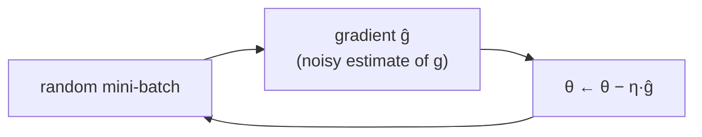

> Tier 4 · Training & Optimization · **Level: beginner** · Reading time: about 9 minutes

# 4.6 SGD (stochastic gradient descent)

**Metadata** — Tier: 4 · Phase: 1 · Priority: P0 · Difficulty: 2/5 · Interview: Very high · Hands-on: Very high
Prerequisites: 1.22 Gradient descent, 4.5 Parameter update · Leads to: 4.7 Momentum, 4.8 Adam, 4.13 Batch size

> **In plain words**
> **SGD** takes a downhill step using the gradient measured on **just a small random batch** of examples instead of the whole dataset. The batch gradient is a **noisy but cheap estimate** of the true one, so you can take many quick steps instead of a few slow ones. The rule is still `w ← w − lr × gradient`.
> It is like judging which way a hill slopes from a handful of footprints: not perfect, but fast, and on average right.

**You need first:** 1.22 Gradient descent, 4.5 Parameter update.

> **Figure 4.6-1 — full-batch versus stochastic**
>
> 
>
> *How to read it:* the thin rings are the loss landscape of a long, narrow valley (steep walls, gentle floor); the star is the minimum. The red path is plain SGD with a safe step size: it bounces between the walls and moves slowly along the valley floor. Momentum (yellow) and Adam (teal) travel much further in the same 60 steps; they are the next two concepts. (This picture uses exact gradients to isolate the valley effect; real SGD adds batch noise on top.)
>
> *Generated by* `tier-04-training-optimization/figures/src/t4_figures.py`.

**Words you'll meet on this page**

| Word | What it means here |
|---|---|
| SGD | stochastic gradient descent |
| mini-batch | the small random group of examples used per step |
| full-batch (batch GD) | use all examples for each step |
| gradient noise | the batch gradient differs from the true gradient |
| learning rate | step size |
| converge | settle near a minimum |
| unbiased estimate | right on average |

### 1. What is it?
Gradient descent where each update uses the gradient of the loss on a randomly chosen mini-batch: `θ ← θ − η·ĝ`, where `ĝ` estimates the full gradient `g`.

### 2. Why does it exist?
Computing the gradient over millions of examples for every single step is wasteful. A small batch gives a cheap, noisy estimate that is correct on average, so more (cheaper) steps fit in the same time.

### 3. Detailed explanation
- **Unbiased estimate.** The expected batch gradient equals the full gradient, so on average SGD goes the right way.
- **Noise shrinks with batch size** roughly like `1/√B` (4.13). Noise is a nuisance near the minimum but also helps escape bad spots and acts as a mild regularizer.
- **Learning rate needs care.** Too large: the loss bounces or diverges. Too small: slow. A rule for a quadratic bowl: stable if `lr < 2/curvature` (4.5; code ②).
- **Ill-conditioned problems** (steep in one direction, gentle in another) make SGD zig-zag and crawl (Figure 4.6-1). Momentum (4.7) and Adam (4.8) fix this.
- **Learning-rate decay** reduces the noise's effect late in training (4.10).
- **Strengths:** simple, tiny memory (no extra state), often generalizes very well (used for many image models).
- **Weaknesses:** needs a tuned learning rate (and schedule); slow on badly scaled problems; less popular for Transformers, where AdamW dominates (4.9).
- **Data order matters.** Shuffle each epoch (4.1).
- **"SGD" in libraries** usually means mini-batch SGD, possibly with momentum; `torch.optim.SGD(lr, momentum=0.0)` is the plain version.

### 4. How does it work?
Sample a batch, compute its gradient, step against it. Repeat.



### 5. Simple example
Finding the downhill direction by asking 8 random people at a stadium instead of all 50,000: a rough but fast answer that is right on average.

**By hand.** Two examples `(x=1, y=2)`, `(x=3, y=6)`, model `y = w·x`, `w = 0`. Gradient on example 1 alone: `2(wx − y)x = −4`; on example 2 alone: `−36`; full-batch average: `−20`. SGD with example 1 steps by `−lr·(−4)`, with example 2 by `−lr·(−36)`: different sizes, same direction; on average they match `−20`.

### 6. Technical example
Image classifiers (ResNets) are commonly trained with SGD + momentum 0.9, batch 256, learning rate 0.1 with decay and weight decay 1e-4 (REVIEW_REQUIRED: typical recipe).

### 7. Code
**① By hand (plain Python).** Full-batch versus single-example steps on `y = 2x`.

```python
import random

random.seed(0)
data = [(x, 2.0 * x) for x in (1.0, 2.0, 3.0, 4.0)]
grad = lambda w, x, y: 2 * (w * x - y) * x

full = sum(grad(0.0, x, y) for x, y in data) / len(data)
print("full-batch gradient at w = 0:", full)
print("single-example gradients    :", [grad(0.0, x, y) for x, y in data], "-> their mean is", full)

w = 0.0
for step in range(1, 61):
    x, y = random.choice(data)                                  # one random example per step
    w -= 0.02 * grad(w, x, y)
    if step in (1, 10, 60):
        print(f"SGD step {step:>2}: w = {w:.3f}   (target 2.0)")
```

```text
full-batch gradient at w = 0: -30.0
single-example gradients    : [-4.0, -16.0, -36.0, -64.0] -> their mean is -30.0
SGD step  1: w = 1.280   (target 2.0)
SGD step 10: w = 1.997   (target 2.0)
SGD step 60: w = 2.000   (target 2.0)
```

**② With NumPy.** Batch size changes the noise; the learning-rate limit on a bowl.

```python
import numpy as np

rng = np.random.default_rng(0)
X = rng.normal(0, 1, 5000)
y = 2 * X + rng.normal(0, 1, 5000)
w0, true_grad = 0.0, np.mean(2 * (0.0 * X - y) * X)
for B in (1, 10, 100, 1000):
    g = [np.mean(2 * (w0 * X[idx] - y[idx]) * X[idx]) for idx in (rng.choice(5000, B) for _ in range(2000))]
    print(f"batch {B:>4}: gradient estimates have mean {np.mean(g):6.2f} (true {true_grad:.2f}) and std {np.std(g):5.2f}")

for lr in (0.4, 0.9, 1.1):                                     # loss = 1 * w^2, curvature 2 -> stable if lr < 1.0
    w = 1.0
    for _ in range(30):
        w -= lr * 2 * w
    print(f"lr {lr}: |w| after 30 steps = {abs(w):.1e}")
```

```text
batch    1: gradient estimates have mean  -3.84 (true -3.99) and std  5.63
batch   10: gradient estimates have mean  -4.07 (true -3.99) and std  1.84
batch  100: gradient estimates have mean  -3.97 (true -3.99) and std  0.57
batch 1000: gradient estimates have mean  -3.99 (true -3.99) and std  0.19
lr 0.4: |w| after 30 steps = 1.1e-21
lr 0.9: |w| after 30 steps = 1.2e-03
lr 1.1: |w| after 30 steps = 2.4e+02
```

**③ With PyTorch.** Plain SGD with mini-batches.

```python
import torch

torch.manual_seed(0)
X = torch.randn(1000, 1)
y = 2 * X + 1 + 0.5 * torch.randn_like(X)
model = torch.nn.Linear(1, 1)
opt = torch.optim.SGD(model.parameters(), lr=0.05)                # momentum=0.0 by default: plain SGD

for epoch in range(1, 6):
    order = torch.randperm(1000)
    for i in range(0, 1000, 50):                                   # batch size 50 -> 20 steps per epoch
        idx = order[i:i + 50]
        opt.zero_grad()
        torch.nn.functional.mse_loss(model(X[idx]), y[idx]).backward()
        opt.step()
    print(f"epoch {epoch}: w = {model.weight.item():.3f}  b = {model.bias.item():.3f}  (target 2, 1)")
```

```text
epoch 1: w = 1.752  b = 0.900  (target 2, 1)
epoch 2: w = 1.960  b = 1.000  (target 2, 1)
epoch 3: w = 1.995  b = 1.009  (target 2, 1)
epoch 4: w = 1.980  b = 1.009  (target 2, 1)
epoch 5: w = 1.994  b = 1.004  (target 2, 1)
```

### 8. Input → Process → Output
`mini-batch → noisy gradient → w − lr·gradient → slightly better weights`

<details>
<summary><b>Beyond the basics (sections 9–16)</b> — real-world use, limits, mistakes. Skip on a first read.</summary>

### 9. Enterprise use case
SGD with momentum remains a strong, memory-light choice for vision models in production.

### 10. AI engineering connection
LLM training mostly uses AdamW (4.9), but SGD variants appear in federated learning and some fine-tuning.

### 11. Advantages
Simple, no state, strong generalization in many settings.

### 12. Limitations
Slow on ill-conditioned problems; learning-rate sensitive; needs a schedule.

### 13. Trade-offs
Small batches: noisier but more updates and sometimes better generalization. Large batches: smoother but need larger learning rates (4.13).

### 14. Common mistakes
Not shuffling; a learning rate copied from an Adam recipe; forgetting a decay schedule; comparing optimizers without tuning each learning rate.

### 15. Performance / cost
Cheapest optimizer in memory and compute.

### 16. Security
Noisy-gradient SGD with clipping and noise is the basis of differentially private training (DP-SGD).

</details>

### 17. Interview explanation
"SGD updates the weights with the gradient of a random mini-batch, an unbiased but noisy estimate of the full gradient. It's cheap and generalizes well, but it's sensitive to the learning rate and slow on badly conditioned problems, which momentum and Adam address."

### 18. Rapid-fire answer
Step along the negative mini-batch gradient; noisy but unbiased; cheap; needs lr tuning; weak on ill-conditioned problems.

### 19. Interview questions
- **Basic:** What is the difference between GD and SGD?
- **Intermediate:** Why is the mini-batch gradient an unbiased estimate?
- **Advanced:** How does batch size affect the noise and the best learning rate?
- **Scenario:** Loss oscillates wildly with SGD. What do you change first?

### 20. Hands-on exercise
**Goal:** see the learning-rate sweet spot with SGD.

1. Fit `y = 2x + 1` (200 points) with `Linear(1, 1)`.
2. Train 100 full-batch steps for lr in 0.001, 0.01, 0.1, 0.9, 1.1.
3. Print the final loss for each.

<details>
<summary>Show a solution</summary>

```python
import torch

torch.manual_seed(0)
X = torch.linspace(-1, 1, 200).unsqueeze(1)
y = 2 * X + 1
for lr in (0.001, 0.01, 0.1, 0.9, 1.1):
    torch.manual_seed(1)
    model = torch.nn.Linear(1, 1)
    opt = torch.optim.SGD(model.parameters(), lr=lr)
    for _ in range(100):
        opt.zero_grad()
        loss = torch.nn.functional.mse_loss(model(X), y)
        loss.backward(); opt.step()
    print(f"lr {lr:>5}: final loss {loss.item():.2e}")
```

```text
lr 0.001: final loss 2.05e+00
lr  0.01: final loss 2.33e-01
lr   0.1: final loss 7.52e-07
lr   0.9: final loss 1.93e-14
lr   1.1: final loss 9.90e+15
```

</details>

### 21. Revision questions
1. Why is SGD "stochastic"?
2. How does batch size change the gradient noise?
3. Why does SGD struggle on a narrow valley?

### 22. Related concepts
1.22 Gradient descent · 4.5 Update · 4.7 Momentum · 4.8 Adam · 4.13 Batch size

### 23. One-line memory hook
**SGD: a quick, noisy glance downhill, repeated many times.**

<details>
<summary><b>For reviewers</b> (not part of the lesson)</summary>

- Status: DRAFT, learner-first layout (Author: Claude). Code is executed by `tests/test_md_snippets.py`.
- Figure 4.6-1 shares the optimizer-path picture with 4.7 and 4.8 (`fig_4_08_optimizer_paths.svg`); numbers in its legend are computed by the script.
- Typical ResNet recipe in section 6 is REVIEW_REQUIRED.
</details>
