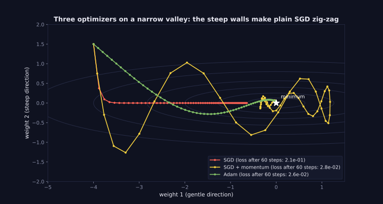
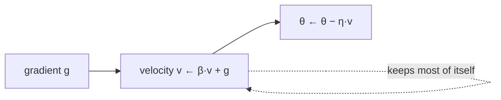

> Tier 4 · Training & Optimization · **Level: beginner** · Reading time: about 8 minutes

# 4.7 Momentum

**Metadata** — Tier: 4 · Phase: 1 · Priority: P0 · Difficulty: 2/5 · Interview: High · Hands-on: High
Prerequisites: 4.6 SGD · Leads to: 4.8 Adam

> **In plain words**
> **Momentum** gives SGD a memory, like a heavy ball rolling downhill. Instead of using only the current gradient, it keeps a running **velocity** that adds up the recent gradients. Directions that keep pointing the same way build up speed; directions that flip back and forth cancel out.
> Result: less zig-zag across a valley, more progress along it.

**You need first:** 4.6 SGD.

> **Figure 4.7-1 — momentum on the narrow valley**
>
> 
>
> *How to read it:* the yellow path is SGD with momentum 0.9. Across the valley the gradient keeps flipping sign, so those pushes cancel in the velocity; along the valley the gradient keeps pointing the same way, so the velocity grows. After 60 steps momentum's loss (about 0.03) is roughly seven times lower than plain SGD's (about 0.2), using a smaller learning rate.
>
> *Generated by* `tier-04-training-optimization/figures/src/t4_figures.py`.

**Words you'll meet on this page**

| Word | What it means here |
|---|---|
| velocity `v` | running combination of past gradients |
| momentum `β` | how much of the old velocity is kept (usually 0.9) |
| Nesterov | a variant that looks ahead before computing the gradient |
| damping | cancelling of back-and-forth motion |
| effective learning rate | about `lr / (1 − β)` along a steady direction |
| overshoot | going past the minimum because of speed |

### 1. What is it?
An SGD variant with a velocity: `v ← βv + g`, `θ ← θ − η·v` (PyTorch's convention). `β` is typically 0.9.

### 2. Why does it exist?
Plain SGD zig-zags on narrow valleys and slows on flat stretches. Averaging recent gradients smooths the noise and accelerates consistent directions.

### 3. Detailed explanation
- **Steady direction.** If the gradient is a constant `g`, the velocity grows to `g/(1−β)`: with `β = 0.9` that's 10× bigger steps. So momentum acts like a larger effective learning rate along consistent directions (code ②).
- **Oscillating direction.** If the gradient alternates `+g, −g, …`, the velocity stays small. Zig-zag is damped.
- **Overshoot.** The ball can roll past the minimum and come back; too much momentum or too high a learning rate gives oscillations (in the exercise, β = 0.99 does badly at every learning rate tried).
- **Nesterov momentum** computes the gradient at the looked-ahead position; often slightly better (`nesterov=True`).
- **Memory.** One extra tensor the size of the model (the velocity).
- **Pairing.** SGD + momentum 0.9 + learning-rate decay is a classic strong recipe for vision (4.6); Adam (4.8) builds on the same idea of averaging gradients and adds per-parameter scaling.
- **Interactions.** Changing `β` changes the effective step: when raising `β` from 0.9 to 0.99 you usually need to lower the learning rate.
- **Batch noise** is also averaged out a little.
- **Debugging.** Velocity carries over from before a data change or a restart, so resume from a checkpoint with the optimizer state (4.20).

### 4. How does it work?
Keep `v`. Each step: `v ← βv + g`, then step by `−η·v`.



### 5. Simple example
A bowling ball versus a feather on a bumpy slope: the ball keeps moving in its direction and ignores small bumps; the feather is pushed around by each one.

**By hand.** Gradients `[1, 1, 1, 1]` (steady), β = 0.9: velocities `1, 1.9, 2.71, 3.44`: steps grow. Gradients `[1, −1, 1, −1]`: velocities `1, −0.1, 0.91, −0.18`: stay small.

### 6. Technical example
`torch.optim.SGD(params, lr=0.1, momentum=0.9, nesterov=True)`.

### 7. Code
**① By hand (plain Python).** The velocity for steady and alternating gradients.

```python
def velocities(grads, beta=0.9):
    v, out = 0.0, []
    for g in grads:
        v = beta * v + g
        out.append(round(v, 2))
    return out

print("steady gradients     :", velocities([1, 1, 1, 1]))
print("alternating gradients:", velocities([1, -1, 1, -1]))
print("long steady run ->", velocities([1] * 60)[-1], "(limit 1/(1-0.9) = 10)")
```

```text
steady gradients     : [1.0, 1.9, 2.71, 3.44]
alternating gradients: [1.0, -0.1, 0.91, -0.18]
long steady run -> 9.98 (limit 1/(1-0.9) = 10)
```

**② With NumPy.** The narrow valley: plain SGD versus momentum.

```python
import numpy as np

grad = lambda p: np.array([p[0], 25.0 * p[1]])                       # f = 0.5*(x^2 + 25*y^2)
loss = lambda p: 0.5 * (p[0] ** 2 + 25 * p[1] ** 2)

def run(lr, beta, steps=60):
    p, v = np.array([-4.0, 1.5]), np.zeros(2)
    for _ in range(steps):
        v = beta * v + grad(p)
        p = p - lr * v
    return loss(p)

print("plain SGD, lr 0.03          : loss after 60 steps = %.3f" % run(0.03, 0.0))
print("momentum 0.9, lr 0.02       : loss after 60 steps = %.3f" % run(0.02, 0.9))
print("momentum 0.9, lr 0.1 (large): loss after 60 steps = %.3g" % run(0.1, 0.9))
```

```text
plain SGD, lr 0.03          : loss after 60 steps = 0.207
momentum 0.9, lr 0.02       : loss after 60 steps = 0.028
momentum 0.9, lr 0.1 (large): loss after 60 steps = 0.0165
```

**③ With PyTorch.** The library option, and the effect on a simple fit.

```python
import torch

def train(momentum, lr=0.02, steps=80, nesterov=False):
    torch.manual_seed(0)
    X = torch.randn(256, 10) * torch.logspace(0, 1, 10)             # features on very different scales: a stretched valley
    y = X @ torch.ones(10, 1) + 0.1 * torch.randn(256, 1)
    model = torch.nn.Linear(10, 1)
    opt = torch.optim.SGD(model.parameters(), lr=lr, momentum=momentum, nesterov=nesterov)
    for _ in range(steps):
        opt.zero_grad()
        loss = torch.nn.functional.mse_loss(model(X), y)
        loss.backward(); opt.step()
    return loss.item()

print("SGD momentum 0.0           : loss %.3f" % train(0.0, lr=0.001))
print("SGD momentum 0.9           : loss %.3f" % train(0.9, lr=0.001))
print("SGD momentum 0.9 + Nesterov: loss %.3f" % train(0.9, lr=0.001, nesterov=True))
```

```text
SGD momentum 0.0           : loss 6.405
SGD momentum 0.9           : loss 0.105
SGD momentum 0.9 + Nesterov: loss 0.092
```

### 8. Input → Process → Output
`gradients over time → velocity → smoothed, accelerated step`

<details>
<summary><b>Beyond the basics (sections 9–16)</b> — real-world use, limits, mistakes. Skip on a first read.</summary>

### 9. Enterprise use case
SGD + momentum is a standard, memory-light recipe for production vision models.

### 10. AI engineering connection
Adam's first moment is momentum; understanding it explains Adam's `β₁`.

### 11. Advantages
Faster on ill-conditioned problems; smooths batch noise; one line to enable.

### 12. Limitations
Extra state; can overshoot; one more hyperparameter.

### 13. Trade-offs
Higher `β` smooths more but reacts more slowly to changes of direction.

### 14. Common mistakes
Raising `β` without lowering the learning rate; resuming without the velocity; assuming the PyTorch convention equals the textbook one (PyTorch folds the learning rate into the update, not into `v`).

### 15. Performance / cost
One extra model-sized buffer.

### 16. Security
Optimizer state in checkpoints is part of what you must protect.

</details>

### 17. Interview explanation
"Momentum keeps an exponentially weighted velocity of past gradients, so consistent directions accelerate and oscillating ones cancel. With β = 0.9 the effective step along a steady gradient is about ten times larger, which is why I usually lower the learning rate when I add it."

### 18. Rapid-fire answer
`v = βv + g; θ −= lr·v`; damps zig-zag, speeds steady directions; β ≈ 0.9; Nesterov looks ahead.

### 19. Interview questions
- **Basic:** What does momentum add to SGD?
- **Intermediate:** What is the effective learning rate with β = 0.9?
- **Advanced:** How does Nesterov differ from classical momentum?
- **Scenario:** Adding momentum made your loss diverge. What do you change?

### 20. Hands-on exercise
**Goal:** find how the best learning rate shifts with β.

1. Use the valley of code ② (60 steps).
2. For β in 0.0, 0.5, 0.9, 0.99 scan lr in 0.001, 0.003, 0.01, 0.03, 0.1.
3. Print the best lr for each β.

<details>
<summary>Show a solution</summary>

```python
import numpy as np

grad = lambda p: np.array([p[0], 25.0 * p[1]])
loss = lambda p: 0.5 * (p[0] ** 2 + 25 * p[1] ** 2)

def run(lr, beta, steps=60):
    p, v = np.array([-4.0, 1.5]), np.zeros(2)
    for _ in range(steps):
        v = beta * v + grad(p)
        p = p - lr * v
    return loss(p)

for beta in (0.0, 0.5, 0.9, 0.99):
    results = {lr: run(lr, beta) for lr in (0.001, 0.003, 0.01, 0.03, 0.1)}
    finite = {lr: v for lr, v in results.items() if np.isfinite(v)}
    best = min(finite, key=finite.get)
    print(f"beta {beta:>4}: best lr = {best}   loss = {finite[best]:.2e}")
```

```text
beta  0.0: best lr = 0.03   loss = 2.07e-01
beta  0.5: best lr = 0.1   loss = 3.09e-17
beta  0.9: best lr = 0.1   loss = 1.65e-02
beta 0.99: best lr = 0.03   loss = 7.96e+00
```

</details>

### 21. Revision questions
1. Write the momentum update.
2. Why does zig-zag cancel?
3. What happens to the effective step as β → 1?

### 22. Related concepts
4.6 SGD · 4.8 Adam · 4.5 Update · 4.10 Scheduling

### 23. One-line memory hook
**Momentum: a heavy ball rolls through the bumps and speeds up on long slopes.**

<details>
<summary><b>For reviewers</b> (not part of the lesson)</summary>

- Status: DRAFT, learner-first layout (Author: Claude). Code is executed by `tests/test_md_snippets.py`.
- Figure legend numbers (SGD 0.2, momentum 0.03, Adam 0.03) come from `t4_figures.py`; the "about seven times lower" statement is derived from them (0.207 / 0.028 ≈ 7.3).
</details>
