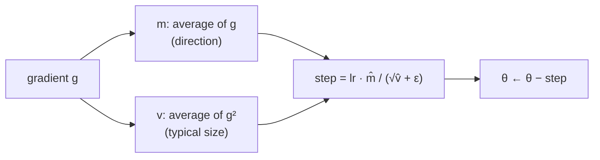

> Tier 4 · Training & Optimization · **Level: intermediate** · Reading time: about 10 minutes

# 4.8 Adam

**Metadata** — Tier: 4 · Phase: 1 · Priority: P0 · Difficulty: 3/5 · Interview: Very high · Hands-on: Very high
Prerequisites: 4.6 SGD, 4.7 Momentum · Leads to: 4.9 AdamW, 4.10 Scheduling

> **In plain words**
> **Adam** is the most popular optimizer. It does two things at once: (1) like momentum, it keeps a **running average of the gradient** (which way to go), and (2) it keeps a running average of the **squared gradient** (how big the gradients usually are for *this* weight) and divides by it. Weights that get big gradients take smaller steps; weights with tiny gradients take relatively bigger ones.
> Every weight gets its own automatic step size, so Adam works well with a default learning rate on many problems.

**You need first:** 4.6 SGD, 4.7 Momentum.

> **Figure 4.8-1 — Adam on the narrow valley**
>
> 
>
> *How to read it:* the valley is 5× steeper in one direction. SGD must use a step small enough for the steep direction, so it crawls along the gentle one. Adam divides each direction by its typical gradient size, so both directions move at a similar pace; in 60 steps its loss (about 0.03) is far below SGD's (about 0.2). Adam's path is not smooth; it oscillates a little near the end because its step size does not shrink on its own.
>
> *Generated by* `tier-04-training-optimization/figures/src/t4_figures.py`.

**Words you'll meet on this page**

| Word | What it means here |
|---|---|
| first moment `m` | running average of the gradient (like momentum) |
| second moment `v` | running average of the squared gradient |
| `β₁`, `β₂` | their decay rates (defaults 0.9 and 0.999) |
| bias correction | fix for `m` and `v` starting at zero |
| `ε` (epsilon) | tiny number to avoid dividing by zero |
| adaptive | step size is chosen per parameter |
| lr | the overall step size (default 1e-3) |

### 1. What is it?
An adaptive optimizer: `m ← β₁m + (1−β₁)g`, `v ← β₂v + (1−β₂)g²`, with bias correction `m̂ = m/(1−β₁ᵗ)`, `v̂ = v/(1−β₂ᵗ)`, then `θ ← θ − η·m̂/(√v̂ + ε)` (Kingma & Ba, 2014).

### 2. Why does it exist?
Different parameters need different step sizes (a word embedding that appears rarely versus a bias that is updated every step). Tuning one global learning rate for all of them is hard. Adam adapts per parameter automatically.

### 3. Detailed explanation
- **Direction × scale.** `m̂` is the smoothed direction; `1/√v̂` rescales it so a step is roughly `±lr` in size no matter how large the gradient is. That is why the **first step of Adam moves each weight by about `lr`** (code ②).
- **Bias correction.** `m` and `v` start at 0, so early on they are too small. Dividing by `1 − βᵗ` fixes this. Without it the first steps are wrong.
- **Defaults** `lr = 1e-3`, `β₁ = 0.9`, `β₂ = 0.999`, `ε = 1e-8` work for many problems. Transformers often use `β₂ = 0.95–0.99` and `lr` between 1e-5 and 6e-4 (REVIEW_REQUIRED per model).
- **Memory.** Two extra tensors per parameter (`m`, `v`): the optimizer state is 2× the model size (4.24).
- **Scale invariance.** Multiplying all gradients by a constant leaves the update (almost) unchanged. Good for badly scaled gradients; it also means the loss scale does not need retuning.
- **Weaknesses.** Can generalize slightly worse than SGD on some vision tasks; `ε` and `β₂` can matter in low precision; the step never shrinks on its own, so a schedule helps (4.10).
- **Weight decay.** Adding L2 to Adam's gradient is not the same as true weight decay; use AdamW (4.9).
- **Sparse or rare features** get relatively large steps because their `v` is small.
- **Spikes.** If `v` is tiny and a sudden big gradient arrives, the step can be large; clipping (4.15) and warm-up (4.11) guard against it.

### 4. How does it work?
Update the two running averages, correct their bias, divide the smoothed gradient by the root of the smoothed squared gradient, step.



### 5. Simple example
Two hikers with the same compass but different terrain: one is on a steep rocky slope (big gradients) and must take small careful steps; the other is on a gentle plain (tiny gradients) and can stride. Adam gives each their own stride length.

**By hand.** First step, gradient `g = 100` for one weight and `g = 0.01` for another. `m̂ = g`, `v̂ = g²`, so the step is `lr·g/|g| = ±lr` for both. SGD would move them by `lr·100` and `lr·0.01`: 10,000 times apart.

### 6. Technical example
`torch.optim.Adam(model.parameters(), lr=1e-3)`; Transformers: `AdamW(lr=3e-4, betas=(0.9, 0.95), weight_decay=0.1)` with warm-up and cosine decay (4.9–4.12).

### 7. Code
**① By hand (plain Python).** Adam on one weight of `L = (w − 3)²`.

```python
import math

w, m, v = 0.0, 0.0, 0.0
lr, b1, b2, eps = 0.3, 0.9, 0.999, 1e-8
for t in range(1, 41):
    g = 2 * (w - 3)
    m = b1 * m + (1 - b1) * g
    v = b2 * v + (1 - b2) * g * g
    m_hat, v_hat = m / (1 - b1 ** t), v / (1 - b2 ** t)           # bias correction
    w -= lr * m_hat / (math.sqrt(v_hat) + eps)
    if t in (1, 2, 5, 10, 20, 40):
        print(f"step {t:>2}: w = {w:.3f}")
```

```text
step  1: w = 0.300
step  2: w = 0.599
step  5: w = 1.476
step 10: w = 2.771
step 20: w = 3.813
step 40: w = 2.698
```

**② With NumPy.** The first step is about `lr` regardless of the gradient size.

```python
import numpy as np

def adam_first_step(g, lr=0.01, b1=0.9, b2=0.999, eps=1e-8):
    m, v = (1 - b1) * g, (1 - b2) * g * g
    return lr * (m / (1 - b1)) / (np.sqrt(v / (1 - b2)) + eps)

for g in (1e-4, 0.01, 1.0, 100.0):
    print(f"gradient {g:>8}: Adam moves the weight by {adam_first_step(g):.4f}   (SGD with lr 0.01 would move {0.01 * g:.6f})")
```

```text
gradient   0.0001: Adam moves the weight by 0.0100   (SGD with lr 0.01 would move 0.000001)
gradient     0.01: Adam moves the weight by 0.0100   (SGD with lr 0.01 would move 0.000100)
gradient      1.0: Adam moves the weight by 0.0100   (SGD with lr 0.01 would move 0.010000)
gradient    100.0: Adam moves the weight by 0.0100   (SGD with lr 0.01 would move 1.000000)
```

**③ With PyTorch.** Adam versus SGD on a badly scaled problem.

```python
import torch

def train(make_opt, steps=150):
    torch.manual_seed(0)
    X = torch.randn(256, 10) * torch.logspace(-1, 1, 10)             # feature scales from 0.1 to 10
    y = X @ torch.ones(10, 1) + 0.1 * torch.randn(256, 1)
    model = torch.nn.Linear(10, 1)
    opt = make_opt(model.parameters())
    for _ in range(steps):
        opt.zero_grad()
        loss = torch.nn.functional.mse_loss(model(X), y)
        loss.backward(); opt.step()
    return loss.item()

print("SGD  lr 0.001 :", round(train(lambda p: torch.optim.SGD(p, lr=0.001)), 4))
print("Adam lr 0.1   :", round(train(lambda p: torch.optim.Adam(p, lr=0.1)), 4))
```

```text
SGD  lr 0.001 : 1.7897
Adam lr 0.1   : 0.0087
```

### 8. Input → Process → Output
`gradient → running mean and mean-square → per-parameter scaled step`

<details>
<summary><b>Beyond the basics (sections 9–16)</b> — real-world use, limits, mistakes. Skip on a first read.</summary>

### 9. Enterprise use case
The default for most fine-tuning and many pre-training jobs because it works with little tuning.

### 10. AI engineering connection
Nearly all LLM training uses Adam-family optimizers (usually AdamW).

### 11. Advantages
Robust defaults; handles badly scaled parameters; fast early progress.

### 12. Limitations
2× model-size optimizer state; sometimes weaker generalization than tuned SGD; sensitive to `ε`/`β₂` in some settings.

### 13. Trade-offs
Convenience versus memory (8-bit and factored variants reduce state).

### 14. Common mistakes
Using L2 in the loss and calling it weight decay; no warm-up for large models; resuming without optimizer state; leaving `lr` at 1e-3 for big Transformers.

### 15. Performance / cost
Use the fused implementation (`fused=True`) on GPU; shard the state in distributed training (4.34).

### 16. Security
Optimizer state in checkpoints doubles the amount of sensitive data to protect.

</details>

### 17. Interview explanation
"Adam keeps exponential averages of the gradient and the squared gradient, bias-corrects them, and divides the first by the square root of the second, giving each parameter its own step size of roughly lr. It needs 2× model-size state and usually pairs with decoupled weight decay (AdamW), warm-up and a decay schedule."

### 18. Rapid-fire answer
`m` = mean gradient, `v` = mean squared gradient; step = `lr·m̂/(√v̂+ε)`; bias correction; defaults 1e-3, 0.9, 0.999.

### 19. Interview questions
- **Basic:** What two running averages does Adam keep?
- **Intermediate:** Why the bias correction?
- **Advanced:** Why is Adam with L2 not the same as weight decay?
- **Scenario:** Loss spikes after thousands of stable steps with Adam. What might be happening?

### 20. Hands-on exercise
**Goal:** see the bias correction matter.

1. Implement Adam by hand on `L = (w − 3)²` (lr 0.3) with and without the bias correction.
2. Print `w` after steps 1, 2, 3, 5.
3. Which one starts correctly?

<details>
<summary>Show a solution</summary>

```python
import math

def run(correct, steps=5, lr=0.3, b1=0.9, b2=0.999):
    w, m, v, out = 0.0, 0.0, 0.0, []
    for t in range(1, steps + 1):
        g = 2 * (w - 3)
        m = b1 * m + (1 - b1) * g
        v = b2 * v + (1 - b2) * g * g
        mh, vh = (m / (1 - b1 ** t), v / (1 - b2 ** t)) if correct else (m, v)
        w -= lr * mh / (math.sqrt(vh) + 1e-8)
        out.append(round(w, 3))
    return out

print("with correction   :", run(True))
print("without correction:", run(False))
```

```text
with correction   : [0.3, 0.599, 0.895, 1.188, 1.476]
without correction: [0.949, 2.189, 3.486, 4.521, 5.028]
```

</details>

### 21. Revision questions
1. What do `m` and `v` track?
2. What is the size of the first step?
3. What does it cost in memory?

### 22. Related concepts
4.6 SGD · 4.7 Momentum · 4.9 AdamW · 4.10 Scheduling · 4.11 Warm-up · 4.34 ZeRO

### 23. One-line memory hook
**Adam: momentum for the direction, a running size for each weight's stride.**

<details>
<summary><b>For reviewers</b> (not part of the lesson)</summary>

- Status: DRAFT, learner-first layout (Author: Claude). Code is executed by `tests/test_md_snippets.py`.
- REVIEW_REQUIRED: Kingma & Ba 2014 attribution; typical Transformer hyperparameters (`β₂ = 0.95`, lr range); claims about generalization versus SGD.
</details>
