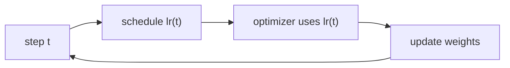

> Tier 4 · Training & Optimization · **Level: beginner** · Reading time: about 9 minutes

# 4.10 Learning-rate scheduling

**Metadata** — Tier: 4 · Phase: 1 · Priority: P0 · Difficulty: 2/5 · Interview: High · Hands-on: High
Prerequisites: 4.5 Parameter update, 4.6 SGD, 4.8 Adam · Leads to: 4.11 Warm-up, 4.12 Cosine decay

> **In plain words**
> A **learning-rate schedule** changes the step size **during training** instead of keeping it fixed. Big steps early (to make fast progress), small steps late (to settle precisely into a good spot).
> Like parking a car: you drive fast along the street, then slow right down for the last metre.

**You need first:** 4.5 Parameter update, 4.6 SGD.

> **Figure 4.10-1 — four common schedules**
>
> 
>
> *How to read it:* the x-axis is the training step and the y-axis the learning rate relative to its peak. **Constant** never changes. **Step decay** drops in stages. **Cosine decay** glides smoothly from the peak to zero. **Warm-up + cosine** (the standard LLM recipe) rises over the first 100 steps (yellow zone), then follows the cosine curve down. Warm-up is 4.11, cosine is 4.12.
>
> *Generated by* `tier-04-training-optimization/figures/src/t4_figures.py`.

**Words you'll meet on this page**

| Word | What it means here |
|---|---|
| schedule | a rule giving the learning rate at each step |
| decay | making the rate smaller over time |
| step decay | multiply by a factor every N epochs |
| exponential decay | multiply by a factor every step |
| scheduler | the PyTorch object that applies a schedule |
| peak / base lr | the highest learning rate in the schedule |
| plateau | loss stops improving |

### 1. What is it?
A function `lr(t)` of the step (or epoch) that the optimizer uses instead of one constant.

### 2. Why does it exist?
A learning rate that is right for the beginning is too large at the end: the weights bounce around the minimum instead of settling. A rate that is right for the end is too slow at the start. Changing it over time gets both.

### 3. Detailed explanation
- **Step decay:** `lr = lr₀ · γ^⌊epoch / N⌋` (for example halve every 30 epochs). Classic for ResNets.
- **Exponential decay:** `lr = lr₀ · γ^t`.
- **Cosine decay** (4.12): smooth, no extra hyperparameter beyond the final value.
- **Linear decay:** straight line to zero; common for fine-tuning.
- **Warm-up** (4.11): rise at the start; usually combined with a decay.
- **Reduce on plateau:** lower the rate when validation loss stops improving (reactive, not planned).
- **Cyclical / restarts:** raise the rate periodically (SGDR) to escape bad regions.
- **Constant:** fine for short runs and some fine-tuning, but leaves loss on the table in long runs.
- **Stepping the scheduler:** call `scheduler.step()` once per step or per epoch, *after* `optimizer.step()`, matching how the schedule is defined (code ③).
- **Resume:** save and restore the scheduler state with the checkpoint (4.20).
- **Total steps matter.** Cosine and linear schedules need the planned total number of steps; stopping early leaves the rate high.
- **Interacts with weight decay:** the per-step decay is `lr·λ` (4.9).
- **Log the learning rate** to check the schedule is what you intended (a classic bug is a scheduler that was never stepped).

### 4. How does it work?
At each step ask the schedule for the current rate, write it into the optimizer, take the step.



### 5. Simple example
Parking a car: fast on the road, slow near the space.

**By hand.** Start 0.1, halve every 10 epochs: epochs 0–9 use 0.1; 10–19 use 0.05; 20–29 use 0.025.

### 6. Technical example
`torch.optim.lr_scheduler.StepLR(opt, step_size=30, gamma=0.1)` for ResNet-50 on ImageNet (REVIEW_REQUIRED: classic recipe).

### 7. Code
**① By hand (plain Python).** Three schedules as functions.

```python
def step_decay(epoch, lr0=0.1, every=10, gamma=0.5):
    return lr0 * gamma ** (epoch // every)

def exponential(epoch, lr0=0.1, gamma=0.9):
    return lr0 * gamma ** epoch

def linear(step, total=100, lr0=0.1):
    return lr0 * (1 - step / total)

for t in (0, 10, 20, 50, 99):
    print(f"t = {t:>2}: step decay {step_decay(t):.4f}   exponential {exponential(t):.4f}   linear {linear(t):.4f}")
```

```text
t =  0: step decay 0.1000   exponential 0.1000   linear 0.1000
t = 10: step decay 0.0500   exponential 0.0349   linear 0.0900
t = 20: step decay 0.0250   exponential 0.0122   linear 0.0800
t = 50: step decay 0.0031   exponential 0.0005   linear 0.0500
t = 99: step decay 0.0002   exponential 0.0000   linear 0.0010
```

**② With NumPy.** Why the final rate matters: noisy SGD around a minimum.

```python
import numpy as np

rng = np.random.default_rng(0)
def final_error(schedule, steps=2000):
    w, errs = 5.0, []
    for t in range(steps):
        g = 2 * (w - 1.0) + rng.normal(0, 3.0)                       # noisy gradient of (w-1)^2
        w -= schedule(t, steps) * g
        errs.append(abs(w - 1.0))
    return np.mean(errs[-200:])

print("constant 0.05      : mean |w - 1| over the last 200 steps = %.3f" % final_error(lambda t, T: 0.05))
print("linear decay to 0  : mean |w - 1| over the last 200 steps = %.3f" % final_error(lambda t, T: 0.05 * (1 - t / T)))
```

```text
constant 0.05      : mean |w - 1| over the last 200 steps = 0.306
linear decay to 0  : mean |w - 1| over the last 200 steps = 0.194
```

**③ With PyTorch.** Built-in schedulers; the stepping order.

```python
import torch

w = torch.nn.Parameter(torch.tensor(0.0))
opt = torch.optim.SGD([w], lr=0.1)
sched = torch.optim.lr_scheduler.StepLR(opt, step_size=10, gamma=0.5)
seen = []
for epoch in range(30):
    seen.append(opt.param_groups[0]["lr"])
    opt.zero_grad(); ((w - 3) ** 2).backward(); opt.step()          # optimizer first...
    sched.step()                                                     # ...then the scheduler
print("lr at epochs 0, 9, 10, 19, 20, 29:", [seen[i] for i in (0, 9, 10, 19, 20, 29)])

opt2 = torch.optim.SGD([w], lr=0.1)
sched2 = torch.optim.lr_scheduler.ExponentialLR(opt2, gamma=0.9)
for _ in range(10):
    opt2.step(); sched2.step()
print("ExponentialLR after 10 epochs:", round(opt2.param_groups[0]["lr"], 5), "  by hand:", round(0.1 * 0.9 ** 10, 5))
```

```text
lr at epochs 0, 9, 10, 19, 20, 29: [0.1, 0.1, 0.05, 0.05, 0.025, 0.025]
ExponentialLR after 10 epochs: 0.03487   by hand: 0.03487
```

### 8. Input → Process → Output
`step number → schedule → learning rate for this step`

<details>
<summary><b>Beyond the basics (sections 9–16)</b> — real-world use, limits, mistakes. Skip on a first read.</summary>

### 9. Enterprise use case
The schedule is one of the key logged hyperparameters; changing the total length changes the whole curve.

### 10. AI engineering connection
LLM pre-training uses warm-up + cosine (or linear) decay; fine-tuning often uses short warm-up + linear decay.

### 11. Advantages
Cheap; reliably improves the final loss.

### 12. Limitations
Needs the total step count in advance (or a reactive scheme); extra hyperparameters.

### 13. Trade-offs
Aggressive decay settles quickly but can stall learning early.

### 14. Common mistakes
Stepping the scheduler in the wrong place; mixing per-step and per-epoch units; forgetting to restore the scheduler on resume; changing total steps without changing the schedule.

### 15. Performance / cost
Negligible.

### 16. Security
No direct issue.

</details>

### 17. Interview explanation
"A learning-rate schedule starts with a larger rate for fast progress and reduces it so the model settles. For Transformers I use short linear warm-up followed by cosine decay, stepped per optimizer step, and I log the rate to check it."

### 18. Rapid-fire answer
`lr(t)`: step/exponential/linear/cosine decay, often with warm-up; step after the optimizer; save with the checkpoint.

### 19. Interview questions
- **Basic:** Why decay the learning rate?
- **Intermediate:** Where does `scheduler.step()` go?
- **Advanced:** Why do cosine schedules need the total step count?
- **Scenario:** Training plateaus at a high loss; the lr log is flat. Why?

### 20. Hands-on exercise
**Goal:** implement `ReduceOnPlateau` logic by hand.

1. Given a list of validation losses, halve the rate whenever the loss has not improved for 3 epochs.
2. Start with lr 0.1 and the losses `[1.0, 0.8, 0.7, 0.7, 0.71, 0.72, 0.69, 0.69, 0.69, 0.70, 0.69]`.
3. Print the rate after each epoch.

<details>
<summary>Show a solution</summary>

```python
losses = [1.0, 0.8, 0.7, 0.7, 0.71, 0.72, 0.69, 0.69, 0.69, 0.70, 0.69]
lr, best, bad = 0.1, float("inf"), 0
for epoch, loss in enumerate(losses, 1):
    if loss < best - 1e-9:
        best, bad = loss, 0
    else:
        bad += 1
        if bad >= 3:
            lr, bad = lr / 2, 0
    print(f"epoch {epoch:>2}: val loss {loss:.2f}   best {best:.2f}   lr after epoch {lr}")
```

```text
epoch  1: val loss 1.00   best 1.00   lr after epoch 0.1
epoch  2: val loss 0.80   best 0.80   lr after epoch 0.1
epoch  3: val loss 0.70   best 0.70   lr after epoch 0.1
epoch  4: val loss 0.70   best 0.70   lr after epoch 0.1
epoch  5: val loss 0.71   best 0.70   lr after epoch 0.1
epoch  6: val loss 0.72   best 0.70   lr after epoch 0.05
epoch  7: val loss 0.69   best 0.69   lr after epoch 0.05
epoch  8: val loss 0.69   best 0.69   lr after epoch 0.05
epoch  9: val loss 0.69   best 0.69   lr after epoch 0.05
epoch 10: val loss 0.70   best 0.69   lr after epoch 0.025
epoch 11: val loss 0.69   best 0.69   lr after epoch 0.025
```

</details>

### 21. Revision questions
1. Name three decay schedules.
2. Why decay at all?
3. In what order do `optimizer.step()` and `scheduler.step()` go?

### 22. Related concepts
4.5 Update · 4.8 Adam · 4.11 Warm-up · 4.12 Cosine decay · 4.20 Checkpoints

### 23. One-line memory hook
**Schedule: sprint early, tiptoe at the finish.**

<details>
<summary><b>For reviewers</b> (not part of the lesson)</summary>

- Status: DRAFT, learner-first layout (Author: Claude). Code is executed by `tests/test_md_snippets.py`.
- The StepLR "classic ResNet recipe" statement is REVIEW_REQUIRED.
</details>
