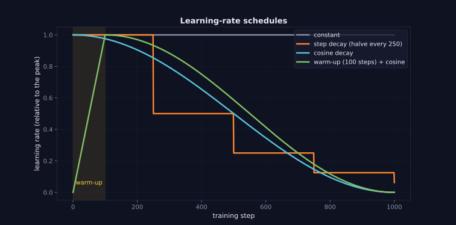
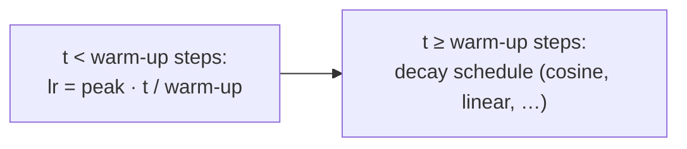

> Tier 4 · Training & Optimization · **Level: beginner** · Reading time: about 7 minutes

# 4.11 Warm-up

**Metadata** — Tier: 4 · Phase: 1 · Priority: P0 · Difficulty: 2/5 · Interview: High · Hands-on: High
Prerequisites: 4.8 Adam, 4.10 Learning-rate scheduling · Leads to: 4.12 Cosine decay

> **In plain words**
> **Warm-up** means starting training with a **very small learning rate** and raising it gradually to the planned peak over the first few hundred or thousand steps.
> Why: at the very start the weights are random and the optimizer's statistics (like Adam's running averages) are not reliable yet, so a big first step can wreck the model. It is like warming up before a sprint.

**You need first:** 4.8 Adam, 4.10 Learning-rate scheduling.

> **Figure 4.11-1 — the warm-up ramp**
>
> 
>
> *How to read it:* look at the teal curve and the yellow shaded zone. For the first 100 steps the learning rate climbs in a straight line from 0 to the peak; after that it follows cosine decay. The other curves start at full speed from step 0.
>
> *Generated by* `tier-04-training-optimization/figures/src/t4_figures.py`.

**Words you'll meet on this page**

| Word | What it means here |
|---|---|
| warm-up | learning rate rises from ~0 to the peak |
| warm-up steps | how long the ramp lasts |
| linear warm-up | straight-line ramp |
| peak lr | the learning rate after warm-up |
| instability | loss spikes or divergence |
| `LambdaLR` | PyTorch scheduler that multiplies the base lr by a function |

### 1. What is it?
A schedule phase `lr(t) = lr_peak · min(1, t / warmup_steps)` at the start of training.

### 2. Why does it exist?
- **Random weights** produce huge, unrepresentative gradients at first.
- **Adam's second-moment estimate** is based on only a few gradients early on, so steps can be too large (4.8).
- **Deep Transformers** are particularly sensitive: big early updates can push them into a bad region from which they never recover.

### 3. Detailed explanation
- **Length.** Common: 1–5% of total steps; a few hundred to a few thousand steps for LLMs; 100–500 for fine-tuning (REVIEW_REQUIRED).
- **Shape.** Linear is standard; others (exponential, constant-then-jump) exist.
- **Larger batch / higher peak lr → longer warm-up.**
- **Symptoms of too little warm-up:** loss spikes or NaN in the first steps (4.38), very slow start, gradient norm spikes (4.37).
- **Evidence is mixed on toy problems** (in the exercise it does not change the final loss); warm-up matters most for big Transformers.
- **Cost.** Almost nothing: it delays full-speed learning by a tiny fraction of the run.
- **In code** with `LambdaLR` (a multiplier on the base lr) or schedulers like `get_linear_schedule_with_warmup` in other libraries (code ③).
- **Resuming:** restore the scheduler so warm-up is not restarted.
- **Related:** RAdam tries to fix Adam's early variance problem without manual warm-up (REVIEW_REQUIRED).
- **Counting units:** warm-up is counted in optimizer steps, not micro-batches (4.14).

### 4. How does it work?
Multiply the peak rate by `t / warmup_steps` until the ramp finishes, then follow the main schedule.



### 5. Simple example
Warming up before a sprint: jog first, then run flat out. Starting at full speed risks a pulled muscle.

**By hand.** Peak 0.001, warm-up 100 steps: step 1 → 0.00001; step 50 → 0.0005; step 100 → 0.001.

### 6. Technical example
GPT-style pre-training: lr peak 6e-4, warm-up 2,000 steps, cosine decay to 10% of the peak (REVIEW_REQUIRED: representative recipe).

### 7. Code
**① By hand (plain Python).** The ramp.

```python
def warmup(step, peak=0.001, warmup_steps=100):
    return peak * min(1.0, step / warmup_steps)

for step in (1, 10, 50, 99, 100, 500):
    print(f"step {step:>3}: lr = {warmup(step):.6f}")
```

```text
step   1: lr = 0.000010
step  10: lr = 0.000100
step  50: lr = 0.000500
step  99: lr = 0.000990
step 100: lr = 0.001000
step 500: lr = 0.001000
```

**② With NumPy.** Why the early Adam step is risky: the size of Adam's steps in the first iterations.

```python
import numpy as np

rng = np.random.default_rng(0)
lr, b1, b2 = 0.01, 0.9, 0.999
m = v = 0.0
print("Adam step sizes (in units of lr); gradients are pure noise with std 1. Step 1 is a full lr-sized move from a single gradient:")
for t in range(1, 2001):
    g = rng.normal(0, 1)
    m, v = b1 * m + (1 - b1) * g, b2 * v + (1 - b2) * g * g
    step = abs((m / (1 - b1 ** t)) / (np.sqrt(v / (1 - b2 ** t)) + 1e-8))
    if t in (1, 2, 5, 50, 2000):
        print(f"  step {t:>4}: |update| = {step:.2f} x lr")
```

```text
Adam step sizes (in units of lr); gradients are pure noise with std 1. Step 1 is a full lr-sized move from a single gradient:
  step    1: |update| = 1.00 x lr
  step    2: |update| = 0.08 x lr
  step    5: |update| = 0.04 x lr
  step   50: |update| = 0.79 x lr
  step 2000: |update| = 0.01 x lr
```

**③ With PyTorch.** Linear warm-up followed by constant, using `LambdaLR`.

```python
import torch

w = torch.nn.Parameter(torch.tensor(0.0))
opt = torch.optim.AdamW([w], lr=1e-3)
warm = 50
sched = torch.optim.lr_scheduler.LambdaLR(opt, lambda step: min(1.0, (step + 1) / warm))
lrs = []
for step in range(100):
    lrs.append(opt.param_groups[0]["lr"])
    opt.zero_grad(); ((w - 3) ** 2).backward(); opt.step(); sched.step()
print("lr at steps 0, 1, 24, 49, 50, 99:", [round(lrs[i], 6) for i in (0, 1, 24, 49, 50, 99)])
```

```text
lr at steps 0, 1, 24, 49, 50, 99: [2e-05, 4e-05, 0.0005, 0.001, 0.001, 0.001]
```

### 8. Input → Process → Output
`step < warm-up → small, rising lr; afterwards → the main schedule`

<details>
<summary><b>Beyond the basics (sections 9–16)</b> — real-world use, limits, mistakes. Skip on a first read.</summary>

### 9. Enterprise use case
Warm-up often decides whether an expensive run survives its first hour; it is a standard guard in large-run recipes.

### 10. AI engineering connection
Every large Transformer recipe uses warm-up; fine-tuning with LoRA uses short warm-up too.

### 11. Advantages
Cheap insurance against early divergence.

### 12. Limitations
One more hyperparameter; too long wastes compute.

### 13. Trade-offs
Longer warm-up is safer but delays progress.

### 14. Common mistakes
Warm-up counted in micro-batches instead of optimizer steps; starting at lr 0 and never stepping the scheduler; warm-up restarted on resume.

### 15. Performance / cost
Negligible.

### 16. Security
No direct issue.

</details>

### 17. Interview explanation
"Warm-up ramps the learning rate linearly from near zero to the peak over the first steps because early gradients and Adam's second-moment estimates are unreliable; without it large Transformers can diverge early. I usually use 1–5% of the total steps, then cosine decay."

### 18. Rapid-fire answer
Linear ramp of lr over the first N steps; protects Adam and deep models early; N ≈ 1–5% of the run.

### 19. Interview questions
- **Basic:** What is warm-up?
- **Intermediate:** Why does Adam benefit from it?
- **Advanced:** How should warm-up length change with batch size?
- **Scenario:** Loss becomes NaN in the first 50 steps. What do you try?

### 20. Hands-on exercise
**Goal:** measure, rather than assume, what warm-up does on a small network.

1. Train a 12-layer ReLU network with Adam at an aggressive lr (0.1) for 60 steps on random data.
2. Run it without warm-up and with 30 warm-up steps, for 5 seeds each.
3. Print the average final loss. Does warm-up help here?

<details>
<summary>Show a solution</summary>

```python
import torch

def run(warm, seed):
    torch.manual_seed(seed)
    layers = []
    for _ in range(12):
        layers += [torch.nn.Linear(32, 32), torch.nn.ReLU()]
    net = torch.nn.Sequential(*layers, torch.nn.Linear(32, 1))
    X = torch.randn(256, 32); y = X[:, :1]
    opt = torch.optim.Adam(net.parameters(), lr=0.1)
    sched = torch.optim.lr_scheduler.LambdaLR(opt, lambda s: min(1.0, (s + 1) / warm) if warm else 1.0)
    worst = 0.0
    for _ in range(60):
        opt.zero_grad()
        loss = torch.nn.functional.mse_loss(net(X), y)
        loss.backward(); opt.step(); sched.step()
        worst = max(worst, loss.item())
    return worst, loss.item()

for warm in (0, 30):
    results = [run(warm, s) for s in range(5)]
    print(f"warm-up {warm:>2}: mean final loss {sum(r[1] for r in results) / 5:.2f}")
```

```text
warm-up  0: mean final loss 1.02
warm-up 30: mean final loss 0.98
```

Here warm-up does not change the final loss: this aggressive learning rate is too high for this network either way. Its effect on the early spike is inconsistent across seeds and machines (it can shrink it a lot, or barely). The real payoff is in large Transformers, where a bad start can be unrecoverable. The lesson is to measure.
</details>

### 21. Revision questions
1. What is the warm-up formula?
2. Two reasons for it?
3. Typical length?

### 22. Related concepts
4.8 Adam · 4.10 Scheduling · 4.12 Cosine decay · 4.15 Gradient clipping · 4.38 NaN debugging

### 23. One-line memory hook
**Warm-up: jog before you sprint.**

<details>
<summary><b>For reviewers</b> (not part of the lesson)</summary>

- Status: DRAFT, learner-first layout (Author: Claude). Code is executed by `tests/test_md_snippets.py`.
- REVIEW_REQUIRED: typical warm-up lengths, the GPT-style recipe, and the RAdam remark. The exercise result on a toy network is seed-dependent and shown honestly.
</details>
