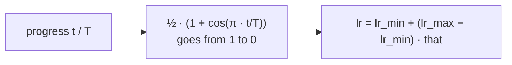

> Tier 4 · Training & Optimization · **Level: beginner** · Reading time: about 7 minutes

# 4.12 Cosine decay

**Metadata** — Tier: 4 · Phase: 1 · Priority: P0 · Difficulty: 2/5 · Interview: High · Hands-on: High
Prerequisites: 4.10 Scheduling, 4.11 Warm-up · Leads to: Tier 8–10 LLM training recipes

> **In plain words**
> **Cosine decay** lowers the learning rate along a smooth curve shaped like half a cosine wave: it stays fairly high at first, falls fastest in the middle, and flattens out gently near the end. No sudden drops, no extra settings beyond where you start and where you finish.
> It is the most common decay in modern training, usually after a short warm-up.

**You need first:** 4.10 Learning-rate scheduling, 4.11 Warm-up.

> **Figure 4.12-1 — cosine decay, alone and after warm-up**
>
> 
>
> *How to read it:* the blue curve is plain cosine decay from the peak to zero over 1,000 steps. The teal curve adds 100 warm-up steps first and then follows the same shape, compressed into the remaining steps. Compare with the orange staircase of step decay: cosine has no jumps.
>
> *Generated by* `tier-04-training-optimization/figures/src/t4_figures.py`.

**Words you'll meet on this page**

| Word | What it means here |
|---|---|
| cosine decay | smooth fall following half a cosine wave |
| `T` | total number of decay steps |
| `lr_min` | the final learning rate (often 0 or 10% of the peak) |
| annealing | gradually lowering the rate |
| restart | jump back up and decay again (cosine with restarts) |
| `CosineAnnealingLR` | PyTorch's scheduler |

### 1. What is it?
`lr(t) = lr_min + ½(lr_max − lr_min)(1 + cos(π·t/T))` for `t` from 0 to `T`.

### 2. Why does it exist?
It decays the rate without choosing stage lengths and drop factors as step decay requires, and it ends with very small steps, which helps the model settle into a good minimum.

### 3. Detailed explanation
- **Shape.** At `t = 0` it equals `lr_max`; at `t = T/2` the average of the two; at `T` it equals `lr_min`. The slope is zero at both ends.
- **Final value.** Many LLM recipes decay to 10% of the peak, not to zero (REVIEW_REQUIRED); vision recipes often go to ~0.
- **Total steps.** You must know `T` in advance. If training stops early, the rate is still high; if you extend training, the old curve is wrong. For open-ended runs people use constant-then-decay ("warm-up–stable–decay") schedules (REVIEW_REQUIRED).
- **With warm-up.** `lr(t) = lr_max·t/W` for `t < W`, otherwise cosine over `T − W` steps (code ②).
- **With restarts (SGDR).** Repeat the cosine with period `T₀`, optionally growing; later restarts start from a lower peak.
- **Compared with linear decay:** similar results in practice; cosine spends a bit longer at high rates early and low rates late.
- **Compared with step decay:** smoother, one fewer hyperparameter.
- **PyTorch:** `CosineAnnealingLR(opt, T_max, eta_min)`; for warm-up combine with `SequentialLR` or write a `LambdaLR`.
- **Logging:** plot the rate to confirm the curve.

### 4. How does it work?
Map `t / T` to `½(1 + cos(π t/T))` (1 → 0) and scale between the peak and the floor.



### 5. Simple example
Gliding a plane to a smooth landing: a gentle start, the steepest descent in the middle, and a soft touch-down.

**By hand.** Peak 1.0, floor 0, `T = 100`: t = 0 → 1.0; t = 25 → `½(1 + cos(π/4)) = 0.854`; t = 50 → 0.5; t = 75 → 0.146; t = 100 → 0.

### 6. Technical example
`lr_max = 3e-4`, 2,000 warm-up steps, cosine to `3e-5` over 100,000 steps for a medium Transformer (REVIEW_REQUIRED: illustrative).

### 7. Code
**① By hand (plain Python).** The formula at key points.

```python
import math

def cosine(t, T=100, lr_max=1.0, lr_min=0.0):
    return lr_min + 0.5 * (lr_max - lr_min) * (1 + math.cos(math.pi * t / T))

for t in (0, 25, 50, 75, 100):
    print(f"t = {t:>3}: lr = {cosine(t):.3f}")
```

```text
t =   0: lr = 1.000
t =  25: lr = 0.854
t =  50: lr = 0.500
t =  75: lr = 0.146
t = 100: lr = 0.000
```

**② With NumPy.** Warm-up followed by cosine to a 10% floor.

```python
import numpy as np

def warmup_cosine(t, total=1000, warm=100, peak=1.0, floor=0.1):
    if t < warm:
        return peak * t / warm
    progress = (t - warm) / (total - warm)
    return floor * peak + 0.5 * (peak - floor * peak) * (1 + np.cos(np.pi * progress))

for t in (0, 50, 100, 400, 700, 1000):
    print(f"step {t:>4}: lr = {warmup_cosine(t):.3f}")
```

```text
step    0: lr = 0.000
step   50: lr = 0.500
step  100: lr = 1.000
step  400: lr = 0.775
step  700: lr = 0.325
step 1000: lr = 0.100
```

**③ With PyTorch.** The built-in scheduler matches the formula.

```python
import math
import torch

w = torch.nn.Parameter(torch.tensor(0.0))
opt = torch.optim.SGD([w], lr=1.0)
sched = torch.optim.lr_scheduler.CosineAnnealingLR(opt, T_max=100, eta_min=0.0)
lrs = []
for _ in range(101):
    lrs.append(opt.param_groups[0]["lr"])
    opt.step(); sched.step()
by_hand = [0.5 * (1 + math.cos(math.pi * t / 100)) for t in range(101)]
print("lr at steps 0, 25, 50, 75, 100:", [round(lrs[i], 3) for i in (0, 25, 50, 75, 100)])
print("max difference from the formula:", f"{max(abs(a - b) for a, b in zip(lrs, by_hand)):.1e}")
```

```text
lr at steps 0, 25, 50, 75, 100: [1.0, 0.854, 0.5, 0.146, 0.0]
max difference from the formula: 0.0e+00
```

### 8. Input → Process → Output
`progress t/T → half-cosine → lr between the peak and the floor`

<details>
<summary><b>Beyond the basics (sections 9–16)</b> — real-world use, limits, mistakes. Skip on a first read.</summary>

### 9. Enterprise use case
A single `total_steps` value drives both the schedule and the training budget; plan it with cost estimates.

### 10. AI engineering connection
The default decay in most open LLM training recipes; also common in fine-tuning.

### 11. Advantages
Smooth, few hyperparameters, strong default.

### 12. Limitations
Needs `T` in advance; rigid if training is extended.

### 13. Trade-offs
A higher floor keeps learning alive longer; a zero floor squeezes out the last bit of loss.

### 14. Common mistakes
`T_max` in epochs while stepping per iteration; forgetting warm-up; not saving scheduler state; extending training without recomputing the curve.

### 15. Performance / cost
Negligible.

### 16. Security
No direct issue.

</details>

### 17. Interview explanation
"Cosine decay lowers the learning rate along half a cosine from the peak to a floor over a known number of steps. It avoids hand-picked drops, and with a short linear warm-up it's the standard schedule for Transformer training. The catch is that you need the total steps in advance."

### 18. Rapid-fire answer
`lr = min + ½(max−min)(1+cos(πt/T))`; smooth; needs `T`; used after warm-up in LLM recipes.

### 19. Interview questions
- **Basic:** What does a cosine schedule look like?
- **Intermediate:** What is the learning rate at half-way?
- **Advanced:** How would you handle a run whose length is not known up front?
- **Scenario:** You extend a cosine run by 20% midway. What happens to the schedule?

### 20. Hands-on exercise
**Goal:** compare schedules on a noisy problem.

1. Minimise `(w − 1)²` with noisy gradients (std 3) for 1,000 steps from `w = 5`.
2. Use a constant 0.05, linear decay and cosine decay (both from 0.05 to 0).
3. Report the mean `|w − 1|` over the last 100 steps, averaged over 20 seeds.

<details>
<summary>Show a solution</summary>

```python
import math
import numpy as np

schedules = {
    "constant": lambda t, T: 0.05,
    "linear":   lambda t, T: 0.05 * (1 - t / T),
    "cosine":   lambda t, T: 0.05 * 0.5 * (1 + math.cos(math.pi * t / T)),
}
for name, sched in schedules.items():
    errs = []
    for seed in range(20):
        rng = np.random.default_rng(seed)
        w, hist = 5.0, []
        for t in range(1000):
            w -= sched(t, 1000) * (2 * (w - 1) + rng.normal(0, 3))
            hist.append(abs(w - 1))
        errs.append(np.mean(hist[-100:]))
    print(f"{name:<9}: mean |w - 1| over the last 100 steps = {np.mean(errs):.3f}")
```

```text
constant : mean |w - 1| over the last 100 steps = 0.265
linear   : mean |w - 1| over the last 100 steps = 0.074
cosine   : mean |w - 1| over the last 100 steps = 0.070
```

</details>

### 21. Revision questions
1. Write the cosine formula.
2. What is the value at the midpoint?
3. Why does it need the total steps?

### 22. Related concepts
4.10 Scheduling · 4.11 Warm-up · 4.9 AdamW · 4.20 Checkpoints

### 23. One-line memory hook
**Cosine decay: a smooth glide from fast to gentle.**

<details>
<summary><b>For reviewers</b> (not part of the lesson)</summary>

- Status: DRAFT, learner-first layout (Author: Claude). Code is executed by `tests/test_md_snippets.py`.
- REVIEW_REQUIRED: floor of 10% of the peak in LLM recipes, the warm-up–stable–decay remark and the illustrative recipe numbers.
</details>
