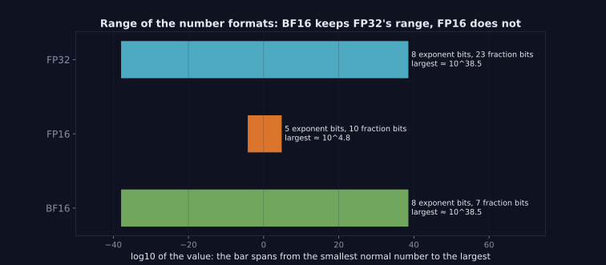

> Tier 4 · Training & Optimization · **Level: intermediate** · Reading time: about 7 minutes

# 4.18 BF16 (bfloat16)

**Metadata** — Tier: 4 · Phase: 1 · Priority: P0 · Difficulty: 2/5 · Interview: High · Hands-on: High
Prerequisites: 4.16 FP32, 4.17 FP16 · Leads to: 4.19 Mixed precision

> **In plain words**
> **BF16** is a 16-bit format that keeps **FP32's wide range** (same 8 exponent bits) but gives up precision (only 7 fraction bits, about 2 decimal digits). Because it almost never overflows or underflows, training in BF16 needs **no loss scaling**. That is why it is the usual choice for LLM training on modern GPUs and TPUs.

**You need first:** 4.16 FP32, 4.17 FP16.

> **Figure 4.18-1 — BF16 keeps FP32's range**
>
> 
>
> *How to read it:* the green bar (BF16) is as long as the blue one (FP32): both reach about 10³⁸ and down to about 10⁻³⁸. The orange FP16 bar is much shorter. What BF16 loses is on the other axis, precision: 7 fraction bits against FP16's 10.
>
> *Generated by* `tier-04-training-optimization/figures/src/t4_figures.py`.

**Words you'll meet on this page**

| Word | What it means here |
|---|---|
| BF16 / bfloat16 | "brain floating point": 1 sign, 8 exponent, 7 fraction bits |
| range | set by exponent bits |
| precision | set by fraction bits |
| truncation | BF16 is FP32 with the low 16 bits cut off (with rounding) |
| autocast | automatically choose a lower precision for suitable operations |
| TPU | Google's accelerator, where BF16 originated |

### 1. What is it?
A 16-bit float: the top 16 bits of an FP32 number. Range ≈ 1.2×10⁻³⁸ to 3.4×10³⁸ (as FP32); epsilon 7.8×10⁻³ (about 2–3 digits).

### 2. Why does it exist?
FP16's narrow range caused overflows and the need for loss scaling. Deep-learning workloads need range far more than precision, so BF16 trades fraction bits for exponent bits.

### 3. Detailed explanation
- **Same range as FP32,** so activations, gradients and large logits rarely overflow or underflow; no `GradScaler` needed.
- **Lower precision than FP16:** only ~3 significant digits. `1 + 0.005` rounds to 1.0. Accumulations must happen in FP32; weights updates need FP32 master weights (4.19).
- **Conversion** FP32 → BF16 is simple (take the high bits, round), so hardware support is cheap; BF16 ↔ FP32 casts are fast.
- **Hardware:** Google TPUs; NVIDIA Ampere (A100) and newer; recent CPUs; Apple silicon support varies (REVIEW_REQUIRED).
- **In practice:** `torch.autocast(device_type, dtype=torch.bfloat16)`; weights may even be stored in BF16 for inference, and for some training with care (stochastic rounding or FP32 optimizer states).
- **Noise:** BF16's coarse rounding adds a small amount of noise to results; most models tolerate it, but evaluate against FP32 on a sample.
- **Versus FP16:** BF16 is safer for training; FP16 offers slightly better precision, useful for inference of models trained or calibrated in FP16.
- **Reductions** (loss, softmax, normalization statistics) are still done in FP32 by autocast.

### 4. How does it work?
Same layout as FP32 with the last 16 fraction bits dropped.

### 5. Simple example
A big map with coarse markings: you never run off the edge of the map (range), but you can only say "about here" (precision).

**By hand (see code ③).** `70000` stays about 70144 in BF16 but overflows to `inf` in FP16. `1e-8` survives in BF16 but becomes 0 in FP16. In exchange, `1.005` becomes 1.0078 in BF16 but 1.0049 in FP16: BF16 is the coarser of the two.

### 6. Technical example
`with torch.autocast("cuda", dtype=torch.bfloat16): loss = model(x)` is the standard modern recipe; no `GradScaler`.

### 7. Code
**① By hand (plain Python).** BF16 is FP32 with the lower 16 bits cut off.

```python
import struct

def to_bf16(x):
    bits = struct.unpack(">I", struct.pack(">f", x))[0]
    bits = (bits + 0x8000) & 0xFFFF0000                                # round to nearest, keep the top 16 bits
    return struct.unpack(">f", struct.pack(">I", bits))[0]

for x in (3.14159265, 70000.0, 1e-8, 1.005):
    print(f"{x!r:>12} -> {to_bf16(x)!r}")
```

```text
  3.14159265 -> 3.140625
     70000.0 -> 70144.0
       1e-08 -> 1.0011717677116394e-08
       1.005 -> 1.0078125
```

**② With NumPy.** NumPy has no bfloat16, so compare range and step size using the bit layout.

```python
import numpy as np

def spacing(exp_bits, frac_bits, at=1.0):
    return at * 2.0 ** -frac_bits

print("gap between numbers near 1.0:")
for name, frac in (("FP32", 23), ("FP16", 10), ("BF16", 7)):
    print(f"  {name}: {spacing(0, frac):.2e}")
print("largest values: FP32", np.finfo(np.float32).max, "  FP16", np.finfo(np.float16).max, "  BF16 about", 3.39e38)
```

```text
gap between numbers near 1.0:
  FP32: 1.19e-07
  FP16: 9.77e-04
  BF16: 7.81e-03
largest values: FP32 3.4028235e+38   FP16 6.55e+04   BF16 about 3.39e+38
```

**③ With PyTorch.** Range survives; precision does not.

```python
import torch

x = torch.tensor([70000.0, 1e-8, 3.14159265, 1.005])
print("float16 :", x.to(torch.float16).tolist())
print("bfloat16:", [f"{v:.6g}" for v in x.to(torch.bfloat16).tolist()])
print("bfloat16 info: max %.3e  eps %.3e" % (torch.finfo(torch.bfloat16).max, torch.finfo(torch.bfloat16).eps))
print("float16  info: max %.3e  eps %.3e" % (torch.finfo(torch.float16).max, torch.finfo(torch.float16).eps))

with torch.autocast("cpu", dtype=torch.bfloat16):
    out = torch.nn.Linear(4, 4)(torch.randn(2, 4))
print("output dtype under autocast:", out.dtype)
```

```text
float16 : [inf, 0.0, 3.140625, 1.0048828125]
bfloat16: ['70144', '1.00117e-08', '3.14062', '1.00781']
bfloat16 info: max 3.390e+38  eps 7.812e-03
float16  info: max 6.550e+04  eps 9.766e-04
output dtype under autocast: torch.bfloat16
```

### 8. Input → Process → Output
`FP32 value → keep sign, 8 exponent bits, 7 fraction bits → wide range, coarse precision`

<details>
<summary><b>Beyond the basics (sections 9–16)</b> — real-world use, limits, mistakes. Skip on a first read.</summary>

### 9. Enterprise use case
BF16 halves training and serving memory with no loss-scaling machinery, simplifying pipelines.

### 10. AI engineering connection
The default precision for LLM pre-training and fine-tuning on A100/H100/TPU class hardware.

### 11. Advantages
FP32 range; no loss scaling; fast casts.

### 12. Limitations
Low precision; needs FP32 accumulators and master weights; hardware support required.

### 13. Trade-offs
Range versus precision; BF16 chooses range.

### 14. Common mistakes
Assuming BF16 equals FP16 in precision; saving checkpoints in BF16 and continuing training from them without FP32 states; comparing losses across precisions as if identical.

### 15. Performance / cost
Same throughput class as FP16 on supporting hardware.

### 16. Security
As FP16: re-run safety and quality evaluations after changing precision.

</details>

### 17. Interview explanation
"BF16 keeps FP32's 8 exponent bits but only 7 fraction bits, so it has FP32's range with about two to three digits of precision. That makes mixed-precision training stable without loss scaling, as long as reductions and master weights stay FP32."

### 18. Rapid-fire answer
16 bits: 1/8/7; FP32 range, low precision; no loss scaling; default for LLM training.

### 19. Interview questions
- **Basic:** How does BF16 differ from FP16?
- **Intermediate:** Why no loss scaling with BF16?
- **Advanced:** What must stay in FP32 when training in BF16?
- **Scenario:** A fine-tune in BF16 plateaus higher than the FP32 run. What might explain it?

### 20. Hands-on exercise
**Goal:** measure the rounding error of each format.

1. Draw 100,000 numbers from `N(0, 1)`.
2. Cast to FP16 and BF16 and back to FP32.
3. Print the mean relative error.

<details>
<summary>Show a solution</summary>

```python
import torch

torch.manual_seed(0)
x = torch.randn(100_000)
for name, dtype in (("FP16", torch.float16), ("BF16", torch.bfloat16)):
    y = x.to(dtype).to(torch.float32)
    rel = ((y - x).abs() / x.abs().clamp(min=1e-6)).mean().item()
    print(f"{name}: mean relative rounding error = {rel:.2e}")
```

```text
FP16: mean relative rounding error = 1.76e-04
BF16: mean relative rounding error = 1.41e-03
```

</details>

### 21. Revision questions
1. What bit split does BF16 use?
2. Why does it avoid overflow?
3. What is the cost?

### 22. Related concepts
4.16 FP32 · 4.17 FP16 · 4.19 Mixed precision · 4.24 GPU memory

### 23. One-line memory hook
**BF16: FP32's range in 16 bits; accuracy traded for safety.**

<details>
<summary><b>For reviewers</b> (not part of the lesson)</summary>

- Status: DRAFT, learner-first layout (Author: Claude). Code is executed by `tests/test_md_snippets.py`.
- REVIEW_REQUIRED: which hardware supports BF16 natively (Apple silicon, CPUs).
</details>
