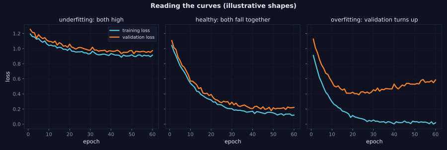

> Tier 4 · Training & Optimization · **Level: beginner** · Reading time: about 8 minutes

# 4.35 Training curves

**Metadata** — Tier: 4 · Phase: 1 · Priority: P0 · Difficulty: 2/5 · Interview: High · Hands-on: Very high
Prerequisites: 4.1 Training loop, 4.3 Loss · Leads to: 4.36 Validation curves, 4.39 Loss debugging

> **In plain words**
> A **training curve** is a plot of the **training loss over time**. It is the first thing to look at and the dashboard of the whole run. A healthy curve falls fast, then slowly, then flattens. Spikes, plateaus, a curve that goes up, or a flat line at the starting value each point to a different problem. Learning to read it is the cheapest debugging skill in deep learning.

**You need first:** 4.1 Training loop, 4.3 Loss.

> **Figure 4.35-1 — three typical shapes (with validation, preview of 4.36)**
>
> 
>
> *How to read it:* each panel plots training loss (blue) and validation loss (orange). **Left:** both are high and flat; the model is too weak or the learning rate/optimization is failing. **Middle:** both fall together and level off; healthy. **Right:** training loss keeps falling while validation turns up; the model is memorizing (overfitting). The shapes are illustrative (synthetic curves), not from a real run.
>
> *Generated by* `tier-04-training-optimization/figures/src/t4_figures.py`.

**Words you'll meet on this page**

| Word | What it means here |
|---|---|
| training curve | training loss versus step or epoch |
| plateau | a flat stretch with no improvement |
| spike | a sudden jump up in the loss |
| smoothing (EMA) | averaging to see the trend through noise |
| log scale | an axis where equal ratios are equal distances |
| converged | the curve has flattened at a low value |
| learning-curve diagnosis | reading shapes to find causes |

### 1. What is it?
The record of the loss (and other metrics) at each logged step, plotted over steps or epochs.

### 2. Why does it exist?
The loss is the only continuous signal from a run that can take days. Its shape tells you whether the model is learning, how fast, and whether something broke.

### 3. Detailed explanation
- **Healthy:** a steep early drop, a long tail of slow improvement, small noise; with a schedule, a visible improvement as the learning rate decays (4.12).
- **Noisy:** small batches and high learning rates give a jittery curve. **Smooth** it with a moving average or EMA for reading, but keep the raw data for spikes (code ②).
- **Flat at the starting value** (for example `ln K` for K-class cross-entropy, 4.3): not learning. Check the learning rate, the labels, that gradients flow (4.37), the optimizer got all parameters (4.29) and that you called `zero_grad`/`step`.
- **Falls then rises / diverges:** learning rate too high, or exploding gradients (3.26, 4.15).
- **Spikes then recovery:** bad batches, learning-rate warm-up missing (4.11), low-precision overflow (4.38).
- **Plateaus then drops:** typical with schedules and sometimes real "grokking"-like phases (REVIEW_REQUIRED).
- **Staircase pattern:** epoch-level effects (the same data order repeating) or step decay.
- **Log axes:** use a log scale for the loss or learning rate when values span orders of magnitude.
- **Compare to a baseline:** the loss of predicting the mean/majority class, or of a tiny model.
- **Always plot validation next to it** (4.36); the gap diagnoses over/underfitting.
- **Log also:** learning rate, gradient norm, throughput. Tools: TensorBoard, Weights & Biases, MLflow (Tier 15).
- **Unit of the x-axis:** steps or tokens seen, not wall-clock time; compare runs at equal data seen.

### 4. How does it work?
Append `(step, loss)` after each (or every k-th) step; plot; read the shape.

### 5. Simple example
A weight-loss chart: a quick drop at first, then slow progress, then a plateau. A chart that never moves, or jumps up and down wildly, means something is off with the plan.

**By hand.** Losses `[2.3, 2.3, 2.3, 2.3]` for a 10-class problem: stuck at `ln 10 = 2.30`, learning nothing.

### 6. Technical example
LLM pre-training dashboards plot loss vs tokens on log–log axes; smooth power-law decline is expected, with occasional spikes investigated (REVIEW_REQUIRED).

### 7. Code
**① By hand (plain Python).** Classify a curve from its numbers.

```python
def diagnose(losses, start_value=2.3026):
    first, last = losses[0], losses[-1]
    if last > first * 1.5:
        return "diverging: loss grew"
    if abs(last - start_value) < 0.05:
        return "stuck at the chance level: not learning"
    if last < first * 0.5:
        return "learning"
    return "barely improving"

print(diagnose([2.30, 2.30, 2.31, 2.30]))
print(diagnose([2.3, 1.4, 0.9, 0.6, 0.5]))
print(diagnose([1.0, 1.5, 3.0, 9.0]))
```

```text
stuck at the chance level: not learning
learning
diverging: loss grew
```

**② With NumPy.** Smoothing a noisy curve with an EMA.

```python
import numpy as np

rng = np.random.default_rng(0)
steps = np.arange(300)
raw = 0.2 + 2.0 * np.exp(-steps / 60) + 0.15 * rng.normal(size=300)
ema, beta = [raw[0]], 0.95
for v in raw[1:]:
    ema.append(beta * ema[-1] + (1 - beta) * v)
ema = np.array(ema)
print("raw: std of step-to-step changes =", np.diff(raw).std().round(3), "   smoothed:", np.diff(ema).std().round(3))
print("raw loss at step 299 =", raw[-1].round(3), "   smoothed =", ema[-1].round(3), "   true value 0.2")
```

```text
raw: std of step-to-step changes = 0.213    smoothed: 0.01
raw loss at step 299 = 0.339    smoothed = 0.185    true value 0.2
```

**③ With PyTorch.** Log a real run and read it.

```python
import torch

torch.manual_seed(0)
X = torch.randn(512, 10); y = (X[:, 0] + X[:, 1] > 0).long()
curves = {}
for name, lr in (("lr 0.0001 (too small)", 1e-4), ("lr 0.05 (good)", 0.05), ("lr 20 (too large)", 20.0)):
    torch.manual_seed(1)
    net = torch.nn.Sequential(torch.nn.Linear(10, 16), torch.nn.ReLU(), torch.nn.Linear(16, 2))
    opt = torch.optim.SGD(net.parameters(), lr=lr)
    losses = []
    for _ in range(100):
        opt.zero_grad(); loss = torch.nn.functional.cross_entropy(net(X), y); loss.backward(); opt.step(); losses.append(loss.item())
    curves[name] = losses
    print(f"{name:<22}: loss {losses[0]:.3f} -> {losses[-1]:.3g}   largest loss seen {max(losses):.3g}")
```

```text
lr 0.0001 (too small) : loss 0.761 -> 0.76   largest loss seen 0.761
lr 0.05 (good)        : loss 0.761 -> 0.399   largest loss seen 0.761
lr 20 (too large)     : loss 0.761 -> 0.643   largest loss seen 4.12e+07
```

### 8. Input → Process → Output
`logged (step, loss) → plot (smoothed + raw) → diagnose the shape`

<details>
<summary><b>Beyond the basics (sections 9–16)</b> — real-world use, limits, mistakes. Skip on a first read.</summary>

### 9. Enterprise use case
Dashboards and alerts on loss spikes and plateaus protect expensive runs.

### 10. AI engineering connection
Scaling-law work plots loss against compute/tokens; LLM runs watch for loss spikes.

### 11. Advantages
Cheap, universal, immediately informative.

### 12. Limitations
The loss alone doesn't say whether the model is useful; noise hides trends; different runs aren't directly comparable if data differ.

### 13. Trade-offs
Logging every step costs I/O; log every N steps and average.

### 14. Common mistakes
Judging from a noisy curve; plotting only training loss; comparing runs with different batch sizes at the same step count; ignoring the starting value check.

### 15. Performance / cost
Log asynchronously; store `loss.item()` not tensors.

### 16. Security
Dashboards can leak experiment details; restrict access.

</details>

### 17. Interview explanation
"I plot training and validation loss, smoothed and raw, plus learning rate and gradient norm. A healthy run drops quickly then flattens; a flat line at ln K means no learning; spikes point to bad batches, missing warm-up or overflow; divergence means too high a learning rate. The train/validation gap tells me about over- and underfitting."

### 18. Rapid-fire answer
Plot loss (raw + smoothed) vs steps; healthy = fast drop then flatten; flat at chance = not learning; spikes/divergence = lr, overflow, data.

### 19. Interview questions
- **Basic:** What does a healthy training curve look like?
- **Intermediate:** The loss is stuck at 2.30 for a 10-class task. What do you check?
- **Advanced:** What causes periodic spikes in LLM pre-training?
- **Scenario:** Two runs have the same final loss but one curve is much noisier. What does it imply?

### 20. Hands-on exercise
**Goal:** pick the best learning rate from curves.

1. Train the model of code ③ for lr in 0.001, 0.01, 0.1, 1.0.
2. Record the loss after 100 steps for each.
3. Which lr is best? Which diverge or crawl?

<details>
<summary>Show a solution</summary>

```python
import torch

torch.manual_seed(0)
X = torch.randn(512, 10); y = (X[:, 0] + X[:, 1] > 0).long()
for lr in (0.001, 0.01, 0.1, 1.0):
    torch.manual_seed(1)
    net = torch.nn.Sequential(torch.nn.Linear(10, 16), torch.nn.ReLU(), torch.nn.Linear(16, 2))
    opt = torch.optim.SGD(net.parameters(), lr=lr)
    for _ in range(100):
        opt.zero_grad(); loss = torch.nn.functional.cross_entropy(net(X), y); loss.backward(); opt.step()
    print(f"lr {lr:>5}: loss after 100 steps = {loss.item():.4f}")
```

```text
lr 0.001: loss after 100 steps = 0.7462
lr  0.01: loss after 100 steps = 0.6597
lr   0.1: loss after 100 steps = 0.2015
lr   1.0: loss after 100 steps = 0.0288
```

</details>

### 21. Revision questions
1. What does a flat line at `ln K` mean?
2. Why smooth, and why keep the raw curve?
3. Why plot validation too?

### 22. Related concepts
4.3 Loss · 4.10 Scheduling · 4.36 Validation curves · 4.37 Gradient monitoring · 4.39 Loss debugging

### 23. One-line memory hook
**Training curve: the heartbeat of the run; learn to read its rhythm.**

<details>
<summary><b>For reviewers</b> (not part of the lesson)</summary>

- Status: DRAFT, learner-first layout (Author: Claude). Code is executed by `tests/test_md_snippets.py`.
- Figure 4.35-1 uses synthetic illustrative curves (stated in its caption), not measured runs. REVIEW_REQUIRED: LLM-loss and grokking remarks.
</details>
