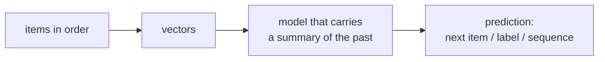

> Tier 5 · Sequence Models · **Level: absolute beginner** · Reading time: about 8 minutes

# 5.1 Sequential data

**Metadata** — Tier: 5 · Phase: 1 · Priority: P0 · Difficulty: 1/5 · Interview: Medium · Hands-on: High
Prerequisites: 1.2 Vectors, 2.13 Train/test split · Leads to: 5.2 Language as sequence, 5.10 RNN

> **In plain words**
> **Sequential data** is data where **the order matters**: a sentence, a stock price over time, a song, a sequence of clicks. Shuffle the items of a sentence and the meaning is gone. Ordinary models (Tier 2–3) treat every example as an independent row; sequence models read the items **one after another and remember what came before**.

**You need first:** 1.2 Vectors, 2.13 Train/test split.

> **Figure 5.1-1 — what makes data sequential**
>
> ```mermaid
> flowchart LR
>     A["x₁"] --> B["x₂"] --> C["x₃"] --> D["x₄"] --> E["…"]
>     A -. "depends on" .-> B
>     B -. "depends on" .-> C
> ```
>
> *How to read it:* the items come in a fixed order, and each item is related to the ones before it. The task decides what we predict: the next item (language model), a label for the whole sequence (sentiment), a label per item (tagging) or another sequence (translation).

**Words you'll meet on this page**

| Word | What it means here |
|---|---|
| sequence | an ordered list of items `x₁, x₂, …, x_T` |
| time step | the position `t` in the sequence |
| window | a short slice of consecutive items |
| autocorrelation | how similar a series is to a shifted copy of itself |
| variable length | different sequences have different `T` |
| causal / look-back | using only the past to predict the future |
| stationarity | the statistics do not change over time |

### 1. What is it?
Data in which each item has a position and its meaning depends on the items around it. Examples: text (words/characters), audio (samples), time series (temperature each hour), events (user clicks), DNA (bases), video (frames).

### 2. Why does it exist?
Many real problems are not bags of independent numbers. To predict the next word you must know the previous words. A model that ignores order throws away the main signal.

### 3. Detailed explanation
- **Order carries information.** If shuffling the data does not change the model's performance, the data was not really sequential (code ②).
- **Common tasks:** next-item prediction (language modelling, forecasting), sequence classification (spam, sentiment), sequence labelling (part-of-speech tags), sequence-to-sequence (translation, summarization).
- **Variable length.** Sentences have 3 or 300 words. Models handle this by reading one step at a time (RNNs, 5.10) or with padding and masks (Transformers, Tier 7). Batches are padded to the longest sequence (4.26).
- **Windows.** The simplest approach: cut the sequence into fixed windows `(x_{t-k}, …, x_{t-1}) → x_t` and use an ordinary model. It works for short memory but cannot see beyond `k` steps (code ①).
- **Time-series cautions.** Split by time, never randomly (2.13, 2.33); watch for trends and seasonality; normalise using only past statistics.
- **Dependencies have different ranges.** In "the keys, which I left in the kitchen, **are** missing" the verb agrees with a word several steps back. This long-range dependency is the central difficulty of Tier 5.
- **Causal versus bidirectional.** Predicting the next item allows only the past; classifying a finished sentence may use both directions (5.10+).
- **Representation first.** Items must be numbers: text becomes token ids and vectors (5.2–5.9, and in depth Tier 6).
- **Evaluation.** Compare with simple baselines: repeat the last value, a moving average, or the most frequent next item.

### 4. How does it work?
Represent each item as a vector; process the items in order, carrying a summary of the past; produce a prediction at the end or at each step.



### 5. Simple example
Reading a sentence: "I went to the bank to deposit money." You understand "bank" from the words before and after it. A single word in isolation is ambiguous.

**By hand.** Temperatures `[20, 21, 23, 22, 24]`. With a window of 2 the training pairs are `([20, 21] → 23)`, `([21, 23] → 22)`, `([23, 22] → 24)`.

### 6. Technical example
Predicting the next day's demand from the last 28 days of sales, or the next token of a prompt from the previous tokens.

### 7. Code
**① By hand (plain Python).** Turn a series into (window → next value) training pairs, and a baseline.

```python
series = [20, 21, 23, 22, 24, 26, 25, 27]
k = 3
pairs = [(series[i:i + k], series[i + k]) for i in range(len(series) - k)]
for window, target in pairs:
    print(window, "->", target)
errors = [abs(w[-1] - t) for w, t in pairs]                      # baseline: "tomorrow equals today"
print("baseline (repeat the last value) mean absolute error:", round(sum(errors) / len(errors), 2))
```

```text
[20, 21, 23] -> 22
[21, 23, 22] -> 24
[23, 22, 24] -> 26
[22, 24, 26] -> 25
[24, 26, 25] -> 27
baseline (repeat the last value) mean absolute error: 1.6
```

**② With NumPy.** Order carries information: shuffling destroys the predictability.

```python
import numpy as np

rng = np.random.default_rng(0)
t = np.arange(400)
series = np.sin(t / 8) + 0.1 * rng.normal(size=400)               # a smooth signal with a little noise

def next_value_error(s):
    return np.mean(np.abs(s[1:] - s[:-1]))                        # error of "predict the previous value"

shuffled = rng.permutation(series)
print("repeat-last error, original order:", round(next_value_error(series), 3))
print("repeat-last error, shuffled order:", round(next_value_error(shuffled), 3))
lag1 = np.corrcoef(series[:-1], series[1:])[0, 1]
lag1_shuffled = np.corrcoef(shuffled[:-1], shuffled[1:])[0, 1]
print("lag-1 autocorrelation: original", round(lag1, 2), "  shuffled", round(lag1_shuffled, 2))
```

```text
repeat-last error, original order: 0.133
repeat-last error, shuffled order: 0.808
lag-1 autocorrelation: original 0.97   shuffled 0.03
```

**③ With PyTorch.** A window dataset and a batch of padded variable-length sequences.

```python
import torch
from torch.nn.utils.rnn import pad_sequence

series = torch.arange(10, dtype=torch.float32)
k = 3
X = series.unfold(0, k, 1)[:-1]                                    # windows of length 3
y = series[k:]
print("windows shape:", tuple(X.shape), "  targets shape:", tuple(y.shape))
print("first window and target:", X[0].tolist(), "->", y[0].item())

sentences = [torch.tensor([4, 8, 15]), torch.tensor([16, 23]), torch.tensor([42, 7, 9, 1])]
batch = pad_sequence(sentences, batch_first=True, padding_value=0)
lengths = torch.tensor([len(s) for s in sentences])
print("padded batch:\n", batch.tolist())
print("true lengths:", lengths.tolist())
```

```text
windows shape: (7, 3)   targets shape: (7,)
first window and target: [0.0, 1.0, 2.0] -> 3.0
padded batch:
 [[4, 8, 15, 0], [16, 23, 0, 0], [42, 7, 9, 1]]
true lengths: [3, 2, 4]
```

### 8. Input → Process → Output
`ordered items → vectors → model that remembers the past → prediction`

<details>
<summary><b>Beyond the basics (sections 9–16)</b> — real-world use, limits, mistakes. Skip on a first read.</summary>

### 9. Enterprise use case
Demand forecasting, log anomaly detection, predictive maintenance, fraud detection from transaction sequences, customer-journey models.

### 10. AI engineering connection
LLM prompts, conversation histories, tool-call traces and agent trajectories are all sequences; their length and order drive cost and quality (Tier 11).

### 11. Advantages
Captures structure that independent-row models cannot see.

### 12. Limitations
Longer sequences cost more; long-range dependencies are hard (5.13); order-sensitive data needs careful splitting.

### 13. Trade-offs
Longer windows give more context but more compute and more chance to overfit.

### 14. Common mistakes
Random train/test splits on time series; leaking future values into features; forgetting to mask padding; assuming order does not matter; comparing to no baseline.

### 15. Performance / cost
Pad as little as possible (bucket by length, 4.26).

### 16. Security
Sequences can carry sensitive histories (messages, locations); anonymize and limit retention.

</details>

### 17. Interview explanation
"Sequential data has meaningful order, so models must carry context from earlier items. I frame the task (next-item, classification, labelling or sequence-to-sequence), split by time to avoid leakage, handle variable length with padding and masks, and compare against a repeat-last baseline."

### 18. Rapid-fire answer
Order matters; tasks: next-item, classification, labelling, seq2seq; variable length → padding/masks; split by time; baseline = repeat last.

### 19. Interview questions
- **Basic:** Give three examples of sequential data.
- **Intermediate:** Why not randomly split a time series?
- **Advanced:** What is a long-range dependency and why is it hard?
- **Scenario:** Your forecast looks great offline but fails in production. What leakage might exist?

### 20. Hands-on exercise
**Goal:** check whether a series really depends on order.

1. Generate `x_t = 0.9·x_{t-1} + noise` for 500 steps.
2. Compute the lag-1 autocorrelation before and after shuffling.
3. Which window length `k` gives the lowest error for a linear next-value predictor (try 1, 2, 5)?

<details>
<summary>Show a solution</summary>

```python
import numpy as np

rng = np.random.default_rng(0)
x = np.zeros(500)
for t in range(1, 500):
    x[t] = 0.9 * x[t - 1] + rng.normal()
corr = lambda s: np.corrcoef(s[:-1], s[1:])[0, 1]
print("lag-1 autocorrelation:", round(corr(x), 2), "-> shuffled:", round(corr(rng.permutation(x)), 2))

for k in (1, 2, 5):
    X = np.stack([x[i:i + k] for i in range(len(x) - k)]); y = x[k:]
    w = np.linalg.lstsq(X[:350], y[:350], rcond=None)[0]
    print(f"window {k}: held-out mean squared error {np.mean((X[350:] @ w - y[350:]) ** 2):.3f}")
```

```text
lag-1 autocorrelation: 0.88 -> shuffled: 0.03
window 1: held-out mean squared error 1.066
window 2: held-out mean squared error 1.062
window 5: held-out mean squared error 1.048
```

A first-order process needs only the last value; longer windows add little.
</details>

### 21. Revision questions
1. What makes data sequential?
2. Name four sequence tasks.
3. Why pad and mask?

### 22. Related concepts
2.13 Train/test split · 2.33 Data leakage · 4.26 DataLoader · 5.2 Language as sequence · 5.10 RNN

### 23. One-line memory hook
**Sequential data: the order is part of the data.**

<details>
<summary><b>For reviewers</b> (not part of the lesson)</summary>

- Status: DRAFT, learner-first layout (Author: Claude). Code is executed by `tests/test_md_snippets.py`.
</details>
