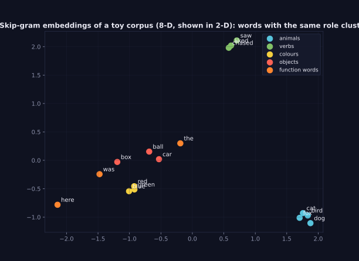
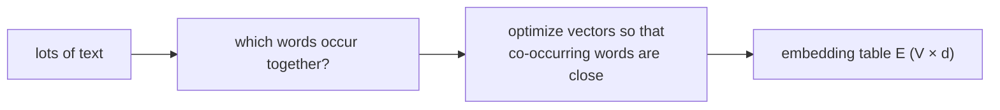

> Tier 5 · Sequence Models · **Level: beginner** · Reading time: about 10 minutes

# 5.4 Word embeddings

**Metadata** — Tier: 5 · Phase: 1 · Priority: P0 · Difficulty: 2/5 · Interview: Very high · Hands-on: High
Prerequisites: 1.10 Dot product, 1.12 Cosine similarity, 5.3 One-hot · Leads to: 5.5–5.9 (how to learn them), Tier 6 Embeddings

> **In plain words**
> A **word embedding** is a **short list of numbers (say 100)** that represents a word, learned so that **words used in similar ways get similar numbers**. "cat" and "dog" end up near each other; "cat" and "tax" end up far apart. Unlike one-hot vectors (5.3), embeddings are small, dense and **carry meaning as geometry**: distance, direction and similarity become measurable.

**You need first:** 1.10 Dot product, 1.12 Cosine similarity, 5.3 One-hot encoding.

> **Figure 5.4-1 — words as points**
>
> 
>
> *How to read it:* each dot is a word, placed by a small embedding learned from a tiny made-up corpus (squashed from 8 dimensions to 2 with PCA). Words that play the same role (animals, verbs, colours, objects) end up near one another, although nobody told the model about categories. It learned them only from which words appear near which.
>
> *Generated by* `tier-05-sequence-models/figures/src/t5_figures.py` from `code/seqmodels.py` (`skipgram`).

**Words you'll meet on this page**

| Word | What it means here |
|---|---|
| embedding | a dense vector standing for a token |
| dimension `d` | length of the vector (50–1024) |
| cosine similarity | angle-based similarity in `[−1, 1]` |
| distributional hypothesis | words used in similar contexts have similar meanings |
| analogy | vector arithmetic such as king − man + woman ≈ queen |
| pre-trained | learned in advance on large text |
| out-of-vocabulary (OOV) | a word not in the table |

### 1. What is it?
A matrix `E` of shape `(V, d)`. Row `i` is the embedding of word `i`; looking it up is `E[id]`.

### 2. Why does it exist?
One-hot vectors treat all words as unrelated (5.3). Embeddings let a model **share what it learned** about "cat" with "dog", use far fewer parameters, and compare words by similarity.

### 3. Detailed explanation
- **Distributional hypothesis.** "You shall know a word by the company it keeps." Words that appear in similar contexts have similar meanings. All embedding methods (5.5–5.9) turn this into an optimization problem.
- **Similarity.** Cosine similarity `cos(a, b) = a·b / (‖a‖‖b‖)`. Close to 1: similar; near 0: unrelated.
- **Directions can carry meaning.** In good embeddings the vector from "man" to "woman" resembles the one from "king" to "queen". This works for some relations and is less reliable than its fame suggests (REVIEW_REQUIRED).
- **Trained inside a model or beforehand.** `nn.Embedding` starts random and is trained with the task. Pre-trained embeddings (Word2Vec, GloVe, FastText) can be loaded as a starting point.
- **Static versus contextual.** These embeddings give one vector per word, so "bank" (river) and "bank" (money) share a vector. Contextual models (ELMo, BERT, GPT; Tier 8) compute a different vector per occurrence.
- **Dimension.** 50–300 for classic embeddings; 768–12,288 inside large models.
- **Bias.** Embeddings absorb stereotypes in the text they were trained on (Tier 15).
- **Count-based versus prediction-based.** Factorizing co-occurrence counts (LSA, GloVe 5.8) and training a predictor (Word2Vec 5.5) give similar results.
- **Evaluation.** Word-similarity benchmarks, analogy tests, and above all downstream task performance.
- **Tier 6** covers token and embedding design for modern models in depth.

### 4. How does it work?
Start with random vectors; adjust them so that words which co-occur have high dot products and unrelated pairs have low ones.



### 5. Simple example
GPS coordinates for words: just as latitude and longitude put nearby towns close together, an embedding puts words used in similar ways close together.

**By hand.** With 2-D vectors `cat = [1, 1]`, `dog = [1.2, 0.9]`, `tax = [−1, 0.3]`: `cos(cat, dog) = (1.2 + 0.9)/(1.414·1.5) ≈ 0.99`; `cos(cat, tax) = (−1 + 0.3)/(1.414·1.044) ≈ −0.47`.

### 6. Technical example
`nn.Embedding(vocab_size, 4096)` is the first layer of an LLM: token ids → vectors that the Transformer then refines.

### 7. Code
**① By hand (plain Python).** Cosine similarity of hand-made vectors.

```python
import math

emb = {"cat": [1.0, 1.0], "dog": [1.2, 0.9], "tax": [-1.0, 0.3]}
def cosine(a, b):
    dot = sum(x * y for x, y in zip(a, b))
    return dot / (math.sqrt(sum(x * x for x in a)) * math.sqrt(sum(y * y for y in b)))

for a, b in (("cat", "dog"), ("cat", "tax")):
    print(f"cosine({a}, {b}) = {cosine(emb[a], emb[b]):.2f}")
```

```text
cosine(cat, dog) = 0.99
cosine(cat, tax) = -0.47
```

**② With NumPy.** Build embeddings from co-occurrence counts with an SVD (the idea behind LSA and GloVe).

```python
import numpy as np

sentences = [s.split() for s in (
    "the cat chased the mouse", "the dog chased the cat", "the cat liked the fish", "the dog liked the bone",
    "a red car was here", "a blue car was here", "a red ball was here", "a blue ball was here")]
vocab = sorted({w for s in sentences for w in s}); idx = {w: i for i, w in enumerate(vocab)}
C = np.zeros((len(vocab), len(vocab)))
for s in sentences:
    for i, w in enumerate(s):
        for j in range(max(0, i - 2), min(len(s), i + 3)):
            if j != i:
                C[idx[w], idx[s[j]]] += 1
U, S, Vt = np.linalg.svd(np.log1p(C))
E = U[:, :3] * S[:3]                                                     # 3-dimensional embeddings
E = E / np.linalg.norm(E, axis=1, keepdims=True)
sim = lambda a, b: float(E[idx[a]] @ E[idx[b]])
print(f"cat ~ dog  : {sim('cat', 'dog'):.2f}   (same role)")
print(f"red ~ blue : {sim('red', 'blue'):.2f}   (same role)")
print(f"cat ~ blue : {sim('cat', 'blue'):.2f}   (different roles)")
```

```text
cat ~ dog  : 1.00   (same role)
red ~ blue : 1.00   (same role)
cat ~ blue : 0.00   (different roles)
```

**③ With PyTorch.** An `nn.Embedding` table, its shape, and which rows receive gradients.

```python
import torch

torch.manual_seed(0)
emb = torch.nn.Embedding(num_embeddings=1000, embedding_dim=50)
ids = torch.tensor([[3, 7, 7, 42]])
vectors = emb(ids)
print("input ids shape:", tuple(ids.shape), "-> vectors shape:", tuple(vectors.shape), "  table parameters:", emb.weight.numel())
vectors.sum().backward()
touched = (emb.weight.grad.abs().sum(dim=1) > 0).nonzero().flatten().tolist()
print("rows that received a gradient:", touched, "(only the words that appeared)")
print("row 7 was used twice, so its gradient is twice as large:", torch.allclose(emb.weight.grad[7], 2 * emb.weight.grad[3]))
```

```text
input ids shape: (1, 4) -> vectors shape: (1, 4, 50)   table parameters: 50000
rows that received a gradient: [3, 7, 42] (only the words that appeared)
row 7 was used twice, so its gradient is twice as large: True
```

### 8. Input → Process → Output
`token id → row of the embedding table → dense vector`

<details>
<summary><b>Beyond the basics (sections 9–16)</b> — real-world use, limits, mistakes. Skip on a first read.</summary>

### 9. Enterprise use case
Semantic search, recommendation (item embeddings), duplicate detection, clustering of support tickets.

### 10. AI engineering connection
Every LLM starts with an embedding table; retrieval systems (RAG) use sentence embeddings and vector databases (Tier 17+).

### 11. Advantages
Compact, similarity-aware, transferable.

### 12. Limitations
One vector per word (no context); biases; out-of-vocabulary words; quality depends on data.

### 13. Trade-offs
Larger `d` captures more but costs memory and may overfit.

### 14. Common mistakes
Fine-tuning pre-trained embeddings with a huge learning rate; mismatched vocabularies; trusting analogies as facts; ignoring embedding bias.

### 15. Performance / cost
Embedding tables can hold most of the parameters of small models (`V × d`).

### 16. Security
Embeddings can leak information about training text; treat embedding stores as sensitive.

</details>

### 17. Interview explanation
"An embedding maps each token to a dense learned vector so that tokens used in similar contexts are close, usually measured by cosine similarity. It is a lookup into a `V × d` matrix, trained either inside the task model or beforehand with Word2Vec/GloVe-style objectives; static embeddings give one vector per word, contextual models give one per occurrence."

### 18. Rapid-fire answer
Dense vector per token from a `V × d` table; trained so that words in similar contexts are close; cosine similarity; static vs contextual.

### 19. Interview questions
- **Basic:** Why embeddings instead of one-hot?
- **Intermediate:** What is the distributional hypothesis?
- **Advanced:** Why can't static embeddings handle polysemy?
- **Scenario:** Your search returns documents with the opposite meaning because of similar words. Why, and what do you do?

### 20. Hands-on exercise
**Goal:** nearest neighbours by cosine.

1. Use the co-occurrence embeddings of code ② (3-D).
2. For the word "cat", print the 3 most similar other words.

<details>
<summary>Show a solution</summary>

```python
import numpy as np

sentences = [s.split() for s in (
    "the cat chased the mouse", "the dog chased the cat", "the cat liked the fish", "the dog liked the bone",
    "a red car was here", "a blue car was here", "a red ball was here", "a blue ball was here")]
vocab = sorted({w for s in sentences for w in s}); idx = {w: i for i, w in enumerate(vocab)}
C = np.zeros((len(vocab), len(vocab)))
for s in sentences:
    for i, w in enumerate(s):
        for j in range(max(0, i - 2), min(len(s), i + 3)):
            if j != i:
                C[idx[w], idx[s[j]]] += 1
U, S, Vt = np.linalg.svd(np.log1p(C)); E = U[:, :3] * S[:3]; E = E / np.linalg.norm(E, axis=1, keepdims=True)
scores = E @ E[idx["cat"]]
order = [vocab[i] for i in np.argsort(-scores) if vocab[i] != "cat"][:3]
print("nearest to 'cat':", order)
```

```text
nearest to 'cat': ['mouse', 'bone', 'fish']
```

</details>

### 21. Revision questions
1. What is the shape of an embedding table?
2. What is the distributional hypothesis?
3. Static versus contextual embeddings?

### 22. Related concepts
1.12 Cosine similarity · 5.3 One-hot · 5.5 Word2Vec · 5.8 GloVe · Tier 6 Tokenization & Embeddings

### 23. One-line memory hook
**Embedding: a word's coordinates in meaning-space, learned from the company it keeps.**

<details>
<summary><b>For reviewers</b> (not part of the lesson)</summary>

- Status: DRAFT, learner-first layout (Author: Claude). Code is executed by `tests/test_md_snippets.py`.
- REVIEW_REQUIRED: reliability of analogies; ELMo/BERT/GPT mentions. The figure uses a tiny synthetic corpus (stated in the caption).
</details>
