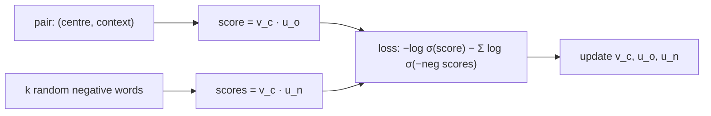

> Tier 5 · Sequence Models · **Level: intermediate** · Reading time: about 11 minutes

# 5.5 Word2Vec

**Metadata** — Tier: 5 · Phase: 1 · Priority: P0 · Difficulty: 3/5 · Interview: Very high · Hands-on: High
Prerequisites: 5.4 Word embeddings, 1.36 Sigmoid/logistic · Leads to: 5.6 CBOW, 5.7 Skip-gram

> **In plain words**
> **Word2Vec** (Mikolov et al., 2013) learns word embeddings by playing a simple game over and over: **predict which words appear near a given word**. It has two versions, CBOW (guess the middle word from its neighbours, 5.6) and skip-gram (guess the neighbours from the middle word, 5.7). The embedding table is a by-product of the game. It is fast because it replaces the huge softmax over the whole vocabulary with a cheap trick, **negative sampling**.

**You need first:** 5.4 Word embeddings, 1.36 Sigmoid.

> **Figure 5.5-1 — what Word2Vec learns from a toy corpus**
>
> 
>
> *How to read it:* these 8-dimensional skip-gram vectors (projected to 2-D) were trained on a made-up corpus with only a few sentence patterns. Words that appear in the same slots of the same patterns (the four animals, the three verbs, the colours, the objects) cluster together. Real Word2Vec does the same with billions of words.
>
> *Generated by* `tier-05-sequence-models/figures/src/t5_figures.py`.

**Words you'll meet on this page**

| Word | What it means here |
|---|---|
| centre word / context word | the word we look at / a neighbour within the window |
| window | how many words on each side count as context |
| input vs output vectors | each word has two vectors; the input ones are the embeddings |
| negative sampling | learn to tell real neighbours from random words |
| softmax over the vocabulary | the expensive alternative (cost ∝ V) |
| subsampling | randomly dropping very frequent words |
| epoch | one pass over all (centre, context) pairs |

### 1. What is it?
A family of shallow models that learn one dense vector per word by predicting words from their contexts, trained with stochastic gradient descent.

### 2. Why does it exist?
Earlier neural language models learned embeddings but were slow. Word2Vec showed that a very simple, very fast objective on huge text produces embeddings that capture similarity and some analogies.

### 3. Detailed explanation
- **Training pairs.** Slide a window over the text. For "the cat sat on the mat" with window 2 and centre "sat": pairs `(sat, the), (sat, cat), (sat, on), (sat, the)`.
- **Two matrices.** `W_in` (embeddings) and `W_out` (output vectors), both `V × d`. A pair `(c, o)` is scored by `W_in[c] · W_out[o]`.
- **Full softmax is too slow.** `P(o | c) = exp(u_o·v_c)/Σ_w exp(u_w·v_c)` needs a sum over `V` (100,000+) words per example.
- **Negative sampling.** Turn it into binary classification: the true pair `(c, o)` should score high (label 1), and `k` random words `n` paired with `c` should score low (label 0). Loss: `−log σ(u_o·v_c) − Σ_n log σ(−u_n·v_c)`. Cost per example ∝ `k + 1`, not `V` (code ②).
- **Noise distribution.** Negatives are drawn from the unigram frequency raised to the power 0.75 (flattens frequent words).
- **Subsampling frequent words** ("the", "of") speeds training and improves rare-word vectors.
- **Hyperparameters.** Dimension 100–300, window 2–10, negatives 5–20, several epochs.
- **Result.** The final embeddings are `W_in` (sometimes averaged with `W_out`).
- **Relation to matrix factorization.** Skip-gram with negative sampling implicitly factorizes a shifted PMI co-occurrence matrix (Levy & Goldberg, 2014; REVIEW_REQUIRED), tying it to GloVe (5.8).
- **Limits.** One vector per word (no polysemy); no subword information (FastText, 5.9); needs lots of text.

### 4. How does it work?
For each (centre, context) pair: pull the centre's input vector toward the true context's output vector and push it away from a few random words' output vectors.



### 5. Simple example
Learning who sits next to whom at a dinner party. You are told some real neighbours ("cat sat next to dog") and shown random mismatches ("cat is not next to tax"). Over many parties you learn that cats and dogs have similar seating patterns.

**By hand.** One pair with `v_c·u_o = 2`: `σ(2) = 0.88`, loss `−log 0.88 = 0.13`. A random negative with score 1: `σ(−1) = 0.27`, loss `−log 0.27 = 1.3`; the gradient pushes that score down.

### 6. Technical example
Training on 100 billion words of news with dimension 300, window 5 and 5 negatives gave the original Google News vectors (REVIEW_REQUIRED: quoted figures).

### 7. Code
**① By hand (plain Python).** Generate the training pairs.

```python
sentence = "the cat sat on the mat".split()
window = 2
pairs = []
for i, centre in enumerate(sentence):
    for j in range(max(0, i - window), min(len(sentence), i + window + 1)):
        if j != i:
            pairs.append((centre, sentence[j]))
print("number of (centre, context) pairs:", len(pairs))
print("pairs for 'sat':", [p for p in pairs if p[0] == "sat"])
```

```text
number of (centre, context) pairs: 18
pairs for 'sat': [('sat', 'the'), ('sat', 'cat'), ('sat', 'on'), ('sat', 'the')]
```

**② With NumPy.** Skip-gram with negative sampling, from scratch.

```python
import numpy as np

def sentences(n=120, seed=0):
    rng = np.random.default_rng(seed); A = ["cat", "dog", "bird", "fox"]; V = ["saw", "chased", "liked"]; C = ["red", "blue", "green"]; O = ["car", "ball", "box"]
    out = []
    for _ in range(n):
        out.append(["the", A[rng.integers(4)], V[rng.integers(3)], "the", A[rng.integers(4)]])
        out.append(["the", C[rng.integers(3)], O[rng.integers(3)], "was", "here"])
    return out

sig = lambda x: 1 / (1 + np.exp(-x))
data = sentences(); vocab = sorted({w for s in data for w in s}); idx = {w: i for i, w in enumerate(vocab)}; V = len(vocab)
rng = np.random.default_rng(0)
W_in, W_out = rng.normal(0, 0.1, (V, 8)), np.zeros((V, 8))
pairs = [(idx[s[i]], idx[s[j]]) for s in data for i in range(len(s)) for j in range(max(0, i - 2), min(len(s), i + 3)) if j != i]
for epoch in range(30):
    for k in rng.permutation(len(pairs)):
        c, o = pairs[k]
        for label, j in [(1.0, o)] + [(0.0, int(n)) for n in rng.integers(0, V, 5) if n != o]:
            g = (sig(W_in[c] @ W_out[j]) - label) * 0.05
            W_in[c], W_out[j] = W_in[c] - g * W_out[j], W_out[j] - g * W_in[c]
E = W_in / np.linalg.norm(W_in, axis=1, keepdims=True)
sim = lambda a, b: float(E[idx[a]] @ E[idx[b]])
print(f"cat ~ dog   {sim('cat', 'dog'):5.2f}    red ~ blue {sim('red', 'blue'):5.2f}    saw ~ chased {sim('saw', 'chased'):5.2f}")
print(f"cat ~ red   {sim('cat', 'red'):5.2f}    saw ~ car  {sim('saw', 'car'):5.2f}    dog ~ ball   {sim('dog', 'ball'):5.2f}")
```

```text
cat ~ dog    0.96    red ~ blue  0.96    saw ~ chased  0.96
cat ~ red    0.45    saw ~ car   0.37    dog ~ ball    0.42
```

**③ With PyTorch.** The same model with `nn.Embedding` and autograd.

```python
import numpy as np
import torch

def sentences(n=120, seed=0):
    rng = np.random.default_rng(seed); A = ["cat", "dog", "bird", "fox"]; V = ["saw", "chased", "liked"]; C = ["red", "blue", "green"]; O = ["car", "ball", "box"]
    out = []
    for _ in range(n):
        out.append(["the", A[rng.integers(4)], V[rng.integers(3)], "the", A[rng.integers(4)]])
        out.append(["the", C[rng.integers(3)], O[rng.integers(3)], "was", "here"])
    return out

torch.manual_seed(0)
data = sentences(); vocab = sorted({w for s in data for w in s}); idx = {w: i for i, w in enumerate(vocab)}; V = len(vocab)
pairs = torch.tensor([(idx[s[i]], idx[s[j]]) for s in data for i in range(len(s)) for j in range(max(0, i - 2), min(len(s), i + 3)) if j != i])
emb_in, emb_out = torch.nn.Embedding(V, 8), torch.nn.Embedding(V, 8)
torch.nn.init.normal_(emb_in.weight, 0, 0.1); torch.nn.init.zeros_(emb_out.weight)       # output vectors start at zero, as in the original Word2Vec
opt = torch.optim.Adam(list(emb_in.parameters()) + list(emb_out.parameters()), lr=0.02)
for epoch in range(150):
    c, o = pairs[:, 0], pairs[:, 1]
    neg = torch.randint(0, V, (len(pairs), 5))
    pos_score = (emb_in(c) * emb_out(o)).sum(-1)
    neg_score = (emb_in(c)[:, None] * emb_out(neg)).sum(-1)
    loss = -(torch.nn.functional.logsigmoid(pos_score).mean() + torch.nn.functional.logsigmoid(-neg_score).sum(-1).mean())
    opt.zero_grad(); loss.backward(); opt.step()
E = torch.nn.functional.normalize(emb_in.weight.detach(), dim=1)
cos = lambda a, b: round((E[idx[a]] @ E[idx[b]]).item(), 2)
print(f"final loss {loss.item():.3f}")
print("cat ~ dog:", cos("cat", "dog"), "   red ~ blue:", cos("red", "blue"), "   cat ~ red:", cos("cat", "red"), "   dog ~ ball:", cos("dog", "ball"))
```

```text
final loss 1.858
cat ~ dog: 1.0    red ~ blue: 0.99    cat ~ red: 0.59    dog ~ ball: 0.22
```

### 8. Input → Process → Output
`text → (centre, context) pairs → score real vs random pairs → learned embedding table`

<details>
<summary><b>Beyond the basics (sections 9–16)</b> — real-world use, limits, mistakes. Skip on a first read.</summary>

### 9. Enterprise use case
Domain-specific embeddings (legal, medical text) for search and clustering; product embeddings from purchase sequences ("item2vec").

### 10. AI engineering connection
The idea of learning representations by predicting context underlies BERT and GPT; embeddings are still used for cheap similarity search.

### 11. Advantages
Fast, simple, scalable; good similarity structure.

### 12. Limitations
No context sensitivity; no subword information; needs a lot of text for good quality.

### 13. Trade-offs
Larger windows capture topic similarity; smaller windows capture syntactic similarity.

### 14. Common mistakes
Too few training epochs; ignoring frequent-word subsampling; evaluating only on analogies; using vectors trained on a different domain.

### 15. Performance / cost
Linear in the corpus size and in `(negatives + 1) × d` per pair.

### 16. Security
Trained vectors can reveal rare training strings; filter private text.

</details>

### 17. Interview explanation
"Word2Vec learns word vectors by predicting context words within a window. Instead of a full softmax over the vocabulary, negative sampling trains a logistic classifier to separate real context pairs from a few random pairs, which makes training cost independent of the vocabulary size. The input embedding matrix is the result."

### 18. Rapid-fire answer
Predict context words; two matrices (in/out); negative sampling loss `−log σ(u_o·v_c) − Σ log σ(−u_n·v_c)`; CBOW vs skip-gram; fast.

### 19. Interview questions
- **Basic:** What does Word2Vec optimize?
- **Intermediate:** Why negative sampling instead of a full softmax?
- **Advanced:** How is skip-gram with negative sampling related to matrix factorization?
- **Scenario:** Your embeddings place "good" and "bad" close together. Why?

### 20. Hands-on exercise
**Goal:** see how similarity structure appears during training.

1. Reuse the PyTorch code ③ (5 negatives) and stop after 2, 20 and 150 epochs.
2. Print the cosine of "cat"–"dog" (same role) and "cat"–"red" (different role) for each.

<details>
<summary>Show a solution</summary>

```python
import numpy as np
import torch

def sentences(n=120, seed=0):
    rng = np.random.default_rng(seed); A = ["cat", "dog", "bird", "fox"]; V = ["saw", "chased", "liked"]; C = ["red", "blue", "green"]; O = ["car", "ball", "box"]
    out = []
    for _ in range(n):
        out.append(["the", A[rng.integers(4)], V[rng.integers(3)], "the", A[rng.integers(4)]])
        out.append(["the", C[rng.integers(3)], O[rng.integers(3)], "was", "here"])
    return out

data = sentences(); vocab = sorted({w for s in data for w in s}); idx = {w: i for i, w in enumerate(vocab)}; V = len(vocab)
pairs = torch.tensor([(idx[s[i]], idx[s[j]]) for s in data for i in range(len(s)) for j in range(max(0, i - 2), min(len(s), i + 3)) if j != i])
for epochs in (2, 20, 150):
    torch.manual_seed(0)
    a, b = torch.nn.Embedding(V, 8), torch.nn.Embedding(V, 8)
    torch.nn.init.normal_(a.weight, 0, 0.1); torch.nn.init.zeros_(b.weight)
    opt = torch.optim.Adam(list(a.parameters()) + list(b.parameters()), lr=0.02)
    for _ in range(epochs):
        c, o = pairs[:, 0], pairs[:, 1]; neg = torch.randint(0, V, (len(pairs), 5))
        loss = -(torch.nn.functional.logsigmoid((a(c) * b(o)).sum(-1)).mean() + torch.nn.functional.logsigmoid(-(a(c)[:, None] * b(neg)).sum(-1)).sum(-1).mean())
        opt.zero_grad(); loss.backward(); opt.step()
    E = torch.nn.functional.normalize(a.weight.detach(), dim=1)
    print(f"{epochs:>3} epochs: cat~dog {(E[idx['cat']] @ E[idx['dog']]).item():.2f}   cat~red {(E[idx['cat']] @ E[idx['red']]).item():.2f}")
```

```text
  2 epochs: cat~dog 0.39   cat~red 0.21
 20 epochs: cat~dog 0.97   cat~red 0.95
150 epochs: cat~dog 1.00   cat~red 0.59
```

</details>

### 21. Revision questions
1. What are the training pairs?
2. What replaces the softmax?
3. Which matrix is the embedding?

### 22. Related concepts
5.4 Word embeddings · 5.6 CBOW · 5.7 Skip-gram · 5.8 GloVe · 5.9 FastText

### 23. One-line memory hook
**Word2Vec: learn a word by guessing its neighbours, and tell real neighbours from random ones.**

<details>
<summary><b>For reviewers</b> (not part of the lesson)</summary>

- Status: DRAFT, learner-first layout (Author: Claude). Code is executed by `tests/test_md_snippets.py`.
- TESTED earlier: `code/test_seqmodels.py::test_word2vec_puts_words_with_the_same_role_closer_together` (skip-gram and CBOW).
- REVIEW_REQUIRED: Mikolov et al. 2013 attribution, Google News figures, Levy & Goldberg 2014 relation.
</details>
