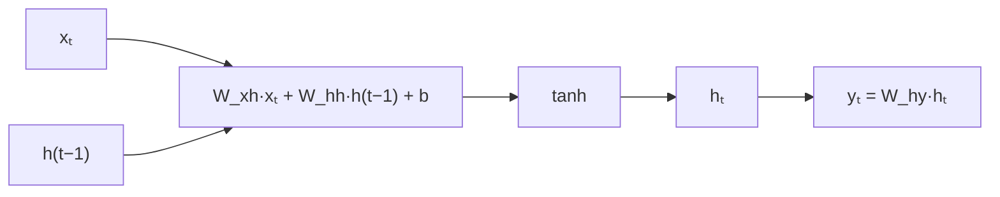

> Tier 5 · Sequence Models · **Level: beginner** · Reading time: about 10 minutes

# 5.10 Recurrent neural network (RNN)

**Metadata** — Tier: 5 · Phase: 1 · Priority: P0 · Difficulty: 2/5 · Interview: Very high · Hands-on: Very high
Prerequisites: 3.17 MLP, 5.1 Sequential data, 5.4 Embeddings · Leads to: 5.11 Hidden state, 5.12 BPTT, 5.14 LSTM

> **In plain words**
> An **RNN** reads a sequence **one item at a time** and keeps a small **memory vector** (the hidden state) that it updates at every step: new memory = a function of (the current input, the previous memory). The **same weights are reused at every step**, so one small network can read sequences of any length. At each step it can also make a prediction from its memory.
> It is like reading a sentence word by word while keeping a running mental summary.

**You need first:** 3.17 MLP, 5.1 Sequential data, 5.4 Word embeddings.

> **Figure 5.10-1 — an RNN, folded and unrolled**
>
> ```mermaid
> flowchart LR
>     subgraph unrolled["unrolled in time (same weights in every box)"]
>     h0["h₀ = 0"] --> A1["RNN cell"] --> h1["h₁"] --> A2["RNN cell"] --> h2["h₂"] --> A3["RNN cell"] --> h3["h₃"]
>     x1["x₁"] --> A1
>     x2["x₂"] --> A2
>     x3["x₃"] --> A3
>     A1 --> y1["y₁"]
>     A2 --> y2["y₂"]
>     A3 --> y3["y₃"]
>     end
> ```
>
> *How to read it:* time runs left to right. Each cell receives the current input `xₜ` and the previous memory `h_{t-1}` and produces the new memory `hₜ` and (optionally) an output `yₜ`. The three boxes are **one** cell applied three times, with identical weights.

**Words you'll meet on this page**

| Word | What it means here |
|---|---|
| hidden state `hₜ` | the memory vector after step `t` |
| cell | the function that updates the state |
| `W_xh`, `W_hh`, `W_hy` | input→hidden, hidden→hidden, hidden→output weights |
| unroll | draw the loop as a chain, one copy per time step |
| weight sharing | the same weights at every step |
| many-to-one / many-to-many | one prediction at the end / one per step |
| `tanh` | the squashing non-linearity inside the vanilla cell |

### 1. What is it?
A neural network with a loop: `hₜ = tanh(W_xh xₜ + W_hh h_{t-1} + b)`, `yₜ = W_hy hₜ + c`, with `h₀ = 0`.

### 2. Why does it exist?
Feed-forward networks need fixed-size input and have no memory. Windows (5.1) only see a fixed past. An RNN processes any length with a fixed number of parameters and, in principle, carries information from the whole past.

### 3. Detailed explanation
- **Parameters** do not depend on the sequence length: `d_in·H + H·H + H` for the cell (plus the output layer). Code ③ checks this count.
- **Unrolling.** To train, imagine the loop unrolled for `T` steps. It becomes a very deep feed-forward network with shared weights (backpropagation through time, 5.12).
- **Task shapes.** *Many-to-many* (tag every word, language modelling): output at each step. *Many-to-one* (sentiment): use the last state `h_T` (or a pooled state). *One-to-many* (caption generation): start from one input, feed outputs back. *Seq2seq* (5.21): encoder RNN then decoder RNN.
- **Language modelling.** Input token `xₜ`, target `x_{t+1}`; the output layer is a softmax over the vocabulary (5.2).
- **Why `tanh`?** It keeps the state in `[−1, 1]`, preventing the state from blowing up forward; ReLU variants exist but are harder to train (5.13).
- **Batching.** Tensors have shape `(batch, time, features)`; padding and masks handle different lengths (5.1).
- **Bidirectional RNNs** run a second RNN backwards and concatenate states (for tasks where the future is available, such as tagging).
- **Stacked RNNs** feed the sequence of states of layer 1 as input to layer 2.
- **Sequential bottleneck.** Step `t` needs step `t−1`, so training cannot be parallelized over time (5.26).
- **Memory is limited.** A vanilla RNN forgets quickly (5.13): the reason for LSTM and GRU (5.14, 5.19).
- **Weight initialization:** recurrent weights are often orthogonal or small so the state neither dies nor explodes (3.22).

### 4. How does it work?
Start with `h = 0`. For each input: mix it with the current memory through shared weights, squash with `tanh`, keep the result as the new memory, optionally predict.



### 5. Simple example
Reading a sentence with a notepad that you can rewrite after every word: the notepad has a fixed size, so you keep only what seems important.

**By hand.** Scalar RNN `h_t = tanh(0.5·x_t + 0.8·h_{t-1})`, inputs `1, 1, 0`: `h₁ = tanh(0.5) = 0.46`; `h₂ = tanh(0.5 + 0.8·0.46) = tanh(0.87) = 0.70`; `h₃ = tanh(0 + 0.8·0.70) = tanh(0.56) = 0.51`. The third state still remembers the first two inputs although the third input was 0.

### 6. Technical example
`nn.RNN(input_size=128, hidden_size=256, num_layers=2, batch_first=True, bidirectional=True)` for tagging; production NLP before 2018 used LSTMs and GRUs (5.14, 5.19).

### 7. Code
**① By hand (plain Python).** A scalar RNN over a short sequence.

```python
import math

w_x, w_h, b = 0.5, 0.8, 0.0
h = 0.0
for t, x in enumerate([1.0, 1.0, 0.0, 0.0, 0.0], start=1):
    h = math.tanh(w_x * x + w_h * h + b)
    print(f"step {t}: input {x}  hidden state {h:.3f}")
```

```text
step 1: input 1.0  hidden state 0.462
step 2: input 1.0  hidden state 0.701
step 3: input 0.0  hidden state 0.509
step 4: input 0.0  hidden state 0.386
step 5: input 0.0  hidden state 0.299
```

**② With NumPy.** A vector RNN cell run over a sequence, checked against PyTorch.

```python
import numpy as np
import torch

torch.manual_seed(0)
torch_rnn = torch.nn.RNN(input_size=3, hidden_size=5, batch_first=True)
x = torch.randn(1, 4, 3)
ref, _ = torch_rnn(x)

Wxh, Whh = torch_rnn.weight_ih_l0.detach().numpy(), torch_rnn.weight_hh_l0.detach().numpy()
b = (torch_rnn.bias_ih_l0 + torch_rnn.bias_hh_l0).detach().numpy()
h = np.zeros(5); states = []
for t in range(4):
    h = np.tanh(Wxh @ x[0, t].numpy() + Whh @ h + b)
    states.append(h)
print("hidden states shape (time, hidden):", np.array(states).shape)
print("matches torch.nn.RNN:", np.allclose(np.array(states), ref[0].detach().numpy(), atol=1e-6))
```

```text
hidden states shape (time, hidden): (4, 5)
matches torch.nn.RNN: True
```

**③ With PyTorch.** Shapes, outputs versus final state, and the parameter count.

```python
import torch

rnn = torch.nn.RNN(input_size=10, hidden_size=20, batch_first=True)
x = torch.randn(4, 7, 10)                                              # batch 4, 7 time steps, 10 features
out, h_n = rnn(x)
print("output (all steps):", tuple(out.shape), "  final hidden state:", tuple(h_n.shape))
print("last output equals final state:", torch.allclose(out[:, -1], h_n[0]))
params = sum(p.numel() for p in rnn.parameters())
print("parameters:", params, "  formula 10*20 + 20*20 + 2*20 =", 10 * 20 + 20 * 20 + 2 * 20)
long = rnn(torch.randn(4, 500, 10))[0]
print("the same weights read a 500-step sequence:", tuple(long.shape), "-> parameter count unchanged")
```

```text
output (all steps): (4, 7, 20)   final hidden state: (1, 4, 20)
last output equals final state: True
parameters: 640   formula 10*20 + 20*20 + 2*20 = 640
the same weights read a 500-step sequence: (4, 500, 20) -> parameter count unchanged
```

### 8. Input → Process → Output
`x₁…x_T → (shared cell, state carried along) → h₁…h_T → outputs`

<details>
<summary><b>Beyond the basics (sections 9–16)</b> — real-world use, limits, mistakes. Skip on a first read.</summary>

### 9. Enterprise use case
Sensor and log sequence modelling, small on-device language models, simple forecasting.

### 10. AI engineering connection
Conceptual ancestor of Transformers; state-space models and linear RNNs (Mamba-style) revisit recurrence for long contexts (Tier 12).

### 11. Advantages
Any length, few parameters, constant memory at inference.

### 12. Limitations
Forgets long-range information; no parallelism over time; hard to train deep in time (5.13).

### 13. Trade-offs
Cheap and streaming-friendly versus weak long-range memory.

### 14. Common mistakes
Forgetting to detach the state between batches; wrong tensor layout (`batch_first`); not clipping gradients; padding included in loss.

### 15. Performance / cost
`O(T)` sequential steps; compute ∝ `T·H²`.

### 16. Security
Streaming state can leak earlier inputs between users if not reset.

</details>

### 17. Interview explanation
"An RNN keeps a hidden state that it updates at each step from the current input and the previous state with shared weights, so it handles any sequence length with a fixed parameter count. Training unrolls it in time (BPTT). A vanilla RNN has weak long-range memory because gradients vanish, which LSTM and GRU address."

### 18. Rapid-fire answer
`hₜ = tanh(W_xh xₜ + W_hh h(t−1) + b)`; shared weights over time; any length; sequential; unroll to train; vanishing gradients limit memory.

### 19. Interview questions
- **Basic:** Write the RNN update equation.
- **Intermediate:** Why can an RNN process variable-length input with fixed parameters?
- **Advanced:** Why can't RNN training be parallelized over time?
- **Scenario:** Your RNN works on sentences of 10 words but fails on 100. Why?

### 20. Hands-on exercise
**Goal:** many-to-one: count the ones.

1. Make sequences of 0/1 of length 6 and the target "number of ones".
2. Train `nn.RNN(1, 8)` + linear on the last state for 300 steps.
3. Report the held-out mean absolute error.

<details>
<summary>Show a solution</summary>

```python
import torch

torch.manual_seed(0)
def batch(n):
    x = (torch.rand(n, 6, 1) > 0.5).float(); return x, x.sum(dim=(1, 2))
rnn, head = torch.nn.RNN(1, 8, batch_first=True), torch.nn.Linear(8, 1)
opt = torch.optim.Adam(list(rnn.parameters()) + list(head.parameters()), lr=0.02)
for _ in range(300):
    x, y = batch(128)
    loss = torch.nn.functional.mse_loss(head(rnn(x)[1][0]).squeeze(1), y)
    opt.zero_grad(); loss.backward(); opt.step()
x, y = batch(1000)
with torch.no_grad():
    print("held-out mean absolute error:", round((head(rnn(x)[1][0]).squeeze(1) - y).abs().mean().item(), 3), "(guessing the mean would give about 1.0)")
```

```text
held-out mean absolute error: 0.072 (guessing the mean would give about 1.0)
```

</details>

### 21. Revision questions
1. What is shared across time?
2. What is the hidden state?
3. Many-to-one versus many-to-many?

### 22. Related concepts
3.17 MLP · 5.11 Hidden state · 5.12 BPTT · 5.13 RNN gradient problems · 5.14 LSTM

### 23. One-line memory hook
**RNN: one cell, reused at every step, carrying a memory forward.**

<details>
<summary><b>For reviewers</b> (not part of the lesson)</summary>

- Status: DRAFT, learner-first layout (Author: Claude). Code is executed by `tests/test_md_snippets.py`.
- TESTED earlier: `code/test_seqmodels.py::test_rnn_cell_matches_torch`.
- REVIEW_REQUIRED: the state-space-model remark (Tier 12).
</details>
